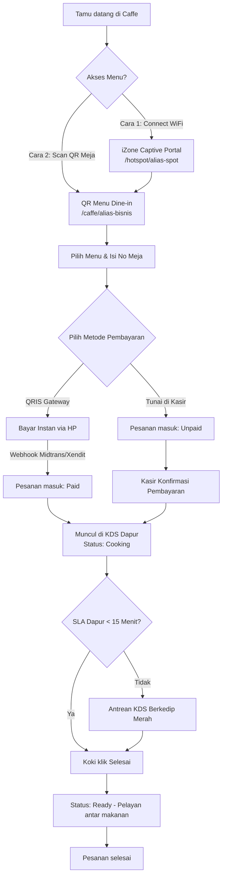
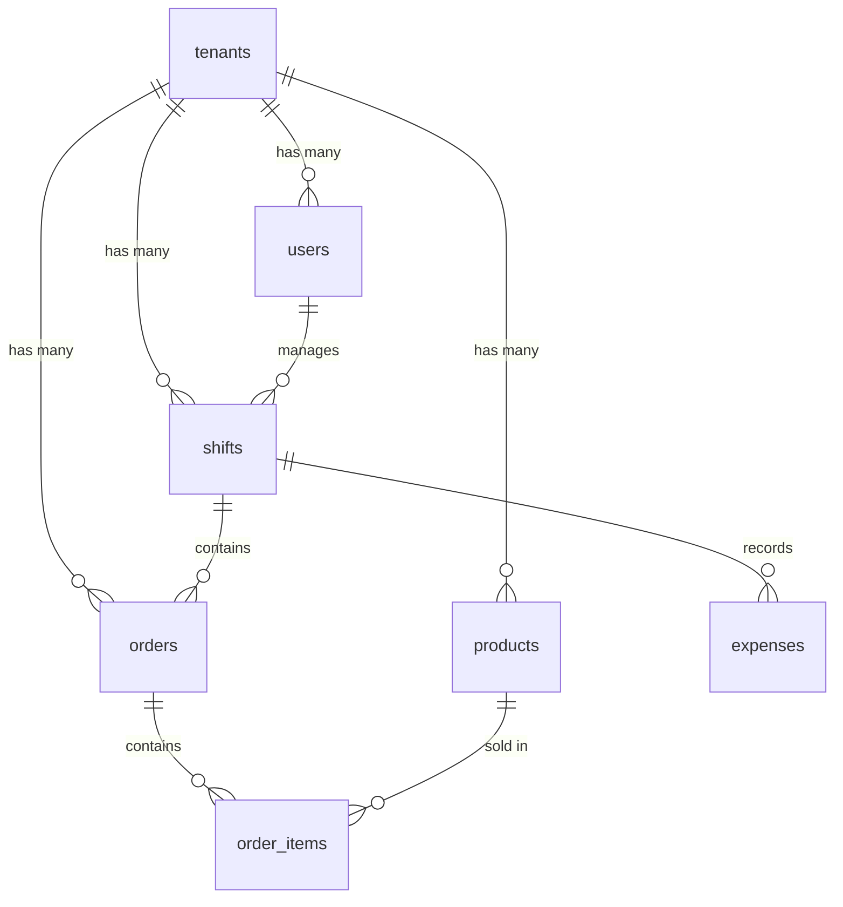

# Alur Sistem & Bisnis Proses Unimart.group (Caffe MVP Edition)

Dokumen ini mendefinisikan secara komprehensif seluruh alur kerja sistem, arsitektur, batasan teknologi, serta perancangan database untuk **Unimart.group** yang difokuskan pada MVP (Minimum Viable Product) untuk usaha **Caffe / Food & Beverage (FnB)**.

---

## 1. Pendahuluan
**Unimart.group** adalah platform **SaaS (Software as a Service) Multi-Tenant Enterprise** yang berfungsi sebagai "Sistem Saraf Digital" untuk membantu pemilik usaha mengelola dan mengembangkan bisnis mereka. Untuk fase MVP ini, sistem diprioritaskan bagi kebutuhan usaha **Caffe / FnB** dengan fitur unggulan mulai dari pemesanan mandiri oleh pelanggan (QR Menu), integrasi WiFi captive portal, sistem tampilan dapur (Kitchen Display System), manajemen shift kasir anti-kebocoran keuangan, hingga asisten AI berbasis WhatsApp.

---

## 2. Arsitektur & Batasan Lingkungan (cPanel-Friendly)
Mengingat target lingkungan *deployment* MVP adalah **Shared Hosting (cPanel)**, sistem dirancang menggunakan strategi **Graceful Fallback** untuk menghindari dependensi pada proses latar belakang jangka panjang (*long-running daemons*):

1. **Penyimpanan Cache & Antrean (Queue)**
   * Menggunakan `file` atau `database` driver.
   * Antrean pengiriman pesan (seperti notifikasi WhatsApp) disimpan pada tabel `jobs` PostgreSQL dan dieksekusi secara periodik menggunakan Cron Job cPanel (`php artisan schedule:run` setiap 1 menit).
2. **Komunikasi Real-time (KDS & POS)**
   * Tanpa WebSocket Server (Laravel Reverb). Sebagai gantinya, digunakan metode **AJAX Short Polling** (interval 5–10 detik) untuk Kitchen Display System (KDS) dan layar kasir.
   * Ditambah **Web Push Notification** via Service Worker di browser Chrome kasir/koki.
3. **Google Gemini AI Engine**
   * Menggunakan model **Gemini 1.5 Flash** melalui `laravel/ai` SDK.
   * Karena tidak ada database vektor (`pgvector`) di hosting cPanel biasa, asisten AI memanfaatkan **Massive Context Window** milik Gemini dengan menyisipkan seluruh data katalog menu (format JSON string) langsung ke dalam instruksi *system prompt*.

---

## 3. Alur Bisnis Utama Caffe (FnB)

### A. Gerbang Digital & iZone Captive Portal
* **Rute**: `/hotspot/{nama-alias-spot}`
* **Alur**:
  1. Tamu terhubung ke jaringan WiFi Kafe yang ditenagai oleh MikroTik RouterOS.
  2. Browser tamu secara otomatis dialihkan (redirected) ke halaman Captive Portal Unimart yang berjalan di rute `/hotspot/{nama-alias-spot}`.
  3. Halaman Captive Portal langsung menampilkan **Katalog Menu Digital** kafe tersebut. Tamu bisa berselancar melihat menu sebelum login internet atau memesan.

### B. Pemesanan Mandiri Dine-In (Self-Order)
* **Rute**: `/caffe/{nama-alias-bisnis}`
* **Alur**:
  1. Tamu memilih menu secara interaktif dari ponsel mereka (melalui rute `/caffe/{nama-alias-bisnis}`).
  2. Tamu memasukkan **Nomor Meja** dan memilih **Metode Pembayaran**:
     * **QRIS Otomatis (Midtrans/Xendit)**: Sistem menampilkan QR Code dinamis sesuai nominal belanja. Setelah dibayar, Webhook payment gateway mengirimkan callback ke Laravel untuk mengubah status transaksi menjadi `Paid`.
     * **Tunai di Kasir (Cash)**: Pesanan masuk dengan status `Unpaid`. Tamu membayar langsung ke kasir secara manual untuk mengaktifkan pesanan.
  3. Setelah pembayaran valid (baik otomatis via QRIS maupun manual via kasir), pesanan diteruskan ke dapur secara real-time.

### C. Kitchen Display System (KDS) & SLA Tracking
* **Alur**:
  1. Dapur membuka layar KDS yang terus memantau pesanan masuk secara berkala (AJAX Short Polling).
  2. Setiap pesanan baru berstatus `cooking` akan muncul di daftar antrean dapur.
  3. **SLA Tracking**: KDS menghitung durasi sejak pesanan masuk (`created_at`). Jika pesanan belum selesai dimasak dalam waktu **15 menit**, blok antrean di layar KDS akan berubah warna menjadi **merah dan berkedip** untuk memberi peringatan kepada koki.
  4. Setelah selesai memasak, koki menekan tombol "Selesai", memperbarui status pesanan menjadi `ready` agar pelayan bisa segera menyajikannya ke meja pelanggan.

### D. Rekonsiliasi Kasir & Shift Management (Anti-Bocor)
* **Alur**:
  1. **Buka Shift**: Kasir memulai hari kerja dengan melakukan konfirmasi modal awal uang fisik di laci kasir (*Starting Cash*).
  2. **Petty Cash (Uang Keluar)**: Setiap kali ada pengeluaran laci kasir mendadak (misal membeli es batu, gas LPG, dsb), kasir wajib mencatat nominal dan alasannya di sistem.
  3. **Tutup Shift (Blind Close)**: Di akhir jam kerja, kasir menekan tombol "Tutup Kasir". Kasir **diwajibkan menghitung uang fisik secara manual** dan menginput nominalnya tanpa melihat angka kalkulasi sistem (*Blind Close*).
  4. **Rekonsiliasi**: Sistem membandingkan uang fisik yang diinput kasir dengan rumus:
     $$\text{Uang Laci Sistem} = \text{Modal Awal} + \text{Total Tunai Masuk} - \text{Total Petty Cash}$$
  5. Selisih (minus/plus) akan dicatat permanen dalam sistem audit.
  6. Rangkuman penutupan kasir (termasuk total QRIS non-tunai yang langsung masuk rekening Owner) akan otomatis dikirim via WhatsApp API ke nomor pemilik kafe (Owner).

### E. Asisten AI WhatsApp 24/7
* **Alur**:
  1. Tamu mengirim pesan WhatsApp bertanya mengenai ketersediaan menu, harga, lokasi kafe, atau reservasi tempat.
  2. Pesan ditangkap oleh webhook dari WhatsApp API Gateway (Evolution API) dan dikirim ke backend Laravel.
  3. Laravel menarik data seluruh menu aktif milik tenant tersebut ke dalam format JSON.
  4. Data JSON menu tersebut disisipkan ke dalam *System Prompt* Google Gemini 1.5 Flash sebagai konteks pengetahuan kafe.
  5. Gemini menjawab pesan pelanggan dengan akurat dan sopan berdasarkan data tersebut, lalu membalasnya kembali ke WhatsApp pelanggan.

---

## 4. Struktur Database & Skema Relasional

Untuk mengisolasi data antar-tenant (kafe) secara ketat, setiap query database wajib di-scope menggunakan `tenant_id` (menggunakan Eloquent Global Scope di Laravel).

### A. Tabel `tenants` (Penyewa/Kafe)
Menyimpan identitas unit bisnis kafe.
* `id` (bigint, primary key)
* `name` (varchar) - Nama Kafe (contoh: "Kopi Kita")
* `domain` (varchar, unique) - Alias domain/subdomain (contoh: "kopi-kita" untuk `/caffe/kopi-kita`)
* `wifi_radius_secret` (varchar, nullable) - Kunci integrasi RADIUS MikroTik
* `settings` (jsonb) - Menyimpan konfigurasi dinamis (layout struk, warna tema, pengaturan pajak/service charge)

### B. Tabel `users` (Pengguna/Staf)
Menyimpan data staf dengan pembagian peran (RBAC) yang terikat pada tenant.
* `id` (bigint, primary key)
* `tenant_id` (foreign key -> `tenants.id`)
* `name` (varchar) - Nama karyawan
* `email` (varchar, unique)
* `pin` (varchar) - PIN 4-6 digit untuk login cepat kasir/koki di tablet POS
* `role` (varchar) - Owner, Cashier, Chef, Waiter

### C. Tabel `shifts` (Sesi Kerja Kasir)
Melacak status keuangan laci kasir per periode kerja.
* `id` (bigint, primary key)
* `tenant_id` (foreign key -> `tenants.id`)
* `user_id` (foreign key -> `users.id`) - Staf kasir yang bertugas
* `opened_at` (timestamp) - Waktu buka shift
* `closed_at` (timestamp, nullable) - Waktu tutup shift
* `starting_cash` (integer) - Modal kas awal di laci
* `system_ending_cash` (integer) - Ekspektasi nominal di laci menurut hitungan sistem
* `actual_ending_cash` (integer, nullable) - Nominal uang fisik yang diinput manual oleh kasir
* `notes` (text, nullable) - Catatan/keterangan selisih kas

### D. Tabel `expenses` (Pengeluaran Kas Laci / Petty Cash)
Mencatat uang keluar dari laci kasir saat shift berjalan.
* `id` (bigint, primary key)
* `tenant_id` (foreign key -> `tenants.id`)
* `shift_id` (foreign key -> `shifts.id`)
* `amount` (integer) - Jumlah pengeluaran
* `description` (varchar) - Keterangan pengeluaran (misal: "Beli Es Batu")

### E. Tabel `products` (Katalog Menu)
* `id` (bigint, primary key)
* `tenant_id` (foreign key -> `tenants.id`)
* `name` (varchar) - Nama makanan/minuman
* `price` (integer) - Harga jual
* `stock` (integer) - Stok tersedia (diperbarui menggunakan DB transaction locks untuk mencegah race conditions)
* `category` (varchar) - makanan, minuman, dessert
* `image_url` (varchar, nullable) - Foto menu

### F. Tabel `orders` (Transaksi Pesanan)
* `id` (bigint, primary key)
* `tenant_id` (foreign key -> `tenants.id`)
* `shift_id` (foreign key -> `shifts.id`, nullable) - Shift kasir yang merekam/menyelesaikan pembayaran
* `order_number` (varchar, unique) - Kode pesanan unik (contoh: `ORD-20260713-0001`)
* `table_number` (varchar, nullable) - Nomor meja tamu
* `status` (varchar) - pending, cooking, ready, completed
* `payment_status` (varchar) - unpaid, paid
* `payment_method` (varchar, nullable) - cash, qris_bni, qris_bri, qris_shopeepay, transfer_manual
* `total_amount` (integer) - Total nilai belanja
* `created_at` (timestamp)
* `updated_at` (timestamp)

### G. Tabel `order_items` (Rincian Item Pesanan)
* `id` (bigint, primary key)
* `order_id` (foreign key -> `orders.id` cascade)
* `product_id` (foreign key -> `products.id`)
* `quantity` (integer) - Jumlah item dipesan
* `price` (integer) - Harga item saat pesanan dibuat (mencegah masalah audit jika harga produk diubah di kemudian hari)
* `notes` (varchar, nullable) - Catatan khusus item (contoh: "kurang manis", "tanpa es")

---

## 5. Alur Bisnis Pemilik Usaha (Owner)

### A. Pendaftaran & Onboarding Tenant Baru
1. Owner mendaftarkan akun di rute `/owner/register`.
2. Owner mengisi data diri (Nama, Email, Password) dan data bisnis (Nama Toko/Kafe, Domain Alias), serta memilih paket layanan:
   * **Bisnis**: Paket dasar untuk UMKM.
   * **Profesional**: Paket lengkap dengan KDS dapur & meja.
   * **Premium VIP**: Paket enterprise dengan iZone WiFi & WhatsApp AI.
3. Setelah disubmit, sistem membuat entri `Tenant` baru (berdasarkan domain alias) dan `User` baru (dengan role `owner` terikat ke `tenant_id`).
4. Sistem otomatis memasukkan sesi login dan mengarahkan Owner ke dashboard utama.

### B. Dashboard Berbasis Paket (Pricing Tiers)
Dashboard Owner (`/owner/dashboard`) merender seluruh modul fungsional Unimart, namun memberikan pengaman/gembok berbasis paket yang dipilih:
* **Paket Bisnis**:
  * Akses aktif: POS & Kasir Dasar, Laporan Ringkas.
  * Modul Dapur (KDS), Inventaris, Meja, iZone WiFi, dan WA AI terkunci dengan overlay gembok premium.
* **Paket Profesional**:
  * Akses aktif: POS, Laporan Ringkas/Detail, Modul Dapur (KDS), Manajemen Meja & Stok.
  * iZone WiFi dan WA AI terkunci.
* **Paket Premium VIP**:
  * Semua akses terbuka penuh secara aktif tanpa gembok (termasuk iZone WiFi Captive Portal dan WA AI Assistant).

### C. Manajemen Karyawan (RBAC)
Owner dapat mendaftarkan staff/karyawan baru untuk bertindak atas nama tenant di halaman `/owner/team`:
1. Owner mengisi Nama Karyawan, memilih Peran pekerjaan (`cashier`, `chef`, atau `waiter`), dan memasukkan PIN akses 4 digit angka.
2. Sistem memvalidasi keunikan PIN tersebut di dalam lingkup toko tenant aktif guna mencegah bentrokan.
3. Karyawan yang terdaftar dapat melakukan login cepat pada tablet toko menggunakan rute `/login-pin` hanya berbekal PIN yang ditentukan oleh Owner. Hak akses menu karyawan pada tablet kasir/dapur disesuaikan otomatis dengan perannya.

