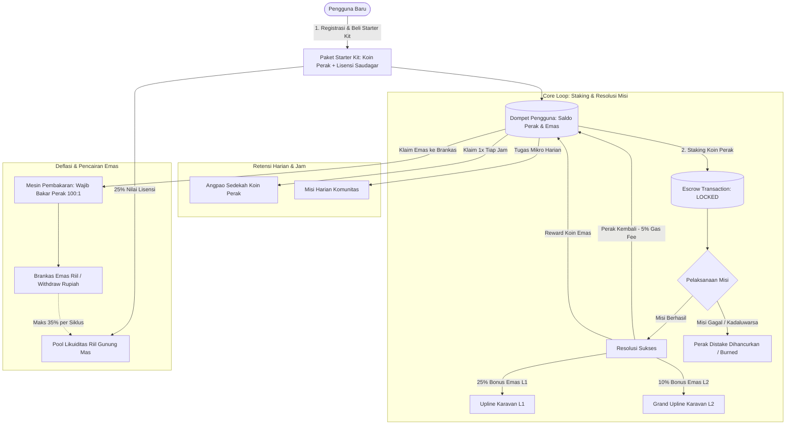
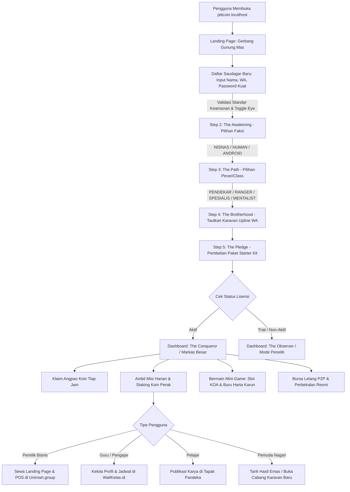

# Analisis Proses Bisnis, Arsitektur Fundamental, & User Flow PitiCoin.id
**Gerbang Gamifikasi Ekonomi Komunitas & Pintu Masuk Multi-Persona Ekosistem Locomo.id**  
*Tanggal Kalibrasi: 10 September 2026*  
*Arsitek Sistem: Locomo AI Agent (Antigravity)*

---

## 1. Visi Fundamental & Filosofi PitiCoin.id

**PitiCoin.id** adalah **Pintu Masuk Utama (Gamified Front Door & Growth Engine)** dari **Federated Ecosystem Locomo.id**. Platform ini mentransformasi proses akuisisi pengguna konvensional menjadi sebuah ekosistem ekonomi sirkular berbasis gamifikasi, di mana koin emas memiliki nilai riil yang dijamin oleh perputaran bisnis nyata (*Fiat-Backed / Real World Asset*).

Melalui narasi **"Perburuan Harta Karun Gunung Mas"**, platform ini menghubungkan 4 pilar komunitas nagari:
1. **Pemuda Nagari (Pencari Kerja & Agen)**: Diberdayakan sebagai penggerak lapangan dengan penghasilan riil dari menyelesaikan misi, membangun jaringan, dan bermain terampil.
2. **Pemilik Bisnis (UMKM)**: Mendapatkan sarana digitalisasi instan berupa landing page usaha, sistem POS kasir pintar, dan pengelolaan keuangan terpadu di **Unimart.group**.
3. **Guru & Pengajar (Private/Lembaga/Yayasan)**: Memiliki portal profil profesional, penjadwalan kelas online, dan manajemen reputasi pendidikan di **WaliKelas.id** & **HakCampus.id**.
4. **Pelajar SMP/SMA**: Membangun jejak rekam prestasi, karya digital, dan reputasi kesiswaan di **Tapak Pandeka** & modul **Smart-Citizen**.

---

## 2. Model Ekonomi Sirkular (Mandalomics V2) & Mekanika Misi



### 2.1 Paket Starter Kit & Piagam Lisensi
- Setiap pengguna yang mendaftar diwajibkan membeli **Paket Starter Kit (Piagam Lisensi Saudagar)**:
  - **Paket Pemula** (Rp 50.000): Injeksi 50.000 Perak + Hak Lisensi Mengajak Downline + 300 XP.
  - **Paket Petualang** (Rp 100.000): Injeksi 100.000 Perak + Hak Lisensi Mengajak Downline + 600 XP.
  - **Paket Saudagar** (Rp 200.000): Injeksi 200.000 Perak + Hak Lisensi Mengajak Downline + 1.200 XP.
- **Injeksi Cadangan Likuiditas**: Tepat **25% dari nominal pembelian paket** secara otomatis dialokasikan ke cadangan fiat perbankan di **Pool Gunung Mas** (`total_fiat_in_bank`), memastikan sistem bebas skema Ponzi.

### 2.2 Mekanisme Staking Koin Perak (Proof of Engagement)
- Untuk mengambil misi harian, misi event khusus, atau ekspedisi petualangan, pengguna **wajib melakukan staking Koin Perak** sebagai jaminan komitmen:
  - **Misi Sukses**: Koin perak yang distake dikembalikan penuh ke dompet (dipotong 5% gas fee mikro untuk deflasi koin sistem) ditambah **Reward Koin Emas**.
  - **Misi Gagal/Expired**: Koin perak yang di-stake dihanguskan (*burned*) 100% dari peredaran sistem.

### 2.3 Jaringan Karavan Saudagar (Multilevel 2-Level Downline)
PitiCoin menerapkan sistem referral 2 tingkat untuk merangsang pertumbuhan komunitas secara mandiri:
- **Level 1 (Direct Downline)**: Upline menerima **25%** dari setiap reward Koin Emas yang dihasilkan downline langsung.
- **Level 2 (Grand Downline)**: Grand Upline menerima **10%** dari reward Koin Emas yang dihasilkan downline tingkat dua.
- Koin emas ini dapat dicairkan atau digunakan untuk menyewa layanan di ekosistem Locomo.

### 2.4 Angpao Koin Tiap Jam & Tugas Mikro Harian
- **Sedekah Koin / Angpao Per Jam**: Pengguna berlisensi aktif dapat melakukan *tap-to-claim* angpao Koin Perak gratis setiap 60 menit sekali untuk memastikan perputaran modal staking selalu tersedia bagi mitra aktif.
- **Notifikasi Tugas Mikro**: Notifikasi push/in-app memandu pengguna menyelesaikan tugas-tugas terukur (kunjungan merchant, review toko, validasi data UMKM).

---

## 3. Matriks 4 Segmen Pengguna (Persona) & Jembatan Ekosistem Locomo

| Segmen Pengguna | Kebutuhan Utama | Peran di PitiCoin.id | Integrasi Ekosistem Locomo |
| :--- | :--- | :--- | :--- |
| **1. Pemuda Nagari (Pencari Kerja)** | Pendapatan mandiri & aktualisasi diri | Menjadi agen lapangan, validator survei toko, pemain Slot KOA terampil, dan pembangun karavan referral. | **Tapak Pandeka**: Pelatihan kepemudaan & kedaulatan data.<br>**Locomo Agent OS**: Menerima misi intelijen bisnis. |
| **2. Pemilik Bisnis (UMKM Nagari)** | Promosi usaha, website profesional, & POS kasir | Menyewa lisensi usaha, memasang promosi voucher produk di PitiCoin, dan menerima pembayaran Koin Emas/Perak. | **Unimart.group**: Landing page merchant, kasir kasir pintar POS, laporan stok, dan manajemen keuangan. |
| **3. Guru & Pengajar (Private/Lembaga)** | Tampilan profil online & jadwal les/mengajar | Menjadi mentor komunitas, membuka kelas keahlian, dan menerima apresiasi jasa. | **WaliKelas.id & HakCampus.id**: Profil guru terverifikasi, kalender jadwal les, dan pembayaran honorarium. |
| **4. Pelajar (SMP/SMA)** | Portofolio karya, sertifikat, & prestasi | Mengikuti misi edukasi, kompetisi kuis sejarah/budaya Minang, dan mengumpulkan sertifikat digital. | **Tapak Pandeka**: Portofolio karya digital & prestasi kesiswaan.<br>**Smart-Citizen**: Latihan demokrasi dan kepengurusan OSIS. |

---

## 4. Desain Skema Database Misi Dinamis & Multi-Parameter

Untuk mendukung fleksibilitas misi yang dapat diupdate secara real-time dari backend atau Locomo Agent OS, skema tabel misi diperluas:

```sql
-- Rekomendasi Pembaruan Skema: quests
ALTER TABLE quests ADD COLUMN IF NOT EXISTS quest_category VARCHAR(50) DEFAULT 'DAILY_TASK';
ALTER TABLE quests ADD COLUMN IF NOT EXISTS target_persona VARCHAR(50) DEFAULT 'ALL';
ALTER TABLE quests ADD COLUMN IF NOT EXISTS target_role_class VARCHAR(50) DEFAULT 'ALL';
ALTER TABLE quests ADD COLUMN IF NOT EXISTS min_user_level INT DEFAULT 1;
ALTER TABLE quests ADD COLUMN IF NOT EXISTS recurrence VARCHAR(20) DEFAULT 'ONE_TIME';
ALTER TABLE quests ADD COLUMN IF NOT EXISTS parameters JSONB DEFAULT '{}';
ALTER TABLE quests ADD COLUMN IF NOT EXISTS priority_order INT DEFAULT 0;
```

### Parameter JSONB Dinamis (`parameters`):
- `cooldown_minutes`: Durasi jeda antar-klaim (misal: 60 menit untuk Angpao Koin).
- `validation_type`: `AUTO_AI_SURVEY`, `ADMIN_MANUAL`, `GEO_LOCATION`, `ECOSYSTEM_SYNC`.
- `target_service`: `unimart`, `walikelas`, `mandeh_online`, `tapak_pandeka`.
- `geo_coordinates`: `{ "lat": -1.350, "lng": 100.570, "radius_meters": 500 }`.

---

## 5. Rancangan User Flow Lengkap (Pintu Masuk Terpadu)



---

## 6. Peningkatan Keamanan Standar Platform

Karena platform ini menyimpan saldo bernilai riil (Koin Emas bernilai Rp 1.000/koin), brankas aset, dan reputasi bisnis:
1. **Fitur Penglihatan Password (Eye Toggle)**: Memastikan pengguna dapat memeriksa akurasi pengetikan kata sandi sebelum submit.
2. **Kriteria Standar Kata Sandi Kuat**:
   - Minimal 8 karakter.
   - Kombinasi huruf besar (A-Z) dan huruf kecil (a-z).
   - Mengandung karakter numerik (0-9).
   - Mengandung simbol/karakter khusus (`@`, `#`, `$`, `%`, dll.).
   - *Meter Bar* dan *live checklist* interaktif di sisi UI frontend.
3. **Pencegahan Akun Gandar & Bot**: Validasi keunikan nomor WhatsApp dan tautan identitas tunggal di federasi **Mandeh.ID**.

---

## 7. Protokol Tanda Tangan Kontrak & Sistem Kunci Pending Verifikasi Pembayaran

Untuk mematuhi regulasi hukum digital Republik Indonesia dan melindungi ekosistem dari risiko fraud:
1. **Legal Gate (Terms of Service & Privacy Policy 7 Pasal)**:
   - Pengguna diwajibkan menyetujui perjanjian hukum yang memuat penafian anti-investasi spekulatif, klausul *non-refundable* pembelian starter kit, pelepasan hak atas Koin Perak yang hangus saat misi gagal, dan perlindungan data pribadi sesuai UU PDP No. 27/2022.
   - **Enforced Reading UX**: Estimasi waktu baca ~3 menit dihitung secara dinamis, dilengkapi *scroll progress bar* (0% - 100%). Checkbox persetujuan terkunci rapat hingga pengguna men-scroll dokumen hingga baris paling akhir.
2. **State Mesin Pembayaran & Status Terkunci (Pending Lock)**:
   - Setelah persetujuan dikirim, status pengguna diubah menjadi `license_status = 'PENDING'`.
   - Pengguna diarahkan ke **Halaman Tagihan & Invoice Pembayaran** (`/onboarding/pending`).
   - **Route Guarding**: Jika pengguna mencoba mengakses `/dashboard` atau login kembali, sistem secara otomatis mengunci sesi dan membelokkan rute kembali ke `/onboarding/pending`.
3. **Protokol Verifikasi Admin**:
   - Lisensi hanya dapat dibuka (`license_status = 'ACTIVE'`) setelah Admin memverifikasi mutasi bank/bukti bayar.
   - Aktivasi otomatis menyuntikkan saldo Perak starter kit (50k/100k/200k), menyetor 25% omzet ke cadangan Pool Gunung Mas, memberikan XP, dan membuka akses ke seluruh fitur Dasbor Penakluk (*Conqueror*).
