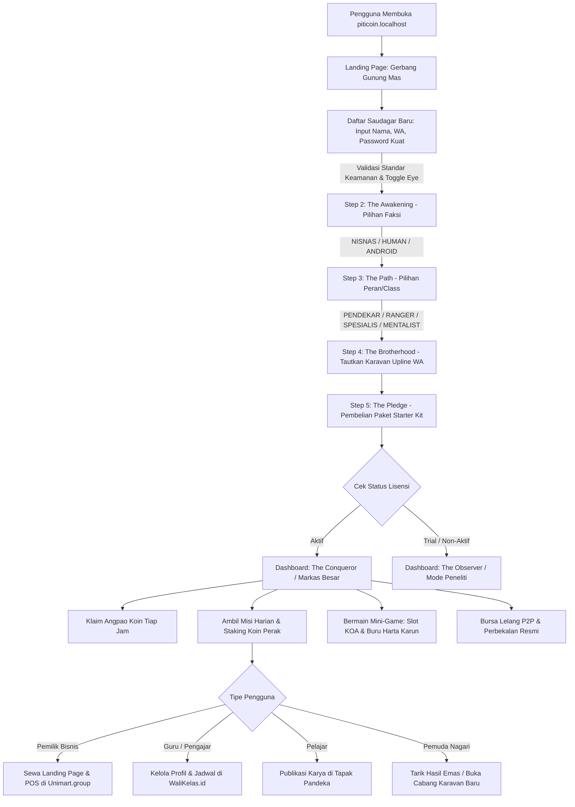
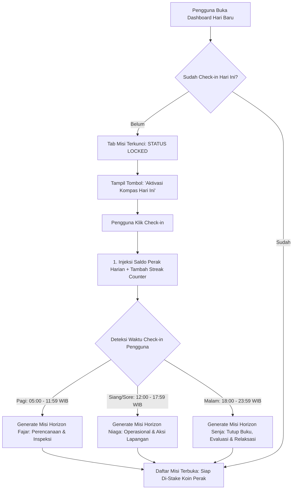
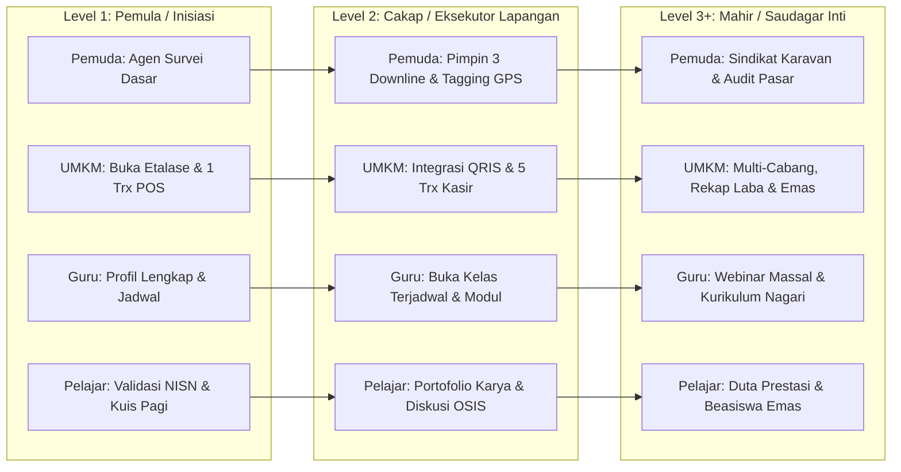
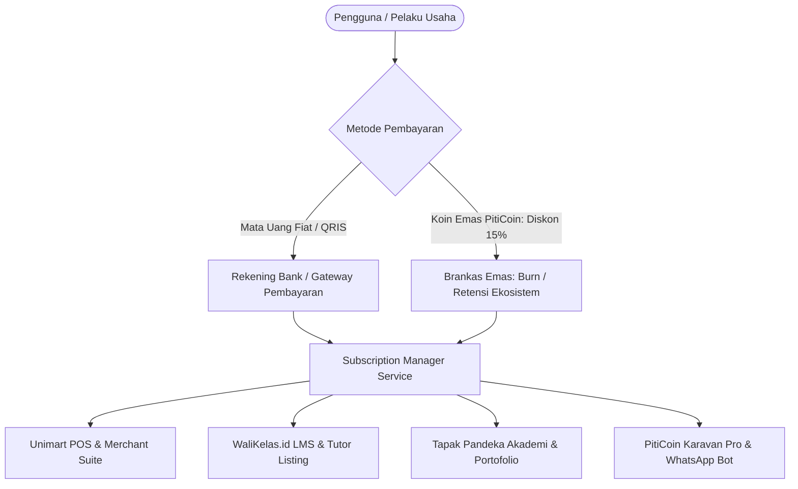
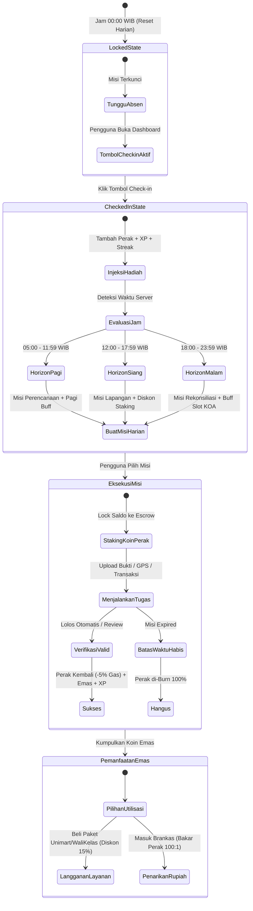

# Analisis Proses Bisnis, Arsitektur Fundamental, & User Flow PitiCoin.id
**Gerbang Gamifikasi Ekonomi Komunitas & Pintu Masuk Multi-Persona Ekosistem Locomo.id**  
*Tanggal Kalibrasi: 10 September 2026*  
*Arsitek Sistem: Locomo AI Agent (Antigravity)*

---

## 1. Visi Fundamental & Filosofi PitiCoin.id

**PitiCoin.id** adalah **Pintu Masuk Utama (Gamified Front Door & Growth Engine)** dari **Federated Ecosystem Locomo.id**. Platform ini mentransformasi proses akuisisi pengguna konvensional menjadi sebuah ekosistem ekonomi sirkular berbasis gamifikasi, di mana koin emas memiliki nilai riil yang dijamin oleh perputaran bisnis nyata (*Fiat-Backed / Real World Asset*).

Melalui narasi **"Perburuan Harta Karun Gunung Mas"**, platform ini menghubungkan 4 pilar komunitas nagari:
1. **Pemuda Nagari (Pencari Kerja & Agen)**: Diberdayakan sebagai penggerak lapangan dengan penghasilan riil dari menyelesaikan misi, membangun jaringan, dan bermain terampil.
2. **Pemilik Bisnis (UMKM)**: Mendapatkan sarana digitalisasi instan berupa landing page usaha, sistem POS kasir pintar, dan pengelolaan keuangan terpadu di **Unimart.group**.
3. **Guru & Pengajar (Private/Lembaga/Yayasan)**: Memiliki portal profil profesional, penjadwalan kelas online, dan manajemen reputasi pendidikan di **WaliKelas.id** & **HakCampus.id**.
4. **Pelajar SMP/SMA**: Membangun jejak rekam prestasi, karya digital, dan reputasi kesiswaan di **Tapak Pandeka** & modul **Smart-Citizen**.

---

## 2. Model Ekonomi Sirkular (Mandalomics V2) & Mekanika Misi


### 2.1 Paket Starter Kit & Piagam Lisensi
- Setiap pengguna yang mendaftar diwajibkan membeli **Paket Starter Kit (Piagam Lisensi Saudagar)**:
  - **Paket Pemula** (Rp 50.000): Injeksi 50.000 Perak + Hak Lisensi Mengajak Downline + 300 XP.
  - **Paket Petualang** (Rp 100.000): Injeksi 100.000 Perak + Hak Lisensi Mengajak Downline + 600 XP.
  - **Paket Saudagar** (Rp 200.000): Injeksi 200.000 Perak + Hak Lisensi Mengajak Downline + 1.200 XP.
- **Injeksi Cadangan Likuiditas**: Tepat **25% dari nominal pembelian paket** secara otomatis dialokasikan ke cadangan fiat perbankan di **Pool Gunung Mas** (`total_fiat_in_bank`), memastikan sistem bebas skema Ponzi.

### 2.2 Mekanisme Staking Koin Perak (Proof of Engagement)
- Untuk mengambil misi harian, misi event khusus, atau ekspedisi petualangan, pengguna **wajib melakukan staking Koin Perak** sebagai jaminan komitmen:
  - **Misi Sukses**: Koin perak yang distake dikembalikan penuh ke dompet (dipotong 5% gas fee mikro untuk deflasi koin sistem) ditambah **Reward Koin Emas**.
  - **Misi Gagal/Expired**: Koin perak yang di-stake dihanguskan (*burned*) 100% dari peredaran sistem.

### 2.3 Jaringan Karavan Saudagar (Multilevel 2-Level Downline)
PitiCoin menerapkan sistem referral 2 tingkat untuk merangsang pertumbuhan komunitas secara mandiri:
- **Level 1 (Direct Downline)**: Upline menerima **25%** dari setiap reward Koin Emas yang dihasilkan downline langsung.
- **Level 2 (Grand Downline)**: Grand Upline menerima **10%** dari reward Koin Emas yang dihasilkan downline tingkat dua.
- Koin emas ini dapat dicairkan atau digunakan untuk menyewa layanan di ekosistem Locomo.

### 2.4 Angpao Koin Tiap Jam & Tugas Mikro Harian
- **Sedekah Koin / Angpao Per Jam**: Pengguna berlisensi aktif dapat melakukan *tap-to-claim* angpao Koin Perak gratis setiap 60 menit sekali untuk memastikan perputaran modal staking selalu tersedia bagi mitra aktif.
- **Notifikasi Tugas Mikro**: Notifikasi push/in-app memandu pengguna menyelesaikan tugas-tugas terukur (kunjungan merchant, review toko, validasi data UMKM).

---

## 3. Matriks 4 Segmen Pengguna (Persona) & Jembatan Ekosistem Locomo

| Segmen Pengguna | Kebutuhan Utama | Peran di PitiCoin.id | Integrasi Ekosistem Locomo |
| :--- | :--- | :--- | :--- |
| **1. Pemuda Nagari (Pencari Kerja)** | Pendapatan mandiri & aktualisasi diri | Menjadi agen lapangan, validator survei toko, pemain Slot KOA terampil, dan pembangun karavan referral. | **Tapak Pandeka**: Pelatihan kepemudaan & kedaulatan data.<br>**Locomo Agent OS**: Menerima misi intelijen bisnis. |
| **2. Pemilik Bisnis (UMKM Nagari)** | Promosi usaha, website profesional, & POS kasir | Menyewa lisensi usaha, memasang promosi voucher produk di PitiCoin, dan menerima pembayaran Koin Emas/Perak. | **Unimart.group**: Landing page merchant, kasir kasir pintar POS, laporan stok, dan manajemen keuangan. |
| **3. Guru & Pengajar (Private/Lembaga)** | Tampilan profil online & jadwal les/mengajar | Menjadi mentor komunitas, membuka kelas keahlian, dan menerima apresiasi jasa. | **WaliKelas.id & HakCampus.id**: Profil guru terverifikasi, kalender jadwal les, dan pembayaran honorarium. |
| **4. Pelajar (SMP/SMA)** | Portofolio karya, sertifikat, & prestasi | Mengikuti misi edukasi, kompetisi kuis sejarah/budaya Minang, dan mengumpulkan sertifikat digital. | **Tapak Pandeka**: Portofolio karya digital & prestasi kesiswaan.<br>**Smart-Citizen**: Latihan demokrasi dan kepengurusan OSIS. |

---

## 4. Desain Skema Database Misi Dinamis & Multi-Parameter

Untuk mendukung fleksibilitas misi yang dapat diupdate secara real-time dari backend atau Locomo Agent OS, skema tabel misi diperluas:

```sql
-- Rekomendasi Pembaruan Skema: quests
ALTER TABLE quests ADD COLUMN IF NOT EXISTS quest_category VARCHAR(50) DEFAULT 'DAILY_TASK';
ALTER TABLE quests ADD COLUMN IF NOT EXISTS target_persona VARCHAR(50) DEFAULT 'ALL';
ALTER TABLE quests ADD COLUMN IF NOT EXISTS target_role_class VARCHAR(50) DEFAULT 'ALL';
ALTER TABLE quests ADD COLUMN IF NOT EXISTS min_user_level INT DEFAULT 1;
ALTER TABLE quests ADD COLUMN IF NOT EXISTS recurrence VARCHAR(20) DEFAULT 'ONE_TIME';
ALTER TABLE quests ADD COLUMN IF NOT EXISTS parameters JSONB DEFAULT '{}';
ALTER TABLE quests ADD COLUMN IF NOT EXISTS priority_order INT DEFAULT 0;
```

### Parameter JSONB Dinamis (`parameters`):
- `cooldown_minutes`: Durasi jeda antar-klaim (misal: 60 menit untuk Angpao Koin).
- `validation_type`: `AUTO_AI_SURVEY`, `ADMIN_MANUAL`, `GEO_LOCATION`, `ECOSYSTEM_SYNC`.
- `target_service`: `unimart`, `walikelas`, `mandeh_online`, `tapak_pandeka`.
- `geo_coordinates`: `{ "lat": -1.350, "lng": 100.570, "radius_meters": 500 }`.

---

## 5. Rancangan User Flow Lengkap (Pintu Masuk Terpadu)



---

## 6. Peningkatan Keamanan Standar Platform

Karena platform ini menyimpan saldo bernilai riil (Koin Emas bernilai Rp 1.000/koin), brankas aset, dan reputasi bisnis:
1. **Fitur Penglihatan Password (Eye Toggle)**: Memastikan pengguna dapat memeriksa akurasi pengetikan kata sandi sebelum submit.
2. **Kriteria Standar Kata Sandi Kuat**:
   - Minimal 8 karakter.
   - Kombinasi huruf besar (A-Z) dan huruf kecil (a-z).
   - Mengandung karakter numerik (0-9).
   - Mengandung simbol/karakter khusus (`@`, `#`, `$`, `%`, dll.).
   - *Meter Bar* dan *live checklist* interaktif di sisi UI frontend.
3. **Pencegahan Akun Gandar & Bot**: Validasi keunikan nomor WhatsApp dan tautan identitas tunggal di federasi **Mandeh.ID**.

---

## 7. Protokol Tanda Tangan Kontrak & Sistem Kunci Pending Verifikasi Pembayaran

Untuk mematuhi regulasi hukum digital Republik Indonesia dan melindungi ekosistem dari risiko fraud:
1. **Legal Gate (Terms of Service & Privacy Policy 7 Pasal)**:
   - Pengguna diwajibkan menyetujui perjanjian hukum yang memuat penafian anti-investasi spekulatif, klausul *non-refundable* pembelian starter kit, pelepasan hak atas Koin Perak yang hangus saat misi gagal, dan perlindungan data pribadi sesuai UU PDP No. 27/2022.
   - **Enforced Reading UX**: Estimasi waktu baca ~3 menit dihitung secara dinamis, dilengkapi *scroll progress bar* (0% - 100%). Checkbox persetujuan terkunci rapat hingga pengguna men-scroll dokumen hingga baris paling akhir.
2. **State Mesin Pembayaran & Status Terkunci (Pending Lock)**:
   - Setelah persetujuan dikirim, status pengguna diubah menjadi `license_status = 'PENDING'`.
   - Pengguna diarahkan ke **Halaman Tagihan & Invoice Pembayaran** (`/onboarding/pending`).
   - **Route Guarding**: Jika pengguna mencoba mengakses `/dashboard` atau login kembali, sistem secara otomatis mengunci sesi dan membelokkan rute kembali ke `/onboarding/pending`.
3. **Protokol Verifikasi Admin**:
   - Lisensi hanya dapat dibuka (`license_status = 'ACTIVE'`) setelah Admin memverifikasi mutasi bank/bukti bayar.
   - Aktivasi otomatis menyuntikkan saldo Perak starter kit (50k/100k/200k), menyetor 25% omzet ke cadangan Pool Gunung Mas, memberikan XP, dan membuka akses ke seluruh fitur Dasbor Penakluk (*Conqueror*).

---

## 8. Sistem Gerbang Absen Harian (Mandatory Daily Check-in & Time-Based Missions)

Sistem Absen Harian (*Daily Check-in*) berfungsi sebagai **Kompas Petualangan & Katup Gerbang (Gatekeeper)** utama platform. Setiap hari pada pukul 00:00 WIB, status petualangan seluruh pengguna di-reset menjadi `UNINITIALIZED`. Pengguna **wajib** melakukan Check-in harian untuk membuka (*unlock*) daftar misi harian mereka.



### 8.1 Aturan Wajib Absen (Mandatory Gatekeeper)
1. **Pencegahan Bot & Akun Pasif**: Akun yang tidak melakukan check-in tidak dapat mengeksekusi misi, menerima limpahan bonus downline hari itu, atau mengklaim jackpot turnamen.
2. **Reward Check-in Dasar**: Setiap kali check-in berhasil:
   - +250 Koin Perak langsung ke dompet pengguna.
   - +25 XP pengalaman karakter.
   - +1 Hari Streak Absensi.

### 8.2 Mekanisme Streak & Multiplier Loyalitas
Untuk mendorong retensi harian yang konsisten (*Day-30 Retention Rate*):
- **Streak 3 Hari**: Bonus instan 500 Koin Perak + 50 XP.
- **Streak 7 Hari**: Bonus 1.500 Koin Perak + **1 Koin Emas** + 200 XP.
- **Streak 14 Hari**: Bonus 3.500 Koin Perak + **3 Koin Emas** + Voucher Diskon Langganan Layanan 10%.
- **Streak 30 Hari (Puncak Siklus)**: Bonus 10.000 Koin Perak + **10 Koin Emas** + Gelar Kehormatan Profil *"Saudagar Istiqomah"* + Buff Pengganda Reward Misi 1.15x selama 7 hari berikutnya.
- **Aturan Pemulihan Bolos (Streak Freeze)**: Pengguna diberikan hak 1x *"Tiket Pembeku Kompas"* per bulan (dapat dibeli seharga 500 Perak) agar streak tidak hangus jika terlewat satu hari karena kendala jaringan.

### 8.3 Misi Dinamis Berdasarkan Waktu Absen (Time-Window Dynamic Missions)
Waktu saat pengguna menekan tombol check-in menentukan variasi misi yang diterbitkan oleh sistem:

| Horizon Waktu | Rentang Jam (WIB) | Tema & Karakteristik Misi | Contoh Misi Dinamis | Buff / Insentif Waktu |
| :--- | :--- | :--- | :--- | :--- |
| **Horizon Fajar (Pagi)** | 05:00 - 11:59 | **Perencanaan & Inspeksi Pagi**<br>Fokus pada persiapan hari, pengecekan data awal, dan sarapan literasi. | • Cek & perbarui inventaris toko (UMKM)<br>• Broadcast kabar karavan pagi ke grup WA (Pemuda)<br>• Kuis 5 menit literasi pagi (Pelajar)<br>• Cek kesiapan materi ajar (Guru) | **Buff Fajar**: Bonus +10% XP untuk semua misi yang diselesaikan sebelum pukul 12:00 WIB. |
| **Horizon Niaga (Siang/Sore)** | 12:00 - 17:59 | **Operasional & Aksi Lapangan**<br>Fokus pada transaksi aktif di jam sibuk, pergerakan fisik, dan interaksi sosial. | • Catat transaksi jam ramai di POS (UMKM)<br>• Verifikasi lokasi GPS toko tetangga (Pemuda)<br>• Diskusi tugas kelompok online (Pelajar)<br>• Verifikasi presensi siswa les (Guru) | **Buff Niaga**: Biaya staking Koin Perak diskon 15% untuk misi lapangan. |
| **Horizon Senja (Malam)** | 18:00 - 23:59 | **Rekonsiliasi, Evaluasi & Relaksasi**<br>Fokus pada rekapitulasi finansial harian, audit pencapaian, dan permainan santai. | • Tutup buku & cetak rekap kasir harian (UMKM)<br>• Evaluasi perolehan komisi karavan (Pemuda)<br>• Review ringkasan belajar malam (Pelajar)<br>• Bermain 3 putaran santai Slot KOA (Semua) | **Buff Senja**: Peningkatan peluang (+20% Drop Rate) item langka di mini-game malam hari. |

---

## 9. Matriks Task Detail: Standar (Default) & Spesifik per Persona x Level

### 9.1 Task Default (Standar Seluruh Pengguna)
Setiap pengguna yang memiliki lisensi aktif akan selalu menerima daftar **Task Wajib Default** berikut setiap hari:
1. **Mandatory Daily Check-in**: Absen harian untuk membuka kunci gerbang misi harian.
2. **Klaim Angpao Sedekah Per Jam (Hourly Claim)**: Klaim Koin Perak gratis (50–150 Perak) setiap 60 menit (kuota harian: 5x klaim).
3. **Pemeriksaan Higienitas Keamanan Akun**: Memeriksa sesi login aktif, memastikan status WhatsApp tetap terhubung, dan mengganti PIN transaksi jika masa berlaku 90 hari habis.
4. **Interaksi Sosial Karavan**: Mengirim 1 reaksi/sapaan di papan pesan karavan atau mengonfirmasi downline baru.
5. **Mini-Game Harian Santai**: Memutar minimal 1x Mini-Game Slot KOA atau menjawab 1 Soal Tebak Nagari untuk menjaga keaktifan kognitif.

---

### 9.2 Task Khusus Berdasarkan Persona & Tingkat Level (Level Progression)



#### A. Persona: Pemuda Nagari (Agen Karavan & Penggerak Lapangan)
*Tujuan: Menjadi motor penggerak pertumbuhan ekosistem, validasi merchant, dan pencari nafkah mandiri.*

- **Level 1 (Kadet Pengelana - Level 1 s.d 3)**:
  - **Task 1 (Harian)**: Bagikan tautan referral karavan ke 3 kontak atau grup WhatsApp (Reward: 300 Perak, 50 XP).
  - **Task 2 (Harian)**: Kunjungi 1 warung/toko UMKM lokal dan catat nama pemilik serta nomor kontak (Staking: 500 Perak | Reward: 500 Perak + 0.5 Koin Emas).
  - **Task 3 (Mingguan)**: Mengikuti sesi pengenalan aplikasi Tapak Pandeka dan selesaikan 1 modul keahlian dasar.
- **Level 2 (Pandeka Lapangan - Level 4 s.d 7)**:
  - **Task 1 (Harian)**: Dampingi dan pastikan minimal 1 downline baru menyelesaikan pembelian Starter Kit (Reward: Komisi Upline 25% Emas + 150 XP).
  - **Task 2 (Harian)**: Lakukan validasi foto fisik dan koordinat GPS untuk 2 merchant terdaftar di Unimart (Staking: 2.500 Perak | Reward: 2.500 Perak + 3 Koin Emas).
  - **Task 3 (Mingguan)**: Mengorganisir mabar mini-game Slot KOA komunitas nagari dengan minimal 5 peserta.
- **Level 3+ (Saudagar Karavan Inti - Level 8+)**:
  - **Task 1 (Harian)**: Monitor dan pimpin karavan aktif beranggotakan minimal 15 orang; pastikan 80% anggota melakukan check-in harian (Reward: 5 Koin Emas pool bonus).
  - **Task 2 (Harian)**: Audit dan verifikasi sengketa transaksi merchant mitra lokal di panel agen (Staking: 10.000 Perak | Reward: 10.000 Perak + 12 Koin Emas).
  - **Task 3 (Bulanan)**: Menyelenggarakan ekspedisi perekrutan merchant baru sekecamatan dan menerima sertifikasi Agen Resmi Nagari.

---

#### B. Persona: Pemilik Bisnis (UMKM Nagari / Pedagang)
*Tujuan: Digitalisasi toko, pencatatan kasir modern di Unimart, dan peningkatan omzet penjualan.*

- **Level 1 (Kios Rintisan - Level 1 s.d 3)**:
  - **Task 1 (Harian)**: Catat minimal 1 transaksi penjualan harian di aplikasi Kasir Pintar POS Unimart (Reward: 250 Perak + 50 XP).
  - **Task 2 (Harian)**: Periksa stok 3 barang dagangan utama dan perbarui jumlah stok di aplikasi (Reward: 200 Perak).
  - **Task 3 (Milestone)**: Lengkapi profil toko online di Unimart (foto toko, jam buka, lokasi Google Maps, nomor WA kasir).
- **Level 2 (Toko Bertumbuh - Level 4 s.d 7)**:
  - **Task 1 (Harian)**: Catat minimal 10 transaksi kasir harian menggunakan sistem POS (Reward: 500 Perak + 1 Koin Emas).
  - **Task 2 (Harian)**: Terima minimal 1 pembayaran non-tunai (QRIS atau voucher Koin Emas PitiCoin) dari pelanggan (Reward: 1 Koin Emas ekstra + 100 XP).
  - **Task 3 (Mingguan)**: Buat 1 promo diskon produk khusus untuk anggota karavan PitiCoin guna mendatangkan pembeli baru.
- **Level 3+ (Juragan Nagari - Level 8+)**:
  - **Task 1 (Harian)**: Jalankan tutup buku kasir otomatis harian tepat waktu sebelum pukul 23:00 WIB (Reward: 1.000 Perak + 2 Koin Emas).
  - **Task 2 (Mingguan)**: Rekonsiliasi laporan laba-rugi mingguan dan kelola multi-rak inventaris gudang (Staking: 5.000 Perak | Reward: 5.000 Perak + 6 Koin Emas).
  - **Task 3 (Bulanan)**: Mencapai omzet minimum tertentu dan berhak atas bagi hasil dividen likuiditas Pool Gunung Mas.

---

#### C. Persona: Guru & Pengajar (Private, Lembaga, Sekolah)
*Tujuan: Monetisasi keahlian mengajar, manajemen jadwal les privat, dan membangun reputasi akademik di WaliKelas.id & HakCampus.*

- **Level 1 (Tutor Pemula - Level 1 s.d 3)**:
  - **Task 1 (Harian)**: Unggah atau bagikan 1 rangkuman tips belajar singkat ke feed komunitas (Reward: 250 Perak + 50 XP).
  - **Task 2 (Harian)**: Cek dan konfirmasi pesan/pertanyaan konsultasi dari wali murid atau siswa (Reward: 300 Perak).
  - **Task 3 (Milestone)**: Lengkapi dokumen portofolio ijazah, mata pelajaran keahlian, dan tarif les per jam di WaliKelas.id.
- **Level 2 (Pendidik Terverifikasi - Level 4 s.d 7)**:
  - **Task 1 (Harian)**: Laksanakan dan catat kehadiran 1 sesi les privat / kelas tatap muka terjadwal (Reward: 500 Perak + 1.5 Koin Emas).
  - **Task 2 (Mingguan)**: Unggah 1 paket bank soal latihan (minimal 10 soal + pembahasan) ke modul HakCampus (Reward: 3 Koin Emas + 200 XP).
  - **Task 3 (Bulanan)**: Mempertahankan rating ulasan siswa minimal 4.8 bintang selama 30 hari berturut-turut.
- **Level 3+ (Mahaguru Komunitas - Level 8+)**:
  - **Task 1 (Mingguan)**: Mengadakan 1 sesi webinar atau workshop keahlian interaktif untuk pelajar se-kabupaten (Reward: 15 Koin Emas).
  - **Task 2 (Bulanan)**: Menjadi kurator utama modul ajar digital nagari dan membina 5 guru pemula di platform.
  - **Task 3 (Berkala)**: Menerima pencairan honorarium mengajar terintegrasi otomatis ke rekening bank tanpa potongan admin.

---

#### D. Persona: Pelajar (SMP, SMA, Mahasiswa)
*Tujuan: Membangun portofolio karya nyata, sertifikasi keahlian, dan mengumpulkan beasiswa Koin Emas.*

- **Level 1 (Santri/Siswa Pembelajar - Level 1 s.d 3)**:
  - **Task 1 (Harian)**: Selesaikan 1 kuis pemahaman harian (5 butir soal materi sekolah / wawasan budaya Minang) (Reward: 300 Perak + 50 XP).
  - **Task 2 (Harian)**: Baca 1 artikel edukasi atau modul ringkas di Tapak Pandeka selama minimal 3 menit (Reward: 200 Perak).
  - **Task 3 (Milestone)**: Tautkan nomor induk kesiswaan (NISN) dan nama sekolah asal untuk verifikasi akun pelajar.
- **Level 2 (Talenta Muda - Level 4 s.d 7)**:
  - **Task 1 (Harian)**: Selesaikan latihan soal tryout bertarget waktu dengan skor minimal 75 (Reward: 500 Perak + 1 Koin Emas).
  - **Task 2 (Mingguan)**: Unggah 1 karya digital (tulisan esai, foto seni, koding mini, atau video kreasi) ke portofolio Tapak Pandeka (Reward: 3 Koin Emas + 150 XP).
  - **Task 3 (Mingguan)**: Berpartisipasi dalam jajak pendapat aspirasi kesiswaan di modul Smart-Citizen.
- **Level 3+ (Ksatria Berprestasi / Duta Nagari - Level 8+)**:
  - **Task 1 (Mingguan)**: Membimbing kelompok belajar adik kelas (peer-tutoring) dalam forum diskusi komunitas (Reward: 5 Koin Emas).
  - **Task 2 (Bulanan)**: Memenangkan kompetisi bulanan karya digital atau kuis akademik antar-sekolah (Reward: 25 Koin Emas Pool Beasiswa).
  - **Task 3 (Milestone)**: Menerbitkan portofolio digital terverifikasi yang siap dilampirkan untuk seleksi beasiswa kuliah / dunia kerja.

---

## 10. Katalog Layanan Ekosistem Berlangganan (Subscription Services)

Ekosistem PitiCoin menghubungkan gamifikasi dengan **utilitas dunia nyata (*Real Utility*)**. Koin Emas yang dikumpulkan oleh pengguna dapat dibelanjakan untuk berlangganan layanan digital premium, atau pengguna dapat membayar menggunakan Rupiah (Fiat):



### 10.1 Matriks Paket Berlangganan per Sektor

| Layanan / Modul | Target Pengguna | Nama Paket | Biaya Bulanan (Fiat / Koin Emas) | Fitur Utama yang Didapatkan |
| :--- | :--- | :--- | :--- | :--- |
| **Unimart POS Kasir Pintar** | Pemilik Bisnis (UMKM) | **UMKM Basic** | Rp 29.000 / bln *(atau 25 Koin Emas)* | • Aplikasi Kasir Android/Web<br>• Maksimal 100 Produk<br>• Laporan Penjualan Harian<br>• Cetak Struk Bluetooth |
| **Unimart POS Kasir Pintar** | Pemilik Bisnis (UMKM) | **Juragan Pro** | Rp 79.000 / bln *(atau 65 Koin Emas)* | • Semua Fitur Basic<br>• Produk & Transaksi Tanpa Batas<br>• Kelola Stok & Peringatan Habis<br>• QRIS Dinamis Otomatis<br>• Laporan Laba/Rugi Akuntansi |
| **Unimart Landing Page Toko** | Pemilik Bisnis (UMKM) | **Custom Domain & Storefront** | Rp 49.000 / bln *(atau 40 Koin Emas)* | • Web Toko Online (`namatoko.unimart.group`)<br>• Katalog Produk SEO-Friendly<br>• Integrasi Direct WhatsApp Order<br>• Slot Iklan Banner di Dasbor PitiCoin |
| **WaliKelas.id & HakCampus** | Guru & Pengajar | **Tutor Mandiri** | Rp 39.000 / bln *(atau 30 Koin Emas)* | • Profil Pendidik Terverifikasi dengan Badge<br>• Sistem Booking & Jadwal Les Siswa<br>• Rekening Escrow Pembayaran Les<br>• Generator Kuitansi Les Otomatis |
| **WaliKelas.id & HakCampus** | Guru & Pengajar | **Lembaga / Bimbel Suite** | Rp 149.000 / bln *(atau 120 Koin Emas)* | • Manajemen Multi-Pengajar (hingga 5 guru)<br>• Ruang Kelas Virtual & Presensi Siswa<br>• Bank Soal Digital & Penilaian Otomatis<br>• Broadcast Pengumuman ke Wali Murid |
| **Tapak Pandeka Akademi** | Pelajar (SMP/SMA/Mhs) | **Siswa Juara (Tryout Pass)** | Rp 19.000 / bln *(atau 15 Koin Emas)* | • Akses Seluruh Bank Soal & Tryout UTBK<br>• Pembahasan Video & Analisis Kelemahan AI<br>• Peringkat Leaderboard Tryout Se-Sumbar |
| **Tapak Pandeka Portofolio** | Pelajar & Mahasiswa | **Portofolio Emas Terverifikasi** | Rp 25.000 / 6 bln *(atau 20 Koin Emas)* | • Halaman CV Digital Terenkripsi Kemenkominfo<br>• Penyimpanan Karya Digital Tanpa Batas<br>• Surat Rekomendasi Prestasi Digital Otomatis |
| **PitiCoin Karavan Bot** | Pemuda (Agen Karavan) | **Karavan Master Pro** | Rp 49.000 / bln *(atau 40 Koin Emas)* | • Bot WhatsApp Pengingat Check-in Downline Otomatis<br>• Kuota Downline Level 1 & Level 2 Tanpa Batas<br>• Dasbor Analitik Konversi Referral Real-Time<br>• Akses Turnamen Mingguan Slot KOA Gratis |

### 10.2 Keunggulan Pembayaran dengan Koin Emas (Utility Driver)
- Pengguna yang membayar langganan menggunakan **Koin Emas murni** mendapatkan insentif **diskon harga sebesar 15% s.d 20%** dibandingkan harga tunai (Fiat).
- Koin Emas yang dibayarkan untuk langganan dialokasikan:
  - **50% Dibakar (*Burned*)**: Mengurangi pasokan emas beredar untuk menjaga stabilitas nilai tukar Rp 1.000 / Koin Emas.
  - **30% Disimpan di Brankas Ekosistem**: Sebagai dana pemeliharaan server dan infrastruktur.
  - **20% Dikembalikan ke Pool Gunung Mas**: Memperkuat likuiditas hadiah ekspedisi.

---

## 11. Skema Database & Arsitektur Eksekusi Teknis

Untuk mengimplementasikan fungsionalitas Absen Harian, Misi Waktu Dinamis, dan Layanan Berlangganan secara terstruktur, berikut skema database pelengkap:

```sql
-- 1. Tabel Riwayat Absen Harian & Deteksi Waktu
CREATE TABLE IF NOT EXISTS user_checkins (
    id UUID PRIMARY KEY DEFAULT gen_random_uuid(),
    user_id UUID NOT NULL REFERENCES users(id) ON DELETE CASCADE,
    checkin_date DATE NOT NULL,
    checkin_time TIME NOT NULL,
    time_window VARCHAR(20) NOT NULL, -- 'MORNING', 'AFTERNOON', 'EVENING'
    streak_count INT DEFAULT 1,
    silver_reward_claimed BIGINT DEFAULT 250,
    xp_reward_claimed INT DEFAULT 25,
    gold_bonus_claimed BIGINT DEFAULT 0,
    ip_address VARCHAR(45),
    user_agent TEXT,
    created_at TIMESTAMP DEFAULT CURRENT_TIMESTAMP,
    CONSTRAINT unique_user_checkin_per_day UNIQUE (user_id, checkin_date)
);

-- 2. Tabel Instansi Tugas Harian Pengguna (Dynamic Daily Quests)
CREATE TABLE IF NOT EXISTS user_daily_tasks (
    id UUID PRIMARY KEY DEFAULT gen_random_uuid(),
    user_id UUID NOT NULL REFERENCES users(id) ON DELETE CASCADE,
    quest_id UUID REFERENCES quests(id) ON DELETE SET NULL,
    task_date DATE NOT NULL,
    time_window VARCHAR(20) NOT NULL, -- 'MORNING', 'AFTERNOON', 'EVENING', 'ALL_DAY'
    task_type VARCHAR(50) NOT NULL,   -- 'DEFAULT', 'PERSONA_SPECIFIC', 'TIME_DYNAMIC'
    target_persona VARCHAR(50) NOT NULL,
    required_level INT DEFAULT 1,
    stake_amount_silver BIGINT DEFAULT 0,
    reward_amount_gold BIGINT DEFAULT 0,
    reward_amount_silver BIGINT DEFAULT 0,
    reward_xp INT DEFAULT 0,
    status VARCHAR(20) DEFAULT 'AVAILABLE', -- 'AVAILABLE', 'STAKED', 'COMPLETED', 'FAILED', 'EXPIRED'
    proof_data JSONB DEFAULT '{}',
    completed_at TIMESTAMP,
    created_at TIMESTAMP DEFAULT CURRENT_TIMESTAMP
);

-- 3. Tabel Langganan Layanan Ekosistem
CREATE TABLE IF NOT EXISTS user_subscriptions (
    id UUID PRIMARY KEY DEFAULT gen_random_uuid(),
    user_id UUID NOT NULL REFERENCES users(id) ON DELETE CASCADE,
    service_code VARCHAR(50) NOT NULL, -- 'UNIMART_POS', 'UNIMART_STOREFRONT', 'WALIKELAS_TUTOR', 'TAPAK_ACADEMY', 'KARAVAN_PRO'
    tier_plan VARCHAR(50) NOT NULL,    -- 'BASIC', 'PRO', 'ENTERPRISE'
    payment_method VARCHAR(20) NOT NULL, -- 'FIAT_BANK', 'QRIS', 'GOLD_COIN'
    fiat_amount_paid NUMERIC(12, 2) DEFAULT 0,
    gold_amount_paid BIGINT DEFAULT 0,
    is_active BOOLEAN DEFAULT TRUE,
    starts_at TIMESTAMP NOT NULL,
    expires_at TIMESTAMP NOT NULL,
    auto_renew BOOLEAN DEFAULT FALSE,
    features_payload JSONB DEFAULT '{}',
    created_at TIMESTAMP DEFAULT CURRENT_TIMESTAMP,
    updated_at TIMESTAMP DEFAULT CURRENT_TIMESTAMP
);

-- Indexing untuk performa kueri harian
CREATE INDEX IF NOT EXISTS idx_user_checkins_date ON user_checkins (user_id, checkin_date);
CREATE INDEX IF NOT EXISTS idx_user_daily_tasks_status ON user_daily_tasks (user_id, task_date, status);
CREATE INDEX IF NOT EXISTS idx_user_subscriptions_active ON user_subscriptions (user_id, service_code, is_active);
```

### 11.1 Diagram State Machine Siklus Harian Pengguna



