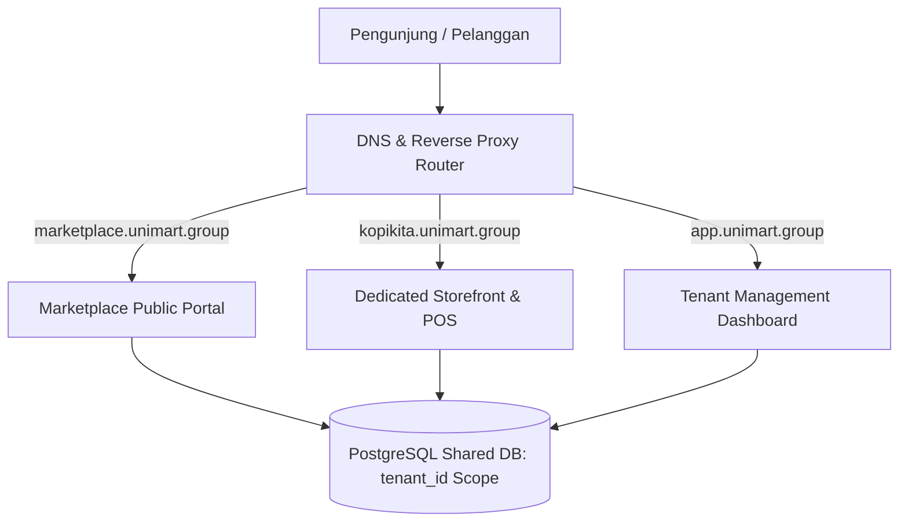
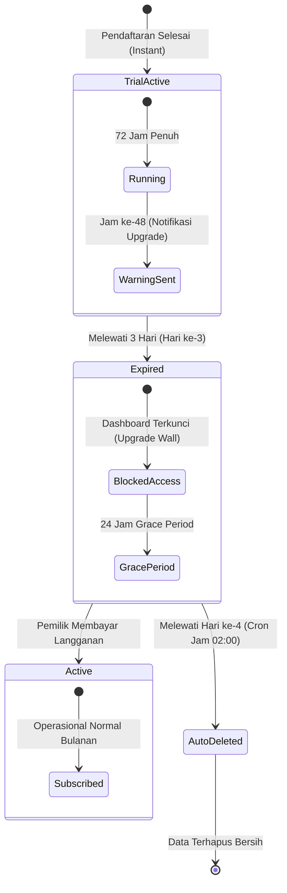
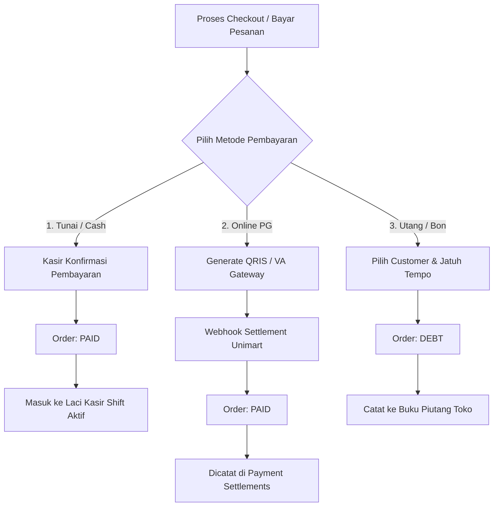
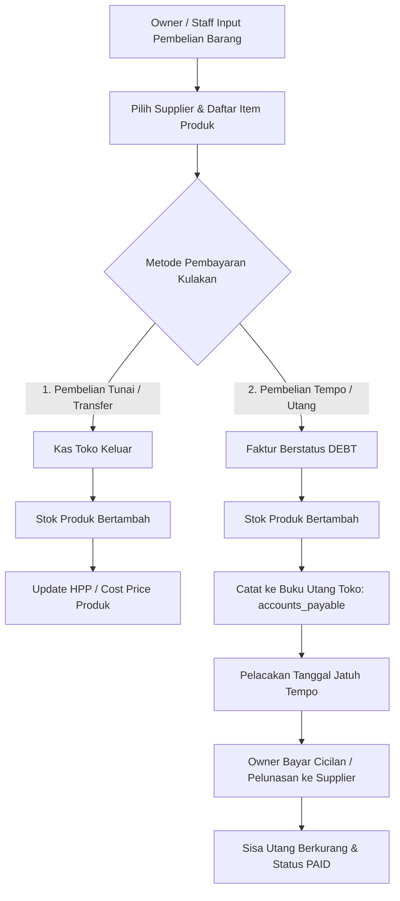
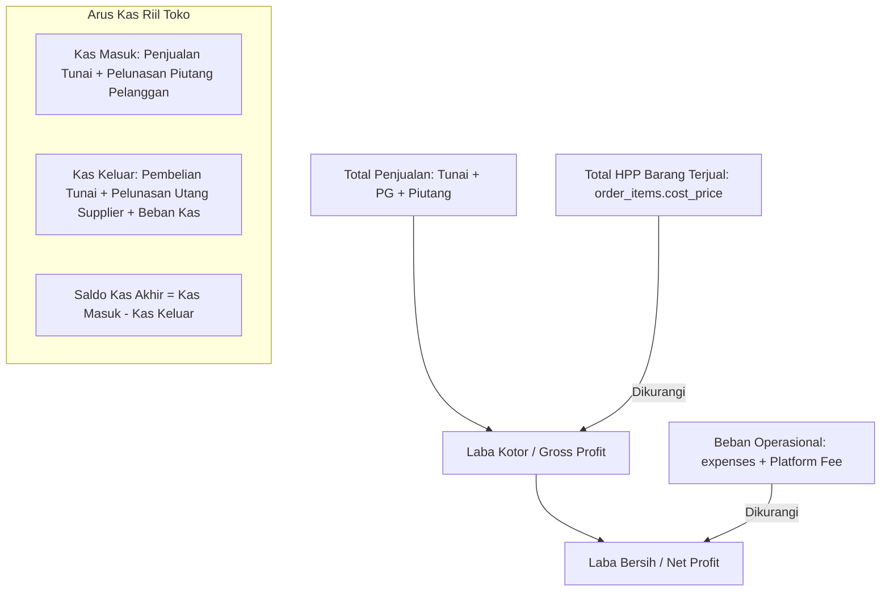
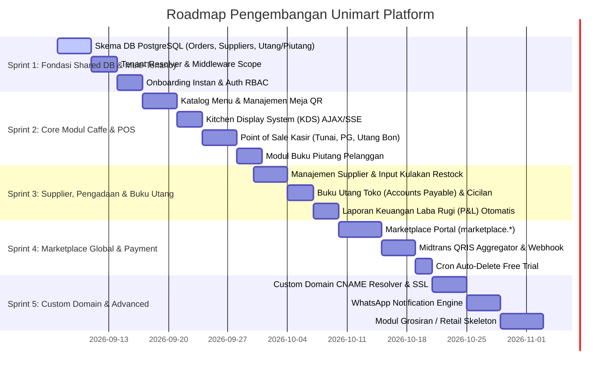

# 📐 Blueprint Arsitektur Sistem Unimart.group
## Dokumen Desain Teknis Komprehensif: Unified Marketplace, Multi-Store Engine & Full-Cycle Financial Management

> **Versi**: 3.2 — Full-Cycle Commerce, Supplier Management & Accounts Payable/Receivable  
> **Tanggal**: 2026-09-06  
> **Status**: Living Architecture Standard (Standar Utama Pengembangan)  
> **Target Audiens**: Tim Pengembang Software, DevOps, Product Owner, dan AI Agent (Antigravity/Locomo)

---

## DAFTAR ISI
1. [Eksekutif Ringkasan & Visi Sistem](#1-eksekutif-ringkasan--visi-sistem)
2. [Keputusan Arsitektur Final (Key Architectural Decisions)](#2-keputusan-arsitektur-final-key-architectural-decisions)
3. [Arsitektur Multi-Tenancy: Shared Database + Tenant Scope](#3-arsitektur-multi-tenancy-shared-database--tenant-scope)
4. [Tiga Pilar Antarmuka (Unified Triple-Tier Interface)](#4-tiga-pilar-antarmuka-unified-triple-tier-interface)
5. [Skema Database Komprehensif (PostgreSQL)](#5-skema-database-komprehensif-postgresql)
6. [Mekanisme Isolasi Data & Row-Level Security (RLS)](#6-mekanisme-isolasi-data--row-level-security-rls)
7. [Desain Modul Bisnis Berbeda (Caffe, Grosir, dll via Polymorphic Metadata)](#7-desain-modul-bisnis-berbeda-caffe-grosir-dll-via-polymorphic-metadata)
8. [Lifecycle Mitra: Pendaftaran, Free Trial 3 Hari & Auto-Delete](#8-lifecycle-mitra-pendaftaran-free-trial-3-hari--auto-delete)
9. [Manajemen Multi-Payment: Tunai, Online Gateway & Buku Piutang](#9-manajemen-multi-payment-tunai-online-gateway--buku-piutang)
10. [Manajemen Supplier, Pengadaan (Purchasing) & Buku Utang Toko](#10-manajemen-supplier-pengadaan-purchasing--buku-utang-toko)
11. [Integritas Keuangan & Laporan Laba Rugi P&L Utuh](#11-integritas-keuangan--laporan-laba-rugi-pl-utuh)
12. [Routing Subdomain, Custom Domain & DNS Ingress](#12-routing-subdomain-custom-domain--dns-ingress)
13. [Request Lifecycle & Data Flow](#13-request-lifecycle--data-flow)
14. [Caffe MVP & Alur Operasional Kasir/Dapur](#14-caffe-mvp--alur-operasional-kasirdapur)
15. [Roadmap Implementasi Bertahap](#15-roadmap-implementasi-bertahap)

---

## 1. Eksekutif Ringkasan & Visi Sistem

**Unimart.group** adalah platform ekosistem *Commerce & SaaS* terpadu yang menggabungkan dua kapabilitas utama dalam satu arsitektur terintegrasi:
1. **Public Multi-Vendor Marketplace** (`marketplace.unimart.group`): Agregator katalog publik di mana pengunjung dapat mencari produk, membandingkan harga, dan menemukan berbagai toko/mitra di seluruh platform.
2. **Dedicated Storefront & Management SaaS** (`{toko}.unimart.group` atau domain kustom): Toko online mandiri untuk masing-masing mitra bisnis dengan landing page kustom, sistem pemesanan online/QR table, Point-of-Sale (POS) kasir, Kitchen Display System (KDS), sistem manajemen pengadaan (supplier), buku utang/piutang lengkap, dan dashboard analitik laba rugi.



---

## 2. Keputusan Arsitektur Final (Key Architectural Decisions)

| Aspek | Keputusan Arsitektur | Rationale (Alasan Teknis) |
| :--- | :--- | :--- |
| **Pola Multi-Tenancy** | **Shared Database with `tenant_id` + Row-Level Security (RLS)** | Memungkinkan agregasi produk marketplace secara instan (0 sync lag), migrasi database 1x jalan, serta efisiensi resource server tinggi. |
| **Database Engine** | PostgreSQL 16+ | Mendukung fitur JSONB cepat, GIN indexing untuk pencarian marketplace, dan native Row-Level Security. |
| **Struktur Modul Bisnis** | **Modular Monolith + Dynamic JSONB Attributes** | Tabel inti seragam (`products`, `orders`), perbedaan spesifik modul (meja caffe vs satuan grosir) ditampung dalam metadata JSONB. |
| **Metode Pembayaran** | **Flexible Multi-Payment (Tunai, Online Gateway, & Piutang)** | Payment Gateway **TIDAK mandatory**. Hanya dipicu saat pelanggan bayar online. Pembayaran tunai diverifikasi kasir, dan pembayaran utang dicatat ke Buku Piutang Toko. |
| **Pengadaan & Utang Toko** | **Supplier & Accounts Payable Engine** | Mencatat pembelian modal kulakan (tunai/tempo), update stok otomatis, dan melacak buku utang toko ke pemasok. |
| **Model Onboarding** | Self-Service Instant Provisioning | Akun dan toko aktif dalam milidetik tanpa overhead pembuatan skema/database baru. |
| **Free Trial Lifecycle** | 3 Hari Trial + 24 Jam Grace Period | Manajemen soft/hard delete otomatis via Scheduled Command/Cron Job. |

---

## 3. Arsitektur Multi-Tenancy: Shared Database + Tenant Scope

Dengan **Shared Database (`tenant_id`)**:
- Query Marketplace: `SELECT * FROM products WHERE is_active = true AND is_published = true;` (Sangat cepat, natural, mendukung pagination & filter standar).
- Query Toko Tertentu: `SELECT * FROM products WHERE tenant_id = 101 AND is_active = true;` (Diterapkan otomatis oleh Tenant Scope / RLS).

```
PostgreSQL (unimart_db)
└── Schema: public
    ├── Table: tenants                ← Metadata Toko (Kopi Kita, Grosir Makmur, dll)
    ├── Table: users                  ← Pengguna (Owner, Kasir, Koki, Pembeli)
    ├── Table: suppliers              ← Pemasok / Distributor Barang Toko
    ├── Table: products               ← SEMUA produk & status stok
    ├── Table: purchases              ← Faktur Pembelian / Pengadaan Stok
    ├── Table: purchase_items         ← Detail Item Kulakan (Update Stok & HPP)
    ├── Table: accounts_payable       ← Buku Utang Toko ke Supplier (Kewajiban)
    ├── Table: payable_payments       ← Riwayat Cicilan Pelunasan Utang Toko
    ├── Table: orders                 ← SEMUA transaksi penjualan (via tenant_id)
    ├── Table: order_items            ← Detail item pesanan (via order_id)
    ├── Table: payments               ← Transaksi gateway & kasir tunai
    ├── Table: accounts_receivable    ← Buku Piutang Toko (Bon Pelanggan / Aset)
    └── Table: receivable_payments    ← Riwayat Cicilan Pelunasan Piutang Pelanggan
```

---

## 4. Tiga Pilar Antarmuka (Unified Triple-Tier Interface)

```mermaid
flowchart LR
    subgraph Tier1 [1. Public Marketplace]
        M1[marketplace.unimart.group]
        M2[Cari produk global]
        M3[Filter per kategori & lokasi]
        M4[Direktori Toko Mitra]
    end

    subgraph Tier2 [2. Dedicated Storefront]
        S1[kopikita.unimart.group]
        S2[Landing Page Kustom Toko]
        S3[Katalog & Self-Order QR]
        S4[Checkout Langsung Toko]
    end

    subgraph Tier3 [3. Store Backoffice & POS]
        B1[app.unimart.group / {toko}/admin]
        B2[Kasir POS & Shift Kas]
        B3[Kitchen Display System - KDS]
        B4[Supplier, Utang Toko & Piutang]
    end
```

---

## 5. Skema Database Komprehensif (PostgreSQL)

Semua tabel berada di schema `public`. Setiap tabel operasional menyertakan relasi `tenant_id`.

```sql
-- ============================================================================
-- 1. MASTER & MULTI-TENANCY REGISTRY
-- ============================================================================

CREATE TABLE subscription_plans (
    id          SERIAL PRIMARY KEY,
    code        VARCHAR(50) UNIQUE NOT NULL,      -- 'free_trial', 'bisnis', 'pro', 'enterprise'
    name        VARCHAR(100) NOT NULL,            -- 'Paket Bisnis Caffe'
    price       INTEGER NOT NULL DEFAULT 0,       -- Harga bulanan dalam Rupiah
    max_staff   INTEGER DEFAULT 5,
    max_products INTEGER DEFAULT 500,
    features    JSONB NOT NULL DEFAULT '{}',
    is_active   BOOLEAN DEFAULT true,
    created_at  TIMESTAMP WITH TIME ZONE DEFAULT NOW()
);

CREATE TABLE tenants (
    id                   BIGSERIAL PRIMARY KEY,
    name                 VARCHAR(150) NOT NULL,         -- 'Kopi Kita Coffee & Eatery'
    slug                 VARCHAR(100) UNIQUE NOT NULL,  -- 'kopikita' (subdomain)
    business_type        VARCHAR(50) NOT NULL,          -- 'caffe', 'grosiran', 'minimarket', 'apotek', 'butik'
    owner_name           VARCHAR(150) NOT NULL,
    owner_email          VARCHAR(150) UNIQUE NOT NULL,
    owner_phone          VARCHAR(50) NOT NULL,
    status               VARCHAR(30) DEFAULT 'trial',   -- 'trial', 'active', 'expired', 'suspended'
    subscription_plan_id INTEGER REFERENCES subscription_plans(id),
    trial_ends_at        TIMESTAMP WITH TIME ZONE,
    subscription_ends_at TIMESTAMP WITH TIME ZONE,
    
    settings             JSONB DEFAULT '{
        "theme": {"primary_color": "#2563EB", "layout": "modern"},
        "payment_methods": {
            "cash_enabled": true,
            "online_pg_enabled": true,
            "debt_enabled": true
        },
        "landing": {"tagline": "Kopi Terbaik di Kota", "banner_url": null, "description": null},
        "operational": {"tax_percentage": 10, "service_charge": 5, "currency": "IDR"}
    }',
    
    is_marketplace_enabled BOOLEAN DEFAULT true,
    city                 VARCHAR(100),
    address              TEXT,
    created_at           TIMESTAMP WITH TIME ZONE DEFAULT NOW(),
    updated_at           TIMESTAMP WITH TIME ZONE DEFAULT NOW()
);

CREATE TABLE domain_mappings (
    id            BIGSERIAL PRIMARY KEY,
    tenant_id     BIGINT NOT NULL REFERENCES tenants(id) ON DELETE CASCADE,
    custom_domain VARCHAR(150) UNIQUE NOT NULL,
    is_verified   BOOLEAN DEFAULT false,
    verified_at   TIMESTAMP WITH TIME ZONE,
    ssl_status    VARCHAR(30) DEFAULT 'pending',
    created_at    TIMESTAMP WITH TIME ZONE DEFAULT NOW()
);

-- ============================================================================
-- 2. AKUN PENGGUNA & AUTENTIKASI
-- ============================================================================

CREATE TABLE users (
    id             BIGSERIAL PRIMARY KEY,
    tenant_id      BIGINT REFERENCES tenants(id) ON DELETE CASCADE,
    name           VARCHAR(150) NOT NULL,
    email          VARCHAR(150),
    phone          VARCHAR(50),
    password       VARCHAR(255),
    role           VARCHAR(50) NOT NULL, -- 'superadmin', 'owner', 'cashier', 'chef', 'waiter', 'customer'
    pin            CHAR(6),              -- PIN cepat 6 angka untuk POS/Tablet Kasir/Dapur
    avatar_url     VARCHAR(255),
    is_active      BOOLEAN DEFAULT true,
    last_login_at  TIMESTAMP WITH TIME ZONE,
    created_at     TIMESTAMP WITH TIME ZONE DEFAULT NOW(),
    updated_at     TIMESTAMP WITH TIME ZONE DEFAULT NOW(),
    
    CONSTRAINT uq_user_tenant_email UNIQUE (tenant_id, email)
);

-- ============================================================================
-- 3. KATALOG PRODUK, KATEGORI & INVENTARIS
-- ============================================================================

CREATE TABLE categories (
    id         BIGSERIAL PRIMARY KEY,
    tenant_id  BIGINT NOT NULL REFERENCES tenants(id) ON DELETE CASCADE,
    name       VARCHAR(100) NOT NULL,
    slug       VARCHAR(100) NOT NULL,
    icon       VARCHAR(50),
    sort_order INTEGER DEFAULT 0,
    is_active  BOOLEAN DEFAULT true,
    created_at TIMESTAMP WITH TIME ZONE DEFAULT NOW()
);

CREATE TABLE products (
    id           BIGSERIAL PRIMARY KEY,
    tenant_id    BIGINT NOT NULL REFERENCES tenants(id) ON DELETE CASCADE,
    category_id  BIGINT REFERENCES categories(id) ON DELETE SET NULL,
    name         VARCHAR(200) NOT NULL,
    slug         VARCHAR(200) NOT NULL,
    description  TEXT,
    price        INTEGER NOT NULL,              -- Harga jual dalam Rupiah
    cost_price   INTEGER DEFAULT 0,             -- Harga Modal Pokok (HPP)
    stock        INTEGER DEFAULT 0,             -- Stok saat ini (otomatis bertambah saat kulakan)
    min_stock    INTEGER DEFAULT 5,             -- Peringatan stok menipis
    track_stock  BOOLEAN DEFAULT true,          -- false jika item tidak terbatas / jasa
    sku          VARCHAR(100),                  -- Barcode / SKU
    image_url    TEXT,
    
    is_available BOOLEAN DEFAULT true,          -- Toggle ketersediaan hari ini (misal menu habis)
    is_published BOOLEAN DEFAULT true,          -- Tayang di Marketplace Unimart
    is_active    BOOLEAN DEFAULT true,          -- Soft delete
    
    metadata     JSONB DEFAULT '{}',
    created_at   TIMESTAMP WITH TIME ZONE DEFAULT NOW(),
    updated_at   TIMESTAMP WITH TIME ZONE DEFAULT NOW()
);

CREATE INDEX idx_products_marketplace ON products(is_published, is_active, is_available) WHERE is_published = true;
CREATE INDEX idx_products_tenant ON products(tenant_id, category_id);
CREATE INDEX idx_products_metadata_gin ON products USING gin (metadata);

-- ============================================================================
-- 4. MANAJEMEN SUPPLIER, PENGADAAN (PURCHASING) & BUKU UTANG TOKO
-- ============================================================================

-- Pemasok / Distributor Barang
CREATE TABLE suppliers (
    id                 BIGSERIAL PRIMARY KEY,
    tenant_id          BIGINT NOT NULL REFERENCES tenants(id) ON DELETE CASCADE,
    name               VARCHAR(150) NOT NULL,         -- 'PT Sumber Kopi Makmur', 'Distributor Sembako Jaya'
    contact_person     VARCHAR(100),
    phone              VARCHAR(50) NOT NULL,
    email              VARCHAR(150),
    address            TEXT,
    bank_account_info  TEXT,                          -- Info Rekening Pembayaran Supplier
    current_debt       INTEGER DEFAULT 0,            -- Saldo utang toko ke supplier ini
    is_active          BOOLEAN DEFAULT true,
    created_at         TIMESTAMP WITH TIME ZONE DEFAULT NOW(),
    updated_at         TIMESTAMP WITH TIME ZONE DEFAULT NOW()
);

-- Faktur Pembelian / Pengadaan Barang Toko (Restock)
CREATE TABLE purchases (
    id                   BIGSERIAL PRIMARY KEY,
    tenant_id            BIGINT NOT NULL REFERENCES tenants(id) ON DELETE CASCADE,
    supplier_id          BIGINT NOT NULL REFERENCES suppliers(id) ON DELETE RESTRICT,
    purchase_number      VARCHAR(50) NOT NULL,         -- 'PO-20260906-0001'
    supplier_invoice_no  VARCHAR(100),                 -- Nomor nota/faktur dari pihak supplier
    purchase_date        DATE NOT NULL DEFAULT CURRENT_DATE,
    total_amount         INTEGER NOT NULL,             -- Total biaya kulakan
    payment_status       VARCHAR(30) DEFAULT 'paid',   -- 'paid', 'debt', 'partial'
    payment_method       VARCHAR(50) NOT NULL,         -- 'cash', 'bank_transfer', 'debt'
    due_date             DATE,                         -- Jatuh tempo jika utang/tempo
    notes                TEXT,
    created_by_user_id   BIGINT NOT NULL REFERENCES users(id),
    created_at           TIMESTAMP WITH TIME ZONE DEFAULT NOW(),
    updated_at           TIMESTAMP WITH TIME ZONE DEFAULT NOW(),
    
    CONSTRAINT uq_tenant_purchase_num UNIQUE (tenant_id, purchase_number)
);

-- Detail Item Pembelian Barang (Otomatis Tambah Stok & Update HPP)
CREATE TABLE purchase_items (
    id            BIGSERIAL PRIMARY KEY,
    tenant_id     BIGINT NOT NULL REFERENCES tenants(id) ON DELETE CASCADE,
    purchase_id   BIGINT NOT NULL REFERENCES purchases(id) ON DELETE CASCADE,
    product_id    BIGINT NOT NULL REFERENCES products(id) ON DELETE RESTRICT,
    quantity      INTEGER NOT NULL,                    -- Jumlah barang yang dibeli
    buy_price     INTEGER NOT NULL,                    -- Harga modal per unit saat beli
    subtotal      INTEGER NOT NULL,
    notes         VARCHAR(255),
    created_at    TIMESTAMP WITH TIME ZONE DEFAULT NOW()
);

-- BUKU UTANG TOKO KE SUPPLIER (ACCOUNTS PAYABLE / HUTANG USAHA)
CREATE TABLE accounts_payable (
    id                   BIGSERIAL PRIMARY KEY,
    tenant_id            BIGINT NOT NULL REFERENCES tenants(id) ON DELETE CASCADE,
    supplier_id          BIGINT NOT NULL REFERENCES suppliers(id) ON DELETE CASCADE,
    purchase_id          BIGINT NOT NULL REFERENCES purchases(id) ON DELETE CASCADE,
    payable_number       VARCHAR(50) NOT NULL,         -- 'AP-20260906-0001'
    total_debt_amount    INTEGER NOT NULL,             -- Total utang atas faktur ini
    remaining_amount     INTEGER NOT NULL,             -- Sisa utang yang belum dibayar toko
    due_date             DATE,                         -- Batas akhir jatuh tempo pembayaran
    status               VARCHAR(30) DEFAULT 'unpaid', -- 'unpaid', 'partially_paid', 'paid'
    notes                TEXT,
    created_at           TIMESTAMP WITH TIME ZONE DEFAULT NOW(),
    updated_at           TIMESTAMP WITH TIME ZONE DEFAULT NOW(),
    
    CONSTRAINT uq_tenant_ap_num UNIQUE (tenant_id, payable_number)
);

-- RIWAYAT PEMBAYARAN CICILAN / PELUNASAN UTANG KE SUPPLIER
CREATE TABLE payable_payments (
    id                     BIGSERIAL PRIMARY KEY,
    tenant_id              BIGINT NOT NULL REFERENCES tenants(id) ON DELETE CASCADE,
    payable_id             BIGINT NOT NULL REFERENCES accounts_payable(id) ON DELETE CASCADE,
    shift_id               BIGINT REFERENCES shifts(id) ON DELETE SET NULL,
    payment_method         VARCHAR(50) NOT NULL, -- 'cash', 'bank_transfer'
    amount_paid            INTEGER NOT NULL,     -- Nominal kas/transfer yang dibayarkan ke supplier
    processed_by_user_id   BIGINT NOT NULL REFERENCES users(id),
    receipt_image_url      TEXT,                 -- Bukti transfer
    notes                  TEXT,
    created_at             TIMESTAMP WITH TIME ZONE DEFAULT NOW()
);

-- ============================================================================
-- 5. OPERASIONAL TOKO / CAFFE & SHIFT RECONCILIATION
-- ============================================================================

CREATE TABLE tables (
    id         BIGSERIAL PRIMARY KEY,
    tenant_id  BIGINT NOT NULL REFERENCES tenants(id) ON DELETE CASCADE,
    name       VARCHAR(50) NOT NULL,
    qr_token   VARCHAR(100) UNIQUE NOT NULL,
    capacity   INTEGER DEFAULT 4,
    status     VARCHAR(30) DEFAULT 'available',
    created_at TIMESTAMP WITH TIME ZONE DEFAULT NOW()
);

CREATE TABLE customers (
    id             BIGSERIAL PRIMARY KEY,
    tenant_id      BIGINT NOT NULL REFERENCES tenants(id) ON DELETE CASCADE,
    name           VARCHAR(150) NOT NULL,
    phone          VARCHAR(50),
    email          VARCHAR(150),
    address        TEXT,
    credit_limit   INTEGER DEFAULT 0,            -- Batas maksimal nominal bon/utang
    current_debt   INTEGER DEFAULT 0,            -- Saldo utang aktif berjalan
    points         INTEGER DEFAULT 0,
    created_at     TIMESTAMP WITH TIME ZONE DEFAULT NOW()
);

CREATE TABLE shifts (
    id                 BIGSERIAL PRIMARY KEY,
    tenant_id          BIGINT NOT NULL REFERENCES tenants(id) ON DELETE CASCADE,
    user_id            BIGINT NOT NULL REFERENCES users(id),
    opened_at          TIMESTAMP WITH TIME ZONE NOT NULL DEFAULT NOW(),
    closed_at          TIMESTAMP WITH TIME ZONE,
    starting_cash      INTEGER NOT NULL DEFAULT 0,
    total_cash_sales   INTEGER DEFAULT 0,        -- Total penjualan tunai
    total_debt_sales   INTEGER DEFAULT 0,        -- Total penjualan bon/utang
    total_supplier_cash_out INTEGER DEFAULT 0,   -- Pengeluaran kas laci untuk bayar supplier
    system_ending_cash INTEGER,                  -- Perhitungan otomatis sistem
    actual_ending_cash INTEGER,                  -- Input fisik kasir saat blind close
    cash_difference    INTEGER,                  -- Selisih (actual - system)
    status             VARCHAR(30) DEFAULT 'open',
    notes              TEXT,
    created_at         TIMESTAMP WITH TIME ZONE DEFAULT NOW()
);

CREATE TABLE expenses (
    id          BIGSERIAL PRIMARY KEY,
    tenant_id   BIGINT NOT NULL REFERENCES tenants(id) ON DELETE CASCADE,
    shift_id    BIGINT REFERENCES shifts(id) ON DELETE SET NULL,
    user_id     BIGINT NOT NULL REFERENCES users(id),
    amount      INTEGER NOT NULL,
    category    VARCHAR(100) DEFAULT 'operasional', -- 'operasional', 'utilitas', 'gaji', 'lainnya'
    description VARCHAR(255) NOT NULL,          -- 'Beli Gas LPG', 'Beli Es Batu'
    created_at  TIMESTAMP WITH TIME ZONE DEFAULT NOW()
);

-- ============================================================================
-- 6. TRANSAKSI PENJUALAN, MULTI-PAYMENT & BUKU PIUTANG PELANGGAN
-- ============================================================================

CREATE TABLE orders (
    id                 BIGSERIAL PRIMARY KEY,
    tenant_id          BIGINT NOT NULL REFERENCES tenants(id) ON DELETE CASCADE,
    shift_id           BIGINT REFERENCES shifts(id) ON DELETE SET NULL,
    customer_id        BIGINT REFERENCES customers(id) ON DELETE SET NULL,
    table_id           BIGINT REFERENCES tables(id) ON DELETE SET NULL,
    order_number       VARCHAR(50) NOT NULL,     -- 'ORD-20260906-0001'
    customer_name      VARCHAR(150),
    order_type         VARCHAR(30) DEFAULT 'dine_in',
    order_source       VARCHAR(30) DEFAULT 'pos',
    
    kitchen_status     VARCHAR(30) DEFAULT 'pending',
    payment_status     VARCHAR(30) DEFAULT 'unpaid',  -- 'unpaid', 'paid', 'debt', 'partial', 'refunded'
    
    subtotal           INTEGER NOT NULL DEFAULT 0,
    tax_amount         INTEGER DEFAULT 0,
    service_charge     INTEGER DEFAULT 0,
    discount_amount    INTEGER DEFAULT 0,
    delivery_fee       INTEGER DEFAULT 0,
    total_amount       INTEGER NOT NULL,
    
    notes              TEXT,
    delivery_address   TEXT,
    metadata           JSONB DEFAULT '{}',
    
    created_at         TIMESTAMP WITH TIME ZONE DEFAULT NOW(),
    updated_at         TIMESTAMP WITH TIME ZONE DEFAULT NOW(),
    
    CONSTRAINT uq_tenant_order_num UNIQUE (tenant_id, order_number)
);

CREATE TABLE order_items (
    id         BIGSERIAL PRIMARY KEY,
    tenant_id  BIGINT NOT NULL REFERENCES tenants(id) ON DELETE CASCADE,
    order_id   BIGINT NOT NULL REFERENCES orders(id) ON DELETE CASCADE,
    product_id BIGINT NOT NULL REFERENCES products(id) ON DELETE RESTRICT,
    quantity   INTEGER NOT NULL,
    price      INTEGER NOT NULL,                 -- Snapshot harga jual
    cost_price INTEGER DEFAULT 0,                -- Snapshot HPP (untuk kalkulasi laba kotor)
    notes      VARCHAR(255),
    status     VARCHAR(30) DEFAULT 'pending',
    created_at TIMESTAMP WITH TIME ZONE DEFAULT NOW()
);

CREATE TABLE payments (
    id                     BIGSERIAL PRIMARY KEY,
    tenant_id              BIGINT NOT NULL REFERENCES tenants(id) ON DELETE CASCADE,
    order_id               BIGINT NOT NULL REFERENCES orders(id) ON DELETE CASCADE,
    payment_method         VARCHAR(50) NOT NULL, -- 'cash', 'qris_online', 'bank_transfer', 'debt'
    amount_paid            INTEGER NOT NULL,
    change_amount          INTEGER DEFAULT 0,
    
    gateway_name           VARCHAR(50),
    gateway_transaction_id VARCHAR(100),
    gateway_response       JSONB,
    
    status                 VARCHAR(30) DEFAULT 'success',
    processed_by_user_id   BIGINT REFERENCES users(id),
    created_at             TIMESTAMP WITH TIME ZONE DEFAULT NOW()
);

CREATE TABLE accounts_receivable (
    id                   BIGSERIAL PRIMARY KEY,
    tenant_id            BIGINT NOT NULL REFERENCES tenants(id) ON DELETE CASCADE,
    customer_id          BIGINT NOT NULL REFERENCES customers(id) ON DELETE CASCADE,
    order_id             BIGINT NOT NULL REFERENCES orders(id) ON DELETE CASCADE,
    receivable_number    VARCHAR(50) NOT NULL,         -- 'AR-20260906-0001'
    total_debt_amount    INTEGER NOT NULL,
    remaining_amount     INTEGER NOT NULL,
    due_date             DATE,
    status               VARCHAR(30) DEFAULT 'unpaid', -- 'unpaid', 'partially_paid', 'paid', 'bad_debt'
    notes                TEXT,
    created_at           TIMESTAMP WITH TIME ZONE DEFAULT NOW(),
    updated_at           TIMESTAMP WITH TIME ZONE DEFAULT NOW(),
    
    CONSTRAINT uq_tenant_ar_num UNIQUE (tenant_id, receivable_number)
);

CREATE TABLE receivable_payments (
    id                     BIGSERIAL PRIMARY KEY,
    tenant_id              BIGINT NOT NULL REFERENCES tenants(id) ON DELETE CASCADE,
    receivable_id          BIGINT NOT NULL REFERENCES accounts_receivable(id) ON DELETE CASCADE,
    shift_id               BIGINT REFERENCES shifts(id) ON DELETE SET NULL,
    payment_method         VARCHAR(50) NOT NULL,
    amount_paid            INTEGER NOT NULL,
    processed_by_user_id   BIGINT NOT NULL REFERENCES users(id),
    notes                  TEXT,
    created_at             TIMESTAMP WITH TIME ZONE DEFAULT NOW()
);

-- ============================================================================
-- 7. SETTLEMENT BILLING & AUDIT LOGS
-- ============================================================================

CREATE TABLE payment_settlements (
    id                     BIGSERIAL PRIMARY KEY,
    tenant_id              BIGINT NOT NULL REFERENCES tenants(id) ON DELETE CASCADE,
    payment_id             BIGINT REFERENCES payments(id),
    gross_amount           INTEGER NOT NULL,
    gateway_fee            INTEGER NOT NULL DEFAULT 0,
    platform_fee           INTEGER NOT NULL DEFAULT 0,
    net_payout_amount      INTEGER NOT NULL,
    payout_status          VARCHAR(30) DEFAULT 'pending',
    payout_batch_id        VARCHAR(100),
    transferred_at         TIMESTAMP WITH TIME ZONE,
    created_at             TIMESTAMP WITH TIME ZONE DEFAULT NOW()
);

CREATE TABLE billing_invoices (
    id                   BIGSERIAL PRIMARY KEY,
    tenant_id            BIGINT NOT NULL REFERENCES tenants(id) ON DELETE CASCADE,
    subscription_plan_id INTEGER REFERENCES subscription_plans(id),
    invoice_number       VARCHAR(50) UNIQUE NOT NULL,
    amount               INTEGER NOT NULL,
    status               VARCHAR(30) DEFAULT 'unpaid',
    period_start         DATE NOT NULL,
    period_end           DATE NOT NULL,
    paid_at              TIMESTAMP WITH TIME ZONE,
    gateway_payment_url  TEXT,
    created_at           TIMESTAMP WITH TIME ZONE DEFAULT NOW()
);

CREATE TABLE audit_logs (
    id         BIGSERIAL PRIMARY KEY,
    tenant_id  BIGINT REFERENCES tenants(id) ON DELETE CASCADE,
    user_id    BIGINT,
    event      VARCHAR(100) NOT NULL,
    payload    JSONB,
    ip_address VARCHAR(50),
    created_at TIMESTAMP WITH TIME ZONE DEFAULT NOW()
);
```

---

## 6. Mekanisme Isolasi Data & Row-Level Security (RLS)

Unimart menerapkan pendekatan **Dual-Layer Isolation**:
1. **Layer 1 (Application Level)**: `BelongsToTenant` Eloquent Global Scope menyuntikkan `WHERE tenant_id = :current_tenant` secara otomatis pada seluruh tabel operasional (termasuk `suppliers`, `purchases`, `accounts_payable`, dan `accounts_receivable`).
2. **Layer 2 (Database Level)**: PostgreSQL Row-Level Security (RLS) mengunci baris data di level koneksi database.

---

## 7. Desain Modul Bisnis Berbeda (Polymorphic Metadata)

| Modul Bisnis | Fitur Khas Antarmuka | Metadata Produk (`products.metadata`) | Metadata Pesanan / Pembelian |
| :--- | :--- | :--- | :--- |
| **Caffe / F&B** | - Meja & QR Scan<br>- KDS Dapur & SLA Masak<br>- Varian Sugar/Ice | `{"prep_time": 10, "variants": ["Less Sweet", "No Ice"]}` | `{"table_id": 4, "kitchen_notes": "Bikin pedas"}` |
| **Grosiran** | - Tier Harga Grosir<br>- Satuan Dus/Karton/Pcs<br>- Utang Supplier & Bon Pelanggan | `{"wholesale_tiers": [{"min": 10, "price": 8500}], "unit": "karton"}` | `{"delivery_vehicle": "truk_engkel"}` |
| **Minimarket** | - Scan Barcode Cepat (POS)<br>- Warning Stok Minimum | `{"barcode": "8992775211", "min_stock_alert": 5}` | `{"cashier_terminal_id": "POS-01"}` |
| **Apotek** | - Resep Dokter<br>- Nomor Batch & Kadaluarsa | `{"bpom_code": "DBL12345", "expiry_date": "2027-10-10"}` | `{"prescription_image_url": "https://..."}` |
| **Butik / Pakaian**| - Pilihan Ukuran (S/M/L/XL)<br>- Pilihan Warna | `{"sizes": ["S", "M", "L"], "colors": ["Hitam", "Navy"]}` | `{"gift_wrapping": true}` |

---

## 8. Lifecycle Mitra: Pendaftaran, Free Trial 3 Hari & Auto-Delete



---

## 9. Manajemen Multi-Payment: Tunai, Online Gateway & Buku Piutang



---

## 10. Manajemen Supplier, Pengadaan (Purchasing) & Buku Utang Toko

Untuk memastikan pencatatan modal dan perputaran barang berlangsung utuh, Unimart menyediakan alur pengadaan barang dan manajemen kewajiban toko ke pemasok (supplier):



### 10.1 Alur Pengadaan Barang & Restock Otomatis
1. Owner / Bagian Gudang membuat transaksi di `/admin/purchases/create`.
2. Memilih **Supplier** dan memasukkan daftar produk, kuantitas beli, serta harga beli satuan (`buy_price`).
3. **Eksekusi Atomik di Database**:
   - Record `purchases` dan `purchase_items` tersimpan.
   - Kolom `products.stock` otomatis bertambah sesuai kuantitas yang dibeli.
   - Kolom `products.cost_price` (HPP) diperbarui menggunakan metode *Moving Average*:
     $$\text{HPP Baru} = \frac{(\text{Stok Lama} \times \text{HPP Lama}) + (\text{Qty Beli} \times \text{Harga Beli})}{\text{Stok Total Baru}}$$

### 10.2 Manajemen Utang Toko (Accounts Payable)
- Jika pembelian dilakukan secara tempo/kredit ke supplier:
  - `purchases.payment_status` bernilai `'debt'`.
  - Record baru dibuat di tabel `accounts_payable` dengan mencatat `due_date` (tanggal jatuh tempo) dan sisa tagihan.
  - Saldo utang toko ke supplier bertambah (`suppliers.current_debt`).
- **Pelunasan Utang**:
  - Melalui menu **Buku Utang Toko** (`/admin/payables`), owner dapat melihat total kewajiban yang harus dibayar kepada seluruh pemasok.
  - Saat toko mentransfer uang ke supplier, dicatat di `payable_payments`. Sisa utang berkurang hingga berstatus `'paid'`.

---

## 11. Integritas Keuangan & Laporan Laba Rugi (P&L) Utuh

Dengan tercatatnya sisi Penjualan (Revenue), Pembelian/Kulakan (COGS/HPP), Utang Toko (Payable), Piutang Pelanggan (Receivable), dan Beban Kasir (Expenses), Unimart menyajikan laporan keuangan komprehensif secara otomatis:



### 11.1 Formula Perhitungan Keuangan Standar Unimart
1. **Omset Penjualan (Revenue)**:
   $$\text{Revenue} = \sum \text{orders.total\_amount} \quad (\text{Status: Paid \& Debt})$$
2. **Beban Pokok Penjualan (HPP / COGS)**:
   $$\text{COGS} = \sum (\text{order\_items.quantity} \times \text{order\_items.cost\_price})$$
3. **Laba Kotor (Gross Profit)**:
   $$\text{Gross Profit} = \text{Revenue} - \text{COGS}$$
4. **Laba Bersih (Net Profit)**:
   $$\text{Net Profit} = \text{Gross Profit} - \sum \text{expenses.amount} - \text{Total MDR/Platform Fee}$$
5. **Posisi Neraca Sederhana (Balance Snapshot)**:
   - **Piutang Usaha (Aset Berjalan)** = $\sum \text{accounts\_receivable.remaining\_amount}$
   - **Utang Usaha (Kewajiban Berjalan)** = $\sum \text{accounts\_payable.remaining\_amount}$

---

## 12. Routing Subdomain, Custom Domain & DNS Ingress

```php
class ResolveTenantDomainMiddleware
{
    public function handle(Request $request, Closure $next)
    {
        $host = $request->getHost();

        // 1. Marketplace Pusat
        if ($host === 'marketplace.unimart.group' || $host === 'unimart.group') {
            app()->instance('is_marketplace_context', true);
            return $next($request);
        }

        // 2. Subdomain Toko (*.unimart.group)
        if (str_ends_with($host, '.unimart.group')) {
            $slug = str_replace('.unimart.group', '', $host);
            $tenant = Tenant::where('slug', $slug)->firstOrFail();
        } 
        // 3. Custom Domain Toko (www.namatoko.com)
        else {
            $mapping = DomainMapping::where('custom_domain', $host)
                ->where('is_verified', true)
                ->firstOrFail();
            $tenant = $mapping->tenant;
        }

        if (!in_array($tenant->status, ['trial', 'active'])) {
            return response()->view('errors.tenant_suspended_or_expired', ['tenant' => $tenant], 403);
        }

        app()->instance('current_tenant', $tenant);
        app()->instance('is_marketplace_context', false);

        return $next($request);
    }
}
```

---

## 13. Request Lifecycle & Data Flow

```
[Pengunjung Mengakses: https://kopikita.unimart.group/menu]
       │
       ▼
[1. DNS & Nginx] ──> Match *.unimart.group ──> Kirim HTTP Request ke PHP-FPM
       │
       ▼
[2. Laravel Middleware Pipeline]
       ├── RateLimiter & SessionStart
       ├── ResolveTenantDomainMiddleware (Set current_tenant = Tenant ID 101)
       │
       ▼
[3. Router & Controller: StorefrontController@menu]
       ├── BelongsToTenant Scope otomatis menambahkan: "WHERE tenant_id = 101"
       │
       ▼
[4. PostgreSQL Execution]
       └── SELECT * FROM products WHERE tenant_id = 101 AND is_available = true;
       │
       ▼
[5. View Rendering]
       └── Render template landing page toko
       │
       ▼
[Response 200 OK ke Browser Pengunjung]
```

---

## 14. Caffe MVP & Alur Operasional Kasir/Dapur

### 14.1 Matriks Peran & Izin Pengguna (RBAC)

| Peran (Role) | Akses Antarmuka | Otoritas Utama |
| :--- | :--- | :--- |
| **Owner** | Full Dashboard (`/admin`) | Laporan Laba Rugi, Supplier, Buku Utang & Piutang, Menu/Harga, Meja, Tambah Staf. |
| **Cashier (Kasir)** | POS View (`/pos`) | Buka/tutup shift, buat pesanan, terima tunai/QRIS/utang bon, catat petty cash. |
| **Chef (Koki)** | Kitchen View (`/kds`) | Melihat antrean pesanan, update status masak (`cooking` ➔ `ready`). |
| **Waiter (Pelayan)** | Order List (`/waiter`) | Mengantar pesanan dari dapur ke nomor meja (`ready` ➔ `served`). |
| **Pelanggan** | Self-Order (`/qr/{token}`) | Scan QR di meja, pesan menu langsung dari smartphone, bayar QRIS. |

### 14.2 Prosedur Blind Close Rekonsiliasi Kasir
1. Kasir **TIDAK BISA** melihat saldo sistem sebelum menghitung uang fisik.
2. Kasir menghitung total uang tunai di laci kasir dan memasukkan nominal pada sistem (`actual_ending_cash`).
3. Sistem secara otomatis menghitung `system_ending_cash = starting_cash + total_cash_sales - total_petty_cash - total_supplier_cash_out`.
4. Selisih dicatat secara permanen di database dan dikirimkan via notifikasi ke Owner.

---

## 15. Roadmap Implementasi Bertahap



---

*Dokumen ini merupakan acuan arsitektur resmi Unimart.group.*  
*Dikelola dan diawasi oleh: **Locomo Agent OS — Antigravity Engine**.*
