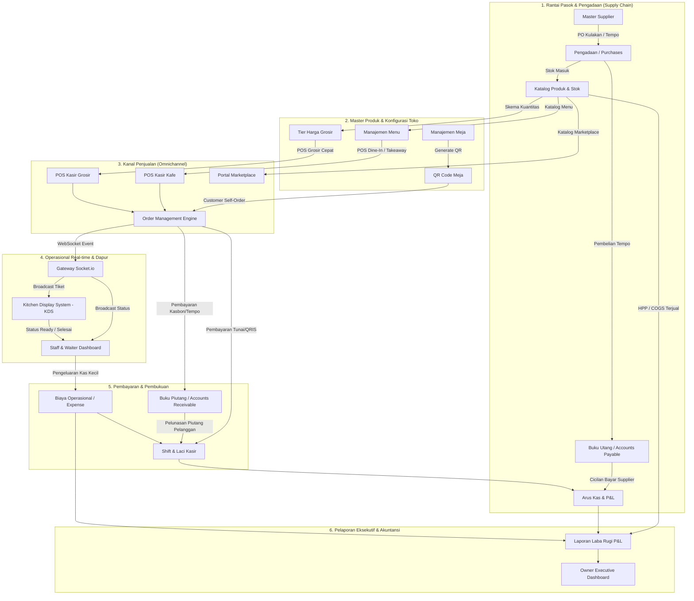

# Kamus Fitur Lengkap & Peta Relasi Sistem Unimart.group

Dokumen ini merupakan inventarisasi dan ulasan menyeluruh terhadap **seluruh fitur, halaman, endpoint, modul, serta hubungan antar-fitur** yang ada pada ekosistem **Unimart.group** (SaaS Multi-Tenant Smart POS & Business Management).

---

## 1. Arsitektur Domain & Resolusi Modul

Unimart.group menggunakan arsitektur **Multi-Tenant Subdomain & Shared Core Kernel**:
- **Domain Utama / SaaS Portal** (`unimart.group` / `unimart.group.localhost`): Portal landing page publik, registrasi tenant, dan marketplace.
- **Subdomain Tenant** (`{alias}.unimart.group` / `{alias}.unimart.group.localhost`): Portal toko mandiri (Kafe, Grosir, Retail) yang otomatis menyesuaikan view berdasarkan `business_type`.
- **Modul Kernel Bersama**: Modul Pengadaan (Purchases), Supplier, Buku Utang (Payable), Buku Piutang (Receivable), dan Laporan Keuangan (P&L) yang dipakai bersama oleh seluruh model bisnis.

---

## 2. Inventarisasi Seluruh Halaman & Fitur Unimart.group

### A. Portal Publik & Pengunjung (Public Facing)

| No | Nama Fitur / Halaman | Rute / URL | Handler / View | Deskripsi & Fungsionalitas |
|:---|:---|:---|:---|:---|
| 1 | **SaaS Interactive Landing Page** | `GET /` (Root Domain) | [`welcome.blade.php`](file:///home/dev360_03/locomo.id/unimart.group/resources/views/welcome.blade.php) | Halaman utama portal Unimart.group. Memuat showcase fitur POS multi-industri (Kafe, Grosir, Minimarket, Apotek, Butik), live interactive demo simulator, modal registrasi merchant lead, kalkulator harga paket, dan integrasi ekosistem (PitiCoin, iZone). |
| 2 | **Portal Marketplace Agregator** | `GET /marketplace` atau `GET /` (Marketplace Subdomain) | [`MarketplaceHomeController.php`](file:///home/dev360_03/locomo.id/unimart.group/app/Modules/Marketplace/Controllers/MarketplaceHomeController.php) [`home.blade.php`](file:///home/dev360_03/locomo.id/unimart.group/app/Modules/Marketplace/Views/home.blade.php) | Direktori agregasi seluruh merchant Unimart. Menampilkan pencarian produk global lintas toko, filter kategori usaha, kartu toko terverifikasi, dan tautan direct order via WhatsApp/web merchant. |
| 3 | **Storefront & QR Self-Order Kafe (F&B)** | `GET /caffe/{alias}` atau `GET /` (Subdomain Kafe) | [`CaffeLandingController.php`](file:///home/dev360_03/locomo.id/unimart.group/app/Modules/Caffe/Controllers/CaffeLandingController.php) [`landing.blade.php`](file:///home/dev360_03/locomo.id/unimart.group/app/Modules/Caffe/Views/landing.blade.php) [`caffe-qr.blade.php`](file:///home/dev360_03/locomo.id/unimart.group/resources/views/caffe-qr.blade.php) | Antarmuka pemesanan mandiri pelanggan via QR Meja. Pelanggan dapat memilih nomor meja, memilih menu & varian, melakukan checkout pesanan, dan memantau status pesanan secara real-time via WebSocket. |
| 4 | **Storefront B2B & Katalog Grosir** | `GET /grosir/{alias}` atau `GET /` (Subdomain Grosir) | [`GrosirLandingController.php`](file:///home/dev360_03/locomo.id/unimart.group/app/Modules/Grosir/Controllers/GrosirLandingController.php) [`landing.blade.php`](file:///home/dev360_03/locomo.id/unimart.group/app/Modules/Grosir/Views/landing.blade.php) | Etalase digital grosir dengan penayangan tier harga bertingkat (harga eceran, tier 1, tier 2, tier 3 berdasarkan minimal kuantiti pembelian) dan pemesanan partai besar. |
| 5 | **Integrasi Captive WiFi Hotspot** | `GET /hotspot/{alias}` | [`izone-hotspot.blade.php`](file:///home/dev360_03/locomo.id/unimart.group/resources/views/izone-hotspot.blade.php) | Halaman portal captive WiFi iZone Hotspot kafe dengan penawaran reward loyalitas token PitiCoin setelah pelanggan login/berbelanja. |

---

### B. Otentikasi, Pendaftaran & Keamanan (Auth & Identity)

| No | Nama Fitur / Halaman | Rute / URL | Handler / View | Deskripsi & Fungsionalitas |
|:---|:---|:---|:---|:---|
| 6 | **Registrasi Owner (Onboarding Wizard)** | `GET /owner/register` `POST /owner/register` | [`OwnerAuthController.php`](file:///home/dev360_03/locomo.id/unimart.group/app/Http/Controllers/Auth/OwnerAuthController.php) [`owner-register.blade.php`](file:///home/dev360_03/locomo.id/unimart.group/resources/views/auth/owner-register.blade.php) | Wizard pendaftaran merchant baru dengan pemilihan tipe bisnis, pembuatan alias subdomain unik, inisialisasi akun owner, dan auto-seeding data awal toko. |
| 7 | **Login Owner** | `GET /owner/login` `POST /owner/login` | [`OwnerAuthController.php`](file:///home/dev360_03/locomo.id/unimart.group/app/Http/Controllers/Auth/OwnerAuthController.php) [`owner-login.blade.php`](file:///home/dev360_03/locomo.id/unimart.group/resources/views/auth/owner-login.blade.php) | Autentikasi khusus pemilik toko/merchant untuk mengakses backoffice owner. |
| 8 | **Login Staff & Kasir (Email / PIN)** | `GET /login` `POST /login` | [`StaffAuthController.php`](file:///home/dev360_03/locomo.id/unimart.group/app/Http/Controllers/Auth/StaffAuthController.php) [`staff-login.blade.php`](file:///home/dev360_03/locomo.id/unimart.group/resources/views/auth/staff-login.blade.php) [`pin-login.blade.php`](file:///home/dev360_03/locomo.id/unimart.group/resources/views/auth/pin-login.blade.php) | Login multi-metode bagi staf operasional (Kasir, Barista/Koki, Waiter) menggunakan email/password atau Quick PIN 4-digit. |
| 9 | **Google OAuth SSO** | `GET /auth/google/redirect` `GET /auth/google/callback` | [`GoogleAuthController.php`](file:///home/dev360_03/locomo.id/unimart.group/app/Http/Controllers/Auth/GoogleAuthController.php) | Single Sign-On (SSO) menggunakan akun Google untuk pendaftaran dan login instan. |
| 10 | **Ubah Password Staff** | `GET /change-password` `POST /change-password` | [`StaffAuthController.php`](file:///home/dev360_03/locomo.id/unimart.group/app/Http/Controllers/Auth/StaffAuthController.php) [`change-password.blade.php`](file:///home/dev360_03/locomo.id/unimart.group/resources/views/auth/change-password.blade.php) | Keamanan mandiri bagi staf untuk memperbarui kredensial password. |
| 11 | **Logout Sistem** | `POST /logout` atau `POST /owner/logout` | [`StaffAuthController.php`](file:///home/dev360_03/locomo.id/unimart.group/app/Http/Controllers/Auth/StaffAuthController.php) [`OwnerAuthController.php`](file:///home/dev360_03/locomo.id/unimart.group/app/Http/Controllers/Auth/OwnerAuthController.php) | Pembersihan sesi pengguna dan reset token otentikasi. |

---

### C. Portal Manajemen Pemilik Toko (Owner Backoffice)

| No | Nama Fitur / Halaman | Rute / URL | Handler / View | Deskripsi & Fungsionalitas |
|:---|:---|:---|:---|:---|
| 12 | **Owner Executive Dashboard** | `GET /owner/dashboard` | [`DashboardController.php`](file:///home/dev360_03/locomo.id/unimart.group/app/Http/Controllers/Owner/DashboardController.php) [`dashboard.blade.php`](file:///home/dev360_03/locomo.id/unimart.group/resources/views/owner/dashboard.blade.php) | Dashboard visual metrik penjualan: omset harian/bulanan, laba kotor, produk terlaris, ringkasan kas kasir, status shift staf aktif, dan shortcut cepat. |
| 13 | **Manajemen Tim & Staf** | `GET /owner/team` `POST /owner/team/add` | [`DashboardController.php`](file:///home/dev360_03/locomo.id/unimart.group/app/Http/Controllers/Owner/DashboardController.php) [`team.blade.php`](file:///home/dev360_03/locomo.id/unimart.group/resources/views/owner/team.blade.php) | Manajemen karyawan toko: penambahan staf, pembagian role (`cashier`, `chef`, `waiter`, `manager`), pembuatan PIN cepat, dan pemantauan aktivitas. |
| 14 | **Katalog Menu & Produk** | `GET /owner/menus` `POST /owner/menus/store` `POST /owner/menus/update/{id}` `POST /owner/menus/delete/{id}` | [`MenuController.php`](file:///home/dev360_03/locomo.id/unimart.group/app/Http/Controllers/Owner/MenuController.php) [`menus.blade.php`](file:///home/dev360_03/locomo.id/unimart.group/resources/views/owner/menus.blade.php) | CRUD produk & menu: nama, kategori, harga jual, harga pokok (HPP/COGS), stok, gambar produk, dan status ketersediaan (in-stock / out-of-stock). |
| 15 | **Manajemen Meja & QR Code Generator** | `GET /owner/tables` `POST /owner/tables/update` | [`TableController.php`](file:///home/dev360_03/locomo.id/unimart.group/app/Http/Controllers/Owner/TableController.php) [`tables.blade.php`](file:///home/dev360_03/locomo.id/unimart.group/resources/views/owner/tables.blade.php) | Konfigurasi layout meja kafe, penambahan batch meja, dan unduh/cetak QR Code pemesanan meja otomatis yang terhubung ke URL toko. |
| 16 | **Pengaturan Profil Toko & Pajak** | `POST /owner/settings/update` | [`DashboardController.php`](file:///home/dev360_03/locomo.id/unimart.group/app/Http/Controllers/Owner/DashboardController.php) | Konfigurasi identitas toko, nomor kontak, jam operasional, pengaturan tarif pajak (PB1/PPN) & service charge, dan footer struk. |
| 17 | **Manajemen Tier Harga Grosir** | `GET /owner/price-tiers` `POST /owner/price-tiers` `DELETE /owner/price-tiers/{id}` | [`PriceTierController.php`](file:///home/dev360_03/locomo.id/unimart.group/app/Modules/Grosir/Controllers/PriceTierController.php) [`price-tiers.blade.php`](file:///home/dev360_03/locomo.id/unimart.group/app/Modules/Grosir/Views/price-tiers.blade.php) | Skema harga bertingkat untuk bisnis grosir: penentuan minimal quantity (cth: beli >= 12 pcs, >= 100 pcs) dengan potongan harga per unit. |
| 18 | **Manajemen Master Supplier** | `GET /owner/suppliers` `POST /owner/suppliers` `POST /owner/suppliers/{id}` `DELETE /owner/suppliers/{id}` | [`SupplierController.php`](file:///home/dev360_03/locomo.id/unimart.group/app/Http/Controllers/Owner/SupplierController.php) [`index.blade.php`](file:///home/dev360_03/locomo.id/unimart.group/resources/views/owner/suppliers/index.blade.php) | Direktori vendor/pemasok barang: nama perusahaan, kontak, alamat, termin pembayaran (tempo/cash), dan ringkasan total utang aktif per supplier. |
| 19 | **Pengadaan Stok / Kulakan (Purchases)** | `GET /owner/purchases` `GET /owner/purchases/create` `POST /owner/purchases` | [`PurchaseController.php`](file:///home/dev360_03/locomo.id/unimart.group/app/Http/Controllers/Owner/PurchaseController.php) [`index.blade.php`](file:///home/dev360_03/locomo.id/unimart.group/resources/views/owner/purchases/index.blade.php) [`create.blade.php`](file:///home/dev360_03/locomo.id/unimart.group/resources/views/owner/purchases/create.blade.php) | Pencatatan faktur pengadaan barang: multi-item purchase, kalkulasi otomatis HPP rata-rata, penambahan stok gudang otomatis, dan pencatatan utang jika dibeli secara tempo/kredit. |
| 20 | **Buku Utang Dagang (Accounts Payable)** | `GET /owner/payables` `POST /owner/payables/{id}/payment` | [`AccountPayableController.php`](file:///home/dev360_03/locomo.id/unimart.group/app/Http/Controllers/Owner/AccountPayableController.php) [`index.blade.php`](file:///home/dev360_03/locomo.id/unimart.group/resources/views/owner/payables/index.blade.php) | Buku besar utang toko ke supplier: pelacakan jatuh tempo, status lunas/sebagian, riwayat pembayaran cicilan utang, dan bukti bayar. |
| 21 | **Buku Piutang Pelanggan (Accounts Receivable)** | `GET /owner/receivables` `POST /owner/receivables/{id}/payment` | [`AccountReceivableController.php`](file:///home/dev360_03/locomo.id/unimart.group/app/Http/Controllers/Owner/AccountReceivableController.php) [`index.blade.php`](file:///home/dev360_03/locomo.id/unimart.group/resources/views/owner/receivables/index.blade.php) | Buku besar piutang / kasbon pelanggan (bon warung/pelanggan grosir): pencatatan saldo utang pelanggan dari kasir, penerimaan cicilan bayar, dan kartu saldo piutang. |
| 22 | **Laporan Keuangan & Laba Rugi (P&L)** | `GET /owner/reports/finance` | [`FinancialReportController.php`](file:///home/dev360_03/locomo.id/unimart.group/app/Http/Controllers/Owner/FinancialReportController.php) [`finance.blade.php`](file:///home/dev360_03/locomo.id/unimart.group/resources/views/owner/reports/finance.blade.php) | Laporan keuangan komprehensif: Pendapatan Kotor (Gross Sales), Harga Pokok Penjualan (HPP/COGS), Laba Kotor (Gross Profit), Biaya Operasional (Expenses), Laba Bersih (Net Profit), Posisi Kas, dan Posisi Utang/Piutang. |

---

### D. Operasional Staf, POS & Kitchen Display (Staff Portal)

| No | Nama Fitur / Halaman | Rute / URL | Handler / View | Deskripsi & Fungsionalitas |
|:---|:---|:---|:---|:---|
| 23 | **Staff Operational Dashboard** | `GET /staff/dashboard` | [`StaffAuthController.php`](file:///home/dev360_03/locomo.id/unimart.group/app/Http/Controllers/Auth/StaffAuthController.php) [`dashboard.blade.php`](file:///home/dev360_03/locomo.id/unimart.group/resources/views/staff/dashboard.blade.php) | Pusat kerja operasional staf terpadu: monitor pesanan masuk secara live, kontrol shift kasir, input pengeluaran kas kecil, dan pelacakan order meja. |
| 24 | **Manajemen Shift & Kas Laci Kasir** | `POST /staff/shift/start` `POST /staff/shift/close` | [`StaffAuthController.php`](file:///home/dev360_03/locomo.id/unimart.group/app/Http/Controllers/Auth/StaffAuthController.php) | Buka shift kasir dengan modal awal (opening cash), rekonsiliasi kas saat tutup shift, perbandingan uang fisik vs sistem, dan laporan selisih kas. |
| 25 | **Point of Sale Kafe / Resto (POS Caffe)** | `GET /caffe/{alias}/pos` `POST /caffe/{alias}/pos/checkout` | [`POSController.php`](file:///home/dev360_03/locomo.id/unimart.group/app/Http/Controllers/Owner/POSController.php) [`pos.blade.php`](file:///home/dev360_03/locomo.id/unimart.group/resources/views/owner/pos.blade.php) | Kasir pintar F&B: pemilihan meja, split bill / hold order, multi-metode bayar (Tunai, QRIS, Transfer, Kasbon Piutang), cetak struk termal, dan integrasi broadcast KDS. |
| 26 | **Point of Sale Grosir (Wholesale POS)** | `GET /grosir/{alias}/pos` `POST /grosir/{alias}/pos/checkout` | [`GrosirPOSController.php`](file:///home/dev360_03/locomo.id/unimart.group/app/Modules/Grosir/Controllers/GrosirPOSController.php) [`pos.blade.php`](file:///home/dev360_03/locomo.id/unimart.group/app/Modules/Grosir/Views/pos.blade.php) | Kasir cepat grosiran: pencarian barcode cepat, kalkulasi otomatis tier harga grosir sesuai jumlah barang, pemilihan data pelanggan untuk pencatatan piutang tempo. |
| 27 | **Kitchen Display System (KDS)** | `GET /caffe/{alias}/kds` `POST /caffe/{alias}/kds/complete/{order_id}` | [`KDSController.php`](file:///home/dev360_03/locomo.id/unimart.group/app/Http/Controllers/Owner/KDSController.php) [`kds.blade.php`](file:///home/dev360_03/locomo.id/unimart.group/resources/views/owner/kds.blade.php) | Antarmuka layar dapur/barista tanpa kertas (paperless): antrean tiket pesanan masuk secara real-time dengan audio alert, timer durasi masak, tombol selesaikan masakan per pesanan. |
| 28 | **Pengeluaran Operasional Kasir (Petty Cash)** | `POST /staff/expense` | [`StaffAuthController.php`](file:///home/dev360_03/locomo.id/unimart.group/app/Http/Controllers/Auth/StaffAuthController.php) | Pencatatan pengeluaran harian toko dari laci kasir (cth: beli es batu mendesak, bensin kurir, gas elpiji) yang langsung memotong kas kasir & masuk P&L. |
| 29 | **Penyelesaian Pembayaran Pesanan (Settle Bill)** | `POST /staff/order/{id}/payment` | [`StaffAuthController.php`](file:///home/dev360_03/locomo.id/unimart.group/app/Http/Controllers/Auth/StaffAuthController.php) | Pelunasan tagihan untuk pesanan yang dipesan melalui QR Meja (dine-in pay later). |
| 30 | **Void Item Pesanan & Audit Log** | `POST /staff/order-item/{id}/void` | [`StaffAuthController.php`](file:///home/dev360_03/locomo.id/unimart.group/app/Http/Controllers/Auth/StaffAuthController.php) | Pembatalan item pesanan dengan alasan void, otomatis mengembalikan stok atau mencatat limbah (waste). |
| 31 | **Status Alur Pesanan (Workflow Actions)** | `POST /staff/order/{id}/prepare` `POST /staff/order/{id}/deliver` `POST /staff/order/{id}/cancel` | [`StaffAuthController.php`](file:///home/dev360_03/locomo.id/unimart.group/app/Http/Controllers/Auth/StaffAuthController.php) | Perubahan status tahapan pesanan: Diproses Dapur -> Diantar ke Meja -> Selesai / Dibatalkan. |
| 32 | **Quick Stock Toggle (Menu 86 / Sold Out)** | `POST /staff/product/{id}/update-stock` | [`StaffAuthController.php`](file:///home/dev360_03/locomo.id/unimart.group/app/Http/Controllers/Auth/StaffAuthController.php) | Fitur cepat bagi staf/barista untuk mengubah status menu habis secara instan agar tidak dapat dipesan pelanggan di QR Meja. |
| 33 | **Polling Data Pesanan Real-time** | `GET /staff/orders-data` | [`StaffAuthController.php`](file:///home/dev360_03/locomo.id/unimart.group/app/Http/Controllers/Auth/StaffAuthController.php) | Endpoint JSON live update pesanan aktif untuk antarmuka staf. |

---

### E. Integrasi API Eksternal & Background Services

| No | Nama Fitur / API | Endpoint | Handler | Deskripsi & Fungsionalitas |
|:---|:---|:---|:---|:---|
| 34 | **Pendaftaran Lead Calon Merchant** | `POST /api/unimart/register-lead` | [`MerchantRegistrationController.php`](file:///home/dev360_03/locomo.id/unimart.group/app/Http/Controllers/Api/MerchantRegistrationController.php) | Ingestion data calon pelanggan dari form landing page untuk tim sales & aktivasi mandiri. |
| 35 | **Konfirmasi Lead & Aktivasi Akun** | `GET /api/unimart/confirm-lead` | [`MerchantRegistrationController.php`](file:///home/dev360_03/locomo.id/unimart.group/app/Http/Controllers/Api/MerchantRegistrationController.php) | Verifikasi email/tautan aktivasi bagi lead pendaftar. |
| 36 | **Webhook Verifikasi Pembayaran** | `POST /api/unimart/verify-payment` | [`MerchantRegistrationController.php`](file:///home/dev360_03/locomo.id/unimart.group/app/Http/Controllers/Api/MerchantRegistrationController.php) | Webhook verifikasi pembayaran otomatis (PitiCoin / Payment Gateway) untuk aktivasi paket langganan SaaS. |
| 37 | **WebSocket Event Broadcaster** | Node.js Gateway (`port 6001`) | [`GatewayService.php`](file:///home/dev360_03/locomo.id/unimart.group/app/Services/GatewayService.php) | Sinkronisasi real-time instan: ketika ada pesanan baru dari QR Meja, event langsung dibroadcast ke layar POS Kasir, KDS Dapur, dan Staff Dashboard tanpa perlu refresh halaman. |

---

## 3. Peta Relasi Antar Fitur & Aliran Data Bisnis

Berikut adalah arsitektur hubungan dan interaksi antar fitur di Unimart.group:

---

## 4. Hubungan Rinci Antar Fitur Spesifik

### 1. Hubungan Pengadaan (Purchases) -> Stok -> HPP (COGS) -> Penjualan -> Laba Rugi (P&L)
- **Alur**:
  1. Owner melakukan kulakan barang melalui menu **Purchases** dengan memilih **Supplier**.
  2. Saat disimpan, stok pada **Products** otomatis bertambah, dan harga beli (HPP) diperbarui.
  3. Jika dibeli tempo, sistem otomatis membuat rekaman tagihan di **Accounts Payable (Buku Utang)**.
  4. Ketika produk terjual di **POS** atau **QR Meja**, stok berkurang dan HPP tercatat pada `order_items.cost_price`.
  5. Menu **Financial Report (Laba Rugi)** mengalkulasi:
     $$\text{Laba Kotor} = \text{Total Penjualan} - \text{Total HPP Barang Terjual}$$
     $$\text{Laba Bersih} = \text{Laba Kotor} - \text{Total Pengeluaran Operasional (Expenses)}$$

### 2. Hubungan Meja (Tables) -> QR Self-Order -> Order Engine -> KDS -> Kasir
- **Alur**:
  1. Owner men-generate meja di menu **Tables** dan mencetak QR Code.
  2. Pelanggan memindai QR Code di meja $\rightarrow$ membuka `caffe-qr.blade.php`.
  3. Pelanggan memilih menu dan melakukan checkout.
  4. **OrderManagerService** menyimpan pesanan dengan status `pending` dan meja terisi (`occupied`).
  5. **GatewayService** memancarkan event WebSocket `order.created`.
  6. Layar **KDS Dapur** langsung berbunyi dan memunculkan tiket pesanan baru tanpa refresh.
  7. Layar **Staff Dashboard** & **POS** langsung memperbarui tagihan meja.
  8. Saat koki menekan tombol "Selesai" di KDS, status pesanan diperbarui menjadi `ready`/`served`.
  9. Pelanggan membayar ke kasir di **POS**, status berubah menjadi `completed`, meja kembali `available`, dan kas laci kasir bertambah.

### 3. Hubungan POS Grosir -> Tier Harga -> Piutang Pelanggan (AR) -> Rekonsiliasi Kas
- **Alur**:
  1. Owner mengatur **Price Tiers** untuk produk grosir (cth: 1-11 pcs @ Rp 10.000, $\ge$ 12 pcs @ Rp 8.500).
  2. Kasir grosir membuka **Wholesale POS** dan memindai barcode.
  3. Sistem secara otomatis menerapkan harga tier terendah saat kuantiti mencapai batas tier.
  4. Jika pembeli membayar dengan sistem kasbon/tempo, kasir memilih opsi pembayaran `Piutang` dan memilih nama **Customer**.
  5. Tagihan otomatis masuk ke **Accounts Receivable (Buku Piutang Pelanggan)**.
  6. Ketika pelanggan mencicil atau melunasi kasbon di kemudian hari, pembayaran dicatat di menu Piutang dan uang kas langsung masuk ke shift kasir aktif.

### 4. Hubungan Shift Kasir -> Pengeluaran Kas Kecil -> Rekonsiliasi Tutup Kasir
- **Alur**:
  1. Staf membuka shift kasir di **Staff Dashboard** dengan memasukkan uang modal awal (Opening Cash).
  2. Setiap transaksi tunai di POS secara otomatis menambahkan saldo kas sistem.
  3. Jika ada pengeluaran mendadak toko (cth: beli es batu/gas), staf menginput via menu **Expense / Petty Cash**, yang langsung memotong saldo kas laci.
  4. Di akhir hari, staf menutup shift (Close Shift) dan memasukkan hitungan fisik uang laci.
  5. Sistem mencocokkan uang fisik dengan total (Modal Awal + Penjualan Tunai + Penerimaan Piutang - Pengeluaran Kasir), mencatat selisih jika ada, dan menyajikan laporannya kepada Owner.

---

## 5. Matriks Peran & Hak Akses (Role & Permission Matrix)

| Fitur / Modul | Owner | Cashier | Chef / Kitchen | Waiter | Public / Customer |
|:---|:---:|:---:|:---:|:---:|:---:|
| **SaaS Landing & Marketplace** | ✅ | ✅ | ✅ | ✅ | ✅ |
| **QR Self-Order Toko** | ✅ | ✅ | ✅ | ✅ | ✅ |
| **Owner Executive Dashboard** | ✅ | ❌ | ❌ | ❌ | ❌ |
| **Manajemen Menu & Stok HPP** | ✅ | ❌ | ❌ | ❌ | ❌ |
| **Purchases & Supplier** | ✅ | ❌ | ❌ | ❌ | ❌ |
| **Buku Utang & Buku Piutang** | ✅ | ❌ | ❌ | ❌ | ❌ |
| **Laporan Laba Rugi (P&L)** | ✅ | ❌ | ❌ | ❌ | ❌ |
| **POS Kasir (Caffe & Grosir)** | ✅ | ✅ | ❌ | ❌ | ❌ |
| **Kitchen Display System (KDS)**| ✅ | ❌ | ✅ | ❌ | ❌ |
| **Buka / Tutup Shift Kasir** | ✅ | ✅ | ❌ | ❌ | ❌ |
| **Staff Dashboard & Antrean Meja**| ✅ | ✅ | ✅ | ✅ | ❌ |
| **Input Petty Cash (Kas Kecil)** | ✅ | ✅ | ❌ | ❌ | ❌ |
| **Quick Sold Out (Menu 86)** | ✅ | ✅ | ✅ | ❌ | ❌ |

---

## 6. Ringkasan & Kesimpulan Review

Sistem **Unimart.group** saat ini telah memiliki **fondasi arsitektur yang sangat lengkap (Enterprise-Grade)**, mencakup:
1. **Omnichannel Front-End**: Landing Page SaaS, Agregator Marketplace, Storefront Mandiri Subdomain, dan QR Self-Order Meja.
2. **Operasional Real-Time**: POS Kasir Caffe & Grosir, KDS Dapur Paperless dengan WebSocket Gateway, dan Multi-Role Staff Dashboard.
3. **Manajemen Backend & Akuntansi Terintegrasi**: Master Supplier, Pengadaan Multi-Item (Purchases), Buku Utang (AP), Buku Piutang (AR), Manajemen Shift Kasir, serta Laporan Laba Rugi Otomatis (P&L).

Seluruh komponen telah teruji dan terisolasi dengan aman secara multi-tenant melalui `TenantScope` dan middleware `IdentifyTenant`.
