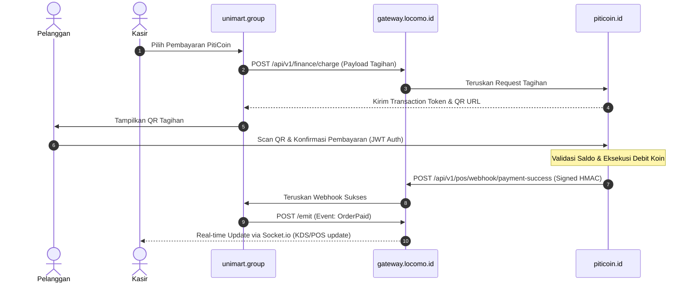
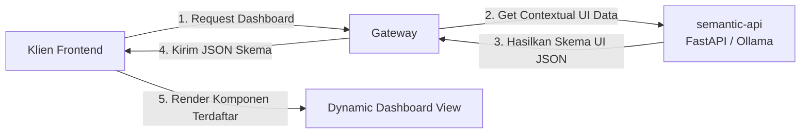

# Fondasi Arsitektur Ekosistem Locomo-OS
**Dokumen Analisis Arsitektur Sistem Terfederasi**  
*Tanggal: 16 Juli 2026*  
*Arsitek: Locomo AI Agent (Antigravity)*

---

## 1. Eksekutif Ringkasan & Visi Arsitektur

Dokumen ini mendefinisikan cetak biru (blueprint) arsitektur federasi untuk **Ekosistem Locomo-OS**. Visi utama dari ekosistem ini adalah membangun jaringan layanan digital terfederasi yang berdaulat, aman, dan modular. Layanan-layanan utama yang tercakup meliputi:
- **mandeh.id** (Identity Provider / Sistem Mediator Utama)
- **mandeh.online** (Portal Pariwisata & Reputasi)
- **unimart.group** (SaaS Kasir Pintar / POS & Asisten Bisnis)
- **piticoin.id** (Modul Ekonomi, Finansial & Loyalty Token)
- **walikelas.ai** (Platform Akademik & LMS)
- **tapakpandeka.net** (Gamifikasi Aktivitas Pemuda)

### Pendekatan Arsitektur Evolusioner (Minimalis ke Skala Besar)
Sebagai langkah awal pergerakan teknis, ekosistem ini mengadopsi **Arsitektur Minimalis Pragmatis** menggunakan kontainerisasi Docker. Prinsip dasar yang dipegang adalah **"Start Small, Think Big"**:
1. **Desain Longgar (Loosely Coupled)**: Setiap layanan berjalan di dalam container-nya sendiri dengan basis datanya masing-masing (Database-per-Service).
2. **Gateway Tunggal (Technical Gateway)**: Semua lalu lintas data, baik internal (inter-service) maupun eksternal, wajib disalurkan melalui `gateway.locomo.id`.
3. **Stateless Identity**: Autentikasi disentralisasi pada `mandeh.id` menggunakan standar industri OpenID Connect (OIDC) dan JSON Web Tokens (JWT).
4. **Kesiapan Skala Paralel (Load-Balancer Ready)**: Struktur routing dan state dirancang stateless agar siap dipasang load balancer (seperti Nginx Upstream / HAProxy) di kemudian hari tanpa mengubah logika bisnis inti.

---

## 2. Hubungan Komponen & Topologi Jaringan

Semua komunikasi di dalam ekosistem disalurkan melalui API Gateway untuk menjaga isolasi keamanan dan memudahkan pengawasan lalu lintas data.

```mermaid
graph TD
    User([Pengguna / Klien]) -->|HTTPS| Gateway[gateway.locomo.id <br/> Node.js Gateway / Nginx]
    
    subgraph Ekosistem Locomo.id (Docker Network)
        Gateway -->|Proxy 80| MandehID[mandeh.id <br/> Identity Provider - Laravel]
        Gateway -->|Proxy 80| Unimart[unimart.group <br/> SaaS POS - Laravel]
        Gateway -->|Proxy 80| Piticoin[piticoin.id <br/> Financial Module - Laravel]
        Gateway -->|Proxy 3000| WS[WebSocket Server <br/> Socket.io]
        
        %% Layanan Masa Depan
        Gateway -.->|Proxy| MandehOnline[mandeh.online]
        Gateway -.->|Proxy| Walikelas[walikelas.ai]
        Gateway -.->|Proxy| TapakPandeka[tapakpandeka.net]
    end

    %% Komunikasi Inter-Service
    Unimart -->|API Request via Gateway| Gateway
    Piticoin -->|API Request via Gateway| Gateway
    MandehID -->|JWKS Verification| Gateway
```

---

## 3. Pilar Arsitektur Inti

### Pilar 1: Identity & Access Management (IAM) - Mandeh.ID
`mandeh.id` bertindak sebagai mediator identitas tunggal berbasis OpenID Connect (OIDC).
- **Stateless Verification**: Layanan seperti `unimart.group` dan `piticoin.id` tidak perlu menanyakan keabsahan token ke database `mandeh.id` pada setiap request. Layanan dapat memverifikasi token secara mandiri (stateless) menggunakan kunci publik yang disediakan oleh endpoint JWKS (`/oauth/jwks`).
- **Alur Login (Authorization Code Grant dengan PKCE)**:
  1. Pengguna mengakses `unimart.group` dan memilih "Masuk dengan Mandeh.ID".
  2. Klien diarahkan ke `gateway.locomo.id/oauth/authorize` yang kemudian diteruskan ke `mandeh.id`.
  3. Setelah login sukses, `mandeh.id` mengeluarkan *Authorization Code*.
  4. Klien menukarkan code tersebut dengan `access_token` dan `id_token` (JWT) melalui gateway.
  5. Layanan menyimpan token secara aman (misal, secure cookie) dan menggunakan JWT payload untuk session local.

### Pilar 2: API Gateway (`gateway.locomo.id`)
Gateway teknis diimplementasikan menggunakan kombinasi Nginx (sebagai reverse-proxy terluar) dan Node.js Express/Socket.io (sebagai event broker).
- **Path & Subdomain Routing**:
  - `gateway.locomo.id/api/v1/auth/*` -> `mandeh.id`
  - `gateway.locomo.id/api/v1/pos/*` -> `unimart.group`
  - `gateway.locomo.id/api/v1/finance/*` -> `piticoin.id`
- **WebSocket Event Broker**:
  - Menyediakan saluran real-time dua arah menggunakan Socket.io.
  - Berguna untuk pembaruan status transaksi kasir secara instan, Kitchen Display System (KDS) di `unimart.group`, dan notifikasi saldo koin real-time di `piticoin.id`.
  - Protokol broadcast internal menggunakan endpoint `/emit` via POST request yang hanya dapat diakses oleh container internal.

### Pilar 3: Integrasi Transaksi Unimart.group & PitiCoin.id
Integrasi ini merupakan fokus utama saat ini, di mana koin dari `piticoin.id` dapat digunakan sebagai metode pembayaran di POS `unimart.group`.

#### Protokol Komunikasi Pembayaran (Secure Transaction Flow)
Untuk memastikan keamanan dan integritas transaksi keuangan:
1. **Delegated Payment Request**:
   - Saat checkout di `unimart.group`, kasir memilih metode pembayaran "PitiCoin".
   - Sistem memunculkan QR Code berisi payload transaksi unik (`transaction_token`).
2. **Otorisasi Pengguna (QR Scan)**:
   - Pelanggan memindai QR menggunakan aplikasi dompet mereka (yang terotentikasi via `mandeh.id` ke `piticoin.id`).
   - Aplikasi mengirimkan instruksi pembayaran ke `piticoin.id` melalui `gateway.locomo.id`.
3. **Penyelesaian Transaksi (Settlement & Webhook)**:
   - `piticoin.id` memverifikasi saldo, melakukan debit, dan mengirimkan webhook aman ke `unimart.group` melalui API Gateway.
   - Webhook ditandatangani menggunakan SHA-256 HMAC dengan shared secret key untuk menjamin keaslian data.
   - Setelah menerima webhook, `unimart.group` mengubah status pesanan menjadi lunas dan memicu broadcast WebSocket ke KDS untuk memproses pesanan.



---

## 4. Generative UI (Adaptive Frontend Interface)

Generative UI adalah pilar inovatif di mana antarmuka pengguna tidak lagi bersifat statis, melainkan dinamis dan dipersonalisasi secara cerdas berdasarkan konteks pengguna dan data transaksi.

### Cara Kerja & Alur Integrasi Generative UI
1. **Analisis Konteks**:
   Saat pengguna membuka dasbor `unimart.group` atau `piticoin.id`, data perilaku mereka (seperti riwayat pembelian, jumlah koin, dan preferensi waktu) dikirimkan ke `semantic-api` (FastAPI + Ollama Local Qwen).
2. **Generasi Skema UI**:
   LLM memproses data tersebut dan menghasilkan struktur JSON yang mendefinisikan tata letak (layout) dan komponen yang relevan (misalnya: widget rekomendasi promo menu cafe yang bisa dibeli dengan sisa koin mereka).
3. **Rendering Adaptif**:
   Aplikasi frontend (Next.js / Blade + Alpine.js) menerima JSON terstruktur tersebut dan memetakan komponen UI secara dinamis menggunakan *UI Component Registry* yang telah didefinisikan sebelumnya di frontend, mencegah eksekusi kode HTML/JS mentah secara tidak aman (mematuhi *Guardrail GR-001*).



---

## 5. Rencana Skalabilitas Paralel & Load Balancing

Untuk menjamin transisi yang mulus seiring pertumbuhan trafik, arsitektur dirancang untuk dapat ditingkatkan ke tingkat produksi (scale-up) tanpa mengganggu kode aplikasi inti.

| Komponen | Fase Awal (Minimalis) | Fase Skala Menengah | Fase Produksi Skala Besar |
| :--- | :--- | :--- | :--- |
| **Load Balancer** | Nginx Reverse Proxy tunggal dalam Docker Compose | Multiple Nginx instances dengan Keepalived (High Availability) | Cloud Load Balancer (AWS ALB / Cloudflare) + Anycast IP |
| **API Gateway** | Node.js Express tunggal di container `gateway` | Kong API Gateway / Traefik dengan auto-service discovery | Kong Enterprise / AWS API Gateway terdistribusi multi-region |
| **State & Session** | File-based session / Local Memory | Redis Cluster terpusat (Shared Cache & Session Store) | Redis Enterprise + Database replikasi read-heavy |
| **Database** | Single pgvector PostgreSQL Instance | Master-Slave Replication (Read/Write Splitting) | Sharded PostgreSQL + PgBouncer Connection Pooler |
| **Event Messaging**| HTTP Webhooks + Socket.io Emits | Redis Pub/Sub sebagai broker internal | Apache Kafka / RabbitMQ untuk Event Sourcing & CQRS |

### Langkah Transisi Tanpa Gangguan
1. **Stateless Middleware**: Pastikan semua middleware otentikasi di `unimart.group` dan `piticoin.id` hanya membaca data dari JWT payload dan tidak bergantung pada session file lokal di server.
2. **Eksternalisasi Environment Variable**: Konfigurasi endpoint koneksi (seperti URL database, key JWT, dan URL gateway) wajib dikelola melalui file `.env` di docker-compose agar dapat diganti dengan mudah saat bermigrasi ke server terpisah.
3. **Database Migration**: Gunakan UUID sebagai Primary Key di seluruh tabel data untuk menghindari tabrakan ID (ID collision) saat melakukan replikasi atau sharding database di kemudian hari.
