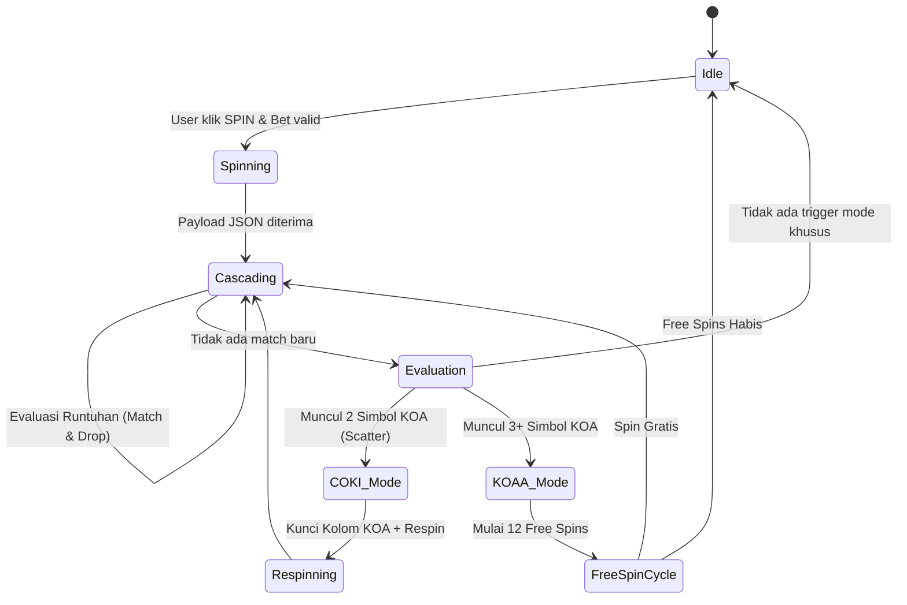

# Rencana Arsitektur Sistem: Slot KOA Mini-Game (V2)
**Dokumen Analisis Arsitektur & Desain Rekayasa Mini-Game**  
*Proyek: piticoin.id*  
*Tanggal: 16 Juli 2026*  
*Arsitek: Locomo AI Agent (Antigravity)*

---

## 1. Pendahuluan & Identitas Visual Minangkabau

### 1.1 Latar Belakang Game
**Slot KOA** adalah bagian dari ekosistem gamifikasi **PitiCoin.id** yang didesain sebagai instrumen deflasi Koin Perak paling adiktif. Game ini mengadaptasi permainan kartu tradisional Minangkabau (KOA) ke dalam mekanika slot modern berformat *Cascading Grid 5x5*.

### 1.2 Budaya Tradisional vs Estetika Modern (Visual Identity)
Untuk memberikan identitas visual yang khas dan membedakan produk dari tema slot Asia (Tiongkok/Naga Emas) yang generik, Slot KOA menerapkan panduan **Visual Identity Minangkabau**:
- **Ukiran & Ornamen Bingkai**: Mengganti ornamen naga dengan motif tradisional Minang seperti **Pucuak Rabuang** (melambangkan kekuatan pertumbuhan), **Aka Cino Sagagang** (melambangkan kelenturan dan adaptasi), dan **Awan Larat** (melambangkan keharmonisan).
- **Latar Belakang**: Memadukan warna hitam pekat bertekstur arang dengan ukiran emas menyala khas rumah gadang.
- **Peti & Aset Efek**: Efek kemenangan menampilkan pola kilau emas berbentuk ukiran Minang yang mengembang sesaat sebelum memudar, dipadukan dengan pemuatan aset kartu KOA asli Minang yang diurai melalui *Atlas Pipeline*.

---

## 2. Arsitektur Komponen & Alur Kerja Sistem

Sistem ini memisahkan secara ketat tanggung jawab antara frontend (Visual Agent) dan backend (Deterministic RNG & Financial Ledger).

```mermaid
graph TD
    User([Pengguna / Browser Mobile]) -->|1. Request Spin| Gateway[gateway.locomo.id]
    Gateway -->|2. Forward Spin Request| BE[piticoin.id Backend - Laravel]
    
    subgraph Backend Engine (Deterministic & Secure)
        BE -->|3. Validasi & Potong Saldo| DB[(PostgreSQL Database)]
        BE -->|4. Hitung RNG & Pola Runtuhan| RNG[Deterministic RNG Engine]
        BE -->|5. Hitung Buff & Limit Pool| Pool[Gunung Mas Pool Engine]
    end

    RNG -->|6. Kirim JSON Payload Runtuhan| Gateway
    Gateway -->|7. Animasikan Grid & Efek| FE[PixiJS Frontend Engine]
```

### 2.1 Skema JSON Payload Hasil Roll (Backend -> Frontend)
Payload JSON dikirimkan secara instan di milidetik pertama putaran. Klien (PixiJS) bertugas mengurai array 2D ini menjadi animasi jatuhnya kartu secara beruntun (*cascading*):

```json
{
  "success": true,
  "transaction_id": "tx_koa_9823019823",
  "bet_amount": 100,
  "remaining_perak": 4900,
  "multiplier_total": 4,
  "total_win_emas": 4.0,
  "free_spin_triggered": false,
  "free_spins_left": 0,
  "cascading_steps": [
    {
      "step": 1,
      "grid": [
        ["card_hiu", "card_babi", "card_hiu", "sym_wild", "card_coki"],
        ["card_babi", "card_hiu", "card_coki", "card_hiu", "card_babi"],
        ["card_coki", "card_hiu", "card_babi", "sym_wild", "card_hiu"],
        ["card_hiu", "card_babi", "card_hiu", "card_coki", "card_babi"],
        ["card_babi", "card_hiu", "card_coki", "card_hiu", "card_hiu"]
      ],
      "matches": [
        {"symbol": "card_hiu", "coordinates": [[0,0], [0,2], [1,1]], "payout_emas": 1.0}
      ],
      "multiplier": 1
    },
    {
      "step": 2,
      "grid": [
        ["new_card_1", "new_card_2", "card_hiu", "sym_wild", "card_coki"],
        ["card_babi", "new_card_3", "card_coki", "card_hiu", "card_babi"],
        ["card_coki", "card_hiu", "card_babi", "sym_wild", "card_hiu"],
        ["card_hiu", "card_babi", "card_hiu", "card_coki", "card_babi"],
        ["card_babi", "card_hiu", "card_coki", "card_hiu", "card_hiu"]
      ],
      "matches": [
        {"symbol": "card_coki", "coordinates": [[1,2], [2,0], [4,2]], "payout_emas": 3.0}
      ],
      "multiplier": 2
    }
  ]
}
```

---

## 3. Logika Backend & Deterministic RNG Lifecycle

### 3.1 Siklus Hidup Spin & Validasi
Setiap transaksi putaran dilakukan dalam satu *database transaction* terisolasi untuk mencegah eksploitasi ganda (*race conditions*):
1. **Pessimistic Locking**: Mengunci baris data saldo pengguna (`SELECT ... FOR UPDATE`).
2. **Validasi Saldo**: Memotong taruhan koin perak sesuai besaran bet. Jika kurang, kembalikan response error 400.
3. **Penerapan Buff**: Memeriksa kepemilikan NFT KTA (Kartu Tanda Anggota) atau item aktif untuk meningkatkan probabilitas kemenangan (RTP buff).
4. **Jackpot Cap Limit**:
   - Membaca saldo total **Pool Gunung Mas**.
   - Kemenangan per putaran dibatasi maksimal **35% dari saldo Pool Gunung Mas** aktif untuk menjaga kestabilan ekonomi.
5. **RNG Roll**: Menghasilkan angka acak antara 0 hingga batas maksimum kemenangan.
6. **Reverse Pattern Mapping**:
   - Memetakan angka acak kemenangan tersebut menjadi daftar runtuhan kartu yang cocok secara matematis.
   - Menghasilkan payload JSON di atas.

---

## 4. Mekanika Grid Cascading & State Machine

Game diatur sebagai State Machine yang beroperasi di frontend, disinkronkan dengan payload dari backend.



### 4.1 Pembagian Ruang Grid Visual 5x5 (25 Kartu)
- **11 Slot (Tengah & Bawah - Pola V)**: Merepresentasikan **Hand** (Kartu di tangan pemain). Area ini diberi efek *glowing overlay* warna perunggu/emas hangat.
- **14 Slot (Atas & Samping)**: Merepresentasikan **Discard Pile** (Kartu buangan). Diberi efek bayangan/redup (*shadowed/muted opacity*).

### 4.2 Matriks Combo Multiplier
Runtuhan beruntun memberikan pelipat gandaan kemenangan yang terus meningkat:
- **Runtuhan 1**: Multiplier **x1** (Normal) | **x2** (Free Spin KOAA). Efek suara benturan kayu/koa hancur.
- **Runtuhan 2**: Multiplier **x2** (Normal) | **x4** (Free Spin KOAA). Efek panel multiplier menyala berapi.
- **Runtuhan 3**: Multiplier **x4** (Normal) | **x6** (Free Spin KOAA). Efek kilatan petir menyambar bingkai.
- **Runtuhan 4+**: Multiplier **x5** (Normal) | **x10** (Free Spin KOAA). Pemicu otomatis penjatuhan **Simbol KOA (Scatter)** ke dalam grid.

### 4.3 Logika State Khusus: COKI & K.O.AA
- **STATE: COKI (Tension Mode)**:
  - Dipicu tepat **2 Simbol KOA** di layar.
  - *Mekanika*: Dua kolom berisi simbol KOA dikunci dengan efek rantai besi dan ornamen **Aka Cino** (`sym_lock`). Kolom lainnya berputar respin gratis 1x.
  - *UX Audio-Visual*: Layar meredup fokus ke area respin, tempo musik beralih ke tabuhan Gandang Tasa intensitas tinggi, jatuhnya kartu melambat (*slow-drop effect*).
- **STATE: K.O.AA (Free Spin Mode)**:
  - Dipicu oleh **3+ Simbol KOA** (baik langsung atau dari respin COKI).
  - Memberikan **12 Putaran Gratis**.
  - Kemenangan langsung masuk ke **Kuota Emas Tambang** yang dapat diklaim melalui mekanisme pembakaran koin perak.

---

## 5. Implementasi Mandalomics & Engine Pembakaran (Burn)

Mekanisme ini mencegah inflasi koin di ekosistem dengan mewajibkan pembakaran (*burn*) koin perak untuk mencairkan koin emas.

### 5.1 Rumus Konversi & Transaksi Keuangan
1. **Nilai Tukar**:  
   $$1 \text{ Koin Emas} = \text{Rp 1.000} \quad || \quad 100 \text{ Koin Perak} = 1 \text{ Koin Emas}$$
2. **Klaim Emas (Burn Engine)**:
   Setiap kali pengguna mengklik **[KLAIM EMAS]** untuk mencairkan koin emas dari kuota hasil game ke Brankas Emas:
   $$\text{Koin Perak yang Wajib Dibakar} = \text{Kuota Emas yang Diklaim} \times 100$$
   - Jika `saldo_perak >= perak_dibakar`, sistem memotong koin perak selamanya (burned) dan menambahkan saldo emas ke Brankas Emas.
   - Jika tidak, tampilkan error "Saldo Perak tidak cukup untuk membakar Kuota Emas".

---

## 6. Desain Mobile-First & Responsif (100dvh)

Layout didesain tanpa scrollbar browser untuk memastikan kenyamanan pengguna di perangkat mobile dengan memanfaatkan CSS dinamis.

### 6.1 Layout Portrait & Landscape

#### Mode Portrait (Vertical Stack)
```
┌──────────────────────────────────────────┐
│   [ GOLD POOL: 🪙 10,000.00 EMAS ]        │  --> HUD Atas (Global Pool)
├──────────────────────────────────────────┤
│                                          │
│              GRID SLOT KOA               │
│                   5 x 5                  │  --> Centerpiece (Dominan 63% Layar)
│                                          │
├──────────────────────────────────────────┤
│  🥈 Saldo Perak: 5,000                   │  --> Dashboard Ekonomi Personal
│  🪙 Kuota Klaim: 25.00  [ KLAIM EMAS ]   │  --> Tombol Crimson Red
├──────────────────────────────────────────┤
│   [ 100 ] [ 500 ] [ 1K ]     (( SPIN ))  --> Footer Kontrol & Tombol Putar
└──────────────────────────────────────────┘
```

#### Mode Landscape (Side-by-Side Flex)
```
┌───────────────────────────────────┬──────────────────────────────────────┐
│                                   │    [ GOLD POOL: 🪙 10,000.00 EMAS ]   │
│                                   ├──────────────────────────────────────┤
│           GRID SLOT KOA           │   🥈 Saldo Perak: 5,000              │
│               5 x 5               │   🪙 Kuota Klaim: 25.00              │
│        (Dominan Kiri 60%)         │   🏦 Brankas Vault: 120.00 EMAS      │
│                                   ├──────────────────────────────────────┤
│                                   │   [ KLAIM EMAS ]        (( SPIN ))   │
└───────────────────────────────────┴──────────────────────────────────────┘
```

### 6.2 Implementasi Kustom CSS Premium
- **Glassmorphism Panels**:
  ```css
  .panel-premium {
    background: linear-gradient(135deg, rgba(255, 255, 255, 0.08) 0%, rgba(0, 0, 0, 0.35) 100%);
    border: 1px solid rgba(255, 255, 255, 0.15);
    backdrop-filter: blur(12px);
    box-shadow: inset 0 1px 1px rgba(255, 255, 255, 0.1);
  }
  ```
- **Shine Sweep Loop (Claim Button)**:
  ```css
  @keyframes shine {
    100% { left: 125%; }
  }
  .btn-burn-crimson::after {
    content: '';
    position: absolute;
    top: 0; left: -75%; width: 50%; height: 100%;
    background: linear-gradient(to right, rgba(255, 255, 255, 0) 0%, rgba(255, 255, 255, 0.4) 50%, rgba(255, 255, 255, 0) 100%);
    transform: skewX(-25deg);
    animation: shine 4s infinite;
  }
  ```
