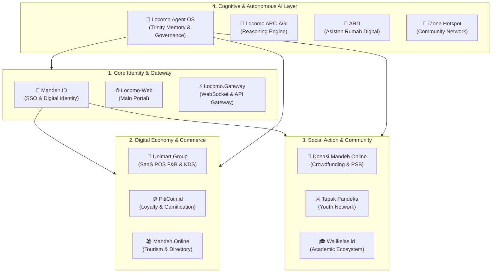

# 🌐 Locomo Federated Ecosystem (`locomo.id`)

> **Sistem Operasi Sosial & Ekosistem Layanan Kedaulatan Digital Terfederasi**

Ekosistem **Locomo.id** adalah platform digital multi-modul terintegrasi yang dirancang untuk memperkuat kedaulatan digital masyarakat lokal, memajukan sektor ekonomi kreatif & UMKM, membangun tata kelola komunitas yang cerdas (*Smart-Citizen*), serta mengintegrasikan kecerdasan buatan otonom (*Autonomous AI Agent*) di tingkat ekosistem.

---

## 🏛️ Arsitektur Ekosistem & Peta Proyek

Ekosistem Locomo dibangun di atas pendekatan **Federated Monorepo** yang terbagi ke dalam 4 pilar fungsional utama:



---

## 📂 Uraian Lengkap Modul & Sub-Proyek

### 1. Fondasi Identitas, Gateway & Web Portal (`Core Layer`)
* **[`mandeh.id`](./mandeh.id)**:  
  *Gateway Identitas Digital & SSO (Single Sign-On)* terdesentralisasi. Berfungsi sebagai penyedia autentikasi terpadu (*Stateless JWT token*) bagi seluruh layanan ekosistem, mengelola reputasi warga, wisatawan, serta pemilik bisnis tanpa silo data.
* **[`locomo-web`](./locomo-web)**:  
  Portal landing page utama dan pintu gerbang informasi publik bagi ekosistem federasi Locomo.ID.
* **[`locomo.gateway`](./locomo.gateway)**:  
  Jembatan komunikasi berkecepatan tinggi berbasis *WebSocket* dan *API Gateway* yang menghubungkan pesan asinkron, streaming data, dan interaksi real-time antar proyek di ekosistem.

---

### 2. Ekonomi Digital, Perdagangan & Pariwisata (`Economic Engine`)
* **[`unimart.group`](./unimart.group)**:  
  Platform *SaaS Multi-Tenant Kasir Pintar (POS)*, Kitchen Display System (KDS), manajemen meja, dan asisten bisnis pintar yang dikhususkan untuk industri kuliner (Kafe / F&B) dan UMKM. Mengusung arsitektur *Skinny Controller, Fat Service* dengan isolasi tenant yang ketat.
* **[`piticoin.id`](./piticoin.id)**:  
  Sistem poin transaksi mikro, tokenisasi loyalitas, dan gamifikasi komunitas berbasis web. Mengintegrasikan pelestarian budaya tradisional melalui digitalisasi permainan lokal seperti kartu Koa (Ceki).
* **[`mandeh.online.v2`](./mandeh.online.v2)**:  
  Portal pariwisata terpadu, direktori UMKM lokal, sistem ulasan berbasis reputasi, dan panduan destinasi wisata kawasan pesisir (Mandeh & sekitarnya).

---

### 3. Komunitas, Filantropi & Edukasi (`Social & Community Layer`)
* **[`donasi.mandeh.online`](./donasi.mandeh.online)**:  
  Platform penggalangan dana kemanusiaan (*crowdfunding*) dan transparansi filantropi warga, digunakan secara aktif untuk inisiatif sosial seperti Gerakan Merdeka Berbagi dan Program Sosial Mandeh.
* **[`tapak.pandeka`](./tapak.pandeka)**:  
  Platform jaringan kepemudaan dan komunitas pemuda mandiri berbasis kearifan lokal untuk pembentukan karakter, koordinasi organisasi pemuda, dan kolaborasi kegiatan kemasyarakatan.
* **[`walikelas.id`](./walikelas.id)**:  
  Modul ekosistem akademik interaktif yang menghubungkan guru, siswa, wali murid, dan institusi sekolah guna memantau perkembangan belajar serta administrasi kelas.

---

### 4. Lapisan Kognitif, Kecerdasan Buatan & Infrastruktur Jaringan (`Cognitive & AI Layer`)
* **[`locomo.agent`](./locomo.agent)** & **`.antigravity/`**:  
  *Sistem Operasi Agen Otonom (Locomo Agent OS)*. Menyediakan memori kognitif *Trinity* (`id.json` untuk guardrails arsitektur, `cortex-core.json` untuk status siklus eksekusi, dan `project-context.json` untuk konteks bisnis aktif) guna mengatur orkestrasi bot/asisten otonom.
* **[`locomo.arc-agi`](./locomo.arc-agi)**:  
  Sub-sistem riset dan mesin penalaran berbasis *Abstraction and Reasoning Corpus (ARC)* untuk melatih kapabilitas penalaran logis tingkat lanjut agen AI.
* **[`ard.asisten-rumah-digital`](./ard.asisten-rumah-digital)**:  
  Riset dan pengembangan asisten rumah digital cerdas berbasis AI lokal untuk otomasi dan bantuan personal di ranah rumah tangga.
* **[`izone.hotspot`](./izone.hotspot)**:  
  Modul manajemen gerbang akses jaringan nirkabel (hotspot gateway) komunitas untuk penyediaan konektivitas internet publik yang terhubung dengan akun Mandeh.ID.

---

## 🛠️ Spesifikasi Teknologi & Arsitektur

| Komponen | Teknologi yang Digunakan |
| :--- | :--- |
| **Backend Framework** | Laravel 11 / Laravel 13, Python FastAPI |
| **Frontend Stack** | Blade, TailwindCSS, Inertia.js, React / Alpine.js |
| **Database & Vector** | PostgreSQL 16+ dengan ekstensi `pgvector` |
| **AI / Machine Learning** | Ollama Local Engine, Model Penalaran Mandiri, Embeddings API |
| **Infrastruktur & Orkestrasi** | Docker & Docker Compose (`compose.yaml`) |
| **Protokol Komunikasi** | RESTful API (API-First), WebSocket Event Stream |

---

## 🚀 Panduan Menjalankan Lingkungan (Docker-Only)

Sesuai aturan operasional ekosistem, seluruh eksekusi aplikasi berjalan di dalam kontainer Docker:

1. **Clone Repositori**:
   ```bash
   git clone https://github.com/LocomoIndonesia/locomo-ecosystem.git locomo.id
   cd locomo.id
   ```

2. **Siapkan Konfigurasi Lingkungan**:
   Salin `.env.example` ke `.env` pada modul yang akan dijalankan (misal: `unimart.group`, `mandeh.id`).

3. **Jalankan Orkestrasi Kontainer**:
   ```bash
   docker compose up -d
   ```

4. **Eksekusi Perintah Framework (Di dalam Container)**:
   * Menjalankan migrasi Laravel:
     ```bash
     docker compose exec app php artisan migrate
     ```
   * Menjalankan Semantic API Python:
     ```bash
     docker compose exec semantic-api python3 main.py
     ```

---

## 🔒 Kebijakan Keamanan & Kontribusi
- **Kerahasiaan Kredensial**: Seluruh file `.env`, sertifikat SSL/TLS, dan token rahasia difilter melalui [`.gitignore`](./.gitignore). Jangan pernah melakukan *hardcode* kunci rahasia pada kode sumber.
- **Standar Database**: Wajib menggunakan prepared statement atau Eloquent ORM untuk mencegah kerentanan SQL Injection.
- **Isolasi Multi-Tenant**: Seluruh kueri pada modul multi-tenant (seperti Unimart) wajib melewati scope tenant (`TenantScope`).

---

<p align="center">
  <b>Locomo Federated Ecosystem</b> • Dikembangkan dengan kedaulatan digital untuk kemajuan bersama.<br/>
  © 2026 Locomo Indonesia. All rights reserved.
</p>
