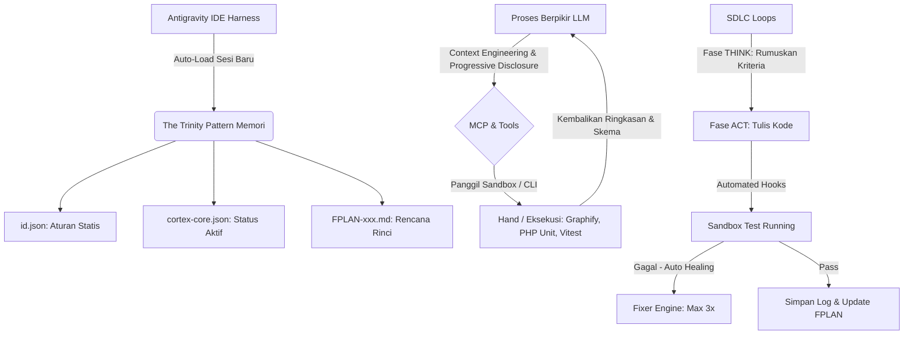

# GRAND DESIGN ARSITEKTUR: LOCOMO AGENT OS (V2.0)
## Penyelarasan dengan Google AI Playbook (SDLC Era AI)

**Versi OS:** 10.0.0-beta (AI-SDLC Compliant)  
**Harness IDE:** Antigravity IDE  
**Penyusun:** AntiGravity AI & User (The Orchestrator)  
**Tanggal:** 28 Juni 2026  

---

## 1. PENGANTAR & TUJUAN EVOLUSI
Pengembangan perangkat lunak tradisional di era AI sering kali mengalami masalah inefisiensi token (pembengkakan biaya), hilangnya memori antar sesi obrolan (*chat amnesia*), dan ketergantungan berlebih pada arahan manual manusia (*vibe coding*). 

Untuk menyelaraskan dengan **Google AI Playbook**, Locomo Agent OS bermigrasi dari sistem reaktif berbasis instruksi tunggal menjadi **Sistem Operasi Agen Otonom Tersinkronisasi berbasis Agentic Engineering**. Arsitektur V2.0 memfokuskan pengembangan pada efisiensi finansial (*Context Engineering*), kemandirian eksekusi (MCP/RCE), stabilitas memori (*The Trinity Pattern*), jaminan kualitas terprogram (*Evals & Checkpoints*), serta standarisasi distribusi lewat **Sistem Master CLI**.

---

## 2. PILAR UTAMA ARSITEKTUR LOCOMO AGENT OS V2.0



### 2.1 Sistem Memori Persisten (The Trinity Pattern)
Guna mengatasi masalah *chat amnesia* (hilangnya memori antar sesi), Antigravity IDE (sebagai *harness*) secara otomatis membaca dan menyuntikkan tiga lapis dokumen keadaan (*state files*) di awal sesi obrolan baru. Pembagian terstruktur ini memastikan agen memiliki kesadaran penuh tentang di mana mereka berada dan apa yang harus dilakukan tanpa perlu mengulang instruksi dari awal:

1. **`id.json` (Konteks Statis / Identitas & Batasan Proyek)**: Berisi informasi peran utama, *guardrails*, dan aturan arsitektur teknis inti. Konteks ini bersifat statis dan jarang berubah.
2. **`cortex-core.json` / `local.json` (Konteks Dinamis / Sejarah & Status Aktif)**: Merekam fase kerja aktif (contoh: `[PHASE 3: ACT] - Refactoring JWT SSO`), target prioritas, dan ringkasan keadaan berjalan. Jika rekam jejak memori terlalu panjang, log terlama otomatis dikompresi menjadi *vector embeddings* di database *pgvector* (`semantic-api`).
3. **`FPLAN-xxx.md` (Rencana Alur Kerja / Incremental Flow Plans)**: Rencana alur kerja langkah-demi-langkah. Setiap kali satu fase SDLC selesai, agen memperbarui berkas ini sehingga sesi berikutnya dapat langsung melanjutkan pengerjaan tanpa kehilangan konteks.

### 2.2 Efisiensi Finansial (Context Engineering & Progressive Disclosure)
Mencegah terjadinya *Token Overflow* dan pembengkakan biaya API secara ekstrem. LLM dilarang memuat seluruh kode sumber atau skema database di awal sesi. Dengan menerapkan *Progressive Disclosure* dan *Lazy Loading*, agen tidak lagi dijejali ribuan baris kode mentah secara sekaligus. Sebagai gantinya, agen hanya membaca peta meta kode (`Graphify`) dan menarik referensi/data spesifik via RAG (`pgvector`) saat benar-benar dibutuhkan.

### 2.3 Pemisahan "Otak" dan "Tangan" (MCP/RCE)
Memisahkan fungsi penalaran (LLM sebagai Otak) dan eksekusi (Antigravity IDE/Docker sebagai Tangan) dengan menggunakan *Model Context Protocol* (MCP). LLM memerintahkan eksekutor latar belakang (seperti AST Scanner, PHP Unit, dll.) untuk menjalankan pengujian atau membedah kode. Tangan eksekutor kemudian hanya mengembalikan **ringkasan (*summary*)** dan **skema/struktur data** ke Otak LLM. Pemisahan ini membuat kerja agen menjadi sangat deterministik, aman, dan menjaga lingkungan berpikir tetap tajam.

### 2.4 Sabuk Pengaman Evaluasi (Evals & Hooks)
Menerapkan disiplin *Agentic Engineering* secara ketat untuk jaminan kualitas terprogram:
* **Pre-declared Acceptance Criteria**: Di Fase 1 (THINK), agen *Architect* wajib merumuskan kriteria pengujian sebelum baris kode pertama ditulis.
* **Automated Hooks Sandbox**: Setelah agen *Coder* menulis kode, Antigravity secara deterministik memblokir respon langsung ke *User* dan memicu skrip pengujian otomatis di lingkungan isolasi (`scratch/` sandbox).
* **Auto-Healing Loop (Max Retries = 3)**: Adanya loop perbaikan mandiri dengan batasan `MAX_RETRIES = 3` memastikan agen tidak membuang-buang token saat terjebak dalam error (halusinasi kode). *User* (*Human-in-the-Loop*) hanya dipanggil ketika agen telah lulus evaluasi atau ketika batas percobaan habis dan memerlukan eskalasi kegagalan.

### 2.5 Intelligent Model Routing
Sistem dikonfigurasi untuk manajemen biaya API ekstrem dengan memilih model LLM sesuai beban tugas:
* **Tinggi (High-Cognitive)**: Model premium (seperti Gemini Pro atau Claude Opus) dialokasikan untuk perancangan arsitektur sistem (`id.json`/`FPLAN`), solusi bug kritikal, dan integrasi kompleks.
* **Menengah/Rendah (Routine)**: Model lokal atau model Flash (seperti Gemini Flash atau Llama-3 8B) dialokasikan untuk tugas rutin seperti meringkas log eror, *routing* modul, dan *review* sintaks. Penggunaan model yang tepat sasaran ini menghemat biaya API secara signifikan.

---

## 3. RANCANGAN SISTEM "MASTER" LOCOMO OS (INSTALLER & UPDATER)

Agar Locomo Agent OS dapat diinstalasi pada proyek baru atau diperbarui pada proyek berjalan dengan rapi, sistem dienkapsulasi menjadi **Sistem Paket Global Berbasis CLI (`locomo-cli`)**. Sistem master ini menyimpan template inti dari direktori `.antigravity/` dan mendistribusikannya ke berbagai proyek.

### 3.1 Mekanisme Instalasi Proyek Baru (`locomo init`)
Saat perintah `locomo init` dijalankan di direktori kosong, Master OS secara otomatis melakukan tugas inisiasi cerdas berikut:
1. **Membangun Struktur Kognitif**: Membuat struktur direktori `.antigravity/` beserta sub-folder pendukungnya secara otomatis (`skills/`, `docs/`, `brain/`, `scratch/`, dan `cortex/`).
2. **Menyuntikkan Kernel (Immutable)**: Menyalin prompt sistem, instruksi peran persona (*Architect*, *Coder*, *Tester*), dan skrip *Hooks*/*Evals* dari Master ke dalam folder `skills/`.
3. **Membuat Berkas Identitas Dasar**: Menghasilkan berkas `id.json` kosong yang siap diisi dengan parameter spesifik proyek baru.

### 3.2 Mekanisme Pembaruan Sistem (`locomo upgrade`)
Ketika dilakukan pembaruan versi Locomo Agent OS (misalnya dari v10.0.0 ke v10.1.0), sistem akan menerapkan **Safe Merge Protocol**:
* **Safe Merge (Pembaruan Aman)**: Hanya akan menimpa dan memperbarui folder `skills/` (mesin/kernel utama) dan menyesuaikan skema `cortex-core.json`.
* **Melindungi Memori Proyek**: Folder `docs/` (pengetahuan domain proyek), `brain/` (memori vektor/pgvector), dan direktori kode sumber utama **sama sekali tidak disentuh**. Langkah ini menjamin konteks dan progres proyek yang sedang berjalan tidak akan hilang.

### 3.3 Kemampuan Inisiasi Awal & Bootstrapping (Starter Kits)
Agar Locomo Agent OS bisa langsung bekerja secara efisien pada proyek baru, Master OS dilengkapi dengan kemampuan inisiasi kebutuhan pengembangan (*Bootstrappers*). Saat OS diinstal, agen *Architect* langsung melakukan wawancara singkat dengan Anda (The Orchestrator) untuk menyiapkan infrastruktur proyek:
1. **Auto-Scaffolding Tech Stack**: Berdasarkan instruksi bahasa alami (Misal: *"Buatkan proyek e-commerce dengan Laravel 13, Vue.js, dan Redis"*), agen *Architect* otomatis mengunduh image Docker yang sesuai, merancang file `docker-compose.yml` di dalam folder `scratch/`, dan memverifikasinya sebelum dipindahkan ke direktori utama.
2. **Auto-Generation FPLAN-001.md**: Setelah tumpukan teknologi disepakati, *Architect* langsung menulis `FPLAN-001.md` (Flow Plan) yang berisi langkah kerja bertahap, contohnya:
   - *Step 1: Setup Database & Migrations.*
   - *Step 2: Setup SSO Authentication.*
   - *Step 3: Build Product Catalog API.*
3. **Injeksi Guardrails Spesifik**: Sistem otomatis mengisi file `id.json` dengan larangan (*guardrails*) spesifik bahasa pemrograman yang digunakan. Sebagai contoh, jika proyek menggunakan PHP/Laravel, agen dilarang menggunakan fungsi `eval()` dan diwajibkan menggunakan Eloquent ORM untuk mencegah SQL Injection.
4. **Membangun Peta Memori Awal (AST)**: Jika proyek menggunakan kerangka kerja atau template kode yang sudah ada, Tangan eksekutor (Antigravity IDE) langsung memindai struktur (`Graphify`) dan menyuntikkannya ke pgvector sebagai *Dynamic Context* awal.

---

## 4. STRUKTUR DIREKTORI OS (`.antigravity/`)

Struktur arsitektur V2.0 dirancang untuk memisahkan fungsi memori *Trinity*, logika statis, dan eksekutor otomatis:

```
.antigravity/
├── SKILL.md                 # Protokol CLI, onboarding otomasi, dan shutdown
├── skills.json              # Pemetaan file role agent dan kernel dasar
├── id.json                  # [TRINITY 1] Identitas, Tech Stack, & Guardrails Mutlak
├── cortex/
│   ├── cortex-core.json     # [TRINITY 2] State mesin aktif & tracking fase
│   ├── decisions.jsonl      # Log histori keputusan arsitektur (disinkronkan ke pgvector)
│   └── conflicts.jsonl      
├── docs/
│   ├── project-context.json # Data stakeholders dan konteks entitas
│   └── fplans/              # [TRINITY 3] Incremental Flow Plans (FPLAN-001.md, dsb.)
├── brain/
│   └── cognitive_memories   # Lokasi penyimpanan persisten pgvector
├── scratch/                 # Sandbox pengujian kode / kontainer scaffolding sementara
├── skills/
│   ├── kernel.md            # Aturan orkestrasi 4 makro-fase (THINK, SYNC, ACT, REFLECT)
│   ├── roles/               # Instruksi persona spesifik (Architect, Coder, Fixer, Tester)
│   ├── roms/                # Pemetaan environment & docker routing
│   └── hooks/               # [NEW] Skrip evaluasi deterministik (Post-Execution Evals)
└── drivers/                 # Container runtime (Ollama, Semantic-API, PGVector)
```

---

## 5. KESIMPULAN & POSISI PENGGUNA (THE ORCHESTRATOR)
Melalui arsitektur Master Locomo Agent OS V2.0, *User* diposisikan murni sebagai **The Orchestrator**. 

Dengan arsitektur Master ini, Anda tidak perlu lagi menyalin prompt secara manual dari satu proyek ke proyek lain. Anda cukup memanggil `locomo init`, menjawab beberapa pertanyaan dari agen *Architect*, menyetujui *Flow Plan* (`FPLAN`), dan membiarkan armada agen (*Swarm Roles*) mulai menulis, menguji, dan mengevaluasi kode di bawah pengawasan Anda secara asinkron. Sistem secara otomatis menyusun langkah kerja, menulis kode, memverifikasi kodenya sendiri di sandbox, memperbaiki bug, dan merekam kesimpulan ke otak memori. Peran Anda adalah melakukan injeksi strategis tingkat tinggi, menyetujui *Flow Plan*, dan bertindak sebagai penjaga gerbang akhir (*Final Gatekeeper*).