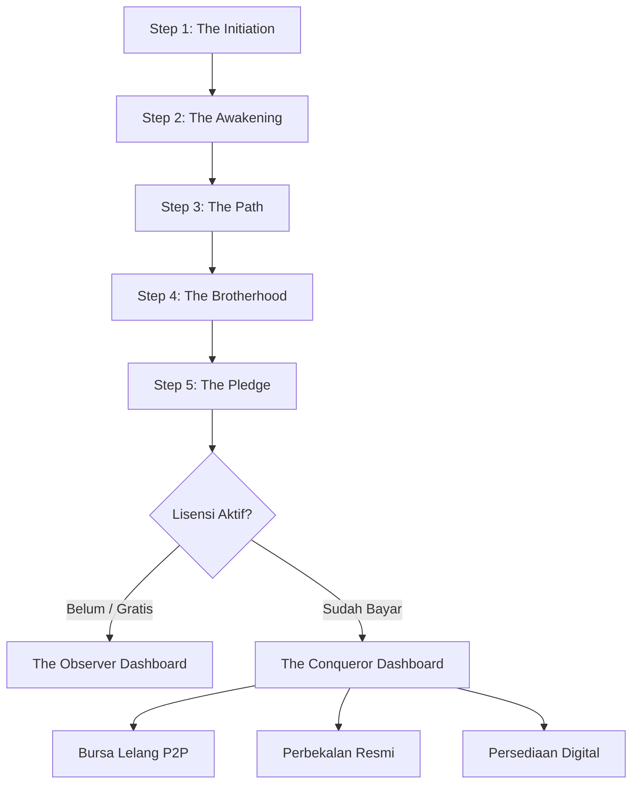

# Analisis Mendalam Arsitektur Sistem & UI/UX Game PitiCoin.id
*Dokumen ini menganalisis dokumen Grand Design Arsitektur Sistem dan seluruh file di folder `stitch_piticoin_treasury_expedition_dashboard`.*

---

## 1. Konsep Dasar & Narasi Game PitiCoin.id
PitiCoin.id dirancang bukan sekadar platform investasi atau afiliasi (MLM/PPOB) biasa, melainkan sebuah **Dunia Virtual (Metaverse) berbasis teks dan UI/UX interaktif** dengan kedalaman sosiologis dan ekonomi. 

### Visi & Rekayasa Perilaku (Behavioral Engineering)
* **Rehabilitasi Perilaku:** Game ini secara sengaja menggunakan elemen psikologis adiktif mirip judi online (seperti spinner, slot, dan gacha) tetapi dengan tujuan positif: **mengalihkan kecanduan merusak menjadi kecanduan produktif** yang membangun ekonomi digital lokal.
* **Closed-Loop Economy:** Seluruh perputaran uang dan koin diatur dalam sistem tertutup untuk mencegah inflasi, di mana Koin Perak (Utility) harus diperoleh dari "kerja keras" (menyelesaikan misi nyata) sebelum dapat diubah menjadi Koin Emas (RWA/Liquid) yang bisa dicairkan ke Rupiah.

### Tribalisme & Kelas Karakter (RF Online-inspired)
* **Faksi (Bangsa):** Pemain bersumpah setia pada salah satu dari tiga bangsa:
  1. **Nisnas (Spiritual/Alam):** Fokus pada retensi harian melalui mekanika merawat telur peliharaan (*pet/animus*). Mendapat buff `+5% Drop Rate Telur Langka`.
  2. **Manusia (Akal/Mesin):** Fokus pada strategi. Menggunakan *Iron Suit (MAU)* yang memerlukan bahan bakar Koin Perak (*sink* inflasi). Mendapat buff `-5% Biaya Upgrade Iron Suit`.
  3. **Android (Teknologi/Efisiensi):** Karakter pencari profit murni/sales. Mendapat buff `+2% Kecepatan Pemrosesan Modal`.
* **Kelas/Peran:** Pendekar (melee), Ranger (ranged/pengintai), Spesialis (teknologi/pet), dan Mentalist (sihir/pengajar).

---

## 2. Arsitektur Tokenomics & Siklus Ekonomi

Sistem ini didasarkan pada dua jenis koin dengan nilai tukar tetap yang dikunci di database:

| Jenis Koin | Konversi Nilai | Sifat & Fungsi |
| :--- | :--- | :--- |
| **Koin Emas** (Liquid/RWA) | 1 Emas = Rp 1.000 | Dapat ditarik (*withdraw*) ke rekening bank atau dibelanjakan untuk utilitas nyata (PPOB seperti pulsa/token listrik). |
| **Koin Perak** (Utility/In-Game) | 100 Perak = 1 Emas (Rp 10) | Tidak bisa ditarik. Digunakan untuk *Staking* (jaminan misi) dan modal bermain mini-games/spinner. |

### Mekanika Staking & Loss Aversion (Misi Utama)
Misi nyata (seperti mendaftarkan warung di *Unimart*, merekrut guru di *Walikelas*, atau memetakan wisata di *Mandeh.online*) memerlukan **Staking Koin Perak** sebagai jaminan. 
* Jika misi **berhasil** dalam waktu tertentu: Jaminan dirilis + hadiah Koin Emas dicairkan.
* Jika misi **gagal/habis waktu**: Koin Perak yang di-stake **hangus** (*burned*) masuk ke Peti Gunung Mas. Ini memanfaatkan psikologi *Loss Aversion* (ketakutan kehilangan modal) agar agen aktif di lapangan.

### Pembakar Koin (Utility Sinks) untuk Mencegah Inflasi
1. **Spinner (Roda Nasib):** Taruhan 500 Koin Perak untuk mendapatkan peluang Jackpot (10 Koin Emas), item buff, atau Zonk (koin diserap sistem).
2. **Slot (Penambang Gila):** Taruhan 100 Koin Perak sekali gali. Visual beliung memukul dinding batu untuk mencari permata (Koin Emas).
3. **Baccarat PvP (Duel Saudagar):** Taruhan 1.000 Koin Perak per pemain. Pemenang mendapat 1.900 Perak, 100 Perak dibakar sebagai pajak meja.
4. **Pusat Lelang P2P:** Transaksi antar pemain dikenakan pajak sistem 10% (koin dibakar).
5. **Persediaan Digital:** Konversi Koin Emas menjadi pulsa/token listrik nyata melalui proses "Lebur Koin" (*burn*).

### Growth Hack (Hak Istimewa Saudagar)
Untuk menjaga replikasi jaringan secara organik, fitur **Transfer Koin** (kirim koin ke akun lain atau jualan koin) dikunci. Fitur ini hanya terbuka jika pemain memiliki minimal **5 downline aktif** (menjadi "Saudagar Besar").

---

## 3. Struktur Antarmuka & Alur Pengguna (Stitched Flow)

Folder UI/UX merancang perjalanan pengguna (*Player Journey*) dari pendaftaran hingga permainan aktif:

### Detil Halaman Dashboard & Fitur:
1. **Step 1: The Initiation ([code.html](file:///home/dev360_03/locomo.id/docs/ui.ux-piticoin/stitch_piticoin_treasury_expedition_dashboard/step_1_the_initiation/code.html)):** Halaman registrasi awal penjelajah (Nama, Email, WhatsApp) dengan latar belakang gerbang tambang kolosal 3D yang terbuka memancarkan cahaya emas.
2. **Step 2: The Awakening ([code.html](file:///home/dev360_03/locomo.id/docs/ui.ux-piticoin/stitch_piticoin_treasury_expedition_dashboard/step_2_the_awakening/code.html)):** Karosel interaktif pemilihan Faksi (Nisnas/Manusia/Android) dengan cahaya latar (*ambient glow*) yang dinamis berubah warna sesuai faksi yang di-scroll.
3. **Step 3: The Path ([code.html](file:///home/dev360_03/locomo.id/docs/ui.ux-piticoin/stitch_piticoin_treasury_expedition_dashboard/step_3_the_path/code.html)):** Halaman pemilihan peran dalam grid 2x2 yang glowing saat kartu dipilih.
4. **Step 4: The Brotherhood ([code.html](file:///home/dev360_03/locomo.id/docs/ui.ux-piticoin/stitch_piticoin_treasury_expedition_dashboard/step_4_the_brotherhood/code.html)):** Validasi kode upline/karavan dengan animasi visual *scanning* garis laser hijau neon bergerak naik-turun dan retikel bidik.
5. **Step 5: The Pledge ([code.html](file:///home/dev360_03/locomo.id/docs/ui.ux-piticoin/stitch_piticoin_treasury_expedition_dashboard/step_5_the_pledge/code.html)):** Halaman checkout pembelian lisensi awal (Pemula Rp 50rb / Petualang Rp 100rb / Saudagar Rp 200rb) dengan penekanan visual pada lisensi tengah (Petualang) sebagai pilihan utama.
6. **The Observer Dashboard ([code.html](file:///home/dev360_03/locomo.id/docs/ui.ux-piticoin/stitch_piticoin_treasury_expedition_dashboard/the_observer_dashboard/code.html)):** Versi dashboard untuk user gratisan (level 1 Musafir). Gunung emas di tengah tampak tertidur/gelap, semua misi dan mini-games memiliki overlay gembok besi besar dengan teks merah "TERKUNCI: Beli Lisensi Saudagar" untuk mendorong peningkatan akun.
7. **The Conqueror Dashboard ([code.html](file:///home/dev360_03/locomo.id/docs/ui.ux-piticoin/stitch_piticoin_treasury_expedition_dashboard/the_conqueror_dashboard/code.html)):** Dashboard utama bagi Saudagar/Petualang premium. Gunung emas menyala benderang, live pool *The Ledger Counter* berputar angkanya secara real-time, dan papan ekspedisi harian (*Campaign Board*) menyala dengan batas waktu mundur.
8. **Bursa Lelang P2P ([code.html](file:///home/dev360_03/locomo.id/docs/ui.ux-piticoin/stitch_piticoin_treasury_expedition_dashboard/bursa_lelang_p2p/code.html)):** Pasar transaksi antar pemain untuk menjual/membeli item langka (seperti Telur Phoenix atau Pedang Es) menggunakan sistem Bid/Buyout dan ticker pengumuman berjalan (*marquee*).
9. **Perbekalan Resmi ([code.html](file:///home/dev360_03/locomo.id/docs/ui.ux-piticoin/stitch_piticoin_treasury_expedition_dashboard/perbekalan_resmi_redesigned/code.html)):** Toko item resmi dari Bank Pusat untuk membeli peralatan tambang (Beliung Emas), makanan Pet, dan baterai Iron Suit dengan harga tetap.
10. **Persediaan Digital ([code.html](file:///home/dev360_03/locomo.id/docs/ui.ux-piticoin/stitch_piticoin_treasury_expedition_dashboard/persediaan_digital_fixed/code.html)):** Halaman penukaran Koin Emas menjadi pulsa atau token listrik nyata dengan input nomor tujuan dan tombol "Bayar & Lebur Koin (Burn)".

---

## 4. Estetika Visual & Sistem Desain (Obsidian Hoard)
Desain visual game ini sangat premium dan mengadopsi standar **Obsidian Hoard Design System**:
* **Tema Utama:** *Dark Obsidian Glassmorphism* dipadukan dengan sentuhan taktil *Neumorphism*.
* **Palet Warna:** 
  * Latar belakang charcoal gelap (`#131313`, `#1A1A1A`) dengan overlay debu emas halus.
  * *Glowing Gold* (`#ffd700`) eksklusif untuk tombol CTA utama dan tanda "harta karun" untuk menarik perhatian mata secara instan.
  * Aksen Faksi: Hijau Nisnas (`#50C878`), Biru Manusia (`#4682B4`), dan Merah Android (`#DC143C`).
* **Tipografi:** Heading menggunakan **Playfair Display** untuk kesan megah dan bernilai kuno/royal; data finansial menggunakan **Inter** untuk keterbacaan yang tajam di layar perangkat.
* **WebGL Shader Background ([code.html](file:///home/dev360_03/locomo.id/docs/ui.ux-piticoin/stitch_piticoin_treasury_expedition_dashboard/shader/code.html)):** WebGL canvas di latar belakang merender partikel debu emas mengambang secara interaktif dan berinteraksi saat kursor mouse digerakkan.
