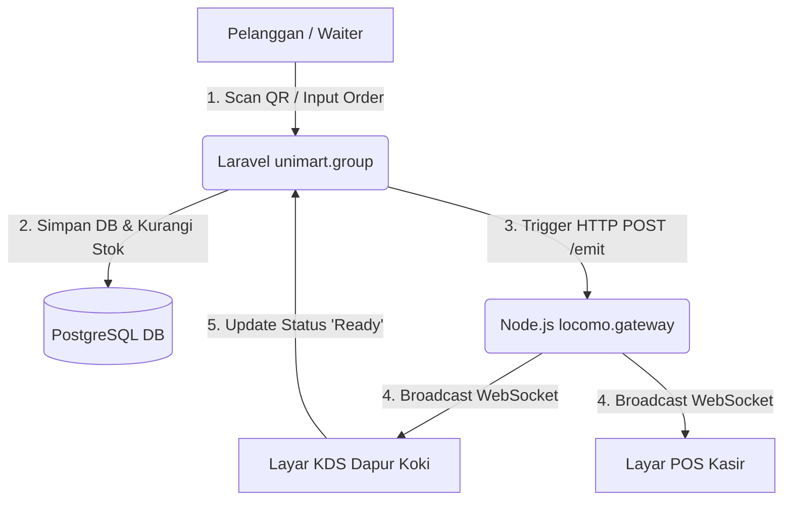

# Dokumen Komprehensif: Rencana Bisnis & Sistem Operasional Unimart.group (Caffe MVP)

Dokumen ini menyajikan rangkuman arsitektur, alur data, peran pengguna, dan status implementasi fitur pada **Unimart.group** yang difokuskan untuk kebutuhan Usaha Kafe (FnB MVP). Dokumen ini berfungsi sebagai dasar evaluasi bagi Pemilik Bisnis (Owner) untuk melakukan review dan revisi terhadap alur proses bisnis yang berjalan.

---

## 1. Peta Arsitektur Ekosistem & Alur Data

Ekosistem Unimart didesain secara modular, terdistribusi, dan dioptimalkan untuk lingkungan shared hosting cPanel menggunakan tiga pilar utama:

1. **Backend & DB Engine (PHP 8.4 Laravel & PostgreSQL)**: Mengelola logika bisnis, autentikasi, enkripsi PIN, manajemen stok berbasis transaksi (`DB::transaction` dengan `lockForUpdate`), dan pelaporan.
2. **Jembatan Real-time (Node.js Express + Socket.io - `locomo.gateway`)**: Bertindak sebagai server WebSocket mandiri (alamat: `gateway.locomo.id.localhost`) yang mendistribusikan sinyal event pesanan secara instan dan tanpa jeda.
3. **Nginx Reverse Proxy**: Mengatur perutean domain kustom lokal agar `unimart.group.localhost` mengarah ke Laravel dan `gateway.locomo.id.localhost` diteruskan ke Node.js dengan mengaktifkan header *WebSocket Upgrade*.

---

## 2. Rangkuman Fitur yang Telah Aktif

### A. Landing Page & Registrasi Owner (`welcome.blade.php`)
* **Landing Page**: Memaparkan profil Unimart.group sebagai asisten kasir pintar terintegrasi dengan visualisasi modern dan responsif.
* **Registrasi Owner (`/owner/register`)**: Form pendaftaran bisnis mandiri yang otomatis men-generate record tenant kustom di database (Multi-Tenant).

### B. Otentikasi & Pengalihan Hak Akses Dinamis (`PinLoginController.php`)
* **Login Owner (`/owner/login`)**: Autentikasi berbasis email & password untuk masuk ke dashboard utama pemilik bisnis.
* **Login Staf Toko (`/login-pin`)**: Autentikasi kilat menggunakan PIN 4-6 digit yang otomatis mengalihkan staf ke antarmuka kerja mereka berdasarkan perannya:
  * **Kasir (Cashier)** $\rightarrow$ Diarahkan langsung ke halaman Kasir POS (`/caffe/{alias}/pos`).
  * **Koki (Chef)** $\rightarrow$ Diarahkan langsung ke Monitor Dapur KDS (`/caffe/{alias}/kds`).
  * **Pelayan (Waiter) / Pelanggan** $\rightarrow$ Diarahkan ke QR Menu Pemesanan (`/caffe/{alias}`).

### C. POS Kasir Dasar - Mobile-First (`pos.blade.php`)
* **Katalog & Stok Real-time**: Menampilkan katalog menu aktif dengan status stok terkini.
* **Responsive Layout (Slide-up Drawer)**: Pada HP kasir portable, keranjang belanja tersembunyi dan dapat dimunculkan via Floating Action Button (FAB) dalam bentuk drawer meluncur dari bawah. Pada tablet/desktop, layout berubah menjadi side-by-side.
* **Checkout Keuangan**: Integrasi pengurangan stok aman, transaksi laci kasir (shift), dan sinkronisasi status ke monitor dapur.

### D. Kitchen Display System (KDS) - Mobile-First (`kds.blade.php`)
* **Layar Monitor Dapur**: Menampilkan pesanan aktif berstatus `cooking` dan `ready` dalam format kartu responsif (1 kolom di HP, 2 kolom di tablet, 3-4 kolom di desktop).
* **SLA Alarm Tracker**: Menghitung durasi penyajian koki sejak pesanan dikirim. Jika melebihi **15 menit**, kartu pesanan akan berkedip merah dan memicu alarm prioritas **OVER SLA**.
* **Audio Beep Alert**: Berbunyi otomatis untuk menarik perhatian koki saat pesanan baru dari kasir masuk ke dapur.

### E. Manajemen Menu & Stok Bahan (`menus.blade.php`)
* **CRUD Menu**: Owner dapat menambah, mengedit, dan menghapus menu makanan, minuman, dan dessert beserta harga dan stoknya.
* **Responsive Card List**: Di HP (< 600px), tabel data otomatis diubah menjadi barisan kartu visual agar mudah dibaca di smartphone.

### F. Denah Meja & Generator QR Code (`tables.blade.php`)
* **Denah Meja**: Mengatur kapasitas meja kafe dinamis (dapat ditambahkan hingga 50 meja via dasbor).
* **Generator QR Code Frontend**: Men-generate QR Code meja kafe secara dinamis berbasis `qrcode.js` di browser dengan layout cetak (print-ready) berisikan instruksi dan logo.

### G. Dine-in Auto-Fill Meja Tamu (`caffe-qr.blade.php`)
* **Auto-Fill Meja**: Saat tamu memindai QR Code di meja fisik (contoh URL: `?table=5`), input nomor meja pada keranjang checkout mereka akan otomatis terisi **5** dan terkunci (*read-only*), meminimalisir kesalahan pelayan/pelanggan memasukkan nomor meja.

---

## 3. Alur Proses Bisnis yang Perlu Ditinjau (Bahan Evaluasi/Revisi)

Berikut adalah hasil pemeriksaan mendalam terhadap seluruh alur operasional sistem Unimart.group, mengidentifikasi alur yang terlewat, berpotensi memicu kebocoran keuangan, atau mempersulit pengguna (*user friction*):

### 1. Rekonsiliasi & Tutup Shift Kasir (Petty Cash)
* **Status Saat Ini**: Kasir dapat langsung melakukan logout tanpa validasi akhir shift. Keuangan laci tidak tercatat secara presisi.
* **Masalah (Friction & Loophole)**: Risiko kebocoran kas laci sangat tinggi karena tidak ada pencocokan saldo kas fisik di akhir hari. Kasir bisa saja menyembunyikan selisih kas.
* **Rekomendasi Solusi**: Wajibkan proses **Tutup Shift (Blind Close)** sebelum kasir keluar. Kasir harus menghitung uang laci fisik secara manual dan menginput nilainya. Sistem membandingkan nilai input vs saldo kalkulasi sistem secara tertutup, mencatat selisihnya, dan otomatis mengirim notifikasi rekap via WhatsApp/Telegram kepada Owner.

### 2. Metode Pembayaran QRIS Dinamis
* **Status Saat Ini**: Pelanggan memindai QRIS statis dan menginput nominal secara manual di ponsel mereka. Kasir harus melakukan verifikasi manual pada mutasi bank atau layar ponsel pelanggan.
* **Masalah (Friction)**: Proses verifikasi manual lambat, menghambat antrean di jam sibuk kafe, dan berisiko terhadap pemalsuan tangkapan layar (screenshot) bukti bayar oleh oknum tamu.
* **Rekomendasi Solusi**: Integrasi payment gateway untuk generate **QRIS Dinamis** per transaksi dengan nominal unik. Setelah pelanggan membayar, sistem menerima Webhook secara instan, otomatis mengubah status order menjadi `PAID`, dan langsung mencetak pesanan ke layar KDS dapur.

### 3. Peringatan Limit Stok Bahan Baku (Low Stock Alert)
* **Status Saat Ini**: Menu langsung ditandai "Habis" di POS dan QR Menu jika nilai stok menyentuh 0.
* **Masalah (Friction)**: Kasir tidak memiliki persiapan untuk memberi tahu pelanggan sebelum menu benar-benar habis, dan Owner terlambat membeli bahan baku kembali.
* **Rekomendasi Solusi**: Implementasikan **Minimum Stock Threshold** (batas ambang minimum stok, misal: 5 porsi). Jika stok produk menyentuh batas tersebut, sistem akan memicu indikator berwarna kuning di POS kasir dan notifikasi peringatan restock pada dasbor Owner.

### 4. Alur Pemesanan Waiter untuk Pelanggan Non-Self Service
* **Status Saat Ini**: Pelanggan wajib memindai QR meja untuk memesan secara mandiri.
* **Masalah (Friction)**: Beberapa pelanggan (khususnya orang tua atau kelompok rombongan besar) sering kali lebih menyukai pelayan yang mencatat pesanan. Jika pelayan harus memindai QR meja dari HP-nya sendiri berulang kali, alurnya sangat tidak efisien.
* **Rekomendasi Solusi**: Tambahkan **Peran Waiter Khusus** di dasbor staf. Pelayan yang login dapat dengan cepat memilih nomor meja dari satu layar tablet, menginput pesanan secara cepat (quick-order), dan meneruskannya ke kasir/dapur tanpa perlu memindai kode QR berulang-ulang.

### 5. Cetak Struk Portabel pada Mobile POS
* **Status Saat Ini**: Pencetakan struk dikonfigurasi melalui print dialog browser biasa yang ditargetkan untuk printer kabel/desktop.
* **Masalah (Friction)**: Unimart ditargetkan untuk mobile device. Kasir keliling membawa smartphone/tablet kesulitan mencetak karena web browser biasa di HP tidak bisa terhubung langsung ke printer thermal Bluetooth mini tanpa konfigurasi rumit.
* **Rekomendasi Solusi**: Integrasikan pustaka **Web Bluetooth API** (atau Web Serial/Bluetooth ESC/POS commands) langsung di frontend. Hal ini memungkinkan browser kasir di HP melakukan pairing Bluetooth langsung dengan printer thermal portabel 58mm/80mm di pinggang kasir secara instan.

### 6. Kebijakan Pesanan Belum Dibayar (Pay Later / Cash Dine-In)
* **Status Saat Ini**: Pesanan tunai dine-in masuk dengan status `Unpaid`, namun detail pesanan langsung dikirim ke KDS koki untuk dimasak.
* **Masalah (Loophole)**: Tamu jahil atau salah input meja dapat memesan menu mahal, makanan langsung dimasak oleh dapur, lalu tamu tersebut pergi sebelum membayar. Ini menyebabkan kerugian bahan baku (*food waste*).
* **Rekomendasi Solusi**: Berikan pengaturan dinamis untuk Owner:
  * **Bayar Dulu (Pay First)**: Pesanan hanya dikirim ke dapur jika status sudah `PAID` (tunai telah diterima kasir atau QRIS sukses).
  * **Bayar Belakangan (Pay Later)**: Pesanan langsung dimasak, tetapi dengan proteksi khusus (konfirmasi awal dari pelayan/kasir sebelum order dikirim ke dapur).

### 7. Navigasi Terkunci pada Mobile Staff Dashboard
* **Status Saat Ini**: Sidebar navigasi utama disembunyikan menggunakan `display: none` pada layar mobile (< 768px).
* **Masalah (Friction)**: Staf kafe yang mengoperasikan sistem menggunakan smartphone tidak dapat mengakses menu logout, berganti peran kerja aktif (untuk owner), atau mengubah kata sandi mereka.
* **Rekomendasi Solusi**: Tambahkan drawer mobile side-navigation yang dapat digeser (slide-in) dari sisi kiri yang dikontrol dengan tombol Hamburger di topbar dasbor, serta navigasi pintasan bawah (bottom nav bar) untuk fungsi operasional utama.

