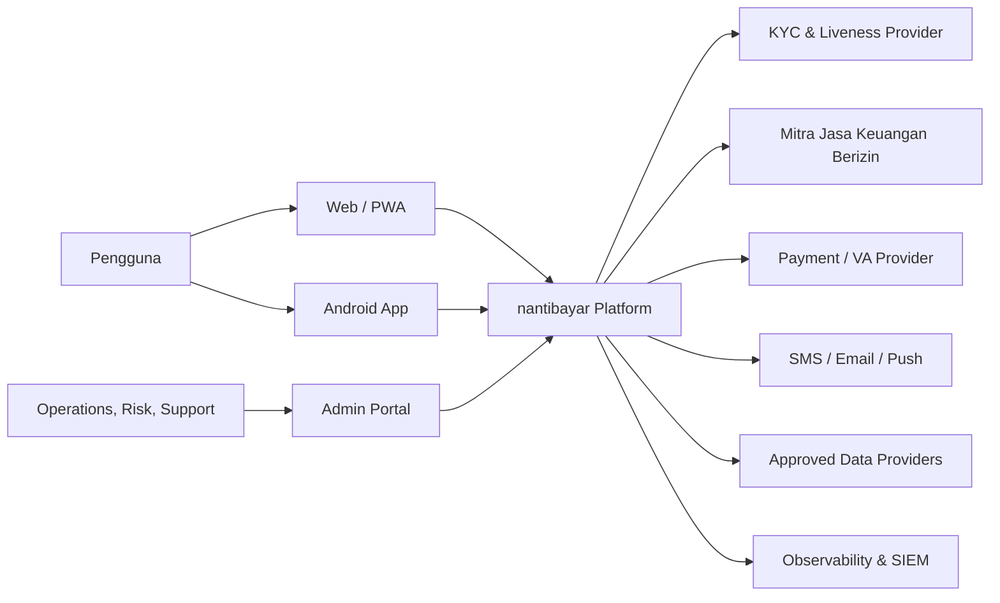
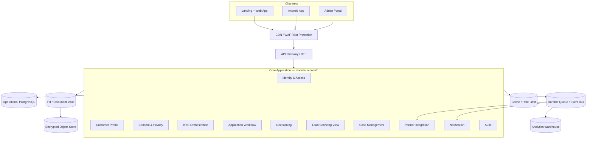
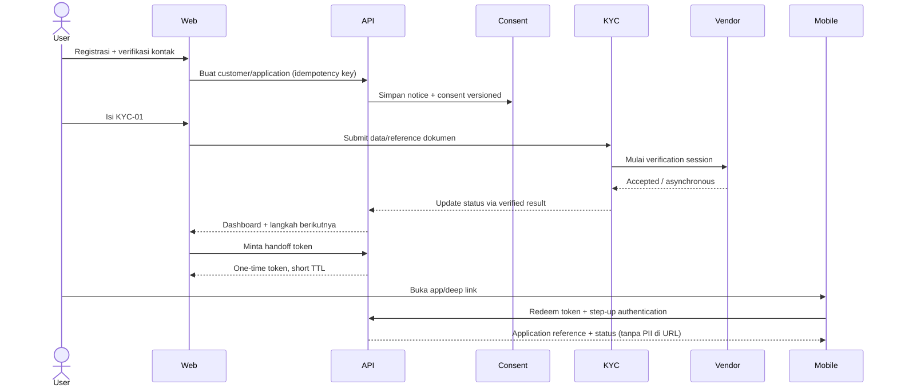
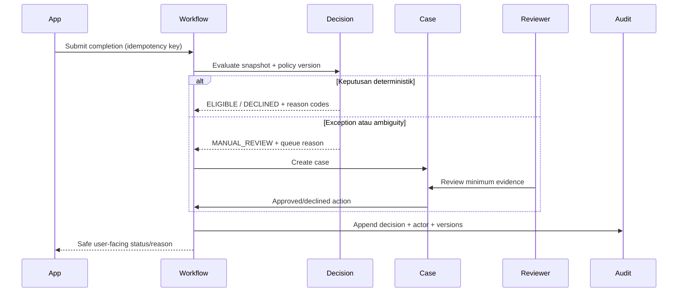
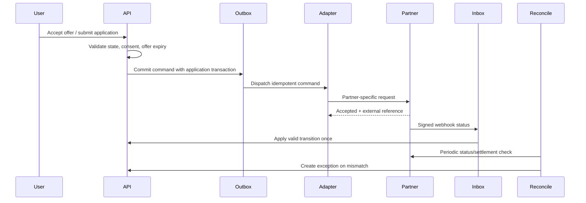
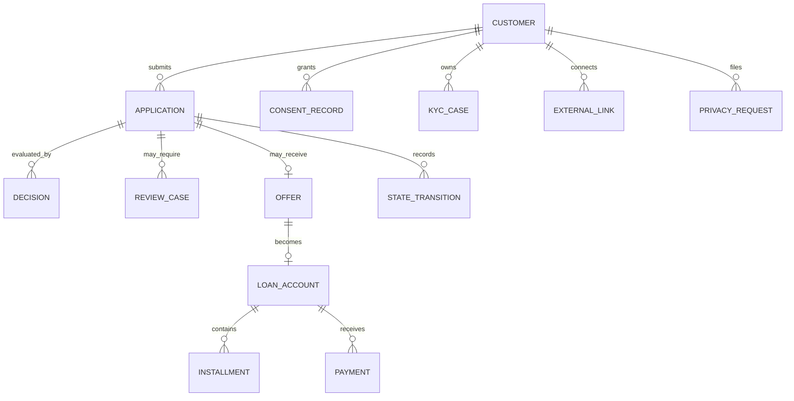
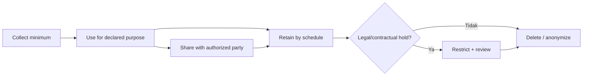
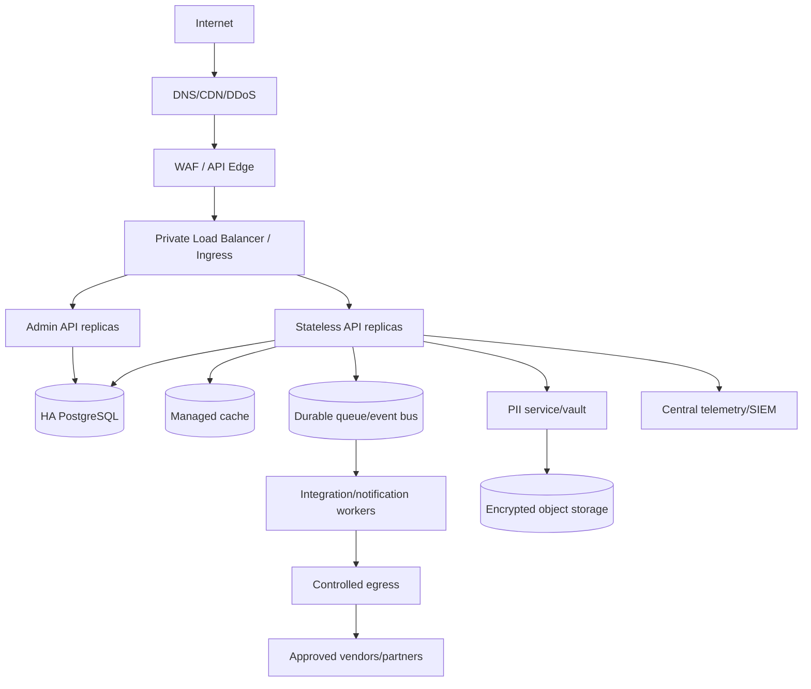

# Arsitektur Fundamental — nantibayar.online

> Status: draft arsitektur awal
>
> Versi: 0.1
>
> Tanggal: 26 September 2026
>
> Dokumen terkait: `project-overview.md`, `App-KreditOnline.md`

## 1. Tujuan

Dokumen ini mendefinisikan fondasi arsitektur untuk funnel web–Android, KYC, eligibility/limit, pengajuan ke mitra, manual review, dan pengelolaan pinjaman. Rancangan sengaja bersifat technology-agnostic pada area yang belum diputuskan, tetapi menetapkan boundary, state, data, dan kontrol yang tidak boleh ditunda.

Arsitektur final bergantung pada keputusan **Gate 0** mengenai posisi hukum platform. Baseline di bawah mengasumsikan:

- platform tidak menyimpan dana;
- keputusan/persetujuan final dan ledger pinjaman dapat dimiliki mitra berizin;
- platform mengorkestrasi pengalaman pengguna dan menyimpan salinan/status yang diperlukan;
- semua integrasi eksternal berada di belakang adapter;
- status, cooldown, dan lifecycle disimpan server-side.

## 2. Prinsip arsitektur

1. **Server authoritative.** Status pengajuan, limit, cooldown, consent, dan pembayaran tidak ditentukan perangkat.
2. **API-first dan channel-neutral.** Web, Android, dan admin memakai kapabilitas domain yang sama melalui API terkontrol.
3. **Modular monolith terlebih dahulu.** Pisahkan bounded context di kode dan database schema; ekstrak service hanya jika skala, isolasi, atau ownership membenarkan.
4. **PII isolated by design.** Identitas mentah dipisahkan dari domain operasional menggunakan token/reference.
5. **Explicit state machine.** Transisi tidak boleh berupa update status bebas.
6. **Asynchronous at boundaries.** Vendor dan mitra dipanggil melalui job/event untuk proses lama, dengan idempotency dan reconciliation.
7. **Zero trust dan least privilege.** Setiap actor, workload, dan admin diverifikasi serta diberi akses minimum.
8. **Explainable decisions.** Setiap hasil mempunyai policy/model version, reason code, dan bukti input.
9. **Auditability over mutability.** Peristiwa penting append-only; koreksi dilakukan dengan event baru.
10. **Progressive delivery.** Feature flag, canary, kill switch, dan rollback untuk policy/integrasi kritis.
11. **No silent fallback.** Kegagalan vendor tidak boleh berubah menjadi approval atau data default yang menyesatkan.
12. **Privacy and consumer protection by design.** Pengumpulan, penggunaan, disclosure, retensi, serta UX ditinjau sejak desain.

## 3. Quality attributes dan target awal

Angka berikut adalah target desain awal dan perlu dikonfirmasi lewat sizing serta kontrak mitra.

| Atribut | Target awal |
|---|---|
| Availability | API pengguna 99,9% bulanan; admin 99,5%; maintenance terjadwal dikecualikan secara transparan |
| Latency | P95 read API < 500 ms; synchronous write < 800 ms, di luar vendor async |
| Durability | Tidak kehilangan state/decision/consent/audit yang sudah committed |
| RPO | ≤ 15 menit untuk data operasional; mendekati 0 untuk ledger/decision event sesuai desain final |
| RTO | ≤ 4 jam MVP; layanan kritis diprioritaskan |
| Review SLA | Target bisnis ≤ 24 jam; direpresentasikan sebagai SLA, bukan lock aplikasi |
| Security | TLS in transit; encryption at rest; secret rotation; MFA admin; tidak ada PII di log |
| Audit | Semua keputusan, override, consent, akses admin sensitif, dan perubahan policy terlacak |
| Accessibility | Web/mobile mengikuti praktik WCAG yang relevan; copy mudah dipahami |
| Scalability | Horizontal stateless API/workers; queue menyerap lonjakan vendor dan notifikasi |

## 4. System context



### Trust boundaries

- Perangkat pengguna adalah untrusted environment.
- Browser/admin workstation tidak dipercaya hanya karena berada di jaringan perusahaan.
- Setiap vendor adalah external trust boundary.
- Webhook harus diautentikasi, ditandatangani, dicegah replay, dan diproses idempotent.
- Analytics tidak boleh menerima data KYC mentah atau pengenal sensitif tanpa kebutuhan yang disetujui.

## 5. Container view



### Mengapa modular monolith untuk MVP

- Transaksi lintas application, decision, dan case masih sering berubah.
- Tim awal cenderung kecil dan belum membutuhkan overhead distributed system.
- Konsistensi serta audit lebih mudah dijaga.
- Boundary tetap eksplisit agar modul berisiko tinggi (misalnya PII vault, decisioning, integration workers) dapat dipisah kemudian.

PII/document vault boleh menjadi service/deployment terpisah sejak awal bila hasil threat model, kewajiban vendor, atau struktur tim membutuhkannya.

## 6. Bounded context dan tanggung jawab

| Modul | Tanggung jawab | Tidak boleh menangani |
|---|---|---|
| Identity & Access | Akun, authentication, session, MFA/step-up, recovery, device/risk binding | Keputusan kredit |
| Customer Profile | Profil non-sensitif yang diperlukan domain, alamat referensi/token | Dokumen mentah tanpa vault |
| Consent & Privacy | Notice version, purpose, consent grant/revoke, DSR, closure/deletion workflow | Menyimpulkan consent dari penggunaan aplikasi |
| KYC Orchestration | KYC session, vendor adapter, verification status, retry, evidence reference | Menyimpan credential vendor atau dokumen di log |
| Application Workflow | Aggregate pengajuan, state machine, checklist, cooldown, transition policy | Mengedit state secara bebas |
| Decisioning | Eligibility rules/model call, policy version, reason, offer eligibility | Menjadi ledger atau mencairkan dana |
| Case Management | Queue, assignment, SLA, reviewer decision, maker-checker, escalation | Mengubah input KYC diam-diam |
| Partner Integration | Adapter, command/event mapping, webhook inbox, reconciliation | Mengekspos payload vendor langsung ke UI |
| Loan Servicing View | Read model kontrak, saldo, jadwal, pembayaran dari source of truth | Menjadi ledger tanpa keputusan bisnis eksplisit |
| Notification | Template-approved transactional messages, preference, delivery receipt | Memuat NIK/dokumen/rahasia dalam pesan |
| Audit | Immutable business/security trail, hash/integrity, evidence export | Menjadi log debugging umum |
| Analytics | Event pseudonymous, funnel, operational/risk metrics | KYC images/raw PII di warehouse |

## 7. Alur utama

### 7.1 KYC web dan handoff ke Android



Kontrol penting:

- Handoff token sekali pakai, TTL singkat, audience-bound, dan tidak memuat PII.
- Token redemption menghasilkan session baru; bukan memindahkan web session mentah.
- Upload memakai pre-signed URL terbatas setelah malware/content validation design disetujui.
- Callback vendor masuk melalui webhook inbox dan diverifikasi sebelum mengubah domain.

### 7.2 Decision dan manual review



### 7.3 Pengajuan ke mitra



## 8. State machine dan invariants

Gunakan state dasar dalam `project-overview.md`. State diimplementasikan sebagai transition table/policy, bukan `status = request.body.status`.

### Invariants

- Maksimal satu application aktif per product/customer, kecuali policy eksplisit mengizinkan.
- `next_eligible_at` hanya dapat dibuat oleh decision policy/authorized override.
- Waktu berasal dari server UTC; UI melokalkan ke zona pengguna.
- `APPROVED/OFFERED` selalu merujuk decision/offer yang belum kedaluwarsa.
- `ACTIVE_LOAN` membutuhkan external/ledger reference yang tervalidasi.
- State terminal tidak dibuka kembali; buat lifecycle baru atau correction event.
- Pembatalan tidak menghapus application, decision, consent evidence, atau audit yang wajib disimpan.
- Uninstall, clear storage, pergantian perangkat, dan reinstall tidak memicu transisi domain.

### Transition record minimum

```text
transition_id
aggregate_type + aggregate_id
from_state + to_state
event_type
actor_type + actor_id/reference
reason_code
policy_or_model_version
correlation_id + causation_id
occurred_at_utc
metadata_reference (tanpa secret/raw PII)
```

## 9. Model data konseptual



### Entitas minimum

- `customer`: internal opaque ID, account status, non-sensitive flags.
- `customer_pii`: encrypted/tokenized identity fields dalam vault/boundary terpisah.
- `application`: product, current state, current version, `next_eligible_at`.
- `kyc_case`: provider, session reference, result code, timestamps, evidence reference.
- `consent_record`: purpose, scope, notice version, legal basis, grant/revoke time, channel.
- `decision`: input snapshot hash/reference, output, reason codes, policy/model version.
- `offer`: issuer, amount/limit, price/fees, terms reference, expiry, status.
- `review_case`: queue, priority, SLA, assignee, outcome, maker-checker state.
- `partner_submission`: adapter, external reference, idempotency key, status.
- `loan_account`: source-of-truth marker, contract reference, balance snapshot time.
- `installment` dan `payment`: external IDs, amount, due/paid timestamps, reconciliation status.
- `outbox_event` / `webhook_inbox`: reliable integration and deduplication.
- `audit_event`: actor, action, object, reason, time, integrity metadata.

### Data classification

| Kelas | Contoh | Kontrol minimum |
|---|---|---|
| Restricted | NIK, selfie/liveness, dokumen, rekening, credential/secret | Vault, field encryption, strict RBAC/ABAC, no logs, access audit, masked UI |
| Confidential | Decision detail, income, contract, balance, fraud signals | Encryption, need-to-know, export control, audit |
| Internal | Operational status, non-sensitive metrics | Authenticated access, retention |
| Public | Landing content, FAQ, disclosure publik | Integrity control, content approval |

## 10. API conventions

### External/channel API

- HTTPS JSON API dengan versioning yang terkontrol; OpenAPI sebagai contract.
- OIDC/OAuth-style token untuk channel; PKCE untuk public clients.
- Access token pendek; refresh rotation dan session revocation.
- `Idempotency-Key` wajib untuk create/submit/accept/payment-sensitive commands.
- Optimistic concurrency (`version`/ETag) untuk update aggregate.
- Error response mempunyai stable code, correlation ID, dan pesan aman.
- Pagination cursor-based; filtering/exports dibatasi sesuai authorization.
- Rate limit per actor/device/IP risk, tanpa menjadikan IP sebagai identitas.

### Endpoint konseptual

```text
POST   /v1/registrations
POST   /v1/auth/challenges
GET    /v1/me
PATCH  /v1/me/profile
POST   /v1/consents
POST   /v1/consents/{id}/revoke
POST   /v1/kyc/sessions
POST   /v1/applications
GET    /v1/applications/{id}
POST   /v1/applications/{id}/submit
POST   /v1/applications/{id}/cancel
POST   /v1/app-handoffs
POST   /v1/app-handoffs/redeem
GET    /v1/offers/{id}
POST   /v1/offers/{id}/accept
GET    /v1/loans
GET    /v1/loans/{id}/schedule
GET    /v1/loans/{id}/payments
POST   /v1/privacy-requests
POST   /v1/complaints
```

Tidak ada endpoint publik untuk menetapkan skor, limit, cooldown, status final, atau saldo secara langsung.

### Webhook ingestion pattern

1. Terima bytes mentah dan header yang diperlukan untuk verifikasi.
2. Verifikasi TLS, signature/key, timestamp, nonce/replay window.
3. Simpan ke inbox dengan provider event ID dan payload terenkripsi.
4. Balas cepat sesuai kontrak.
5. Worker memetakan payload ke canonical event.
6. Terapkan transisi idempotent; event out-of-order ditahan/rekonsiliasi.
7. Dead-letter dan alert setelah retry policy habis.

## 11. Event model

Gunakan domain events internal dan canonical integration events. Hindari membagikan schema tabel sebagai event.

### Event minimum

```text
CustomerRegistered
ConsentGranted
ConsentRevoked
KycSubmitted
KycVerificationCompleted
ApplicationSubmitted
ApplicationNeedsAction
ApplicationQueuedForReview
ApplicationDecisioned
CooldownStarted
OfferCreated
OfferAccepted
PartnerSubmissionAccepted
LoanActivated
InstallmentDueChanged
PaymentPosted
PaymentReconciled
AccountClosureRequested
PrivacyRequestOpened
ComplaintOpened
```

### Envelope

```json
{
  "event_id": "uuid",
  "event_type": "ApplicationDecisioned",
  "event_version": 1,
  "occurred_at": "UTC timestamp",
  "producer": "application-workflow",
  "subject_id": "opaque-id",
  "correlation_id": "uuid",
  "causation_id": "uuid",
  "data": {}
}
```

PII mentah tidak ditempatkan di event bus. Gunakan opaque reference dan fetch terotorisasi bila benar-benar diperlukan.

## 12. Decisioning dan model governance

### MVP

- Rules/policy engine versioned dengan parameter yang direview.
- Input dibentuk sebagai immutable decision snapshot.
- Output: outcome, safe reason codes, internal reason codes, confidence/flags bila relevan, policy version.
- Deployment policy terpisah dari deployment aplikasi, tetapi membutuhkan approval dan audit.
- Manual override dibatasi, beralasan, dan maker-checker untuk kasus tertentu.

### Jika memakai machine learning

- Registry untuk model artifact, features, training dataset lineage, owner, approval, dan expiry.
- Online/offline feature parity serta point-in-time correctness.
- Validation independen: discrimination, calibration, stability, robustness, explainability, fairness.
- Monitor drift input/output, approval rate, bad rate, disparity, missingness, dan vendor changes.
- Champion/challenger dengan exposure terkendali dan kill switch.
- Tidak melakukan online self-learning langsung dari produksi.
- Keputusan historis tetap dapat direkonstruksi berdasarkan model/policy yang berlaku saat itu.

### Integrasi akun digital/media sosial

- OAuth authorization code + PKCE jika penyedia mendukung; tidak pernah meminta password.
- Scope minimum dan ditampilkan sebelum consent.
- Encrypt refresh token di secrets/token vault; rotasi/revoke tersedia.
- Data source melewati data protection impact assessment, security review, vendor due diligence, serta fairness/relevance validation.
- Kegagalan atau penolakan consent opsional tidak boleh diam-diam dianggap sinyal negatif.

## 13. Security architecture

### Identity pengguna

- Verifikasi kontak tidak dianggap setara verifikasi identitas.
- MFA/step-up untuk perubahan profil sensitif, acceptance, rekening tujuan, account recovery, dan privacy request.
- Risk-based session control dengan sinyal proporsional; device binding bukan satu-satunya faktor.
- Credential/password (jika dipakai) mengikuti standar hashing kuat dan breached-password defense.
- Recovery mempunyai rate limit, notification, cooldown sensitif, dan antifraud review.

### Identity workforce

- SSO + phishing-resistant MFA untuk admin.
- RBAC ditambah atribut kasus/region/purpose bila perlu.
- Just-in-time privileged access, approval, session timeout, dan periodic access review.
- Tampilan masked by default; reveal mempunyai reason dan audit.
- Non-production tidak menggunakan data produksi mentah.

### Application dan infrastructure

- WAF, bot/credential-stuffing defense, rate limiting, dan abuse monitoring di edge.
- Network segmentation antara public ingress, application, data, dan management planes.
- Workload identity; hindari long-lived static credentials.
- Secret manager, KMS/HSM sesuai risiko, key rotation, dan separation of duties.
- SAST, dependency/container scan, secret scan, IaC scan, DAST, dan penetration test sebelum launch.
- Signed build, protected branch, reviewed change, SBOM, dan controlled artifact promotion.
- Mobile: secure storage, certificate/network controls yang dapat dirotasi, root/tamper signals sebagai risk input—bukan block buta.

### Fraud/abuse controls

- Velocity per identity/contact/device/payment destination, dengan false-positive monitoring.
- Duplicate/synthetic identity detection lewat provider yang disetujui.
- Referral graph/velocity hanya untuk fraud/reward control, terpisah dari ability-to-pay.
- Replay defense untuk KYC result, handoff token, webhook, dan offer acceptance.
- Account takeover, mule, bot, promo abuse, reviewer collusion, serta insider threat masuk abuse-case catalog.

## 14. Privacy, retention, dan deletion

### Data lifecycle



### Aturan desain

- Retention schedule per data class dan purpose, bukan satu TTL global.
- Account closure, consent withdrawal, dan erasure adalah tiga proses berbeda.
- Legal hold mencegah deletion tetapi membatasi pemrosesan non-wajib.
- Backup deletion mengikuti expiry/crypto-erasure yang terdokumentasi.
- Analytics menggunakan pseudonymous ID; anonymization diuji terhadap re-identification risk.
- Vendor deletion/return dibuktikan melalui contract dan operational evidence.
- Data subject request diverifikasi tanpa mengumpulkan data berlebihan.

## 15. Integrasi dan vendor governance

Setiap vendor mempunyai:

- business owner dan technical owner;
- tujuan serta kategori data;
- legal/security/privacy due diligence;
- API contract, sandbox, versioning, quota, timeout, retry, dan idempotency;
- SLA/SLO dan incident notification;
- data location/subprocessor register bila relevan;
- reconciliation/fallback/manual procedure;
- exit plan serta deletion/return evidence;
- kill switch per integration.

### Adapter pattern

Domain berbicara dalam canonical commands/events. Adapter menerjemahkan:

```text
Canonical SubmitApplication
  -> PartnerA payload/version/auth
  -> PartnerB payload/version/auth

Partner webhook/status
  -> Canonical PartnerSubmissionAccepted/Declined/etc.
```

Dengan demikian, istilah/status vendor tidak bocor ke seluruh aplikasi dan migrasi mitra lebih aman.

## 16. Consistency, resilience, dan recovery

- Transaksi domain + outbox event dilakukan atomik.
- Consumer idempotent dan mempunyai deduplication key.
- Retry memakai exponential backoff + jitter; hanya untuk error retryable.
- Circuit breaker/bulkhead mencegah outage vendor merusak seluruh platform.
- Poison message masuk dead-letter queue dengan runbook dan alert.
- Read model pinjaman menampilkan `last_updated_at`; data stale diberi indikator, bukan disamarkan.
- Reconciliation job membandingkan application, disbursement, payment, dan balance sesuai sumber kebenaran.
- Backup terenkripsi, terisolasi, mempunyai retention, dan diuji restore berkala.
- DR exercise menguji failover, komunikasi, rekonsiliasi, dan pemulihan akses—bukan hanya database restore.

## 17. Observability dan audit

### Telemetry

- Structured logs tanpa raw PII, token, document URL, atau vendor secret.
- Metrics: RED (rate, errors, duration), queue depth/age, webhook lag, vendor latency/error, state counts, SLA breach.
- Distributed tracing memakai correlation ID yang tidak mengandung data pengguna.
- Synthetic checks untuk critical journey tanpa akun/data produksi nyata.
- Alert berbasis dampak pengguna dan SLO; hindari alert untuk setiap retry tunggal.

### Business/risk monitoring

- Funnel dan abandonment per langkah/versi.
- Approval/decline/manual-review rate dan reason distribution.
- Cooldown retry pattern, duplicate identity, fraud signal, override rate.
- Payment reconciliation difference dan stale loan view.
- Complaint volume/root cause, privacy requests, consent revocation.
- Model/policy drift, fairness, serta partner-specific anomaly.

### Audit event

Audit menjawab: siapa melakukan apa, terhadap objek mana, kapan, dari konteks apa, dengan alasan/approval apa, dan hasilnya. Audit store bersifat append-only, aksesnya sendiri diaudit, retention ditetapkan legal, dan integritas dapat diverifikasi.

## 18. Environment, delivery, dan configuration

### Environment

- `local`: emulator/stub, synthetic data.
- `dev`: shared integration development, no production data.
- `test/qa`: automated/regression/performance/security testing.
- `staging`: production-like, partner sandbox/certification, synthetic/masked approved data.
- `production`: isolated account/project, least privilege, controlled access.

### CI/CD gates

1. Lint/unit/schema/contract tests.
2. SAST, secrets, dependencies, container, IaC scan.
3. Integration tests dengan vendor stubs/sandbox.
4. Migration compatibility dan rollback/roll-forward check.
5. Approval untuk perubahan policy, data, IAM, network, dan production.
6. Signed artifact promotion; tidak rebuild per environment.
7. Canary/blue-green sesuai komponen, observability check, dan automated rollback criteria.

### Configuration

- Config non-secret versioned; secret disimpan di secret manager.
- Policy/model/config efektif mempunyai `effective_from`, owner, approval, dan rollback version.
- Feature flag mempunyai owner dan expiry; flag kritis tidak dibiarkan permanen tanpa review.
- Clock disinkronkan; semua persistence menggunakan UTC.

## 19. Testing strategy

### Otomatis

- Unit test untuk invariants, transition policy, reason mapping, dan fee/amount calculation.
- Property/state-machine test untuk transisi ilegal, duplicate request, dan concurrency.
- Contract test per vendor/partner dan backward compatibility.
- Integration test untuk outbox/inbox, retry, out-of-order events, reconciliation.
- End-to-end test untuk web → handoff → Android → review → partner sandbox → loan view.
- Security test untuk authz per object, session, upload, webhook replay/signature, injection, export.
- Data migration, retention, deletion, and restore test.
- Performance test pada API, queue surge, vendor slowness, admin queue.

### Manual/operasional

- UX/accessibility dan disclosure comprehension.
- Review consistency/QA serta maker-checker drill.
- Incident response tabletop: data leak, vendor compromise, wrong decision policy, duplicate disbursement, payment mismatch.
- DR restore/failover dan business reconciliation.
- Penetration testing independen sebelum pilot dan perubahan material.

## 20. Deployment topology konseptual



Admin portal sebaiknya memiliki ingress, policy, rate limit, dan authorization terpisah dari customer API. Database public access dilarang. Egress dibatasi ke tujuan yang disetujui jika platform mendukungnya.

## 21. Ownership dan separation of duties

| Area | Accountable | Approval/oversight |
|---|---|---|
| Product flow/copy | Product | Legal/Compliance/Risk untuk materi relevan |
| Credit/fraud policy | Risk | Governance committee / authorized approver |
| Model | Model owner | Independent validation + Risk |
| PII/data purpose | Data owner | Privacy/Legal/Security |
| Production platform | Engineering/SRE | Security/change control |
| Manual decision | Operations/Risk | QA + maker-checker sesuai threshold |
| Partner integration | Partner/Engineering owner | Legal/Security/Finance/Ops |
| Incident | Incident commander | Legal/Privacy/Business sesuai jenis |

Engineer tidak boleh mengubah keputusan individual melalui database. Reviewer tidak boleh mengubah policy. Support tidak boleh mengubah skor/limit. Model developer tidak menjadi satu-satunya validator model.

## 22. Architecture Decision Records awal

### ADR-001 — Modular monolith untuk core MVP

- **Keputusan:** satu deployable core dengan module boundary eksplisit.
- **Alasan:** domain masih berubah, transaksi konsisten, tim awal, overhead rendah.
- **Konsekuensi:** enforce dependency rules dan schema ownership; ukur alasan ekstraksi service.

### ADR-002 — State server-side, bukan lifecycle instalasi

- **Keputusan:** uninstall tidak mereset permohonan/cooldown.
- **Alasan:** uninstall tidak reliabel sebagai event bisnis dan dapat dieksploitasi.
- **Konsekuensi:** recovery serta multi-device flow harus didukung.

### ADR-003 — PII vault terpisah

- **Keputusan:** domain memakai opaque customer ID/token; data restricted disimpan di boundary khusus.
- **Alasan:** mengurangi blast radius dan akses tidak perlu.
- **Konsekuensi:** pencarian/dedup memerlukan tokenization dan API terotorisasi.

### ADR-004 — Outbox/inbox untuk integrasi

- **Keputusan:** perintah/event eksternal memakai transactional outbox dan webhook inbox.
- **Alasan:** mencegah lost update/duplicate side effect.
- **Konsekuensi:** eventual consistency, reconciliation, dan UI pending state diperlukan.

### ADR-005 — Referral bukan input ability-to-pay pada MVP

- **Keputusan:** referral dipisahkan dari credit limit.
- **Alasan:** hubungan kausal lemah, manipulatif, dan berisiko tidak adil.
- **Konsekuensi:** referral dapat menjadi program reward terpisah setelah review.

### ADR-006 — Consent granular dan versioned

- **Keputusan:** consent tidak disimpan sebagai satu boolean global.
- **Alasan:** tujuan, scope, notice, serta hak pencabutan berbeda.
- **Konsekuensi:** setiap processing path harus mengecek entitlement/purpose yang benar.

## 23. Trigger untuk evolusi ke microservices

Ekstrak modul hanya ketika terdapat bukti:

- kebutuhan isolasi keamanan/compliance yang kuat;
- pola skala atau availability yang sangat berbeda;
- deployment cadence dan ownership tim independen;
- beban integrasi mengganggu core;
- batas transaksi/event telah stabil;
- biaya operasional tambahan dapat ditanggung.

Kandidat awal: PII vault, notification workers, partner integration workers, decision engine, dan analytics ingestion. Jangan memecah hanya berdasarkan nama tabel/modul.

## 24. Open decisions

| ID | Keputusan | Dampak | Owner yang disarankan |
|---|---|---|---|
| OD-001 | Model bisnis dan izin | Seluruh arsitektur/domain | Founder + Legal/Compliance |
| OD-002 | Source of truth untuk decision/offer/loan/payment | Consistency dan reconciliation | Product + Risk + Partner |
| OD-003 | KYC vendor dan data fields | Data model, consent, SLA, security | Compliance + Security + Engineering |
| OD-004 | Authentication method | UX dan ATO risk | Security + Product |
| OD-005 | Hosting region/cloud dan data residency | Infra/compliance/DR | Security + Legal + Engineering |
| OD-006 | Payment architecture | Ledger, reconciliation, PCI/exposure | Finance + Partner + Engineering |
| OD-007 | Eligibility rules dan appeal | Decision module/operations | Risk + Compliance |
| OD-008 | Retention schedule | Storage/deletion/backup | Legal/Privacy + Data owner |
| OD-009 | Traffic, SLO, RTO/RPO | Capacity/cost/topology | Business + SRE |
| OD-010 | Android-only continuation vs assisted alternative | Channel/funnel/accessibility | Product + Compliance |

## 25. Implementation sequence

1. Selesaikan Gate 0 dan threat/data-flow workshop.
2. Definisikan domain glossary, state/transition table, reason taxonomy, dan source-of-truth matrix.
3. Buat repository baseline, CI security gates, environment, IAM, observability, serta audit skeleton.
4. Implement account, consent, PII boundary, profile, dan KYC orchestration dengan stub vendor.
5. Implement application state machine, outbox/inbox, dashboard, serta handoff token.
6. Implement admin case management, SLA, maker-checker, dan audit review.
7. Implement versioned rules decisioning dan safe user-facing reasons.
8. Tambahkan satu partner adapter, sandbox contract tests, webhook, dan reconciliation.
9. Tambahkan loan read model, schedule/payment display, complaint/privacy workflows.
10. Lakukan load/security/privacy/DR/incident tests dan pilot readiness review.

## 26. Checklist sebelum pilot

- [ ] Legal model, izin, kontrak, alur dana, dan tanggung jawab data disetujui.
- [ ] Data-flow diagram, inventory, retention, consent, DSR, dan deletion diuji.
- [ ] Threat model serta abuse cases mempunyai mitigasi dan owner.
- [ ] State machine menolak transisi ilegal/duplikat/concurrent.
- [ ] Decision dapat direkonstruksi dan alasan aman ditampilkan.
- [ ] Admin SSO/MFA, least privilege, masking, maker-checker, dan audit aktif.
- [ ] Vendor signature, idempotency, retry, reconciliation, outage, dan exit path diuji.
- [ ] Tidak ada PII/secrets di log, analytics, crash report, URL, atau push notification.
- [ ] Backup restore, RTO/RPO, DR, incident, serta wrong-policy rollback diuji.
- [ ] Monitoring teknis, funnel, fraud, decision, fairness, complaint, dan privacy aktif.
- [ ] Copy produk membedakan estimasi, eligibility, offer, dan approval final.
- [ ] Uninstall/reinstall tidak memengaruhi state atau cooldown.

## 27. Referensi regulasi awal

Referensi ini dipakai sebagai titik mulai dan harus diverifikasi kembali oleh Legal/Compliance saat implementasi:

- [POJK 40 Tahun 2024 — Layanan Pendanaan Bersama Berbasis Teknologi Informasi](https://www.ojk.go.id/id/regulasi/Documents/Pages/POJK-40-Tahun-2024-Layanan-Pendanaan-Bersama-Berbasis-Teknologi-Informasi/POJK%2040%20Tahun%202024%20Layanan%20Pendanaan%20Bersama%20Berbasis%20Teknologi%20Informasi.pdf)
- [POJK 29 Tahun 2024 — Pemeringkat Kredit Alternatif](https://ojk.go.id/id/regulasi/Pages/POJK-29-2024-Pemeringkat-Kredit-Alternatif-PKA.aspx)
- [POJK 22 Tahun 2023 — Pelindungan Konsumen dan Masyarakat di Sektor Jasa Keuangan](https://ojk.go.id/id/regulasi/Pages/Pelindungan-Konsumen-dan-Masyarakat-di-Sektor-Jasa-Keuangan.aspx)
- UU No. 27 Tahun 2022 tentang Pelindungan Data Pribadi beserta peraturan pelaksana yang berlaku saat peluncuran.

