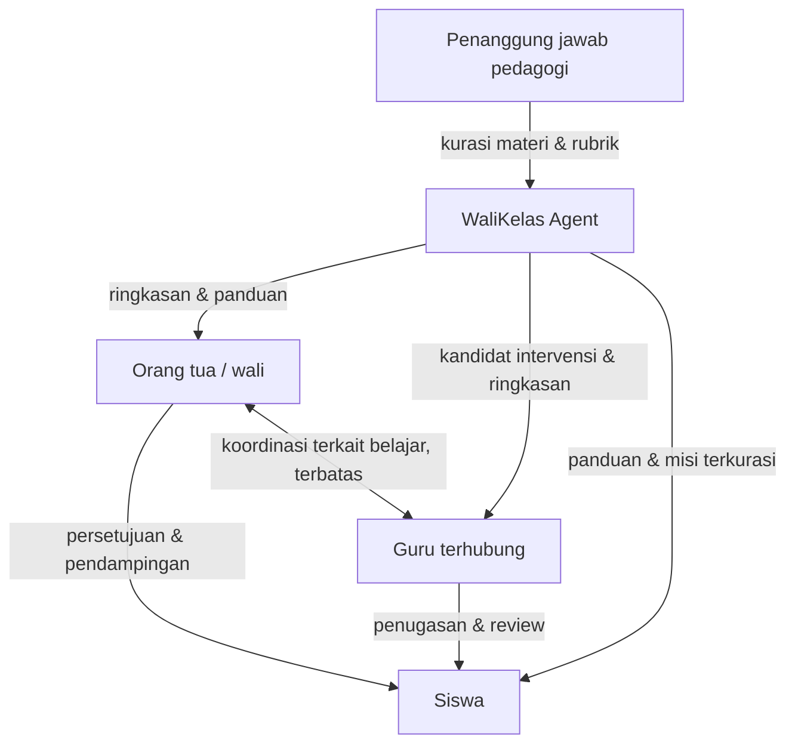
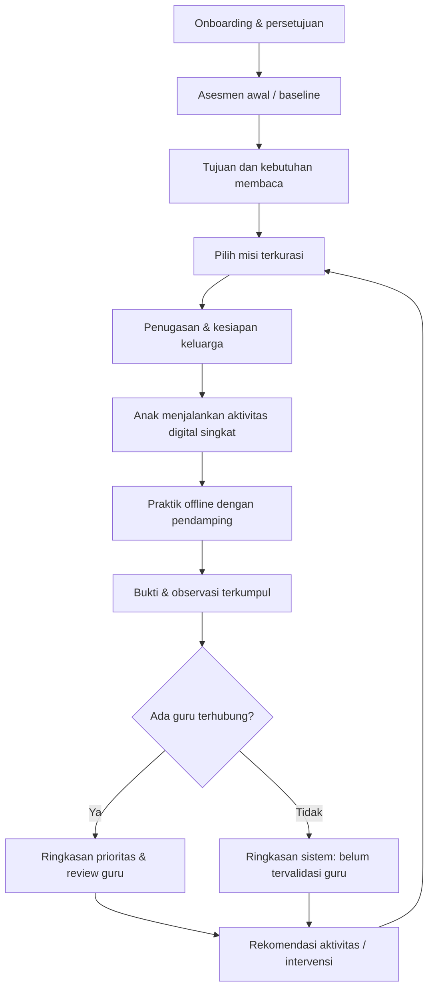
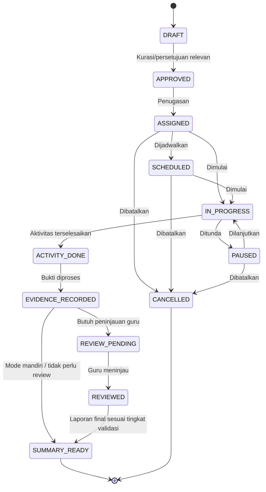

# WALIKELAS.ID
## Arsitektur Fundamental Produk MVP — Kolaborasi Guru, Orang Tua/Wali, dan Siswa

**Versi:** 1.0 — *Baseline produk untuk review dan pengendalian ruang lingkup*  
**Tanggal keputusan:** 13 Oktober 2026  
**Status:** Fondasi konseptual DIKUNCI untuk penyusunan PRD, desain pengalaman pengguna, dan pengujian MVP; keputusan operasional yang belum disepakati ditandai eksplisit sebagai **Terbuka**.  
**Jangkauan MVP:** Literasi membaca awal, berfokus pada pemahaman bacaan naratif untuk kelas 3 SD, dengan jalur asesmen yang dapat menunjukkan kebutuhan prasyarat membaca.  
**Horizon:** MVP/pilot awal menjelang pengajuan accelerator November 2026.  
**Audiens dokumen:** Founder, tim produk, pakar pendidikan, guru pilot, desain UX, QA, pengembang, tim perlindungan anak, dan agent AI pendamping pengembangan.

> [!IMPORTANT]
> **CATATAN REVISI (21 Oktober 2026) — DOKUMEN INI KINI BERSTATUS PELENGKAP.**
> Rujukan utama (*source of truth*) rancangan produk MVP WaliKelas adalah **[WALIKELAS_MVP_PRODUCT_BLUEPRINT_TECHNICAL_HANDOFF_v2.0.md](file:///home/dev360_03/locomo.id/docs/walikelas.id/WALIKELAS_MVP_PRODUCT_BLUEPRINT_TECHNICAL_HANDOFF_v2.0.md)**. Seluruh PRD, desain UX, backlog, QA, dan arsitektur teknis **wajib merujuk ke v2.0 terlebih dahulu**. Dokumen v1.0 ini tetap berlaku sebagai **pelengkap** untuk prinsip keselamatan anak, literasi, persetujuan wali, pengawasan manusia, tingkat keyakinan bukti, laporan 3 lapis, dan antipola, **selama tidak bertentangan dengan v2.0**.
>
> **Bagian v1.0 yang digantikan oleh v2.0:**
> - Unit domain utama: *kelas/ruang kelas guru* → **Learning Program** dengan *program mode* `school` / `private` (v2 §4, D-05).
> - Pendidik: hanya guru SD → **guru sekolah dan tutor privat dalam satu Educator Workspace**; sekolah tidak wajib (v2 §3.3, D-03/D-04).
> - Pintu masuk siklus: *onboarding → asesmen awal* → **planning-first**: impor/wizard rencana → review → enrollment → baseline (v2 §5, D-06/D-07).
> - Mode keluarga mandiri (§7.1, AC-01 di dokumen ini): dari **Wajib MVP** menjadi **[LATER] untuk pengalaman lengkap**; prinsip jalur keluarga tetap dikunci (v2 §4.2-D, D-12, O-11).
> - Siklus status misi (§17): diganti oleh state misi v2 §9.5 (termasuk `NeedsGuardian`, `Returned`, `Deferred`); konfirmasi wali hanya wajib untuk tugas rumah.
> - Metrik keberhasilan pilot (§30): north-star operasional menjadi **educator-completed learning cycles with verified outputs** dan **net educator time saved** (v2 §20.3).
> - Skala pilot (§30.1): mengikuti v2 §20.2 (guru SD dan tutor privat; data sintetis sebelum izin lengkap).
>
> Jika ada perbedaan, gunakan urutan prioritas pada v2 §0.2.

> **Pernyataan inti:** WaliKelas adalah platform pendampingan pendidikan anak berbasis AI dengan pengawasan manusia, yang menghubungkan kegiatan belajar di sekolah dan di rumah melalui misi literasi terarah, bukti perkembangan kompetensi, serta koordinasi guru–orang tua–siswa. Keberhasilan utamanya adalah perkembangan belajar yang dapat diperiksa **tanpa menambah beban guru dan tanpa memperpanjang waktu layar anak sebagai tujuan**.

---

# BAGIAN A — KERANGKA KEPUTUSAN PRODUK

## 1. Tujuan dokumen dan batas pembahasan

Dokumen ini menetapkan **arsitektur fundamental produk**, bukan arsitektur perangkat lunak. Istilah *arsitektur* di sini berarti struktur hubungan pengguna, peran, tanggung jawab, objek kegiatan belajar, alur interaksi, tahapan keputusan, dan prinsip keselamatan yang tidak boleh berubah hanya karena pergantian teknologi.

Dokumen digunakan untuk: (1) menjadi sumber kebenaran bersama tentang MVP; (2) membatasi ruang lingkup sprint; (3) menghindari salah tafsir antara 'AI membimbing', 'guru memvalidasi', dan 'orang tua mendampingi'; (4) memberikan kriteria konseptual bagi penerimaan fitur; (5) menjaga agar visi Indonesia Emas 2045 tidak berubah menjadi janji fitur yang terlalu luas pada MVP.

**Tidak diatur di dokumen ini:** framework, bahasa pemrograman, pilihan model LLM, penyedia hosting, skema tabel, bentuk API, arsitektur layanan, UI pixel-perfect, maupun integrasi formal ke platform pemerintah. Semuanya harus mengikuti aturan produk dalam dokumen ini, bukan mendefinisikan ulang aturannya.

### 1.1 Legenda status keputusan

- **Dikunci:** prinsip dan keputusan yang telah disepakati sebagai dasar MVP.
- **Hipotesis:** arah kerja yang masuk akal tetapi perlu bukti pilot.
- **Terbuka:** perlu persetujuan eksplisit founder/penanggung jawab pedagogi sebelum implementasi yang mengikat.
- **Di luar MVP:** sengaja ditunda, bukan berarti ditolak dari visi jangka panjang.

### 1.2 Basis pemikiran

Rancangan ini meneruskan visi WaliKelas legacy sebagai penghubung siswa, pendidik, dan keluarga; transformasi terbaru ke AI Tutor/pendampingan pendidik profesional; dan diskusi founder Oktober 2026 tentang literasi, misi belajar, keluarga sebagai lingkungan pendidikan pertama, pengurangan beban administratif guru, penggunaan perangkat secara produktif, serta akses pilot melalui jaringan guru SD. Konsep baru dalam dokumen ini adalah **usulan desain untuk diuji**, bukan hasil uji efektivitas yang sudah terbukti.

## 2. Visi, misi, dan identitas produk

### 2.1 Visi jangka panjang

Berkontribusi pada generasi Indonesia yang literat, mandiri, aman secara digital, dan mampu belajar sepanjang hayat menuju Indonesia Emas 2045 melalui kolaborasi pendidikan keluarga dan pendidik profesional.

### 2.2 Misi awal yang terukur

Membantu anak SD menjalankan kegiatan membaca yang sesuai kemampuan; membantu orang tua memberi dukungan sederhana di rumah; dan membantu guru mengamati hasil belajar serta menentukan tindakan berikutnya tanpa menambah pekerjaan administrasi secara tidak proporsional.

### 2.3 Positioning MVP

**WaliKelas Literacy Mission:** siklus belajar membaca berbasis misi, dengan pilihan **mode keluarga mandiri** dan **mode kolaborasi bersama guru**, dukungan AI yang dibatasi, dan penilaian perkembangan yang membedakan bukti otomatis dari validasi profesional.

### 2.4 Lima janji produk

1. **Bermanfaat sejak hari pertama:** keluarga dapat memakai misi terkurasi tanpa menunggu guru; guru dapat menjalankan pilot bersama keluarga dengan alur singkat.
2. **Anak sebagai pusat:** kegiatan sesuai kemampuan, bukan hanya label kelas atau umur.
3. **Kolaborasi yang nyata:** orang tua dan guru mempunyai tindakan serta informasi yang berbeda tetapi saling mendukung.
4. **Bukti, bukan impresi:** keputusan kemajuan disandarkan pada respons siswa dan pengamatan yang dapat ditinjau.
5. **Aman dan tidak adiktif:** sesi digital pendek, titik berhenti jelas, interaksi AI terbatas, kegiatan non-digital, dan kendali orang dewasa.

## 3. Pernyataan masalah dan kebutuhan yang dilayani

### 3.1 Masalah siswa

Perangkat digital lebih mudah menjadi media konsumsi pasif daripada kegiatan belajar terarah; pembelajaran sering diberikan seragam, sementara kemampuan membaca berbeda; anak membutuhkan bimbingan yang tidak otomatis membocorkan jawaban. **Batas klaim:** WaliKelas tidak mengklaim menyembuhkan 'kecanduan gawai', mendeteksi kondisi klinis, atau secara otomatis meningkatkan literasi tanpa evaluasi.

### 3.2 Masalah orang tua/wali

Orang tua menerima tugas atau nilai, tetapi sering tidak mengetahui bagaimana mendampingi secara praktis; jadwal keluarga terbatas; komunikasi dengan guru dapat terfragmentasi. Yang mereka butuhkan bukan menjadi 'guru tambahan', melainkan instruksi ringkas, pilihan jadwal, pemahaman progres, dan bantuan memutuskan kapan perlu meminta dukungan guru.

### 3.3 Masalah guru

Guru perlu mengetahui kebutuhan individual, menentukan intervensi, dan mengomunikasikan perkembangan; administrasi berulang dan sistem yang terfragmentasi berpotensi mengambil waktu. WaliKelas harus menyaring informasi yang perlu keputusan guru, bukan mengirim semua kegiatan harian sebagai tugas peninjauan.

### 3.4 Masalah antarlingkungan

Aktivitas di sekolah dan rumah tidak selalu membentuk siklus belajar yang terkoordinasi. Informasi tentang kebutuhan siswa, pendampingan keluarga, hasil misi, serta keputusan guru sering tidak tersedia dalam satu alur yang konsisten.

## 4. Prinsip produk yang tidak dapat dinegosiasikan

1. **Human-guided, not human-replaced.** Guru tetap pemegang keputusan profesional yang dibuat atas nama guru; orang tua/wali tetap pemegang persetujuan partisipasi anak; AI memberi bantuan sesuai kewenangan.
2. **Pedagogy before personalization.** Misi dan keputusan didasarkan pada kompetensi, rubrik, konteks, serta referensi pembelajaran yang ditinjau; AI tidak bebas mengarang intervensi.
3. **Evidence before claims.** Menyelesaikan misi ≠ menguasai kompetensi; jawaban benar sekali ≠ kompetensi tervalidasi.
4. **Screen time is a cost, not a north star.** Durasi aplikasi bukan metrik keberhasilan yang berdiri sendiri; titik berhenti dan aktivitas offline diprioritaskan.
5. **Family diversity and dignity.** 'Orang tua' mencakup wali/pengasuh sah; sistem tidak memberi skor moral terhadap keluarga.
6. **Least privilege and minimum data.** Anak, guru, dan wali hanya melihat informasi yang diperlukan untuk tugasnya.
7. **Transparency and reversibility.** Rekomendasi AI diberi label dan dapat dikoreksi; keputusan yang berdampak tidak tersembunyi.
8. **Low-friction adoption.** Tidak perlu mengisi profil psikologi, mengunggah dokumen sekolah besar-besaran, atau memasang aplikasi pengawasan pada perangkat anak.
9. **Accessible, culturally appropriate.** Bahasa Indonesia sederhana, relevansi konteks lokal, aksesibilitas, tanpa menganggap satu kondisi keluarga sebagai standar tunggal.
10. **No coercive commercialization.** Hubungan guru–murid tidak boleh digunakan untuk menekan keluarga berlangganan atau memengaruhi penilaian formal.

---

# BAGIAN B — AKTOR, RELASI, DAN HAK KEPUTUSAN

## 5. Aktor utama dan entitas konseptual

### 5.1 Siswa (*learner*)

Penerima manfaat dan pelaksana misi. Siswa bukan pemegang kontrak komersial atau pemberi persetujuan hukum utama. Anak diberi penjelasan sesuai usia dan kesempatan menolak/beristirahat tanpa hukuman. Pada MVP siswa hanya berinteraksi melalui aktivitas terstruktur, bukan chat AI terbuka.

### 5.2 Orang tua/wali (*guardian*)

Memulai hubungan keluarga, memberikan persetujuan yang diperlukan, mengatur ritme penggunaan, melihat informasi anak yang berada dalam tanggung jawabnya, dan mendampingi tugas offline. Wali tidak boleh menyunting hasil jawaban anak lalu membiarkannya tampak sebagai karya anak.

### 5.3 Guru pembimbing/guru kelas (*educator*)

Profesional yang memilih/menyetujui misi kelas, meninjau bukti belajar, memberi umpan balik, serta menetapkan rekomendasi pendidikan. Guru tidak otomatis berwenang atas seluruh data keluarga maupun seluruh siswa sekolah. Hubungan guru–siswa harus dibangun secara eksplisit dan dapat diakhiri.

### 5.4 WaliKelas Agent (*system assistant*)

Pembantu koordinasi yang mengusulkan, menjelaskan, mengingatkan, dan merangkum di dalam batas yang sudah disetujui. Agent bukan guru resmi, psikolog, orang tua, penentu nilai rapor, atau pihak yang berwenang memberikan persetujuan atas nama manusia.

### 5.5 Pengelola program pilot (*pilot coordinator*)

Memastikan pelaksanaan pilot, pelatihan, penanganan keluhan, review konten, dan metrik penggunaan. Tidak mendapat akses otomatis ke identitas atau jawaban detail semua siswa untuk keperluan analitik; akses operasional harus dibatasi.

### 5.6 Penanggung jawab pedagogi dan keselamatan (*review roles*)

Pada MVP dapat dijalankan tim kecil yang ditunjuk; bertugas menyetujui misi/rubrik, menilai insiden konten, dan menetapkan prosedur eskalasi. Peran ini berbeda dari guru yang mengampu siswa tertentu.

## 6. Model relasi antar pengguna

Relasi tidak boleh diasumsikan hanya karena nomor telepon sama, nama sekolah sama, atau guru menyebut nama siswa.



**Relasi minimal:** seorang siswa memiliki setidaknya satu wali yang disetujui untuk penggunaan; siswa boleh belum memiliki guru terhubung. Seorang guru dapat mendampingi beberapa siswa sesuai kelas/program; seorang siswa dapat mempunyai lebih dari satu wali atau pendidik **hanya jika hubungan dan hak aksesnya jelas**.

### 6.1 Matriks tanggung jawab konseptual

| Aktivitas/keputusan | Siswa | Orang tua/wali | Guru | Agent |
|---|---|---|---|---|
| Bergabung dan memahami program | Mendapat penjelasan sesuai usia | Memberi izin/persetujuan | Dapat mengundang secara sukarela | Memandu onboarding |
| Menentukan waktu belajar rumah | Menyampaikan kesiapan | **Menetapkan** | Dapat menyarankan | Mengingatkan bila diizinkan |
| Menentukan tujuan kelas | Mengikuti | Mengetahui | **Menetapkan/menyetujui** | Menyarankan |
| Memilih misi keluarga mandiri | Memilih dari pilihan aman | **Menyetujui pilihan dan jadwal** | Tidak wajib | Menyarankan dari pustaka terkurasi |
| Mengerjakan dan menjawab | **Melaksanakan** | Mendukung tanpa menggantikan jawaban | Tidak wajib saat berlangsung | Memberi petunjuk terbatas |
| Mencatat observasi kegiatan rumah | Memberi respons sesuai usia | **Mencatat yang diketahui** | Membaca jika relevan dan diizinkan | Merangkum |
| Menetapkan 'tervalidasi guru' | Tidak | Tidak | **Hanya guru berwenang** | Tidak |
| Menyusun laporan | Melihat tampilan sederhana | Membaca | Meninjau bagian berlabel guru | Membuat draf otomatis |
| Memutuskan eskalasi pedagogis | Bisa meminta bantuan | Bisa meminta bantuan | **Mengevaluasi dan merespons** | Menandai kebutuhan review |
| Menyetujui penggunaan data anak | Tidak sebagai persetujuan hukum tunggal | **Ya, sesuai ketentuan** | Tidak menggantikan wali | Mencatat status |

### 6.2 Kewenangan melihat data

- **Siswa:** misi sendiri, umpan balik yang sesuai usia, progres sederhana; tidak melihat catatan privat guru/wali atau hasil siswa lain.
- **Wali:** informasi anak yang menjadi tanggung jawabnya; tidak melihat data keluarga atau siswa lain.
- **Guru:** bukti akademik dan catatan pendampingan yang relevan bagi siswa yang resmi terhubung; tidak melihat data pribadi keluarga yang tidak diperlukan.
- **Koordinator pilot:** ringkasan agregat dan hanya data operasional yang benar-benar dibutuhkan.
- **Agent:** mengakses konteks paling sedikit yang diperlukan untuk tindakan spesifik; tidak memindahkan informasi lintas keluarga/kelas.

## 7. Dua jalur penggunaan yang sama-sama sah

### 7.1 Jalur A — Mode keluarga mandiri (*family-led*) — **Dikunci**

Keluarga membuat profil anak minimal, memberikan persetujuan, memilih kompetensi, melakukan asesmen awal, dan menjalankan misi terkurasi. Hasil disajikan sebagai **indikasi perkembangan berdasarkan sistem**, bukan 'sudah diverifikasi guru'. Program dapat digunakan tanpa afiliasi sekolah.

### 7.2 Jalur B — Mode kolaborasi dengan guru (*teacher-guided*) — **Dikunci**

Guru mengundang keluarga atau keluarga menghubungkan diri ke kelas/program guru; hubungan diverifikasi/disetujui kedua pihak; guru menentukan atau menyetujui misi, menerima ringkasan, dan memberikan review profesional. Tidak setiap misi memerlukan persetujuan manual guru apabila pustaka dan kebijakan penugasan sudah disetujui di awal.

### 7.3 Transisi antarjalur

- Keluarga mandiri dapat bergabung dengan guru tanpa kehilangan riwayat belajarnya.
- Penggabungan **tidak otomatis** membuka seluruh riwayat keluarga; wali memilih cakupan riwayat pendidikan yang akan dibagikan sesuai kebutuhan program.
- Ketika hubungan guru berakhir, program keluarga tetap bisa digunakan; akses guru lama dihentikan, kecuali retensi catatan yang sah dan dijelaskan sebelumnya.
- Hasil lama yang hanya dinilai sistem **tidak otomatis berubah menjadi hasil tervalidasi guru** setelah relasi baru terbentuk.

## 8. Undangan, verifikasi hubungan, dan pembatasan

Undangan guru hanya menyatakan niat menghubungkan kelas. Wali harus mengonfirmasi hubungan dengan anak dan memberi persetujuan partisipasi sebelum informasi siswa dibagikan. Hubungan kelas tidak boleh dibentuk dengan menebak berdasarkan nama. Undangan dapat ditolak atau kedaluwarsa. Guru dapat mencabut penugasan; wali dapat mengakhiri hubungan atau meminta peninjauan akses. Sengketa hubungan/perwalian ditangani manusia, bukan diputuskan AI.

---

# BAGIAN C — SIKLUS PEMBELAJARAN DAN INTERAKSI

## 9. Definisi objek inti di tingkat bisnis/pendidikan

1. **Program:** kumpulan tujuan belajar untuk periode tertentu (contoh: literasi kelas 3 SD selama satu minggu).
2. **Kompetensi:** kemampuan terdefinisi dan dapat dinilai (contoh: menemukan sebab kejadian dalam cerita).
3. **Profil pembelajaran:** ringkasan kebutuhan akademik yang selalu bisa berubah; bukan label kepribadian permanen.
4. **Asesmen awal:** kegiatan untuk memperoleh baseline terhadap kompetensi tertentu.
5. **Misi:** paket aktivitas singkat yang mempunyai tujuan, instruksi, konten, evaluasi, serta titik akhir jelas.
6. **Tugas/penugasan:** instans misi yang diberikan kepada seorang siswa untuk periode tertentu.
7. **Percobaan:** respons siswa atas suatu penugasan, termasuk pekerjaan sebagian dan bantuan yang dipakai.
8. **Bukti belajar:** jawaban, rubrik, catatan evaluasi, atau pengamatan yang relevan; masing-masing memiliki sumber.
9. **Observasi wali:** laporan terbatas mengenai pendampingan di rumah; merupakan observasi, bukan penilaian objektif kemampuan.
10. **Review guru:** peninjauan bukti, koreksi, keputusan tindak lanjut; berbeda dari penilaian otomatis.
11. **Intervensi:** tindakan pembelajaran berikutnya untuk kesenjangan tertentu.
12. **Ringkasan perkembangan:** penjelasan singkat tentang apa yang dilakukan, terlihat, dan perlu dicoba selanjutnya—dengan sumber kepastian berbeda.
13. **Persetujuan:** izin terikat tujuan, ruang lingkup, dan pihak yang dapat mengakses informasi.
14. **Agenda:** waktu aktivitas yang disepakati secara fleksibel; bukan sistem absensi kedisiplinan anak.

## 10. Siklus tertutup pembelajaran (*closed-loop literacy learning*) — **Dikunci**



### 10.1 Kondisi awal sebelum belajar

Persetujuan wali sudah ada; siswa berada dalam tingkat usia/kelas yang ditetapkan; misi telah dikurasi untuk penggunaan mandiri atau disetujui guru pada mode kelas; perangkat dan orang dewasa memiliki instruksi yang jelas. Bila belum memenuhi prasyarat tersebut, tidak ada penugasan anak yang dimulai.

### 10.2 Asesmen dasar

Asesmen bertujuan memilih tingkat kegiatan yang cocok, bukan memberi label 'pintar' atau 'lambat'. Guru dapat mengoreksi hasil atau menandai ketidakcocokan. Jika hasil awal menunjukkan kesulitan prasyarat membaca, sistem menawarkan jalur lebih dasar atau menyarankan review guru; tidak memaksa siswa mengerjakan teks kelas 3 yang terlalu sulit.

### 10.3 Pemilihan misi

Misi dipilih berdasarkan kompetensi dan kesiapan, dari pustaka yang terkurasi. Mode keluarga mandiri dibatasi pada misi yang aman dan telah disetujui untuk digunakan tanpa guru. Mode guru memungkinkan penugasan kelas/individual yang telah ditinjau guru.

### 10.4 Misi berjalan

Siswa melihat **satu kegiatan pada satu waktu**. Bantuan bersifat bertahap: petunjuk → kesempatan mencoba ulang → penjelasan sesuai rubrik. Hindari memberikan jawaban penuh di awal. Setiap misi memiliki opsi berhenti, lanjut nanti, atau meminta pendamping, tanpa hukuman.

### 10.5 Aktivitas rumah di luar layar

Wali mendapatkan instruksi yang ringan, misalnya mengajak anak menceritakan kembali atau memilih bagian cerita yang disukai. Wali hanya mengonfirmasi apa yang dilakukan dan opsional memberikan catatan. Konfirmasi wali **tidak sama** dengan bukti penguasaan membaca.

### 10.6 Pengukuran dan tindak lanjut

Evaluasi sistem menggunakan rubrik atas jawaban yang sesuai; ringkasan mencatat ketidakpastian. Pada mode guru, kasus yang relevan masuk antrean review; guru dapat menerima, mengubah, atau menolak rekomendasi. Siklus ditutup dengan rencana kegiatan berikutnya atau penghentian sementara jika kebutuhan pendampingan berubah.

## 11. User journey 1 — Keluarga baru tanpa guru

**Pemicu:** wali ingin membantu anak menggunakan perangkat untuk aktivitas membaca yang terarah.

1. Wali menerima penjelasan tujuan, batas layanan, jenis data yang dikumpulkan, dan pilihan persetujuan.
2. Wali membuat hubungan dengan profil anak menggunakan data minimum; anak mendapatkan penjelasan sesuai usia.
3. Wali memilih kelas/kemampuan yang diperkirakan; sistem tidak menganggap kelas sama dengan tingkat kompetensi.
4. Anak melakukan asesmen awal singkat dengan dukungan orang dewasa seperlunya, tanpa bantuan menjawab.
5. Sistem menyarankan misi pertama dari pustaka terkurasi; wali memilih waktu yang sesuai.
6. Anak menjalankan misi digital singkat, memperoleh petunjuk bila perlu, lalu diarahkan berhenti dari layar.
7. Wali mendampingi aktivitas offline, mengonfirmasi keterlaksanaan, dan dapat meninggalkan catatan.
8. Sistem menampilkan ringkasan hasil dengan label **'berdasarkan latihan WaliKelas, belum ditinjau guru'**.
9. Misi berikutnya disarankan berdasarkan aturan kompetensi dan preferensi keluarga.
10. Keluarga dapat melanjutkan mandiri atau mengajukan koneksi kepada guru di kemudian hari.

**Kondisi berhasil:** satu misi selesai, bukti tersimpan sesuai izin, orang tua memahami hasil dan langkah berikutnya. **Kondisi gagal yang ditangani:** anak tidak berminat, koneksi terputus, wali menunda, hasil asesmen belum dapat dipercaya.

## 12. User journey 2 — Guru mengajak kelas dan keluarga

**Pemicu:** guru SD pilot ingin menugaskan misi literasi kepada siswa secara sukarela.

1. Guru memahami lingkup program, perannya, batas AI, dan kebijakan partisipasi.
2. Guru membuat ruang kelas/program uji dan memilih kompetensi sasaran.
3. Guru meninjau paket misi/rubrik terkurasi, lalu menyetujui tugas yang akan ditawarkan.
4. Undangan dikirim kepada wali; keluarga diberi pilihan bergabung atau tidak tanpa konsekuensi pada penilaian formal.
5. Wali mengonfirmasi hubungan dan persetujuan; siswa masuk program sesuai cakupan izin.
6. Anak mengikuti baseline bila belum ada asesmen yang layak dipakai.
7. Guru menugaskan misi kelas atau misi yang disesuaikan dengan kebutuhan beberapa siswa.
8. Wali membantu penjadwalan; siswa menjalankan misi dan aktivitas offline.
9. Agent merangkum hasil **per prioritas**, bukan meminta guru membaca semua jawaban satu per satu.
10. Guru memeriksa kasus yang memerlukan keputusan, menerima/mengubah rekomendasi, lalu menetapkan tindak lanjut.
11. Wali memperoleh ringkasan yang dapat dipahami; status review guru dinyatakan secara eksplisit.
12. Guru dapat memperbarui program, membatasi atau menghentikan penugasan.

**Kondisi berhasil:** guru dapat menindaklanjuti kebutuhan siswa tanpa menambah pekerjaan administrasi yang tidak sepadan. **Kondisi gagal yang ditangani:** wali tidak setuju, siswa absen, bukti ambigu, guru belum sempat review, atau guru mengundurkan diri dari program.

## 13. User journey 3 — Misi literasi satu sesi

**Pra-kondisi:** tujuan kompetensi jelas, misi telah dikurasi, status persetujuan valid.

| Tahap | Pengalaman siswa | Pendampingan wali | Peran guru/agent | Bukti |
|---|---|---|---|---|
| Orientasi | Memahami tujuan dengan bahasa sederhana | Menyiapkan situasi nyaman | Agent menyampaikan instruksi singkat | Misi dimulai |
| Membaca | Membaca teks pendek sesuai tingkat | Tidak membacakan jawaban kecuali memang mode dibacakan | Konten terkurasi; bantuan terbatas | Aktivitas membaca |
| Memahami | Menjawab pertanyaan/urutkan peristiwa | Memberi dukungan tanpa mengisi jawaban | Penilaian sesuai rubrik | Jawaban & bantuan |
| Umpan balik | Menerima petunjuk, mencoba lagi bila relevan | Memberi dukungan emosional | Agent menghindari klaim berlebihan | Percobaan/koreksi |
| Aktivitas offline | Menceritakan kembali atau diskusi | Mendampingi singkat | Instruksi ringan | Konfirmasi + observasi opsional |
| Penutupan | Mendapat pesan selesai dan istirahat | Melihat ringkasan | Guru melihat ringkasan prioritas bila terhubung | Status akhir & rekomendasi |

**Desain anti-jenuh:** variasi genre bacaan yang aman, tingkat tantangan adaptif, pilihan kegiatan kreatif, nada suportif, jeda alami, serta penghentian setelah misi selesai. Tidak memakai umpan tak berujung, streak menghukum, hadiah acak, atau ranking terbuka.

## 14. User journey 4 — Kesulitan membaca berulang

1. Sistem mendeteksi pola jawaban yang konsisten salah pada kompetensi yang sama setelah sejumlah kesempatan yang memadai.
2. Sistem **tidak** menyimpulkan diagnosis atau kekurangan kecerdasan.
3. Sistem menawarkan bantuan prasyarat atau misi yang lebih mudah sesuai pustaka/rubrik.
4. Jika guru terhubung, ringkasan bukti dan pertanyaan review dikirim pada jadwal yang wajar; bukan alarm terus-menerus.
5. Guru memeriksa kemungkinan kesalahan materi, kondisi asesmen, atau kebutuhan bantuan spesifik.
6. Guru memilih intervensi; wali memperoleh penjelasan praktis tanpa label negatif.
7. Setelah aktivitas lanjutan, siswa dinilai ulang menggunakan bukti yang relevan.
8. Jika kesulitan berlanjut, guru memutuskan apakah memerlukan peninjauan profesional/layanan sekolah sesuai kewenangan; AI tidak mendiagnosis.

## 15. User journey 5 — Perubahan relasi guru dan keluarga

1. Wali menerima permintaan koneksi dari guru atau mengajukan koneksi melalui mekanisme sah.
2. Wali menerima ringkasan data pendidikan apa saja yang dapat dilihat guru, untuk tujuan apa, dan sampai kapan.
3. Setelah disetujui, guru hanya menerima cakupan data pendidikan yang telah ditetapkan.
4. Ketika guru berganti atau hubungan selesai, akses dihentikan; misi keluarga dan riwayat yang sah tetap tersedia bagi wali sesuai kebijakan retensi.
5. Data hasil dari guru lama tidak boleh diubah menjadi klaim guru baru. Setiap review tetap memiliki asal dan waktu.

## 16. Skenario kegagalan, penundaan, dan kasus tepi

| Skenario | Respons fundamental yang diwajibkan |
|---|---|
| Anak tidak ingin belajar | Boleh berhenti/menunda; tanpa penalti, ancaman, atau notifikasi mempermalukan |
| Anak memerlukan bantuan membaca teks instruksi | Sediakan instruksi ramah usia dan dukungan orang dewasa; jangan mengganti asesmen mandiri diam-diam |
| Orang tua membantu memberi jawaban | Hasil ditandai 'dibantu' dan tidak diperlakukan sebagai bukti kemampuan mandiri |
| Koneksi terputus | Pekerjaan yang belum terkonfirmasi tidak dianggap selesai; tampilkan status yang jujur |
| Jawaban ambigu | Tandai perlu review; jangan mengubahnya menjadi skor pasti |
| Guru tidak sempat meninjau | Status tetap 'menunggu review', tidak otomatis 'tervalidasi guru' |
| Orang tua terlambat mendampingi | Penjadwalan ulang; bukan penilaian moral keluarga |
| Dua wali memberikan informasi berbeda | Simpan atribusi sumber, hindari penggabungan seolah satu fakta, sediakan proses klarifikasi |
| Siswa pindah kelas/guru | Akses dan kewenangan lama ditinjau/dicabut, kesinambungan belajar terjaga menurut persetujuan |
| Guru mengirim tugas di luar usia/level | Peringatan kesesuaian; penugasan tidak serta-merta dipaksakan |
| Anak mencoba percakapan AI di luar lingkup | Agent mengarahkan ke aktivitas atau meminta pendamping; tidak melayani chat terbuka |
| Indikasi risiko keselamatan dalam laporan | Terapkan protokol manusia yang disahkan, batasi penyebaran informasi; AI tidak membuat kesimpulan klinis |
| Wali mencabut persetujuan | Hentikan proses/komunikasi terkait; jalankan penanganan data sesuai dasar hukum dan kebijakan retensi |

---

# BAGIAN D — WORKFLOW, STATUS, DAN TATA KELOLA KEPUTUSAN

## 17. Siklus status penugasan misi



Status ini adalah **semantik bisnis**, bukan kewajiban implementasi dengan nama field tertentu. Saat penugasan batal, bukti yang telah terjadi tidak harus dihapus otomatis; pengelolaannya mengikuti kebijakan data, tetapi pembatalan tidak dihitung sebagai misi selesai.

## 18. Tingkat keyakinan hasil belajar

WaliKelas wajib membedakan:

- **Belum dinilai:** tidak ada bukti memadai.
- **Perlu dukungan:** hasil aktivitas menunjukkan area yang patut dibantu; bukan diagnosis.
- **Sedang berkembang:** ada bukti perbaikan, belum cukup untuk klaim penguasaan.
- **Indikasi menguasai:** hasil sistem pada rubrik yang ditetapkan menunjukkan penguasaan sementara.
- **Tervalidasi guru:** pendidik berwenang meninjau bukti dan menyatakan kesimpulan sesuai konteksnya.

Status tidak boleh dipakai sebagai ranking moral siswa, prediksi kecerdasan permanen, atau penentu otomatis nilai sekolah. Kriteria terukur per kompetensi dan minimal bukti penilaian merupakan **Terbuka** untuk ditetapkan tim pedagogi sebelum pilot.

## 19. Aturan laporan perkembangan

Setiap ringkasan harus memisahkan tiga lapisan:

**Fakta kegiatan:** apa yang dilakukan, kapan, dan dengan dukungan apa.  
**Temuan berbasis bukti:** respons siswa, kecenderungan kesalahan, status sementara berdasarkan rubrik.  
**Rekomendasi:** aktivitas berikutnya yang disarankan dan penanggung jawabnya.

Label sumber wajib jelas: *otomatis berdasarkan latihan*, *observasi wali*, atau *ditinjau guru*. Jika belum tersedia bukti kuat, sistem menyatakan ketidakpastian dan meminta review, bukan membuat kesimpulan yakin.

## 20. Prinsip komunikasi proaktif

### 20.1 Orientasi komunikasi

Agent menghubungi orang yang tepat karena ada peristiwa yang membutuhkan informasi atau tindakan, **bukan sekadar agar aplikasi terlihat aktif**. Komunikasi harus ringkas, tidak menghakimi, dapat diatur, dan mempunyai tujuan.

### 20.2 Kategori komunikasi

| Kategori | Pemicu | Penerima | Respons yang diharapkan |
|---|---|---|---|
| Orientasi | Akun/relasi baru | Wali / guru | Memahami program |
| Pengingat ringan | Agenda misi yang disepakati | Wali | Jalankan, tunda, atau matikan pengingat |
| Informasi hasil | Bukti aktivitas siap | Wali | Memahami langkah berikutnya |
| Rekomendasi guru | Pola kesulitan perlu review | Guru | Terima, koreksi, tunda, atau eskalasi |
| Perubahan program | Guru menyetujui kegiatan baru | Wali | Mengetahui atau menyesuaikan jadwal |
| Keselamatan/keluhan | Situasi memenuhi kriteria protokol | Orang dewasa berwenang | Tindakan manusia menurut SOP |

### 20.3 Batas perhatian

Hipotesis MVP: satu ringkasan rutin per hari maksimum untuk wali, ditambah pesan yang benar-benar diminta atau penting; ringkasan guru dikelompokkan per periode/program. Frekuensi final, jam tenang, dan mekanisme preferensi merupakan **Terbuka** untuk ditetapkan sebelum pilot. Tidak ada pesan promosi kepada anak. Komunikasi antar orang dewasa berada dalam ruang lingkup pendidikan yang disetujui, bukan percakapan pribadi tanpa pengawasan.

## 21. Koordinasi guru–orang tua: batas dan etika

1. Guru mengirim arahan pendidikan melalui konteks misi/program, tidak wajib menggunakan percakapan pribadi nonstop.
2. Wali dapat bertanya tentang pelaksanaan kegiatan, melaporkan kendala, atau meminta peninjauan.
3. Agent boleh menyiapkan draf pesan, tetapi tidak menyamar sebagai guru atau wali; pesan yang diterbitkan atas nama manusia perlu persetujuan sesuai tingkat dampak.
4. Riwayat komunikasi yang relevan dapat dijadikan konteks terbatas dengan aturan retensi; komunikasi keluarga di luar WaliKelas tidak dikumpulkan.
5. Respon di luar jam kerja tidak boleh dianggap kewajiban guru; tersedia pilihan waktu dan mekanisme eskalasi terpisah.
6. Guru sekolah tidak boleh memberi perlakuan akademik berbeda berdasarkan pembelian langganan atau partisipasi pilot sukarela.

## 22. Kurasi dan adaptasi literatur pedagogi

### 22.1 Tata kelola sumber pengetahuan

Sumber pendidikan memiliki tingkat keandalan dan relevansi berbeda. WaliKelas harus membedakan pedoman kurikulum, rekomendasi berbasis bukti, kajian ilmiah, materi ahli, dan materi kegiatan yang disusun internal. Materi baru tidak otomatis digunakan hanya karena tersedia secara daring.

### 22.2 Alur usulan metode baru

```text
Sumber/metode diusulkan
  → identifikasi tujuan & usia sasaran
  → telaah mutu bukti, keterbatasan, dan kesesuaian konteks
  → review penanggung jawab pedagogi
  → uji pada misi terbatas jika layak
  → evaluasi respons dan hasil
  → setujui, revisi, atau cabut dari pustaka
```

### 22.3 Prinsip adaptasi

Personalisasi didasarkan pada respons nyata, kebutuhan membaca, tingkat kesulitan, bantuan yang diberikan, dan catatan relevan; bukan diagnosis psikologis otomatis atau label tetap seperti gaya belajar tunggal. Metode dapat berubah jika hasil menunjukkan perlunya penyesuaian. Guru dapat memberikan alasan koreksi yang kemudian ditinjau untuk meningkatkan kualitas konten, **bukan otomatis digunakan untuk melatih model secara umum**.

## 23. Literasi sebagai kompetensi terukur

### 23.1 Cakupan awal

Fokus pada membaca dan memahami teks naratif pendek untuk kelas 3 SD. Kompetensi turunan calon MVP: menemukan informasi eksplisit, mengurutkan kejadian, memahami kosakata dalam konteks, dan menyimpulkan hubungan sebab-akibat sederhana. Kesulitan decoding dan kelancaran membaca dicatat sebagai kebutuhan prasyarat; tidak semua harus diajarkan mendalam dalam MVP.

### 23.2 Pengukuran

Asesmen awal dan akhir harus memiliki tujuan, rubrik, dan tingkat kesulitan yang sebanding. Hasil satu minggu hanya menjadi **sinyal awal**, bukan bukti kausal peningkatan literasi atau perubahan kebiasaan digital. Untuk klaim dampak jangka panjang perlu pilot lebih lama dan rancangan evaluasi yang lebih kuat.

### 23.3 Kriteria kualitas misi

Misi yang disetujui harus memiliki: identitas kompetensi, sasaran kemampuan, materi berlisensi/diizinkan, durasi perkiraan, instruksi anak, panduan wali, pertanyaan dan rubrik, jalur bantuan, aktivitas offline, kondisi selesai, serta mekanisme eskalasi bila kebutuhan anak berbeda.

---

# BAGIAN E — KESELAMATAN, PRIVASI, DAN KEPERCAYAAN

## 24. Persetujuan dan partisipasi anak

MVP meminta persetujuan wali sebelum membuat pengalaman anak atau membagikan data kepada guru. Penjelasan kepada anak harus sederhana dan sesuai usia (*assent*): apa kegiatannya, siapa yang mendampingi, dan bahwa ia boleh meminta berhenti. Persetujuan harus menjelaskan tujuan, pihak yang dapat melihat informasi, jenis data, durasi atau kebijakan retensi, serta cara bertanya/mencabut persetujuan. Pelaksanaan hukum dan kebijakan final perlu pemeriksaan profesional terhadap ketentuan Indonesia yang berlaku.

## 25. Batasan AI terhadap siswa

**Dikunci untuk MVP:** tidak ada chat generatif bebas, tidak ada percakapan yang mengklaim AI sebagai teman pengganti manusia, tidak ada diagnosis medis/psikologis, tidak ada pengumpulan audio/video latar secara terus-menerus, tidak ada akses otomatis ke riwayat aplikasi lain, tidak ada dorongan penggunaan layar tanpa akhir. Konten dan respons siswa berada di dalam misi terstruktur serta bantuan terbatas.

Jika anak mengungkapkan sesuatu di luar konteks misi, sistem tidak melakukan terapi atau investigasi otomatis; tampilkan arahan mencari bantuan orang dewasa tepercaya dan jalankan protokol keselamatan yang sudah disetujui bila dibutuhkan. Detail SOP respons insiden adalah **syarat pra-pilot**.

## 26. Data minimum dan larangan pengumpulan berlebihan

Data yang masuk ruang lingkup: hubungan wali–anak, kelas/tingkat belajar, persetujuan, tujuan kompetensi, misi, jawaban, rubrik, review guru, agenda, dan observasi relevan. Data di luar ruang lingkup: lokasi presisi, histori browsing menyeluruh, kontak perangkat, percakapan keluarga privat, rekaman selalu aktif, skor karakter/emosi otomatis, serta profil iklan berbasis data anak.

Hak melihat, koreksi, pencabutan akses, retensi, dan penghapusan harus didefinisikan sebelum pilot. Pelaporan analitik sebaiknya berbasis agregasi/pseudonim, menghindari paparan identitas anak.

## 27. Keamanan sosial dan kualitas pengalaman

WaliKelas tidak memberi label 'malas', 'gagal', atau 'buruk' pada anak/orang tua. Tidak ada peringkat publik anak. Setiap materi harus sesuai usia dan menghindari stereotip. Anak berkebutuhan dukungan khusus tidak dipaksa masuk asumsi kemampuan umum; jika sistem belum dapat melayani kebutuhan tersebut secara aman, beri transparansi dan jalur alternatif melalui pendidik.

---

# BAGIAN F — KELAYAKAN MVP, PENGUKURAN, DAN PENGENDALIAN PERUBAHAN

## 28. Batas lingkup MVP yang dikunci

**Wajib ada agar alur end-to-end dapat diuji:**

1. Identitas dan peran minimum guru, wali, dan siswa.
2. Persetujuan wali dan hubungan pengguna yang eksplisit.
3. Mode keluarga mandiri serta mode guru terhubung.
4. Kurasi paket kompetensi/misi literasi kelas 3 SD.
5. Baseline ringan dan rekomendasi tingkat misi dari aturan terkurasi.
6. Siklus penugasan, penyelesaian misi digital, serta aktivitas offline.
7. Bukti jawaban dan observasi wali yang dibedakan sumbernya.
8. Ringkasan keluarga yang membedakan hasil sistem dengan review guru.
9. Teacher review berbasis prioritas, tidak seluruh peristiwa mikro.
10. Agent semi-otonom terbatas untuk rekomendasi/penjadwalan/ringkasan; tindakan signifikan melalui persetujuan manusia.
11. Pemantauan pilot dasar atas aktivasi, penyelesaian, kualitas, waktu guru, dan insiden.

**Di luar MVP:** AI Tutor chat bebas, voice real-time, monitoring seluruh perangkat anak, kontrol sistem operasi, integrasi platform pemerintah, otomatisasi nilai rapor resmi, marketplace tutor, reputasi publik guru, pemetaan psikologi/emosi otomatis, semua mata pelajaran/jenjang, gamifikasi kompetitif, maupun klaim peningkatan literasi nasional.

## 29. Kriteria penerimaan konseptual (*acceptance criteria*)

| ID | Kriteria yang dapat diuji | Status wajib |
|---|---|---|
| AC-01 | Keluarga menyelesaikan satu siklus misi tanpa memiliki guru terhubung | Wajib |
| AC-02 | Keluarga dapat menghubungkan guru hanya setelah persetujuan dan pembatasan data yang jelas | Wajib |
| AC-03 | Guru dapat memilih/menyetujui misi dan melihat ringkasan siswa terhubung | Wajib |
| AC-04 | Anak dapat menyelesaikan, menunda, atau berhenti tanpa penalti | Wajib |
| AC-05 | Setiap misi punya kompetensi, rubrik, konten terkurasi, tugas offline, dan titik selesai | Wajib |
| AC-06 | Hasil sistem tidak pernah dilabeli 'tervalidasi guru' tanpa aksi guru | Wajib |
| AC-07 | Observasi orang tua dibedakan dari jawaban dan bukti kompetensi siswa | Wajib |
| AC-08 | Agent tidak mengirim pesan proaktif di luar batas izin dan preferensi pengguna | Wajib |
| AC-09 | Guru tidak menerima kewajiban review manual atas semua kejadian kecil | Wajib |
| AC-10 | Wali dapat menghentikan hubungan dengan guru dan mendapatkan penjelasan akibat akses | Wajib |
| AC-11 | Data siswa lain tidak dapat dibaca oleh wali/siswa/guru tanpa hubungan berwenang | Wajib |
| AC-12 | Materi dan interaksi siswa tidak memakai chat bebas atau mekanisme endless engagement | Wajib |
| AC-13 | Sistem bisa menyampaikan 'belum cukup bukti' dan memerlukan review | Wajib |
| AC-14 | Pilot dapat menghitung waktu kerja guru dan keluhan orang tua untuk menilai dampak negatif | Wajib |

## 30. Rancangan pilot dan indikator nilai

### 30.1 Skala hipotesis pilot

Rencana awal: sekitar 5 guru SD sebagai mitra desain, 20–30 siswa dengan persetujuan wali, 2–3 kelompok/sekolah yang berpartisipasi secara sah, sekitar 5 misi terkurasi, dan periode penggunaan 5–7 hari. Seluruhnya **target perencanaan**, bukan capaian.

### 30.2 Indikator operasional

- **Aktivasi keluarga:** wali memberi persetujuan dan anak memulai misi pertama.
- **Mission completion:** penugasan diselesaikan (dipisah digital, offline, dan keduanya).
- **Repeat use:** keluarga kembali pada kesempatan berikutnya; bukan penambahan durasi layar.
- **Parent participation:** wali mengonfirmasi/mendampingi tanpa beban tidak realistis.
- **Teacher workload impact:** waktu guru menyiapkan, meninjau, dan menindaklanjuti dibanding prosedur pembanding.
- **Evidence quality:** proporsi hasil yang cukup jelas, butuh koreksi, atau gagal dinilai.
- **Safety:** keluhan, insiden, izin, dan kejadian akses tidak sesuai.
- **Product value:** wawancara penggunaan kembali dan kemauan membayar, dipisah dari pujian terhadap demo.

### 30.3 Indikator pembelajaran

Asesmen awal dan akhir dapat menampilkan kecenderungan kemajuan, tetapi uji beberapa hari tidak dapat memastikan perubahan literasi jangka panjang atau efek kausal produk. Jangan memasukkan angka peningkatan sebelum ada data. Tidak ada klaim 'menurunkan kecanduan gawai' berdasarkan durasi pilot pendek.

### 30.4 Prinsip pengujian etis

Partisipasi sukarela, tidak memengaruhi nilai resmi siswa, tidak ada paksaan pembelian, privasi keluarga dijaga, dan sekolah/guru menjalankan prosedur persetujuan yang relevan. Pengujian awal sebisa mungkin memakai konten dan contoh data sintetis sebelum menghadirkan anak yang sebenarnya.

## 31. Tahapan kerja konseptual menuju submission November

**Tahap 0 — Pembekuan desain:** founder dan guru review menyepakati misi, peran, batas penggunaan AI, dan ketentuan pilot.  
**Tahap 1 — Prototipe alur tertutup:** satu keluarga mandiri mampu menyelesaikan misi; guru bisa mengundang dan mereview; laporan tidak salah atribusi.  
**Tahap 2 — Uji usability dewasa:** guru dan wali mencoba seluruh alur memakai data simulasi; perbaiki beban dan kebingungan.  
**Tahap 3 — Pilot anak berskala kecil:** hanya setelah persetujuan, konten, protokol keselamatan, dan kontrol akses siap.  
**Tahap 4 — Evaluasi:** analisis penyelesaian misi, retensi awal, dampak waktu guru, penerimaan orang tua, dan insiden.  
**Tahap 5 — Cerita investor:** demonstrasikan satu siklus pembelajaran yang benar-benar berjalan; pisahkan visi dari capaian pilot yang terukur.

Catatan: jadwal submission accelerator harus diperiksa pada halaman resmi dan bukan merupakan bagian dari arsitektur konseptual ini.

## 32. Hal yang harus tidak berubah saat turunan PRD dibuat

Setiap PRD, user story, rancangan UI, dan proses QA wajib mematuhi:

- Dua mode masuk (mandiri dan guru terhubung) dengan status validasi hasil berbeda.
- Tiga pengguna utama memiliki peran berbeda dan relasi eksplisit.
- Keluarga berwenang atas partisipasi; guru berwenang atas keputusan profesional yang dinyatakan sebagai review guru.
- Misi meliputi belajar digital singkat, aktivitas offline, dan bukti pembelajaran.
- AI tidak mengarang sumber pedagogi atau menetapkan diagnosis.
- Laporan membedakan fakta, observasi, interpretasi, serta rekomendasi.
- Kegagalan, penundaan, dan persetujuan yang dicabut ditangani tanpa manipulasi atau paksaan.
- Beban guru dan waktu layar anak selalu dievaluasi sebagai potensi dampak negatif.

## 33. Daftar keputusan yang masih terbuka (harus diselesaikan sebelum pilot)

| ID | Keputusan terbuka | Pemilik keputusan yang disarankan | Tenggat |
|---|---|---|---|
| D-01 | Paket 5 cerita/misi awal, pemilik hak cipta, dan rubrik untuk kelas 3 | Penanggung jawab pedagogi | Sebelum pengujian |
| D-02 | Ambang dan aturan kompetensi: berapa bukti untuk 'indikasi menguasai' | Guru ahli literasi | Sebelum pengujian |
| D-03 | Bentuk review guru: per siswa, per kelompok, atau hanya flagged cases | Guru pilot + product owner | Sebelum desain final |
| D-04 | Mekanisme persetujuan wali, verifikasi hubungan, dan kondisi multiwali | Legal/privacy + product owner | Sebelum anak ikut |
| D-05 | Protokol eskalasi keselamatan anak serta penanggung jawab insiden | Safeguarding lead | Sebelum anak ikut |
| D-06 | Jam tenang, frekuensi pengingat, dan pembatasan pesan | Product owner + wali pilot | Sebelum notifikasi aktif |
| D-07 | Durasi misi dan rentang adaptasi (10–15 menit hanya hipotesis) | Guru pilot + UX research | Selama pilot |
| D-08 | Kewenangan hubungan guru formal vs tutor/pembimbing di luar sekolah | Product/legal | Sebelum pilot lintas sekolah |
| D-09 | Mekanisme permintaan ekspor/koreksi/hapus data dan kebijakan retensi | Privacy owner | Sebelum pilot |
| D-10 | Apakah orang tua dapat meminta review guru yang bukan guru kelasnya | Product owner + jaringan guru | Sesudah MVP |
| D-11 | Harga, pembayar utama, dan desain percobaan willingness to pay | Founder/business | Selama/akhir pilot |
| D-12 | Dukungan untuk anak yang kesulitan membaca instruksi dasar | Guru literasi + UX | Sebelum pilot |

## 34. Log keputusan utama

| Keputusan | Status | Alasan |
|---|---|---|
| WaliKelas menjadi prioritas riset dan MVP Oktober 2026 | Dikunci | Akses guru aktif dan tujuan submission |
| Mulai dari pendidikan dasar / guru SD | Dikunci | Jalur validasi dan tujuan perlindungan anak |
| Literasi membaca sebagai kompetensi terukur pertama | Dikunci | Dapat dibangun siklus asesmen–aktivitas–review |
| Kelas 3 SD sebagai kelompok awal | Baseline disepakati untuk MVP, dapat disesuaikan dari hasil guru pilot | Menjaga fokus |
| Guru, wali, siswa sebagai tiga aktor inti | Dikunci | Siklus keluarga–sekolah |
| Mode keluarga mandiri tetap tersedia | Dikunci | Nilai sebelum jaringan guru terbentuk |
| Orang tua menjadi pendamping aktif dengan beban ringan | Dikunci | Family-first education |
| Agent semi-otonom, human approval untuk keputusan penting | Dikunci | Keamanan dan kepercayaan |
| Pedagogi berasal dari basis pengetahuan terkurasi/terverifikasi | Dikunci | Kualitas pendidikan |
| Misi digital terstruktur + praktik offline | Dikunci | Produktivitas tanpa meningkatkan konsumsi layar |
| Pembelajaran personal berdasarkan bukti, bukan label psikologi | Dikunci | Validitas dan keselamatan |
| Monetisasi langganan keluarga sebagai hipotesis | Belum dikunci | Perlu uji kemauan membayar |
| Integrasi pemerintah, device monitoring, chat anak bebas | Di luar MVP | Risiko dan kompleksitas |

## 35. Antipola: apa yang tidak boleh disalahartikan oleh tim/agent AI lain

- **'Kolaborasi' bukan** membuka semua data keluarga kepada seluruh guru atau sekolah.
- **'Personalized' bukan** memprofilkan psikologi atau mengunci anak pada kategori gaya belajar.
- **'Misi selesai' bukan** bukti bahwa kompetensi sudah dikuasai.
- **'AI aktif' bukan** notifikasi tanpa henti atau pengambilan keputusan tanpa izin.
- **'Guru membimbing' bukan** kewajiban memeriksa semua aktivitas satu per satu.
- **'Monitoring perkembangan' bukan** surveilans seluruh perangkat dan kehidupan anak.
- **'Mencegah ketergantungan digital' bukan** klaim bahwa MVP dapat mengukur/menyembuhkan kondisi klinis.
- **'Knowledge base' bukan** kumpulan artikel yang langsung dipercaya LLM tanpa kurasi dan review.
- **'Indonesia Emas 2045' bukan** pengganti indikator MVP dan bukti hasil yang aktual.

---

# BAGIAN G — RINGKASAN KONTEKS PORTABEL UNTUK AGENT AI LAIN

## 36. Agent context brief

**Produk:** WaliKelas.ID — Literacy Mission MVP, platform *human-guided AI* untuk kolaborasi guru SD, orang tua/wali, dan siswa.  
**Tujuan awal:** Membuat anak kelas 3 SD menjalankan kegiatan membaca yang terstruktur serta tidak berorientasi menambah screen time; menghubungkan kegiatan rumah–sekolah, memberi guru ringkasan bukti dan opsi intervensi, serta memberi wali panduan singkat.  
**Dua mode:** keluarga mandiri tanpa guru; kolaborasi melalui guru yang dihubungkan dengan persetujuan wali.  
**Prinsip kritis:** guru mengendalikan keputusan profesional; wali mengendalikan partisipasi anak; AI semi-otonom dengan batas kewenangan; hasil otomatis tidak boleh diklaim sebagai validasi guru; asesmen dasar dapat mengarahkan anak ke prasyarat membaca; tidak ada chatbot bebas bagi anak pada MVP.  
**Siklus inti:** onboarding dan persetujuan → baseline literasi → tujuan → misi → aktivitas digital singkat → kegiatan offline dengan wali → bukti → review guru bila terhubung → ringkasan dan tindak lanjut.  
**Moat yang dituju:** pustaka pedagogi terkurasi, *learning evidence* yang bertahan antarsesi, workflow keluarga–guru yang dipercaya, serta jaringan pendidik profesional. Semua masih hipotesis sampai terbukti.  
**Hal yang ditunda:** marketplace guru, pengawasan seluruh perangkat, diagnosis psikologis, AI Tutor bebas, voice real-time, otomatisasi portal pemerintah, perluasan semua jenjang.  
**Ukuran keberhasilan pilot:** aktivasi, penyelesaian misi, kualitas bukti, partisipasi wali, waktu dan beban guru, penggunaan ulang, insiden keselamatan; kemajuan literasi jangka panjang belum bisa disimpulkan dari uji beberapa hari.  
**Tujuan bisnis:** menghasilkan MVP/pilot kredibel sebagai bahan submission accelerator global November 2026.  
**Aturan untuk agent lain:** jangan menambahkan fitur baru sebagai keputusan yang sudah disetujui; tandai usulan/ketidakpastian; jangan menyamakan visi dan capaian; jangan mengubah prinsip perlindungan anak demi mempercepat delivery.

## 37. Langkah setelah persetujuan dokumen

1. **Review founder:** pastikan peran, alur, dan cakupan sudah mencerminkan produk yang ingin dibangun.
2. **Review guru literasi:** finalisasi kompetensi, rubrik, misi, jalur untuk anak yang belum menguasai prasyarat.
3. **Review orang tua pilot:** uji apakah petunjuk dan beban pendampingan realistis.
4. **Review keselamatan/privasi:** finalisasi izin, data minimum, hak akses, dan SOP insiden.
5. **Turunkan menjadi PRD terukur:** user story, aturan bisnis rinci, acceptance criteria, dan rancangan layar.
6. **Bangun prototipe dan pilot:** prioritaskan satu siklus lengkap sebelum meningkatkan jumlah fitur.

---

## 38. Referensi konteks historis dan batas verifikasi

Dokumen ini menyintesis diskusi founder sampai 13 Oktober 2026 dan tiga dokumen konteks terdahulu:

- `WaliKelas.ID_Development_Proposal.pdf`: visi awal platform inklusif, bimbingan privat, pemberdayaan guru, literasi dan pendidikan keluarga.
- `Analisis_Platform_walikelas.ID.pdf`: elaborasi legacy marketplace guru–siswa, LMS, evaluasi, kemitraan, pembiayaan, dan roadmap historis.
- `walikelas-investor-report.md`: evolusi AI Tutor, AI Co-Pilot guru, monitoring perkembangan, reputasi profesional dan rencana investor.

**Batas keabsahan:** dokumen ini menetapkan desain MVP berdasarkan kesepakatan diskusi dan penilaian produk; tidak menyatakan tiga dokumen historis sebagai bukti traction aktual, dan tidak menganggap angka pasar, efektivitas metode, serta peraturan yang disebut dalam dokumen lama telah diverifikasi ulang di sini. Referensi pedagogi, legal, dan kompetitor yang akan digunakan untuk materi produksi memerlukan pencatatan sumber resmi/riset dan review oleh penanggung jawabnya.

---

**Penutup:** Arsitektur fundamental WaliKelas dibangun di atas **tiga hubungan manusia, satu siklus belajar yang jelas, dan satu basis bukti yang dapat diperiksa**. AI menjadi koordinator dan pendamping terarah; guru dan keluarga tetap aktor pendidikan utama. Perubahan teknis apa pun di masa depan harus menjaga prinsip tersebut.
