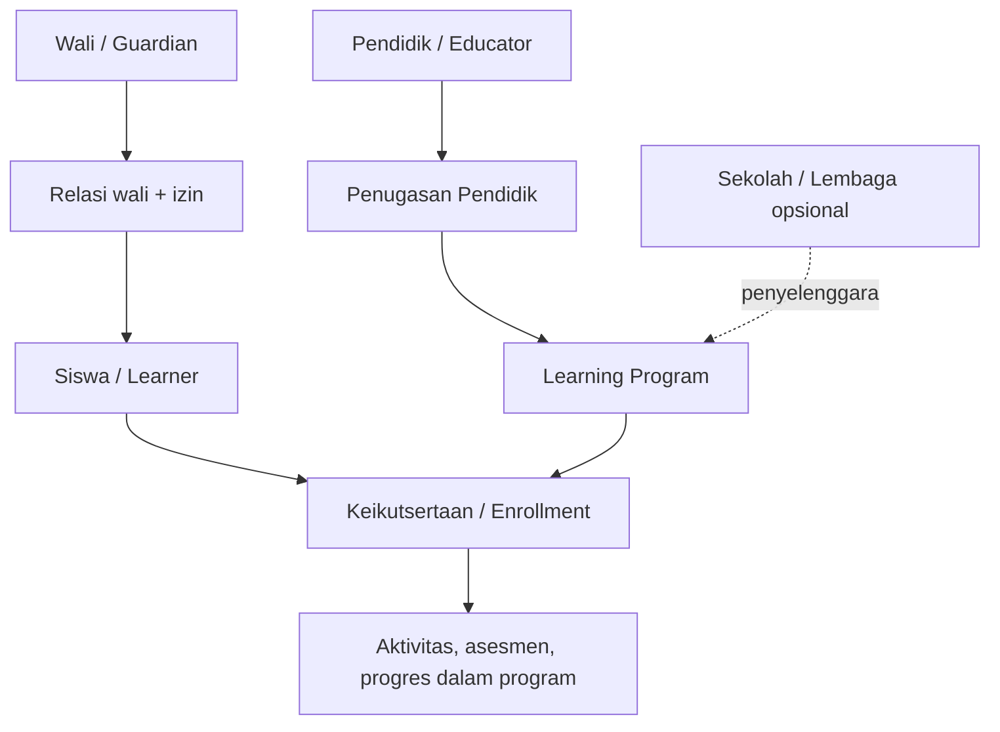
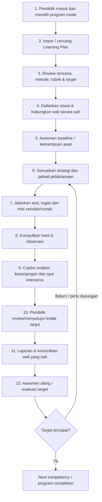
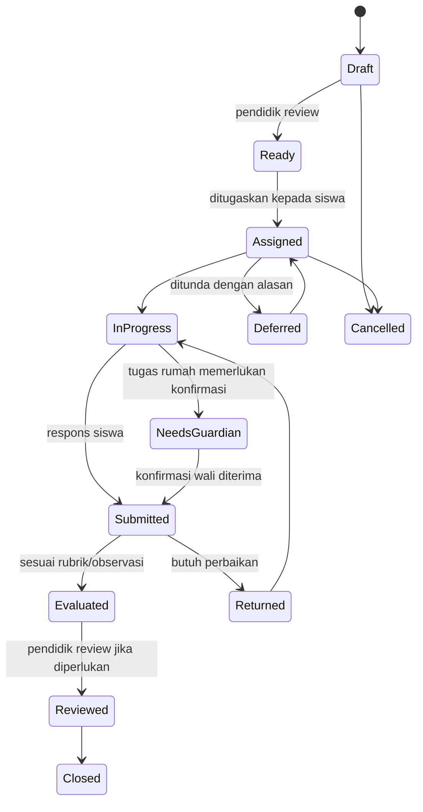
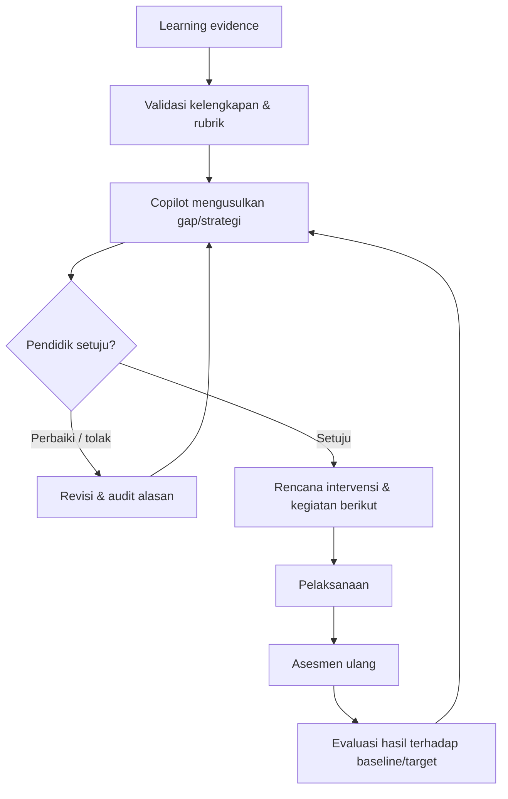

# WALIKELAS.ID — PRODUCT BLUEPRINT & TECHNICAL PLANNING HANDOFF
## MVP v0.1 · Fondasi produk lintas guru sekolah, tutor privat, siswa dan wali

**Versi dokumen:** 2.0 (konsolidasi keputusan hingga 21 Oktober 2026)  
**Status:** Baseline konseptual **untuk menyusun technical architecture, PRD, UX, backlog dan QA**; bukan klaim bahwa produk telah selesai dibangun atau divalidasi.  
**Target bisnis:** MVP/pilot awal untuk mendukung submission accelerator pada November 2026; tenggat masing-masing program perlu dikonfirmasi ulang.  
**Basis:** Diskusi keputusan founder Oktober 2026; `WALIKELAS_MVP_FUNDAMENTAL_PRODUCT_ARCHITECTURE_v1.0.md`; `WaliKelas.ID_Development_Proposal.pdf`; `Analisis_Platform_walikelas.ID.pdf`; `walikelas-investor-report.md`.  
**Audiens:** Founder, product lead, education/pedagogy lead, software architect, AI agent/coding agent, desainer UX, QA, pilot coordinator, dan penanggung jawab privasi/perlindungan anak.

> **PRODUCT NORTH STAR:** Membantu **setiap siswa berkembang menuju kompetensi yang ditargetkan** melalui program pembelajaran yang direncanakan pendidik, kegiatan yang sesuai kemampuan, bukti perkembangan, evaluasi dan tindak lanjut, serta partisipasi keluarga — dengan **lebih sedikit beban administratif** dan penggunaan AI yang dapat diawasi.

> **IDENTITAS:** WaliKelas **bukan hanya** generator RPP, AI chatbot siswa, LMS sekolah, atau marketplace guru. WaliKelas adalah **human-guided AI learning ecosystem**. **Educator Copilot** adalah produk masuk pasar (wedge); **siswa adalah pusat hasil**; tutor privat dan guru sekolah menggunakan **workspace pendidik yang sama, dibedakan oleh mode program**.

---

# 0. CARA MEMBACA DOKUMEN & SUMBER KEBENARAN

## 0.1 Status keputusan

- **[LOCKED]** Disepakati eksplisit dalam diskusi terakhir; jangan diubah diam-diam oleh technical design.
- **[MVP]** Harus ada untuk menunjukkan satu siklus nilai, dengan bentuk sederhana sesuai jadwal.
- **[CONDITIONAL]** Dibangun jika dependensi resmi/operasional siap; harus ada fallback.
- **[PROPOSED]** Rekomendasi desain untuk dikonfirmasi sebelum pengembangan yang mengikat.
- **[OPEN]** Keputusan belum disetujui, perlu pemilik dan tenggat.
- **[LATER]** Visi/kemampuan fase berikut, **bukan** ruang lingkup MVP.

## 0.2 Prioritas jika dokumen berbeda

1. Keputusan founder **terbaru** yang eksplisit dalam percakapan berlaku di atas proposal legacy dan rekomendasi sebelumnya.
2. Dokumen ini merupakan **konsolidasi rekomendasi**, bukan bukti bahwa semua rincian di bawah otomatis disetujui founder.
3. Dokumen fundamental v1.0 tetap menjadi dasar prinsip keselamatan, literasi, persetujuan, dan pengawasan manusia; definisi **school-centric** di dalamnya diperbarui menjadi **student-centric / program-centric** melalui keputusan terakhir.
4. Rancangan lama marketplace privat, modul bimbel, reputasi guru, atau AI Tutor bebas disimpan sebagai **arah ekspansi**; jangan diselundupkan ke backlog MVP.
5. Persyaratan hukum/kurikulum/API resmi wajib diverifikasi secara aktual dan tidak dapat diputuskan hanya dari diskusi.

## 0.3 Apa yang bukan isi dokumen ini

Tidak memilih arsitektur deployment final, tabel fisik, versi API, vendor WhatsApp, vendor LLM, UI final, atau menjamin seluruh persyaratan kurikulum telah tervalidasi. Bagian 'technical handoff' menyatakan **kontrak konsep, batas domain, dan invariants** agar arsitek teknis dapat membuat pilihan implementasi dengan benar.

---

# 1. RINGKASAN EKSEKUTIF & EVOLUSI PRODUK

## 1.1 Asal visi

WaliKelas legacy merupakan gagasan **layanan pendidikan privat eksklusif** yang mempertemukan orang tua/siswa dengan guru/tutor profesional. Proposal yang berkembang kemudian mencakup program pembelajaran, literasi, manajemen pengajar, komunikasi keluarga, dan pelaporan. Perkembangan AI menghasilkan peluang menambahkan **pendidik copilot**, aktivitas siswa yang dipersonalisasi, pendampingan wali, dan analitik perkembangan.

## 1.2 Koreksi dari diskusi mutakhir

**Koreksi pertama:** Alur `asesmen → validasi → analisis` bukan pembuka siklus utama. **Rencana dan strategi belajar terlebih dahulu dipersiapkan**, lalu data kemampuan awal menyempurnakan cara pelaksanaannya.

**Koreksi kedua:** TeacherOS yang hanya cocok untuk guru kelas sekolah akan mengerdilkan pasar awal privat. Pendidik **bisa** guru SD formal, tutor privat independen tanpa sekolah, atau tutor lembaga bimbel. **Tidak boleh diwajibkan memiliki sekolah**.

**Koreksi ketiga:** Nilai siswa harus ditentukan oleh **perkembangan individual yang terukur**, bukan hanya nilai dokumen/aktivitas terselesaikan. Pelaporan dan administratif merupakan hasil samping proses pembelajaran, bukan tujuan tunggal.

**Koreksi keempat:** Guru tidak boleh dibebani dashboard dan input baru yang justru lebih rumit. Copilot harus memperpendek siklus dari informasi yang sudah tersedia ke keputusan/tindakan berikutnya.

## 1.3 Positioning yang dikunci

> **WaliKelas adalah ekosistem pendampingan pendidikan personal berbasis AI dan pendidik profesional, yang membantu pendidik merencanakan, menjalankan, memantau dan meningkatkan kemajuan siswa serta melibatkan keluarga dengan aman.**

**Masuk pasar:** Educator Copilot melalui jaringan guru SD dan tutor privat.  
**Penerima manfaat inti:** siswa.  
**Kolaborator inti:** pendidik dan orang tua/wali.  
**Kompetensi vertikal MVP:** literasi membaca tingkat SD awal, terutama kelas 3 SD (Fase B sebagai konteks, asesmen mampu menangkap kebutuhan prasyarat).  
**Visi panjang:** membaca, berhitung, mengaji, bimbingan ujian, program privat dan lembaga, family-led learning, marketplace tutor dan pendampingan longitudinal — tanpa menjanjikan semua saat MVP.

## 1.4 Definisi keberhasilan

1. Siswa memiliki tujuan kompetensi jelas dan kegiatan yang relevan.
2. Ada **bukti** respons/hasil/observasi untuk menilai progres.
3. Pendidik lebih cepat mendeteksi kebutuhan personal dan menerapkan tindak lanjut.
4. Orang tua mendukung kegiatan rumah dengan friksi minimal tanpa menjadi guru pengganti.
5. Beban administratif bersih pendidik **menurun**, bukan sekadar berpindah aplikasi.
6. AI dapat menjelaskan sumber rekomendasi, menandai ketidakpastian, serta meminta review manusia.

---

# 2. PRINSIP PRODUK / PRODUCT INVARIANTS [LOCKED]

1. **Student-centric value.** Siswa adalah pusat hasil, bukan pusat kepemilikan seluruh data oleh penyelenggara.
2. **One educator workspace, multiple program modes.** Alur dasar sama untuk guru/tutor; sekolah dan lembaga adalah konteks, bukan prasyarat identitas pendidik.
3. **Learning Program adalah unit kegiatan pembelajaran universal.** Program boleh individual atau kelompok, formal atau nonformal, sepanjang tujuan dan pengawasnya jelas.
4. **Planning-first, evidence-adaptive.** Tujuan dan rencana dibuat sebelum pelaksanaan; asesmen awal boleh merevisi strategi, bukan menghilangkan kejelasan target.
5. **Import OR guided creation.** Pendidik boleh membawa dokumen sendiri maupun menyiapkan rencana dari wizard; tidak dipaksa membuat ulang yang valid.
6. **Do not create unnecessary paperwork.** Format dokumen mengikuti kebutuhan nyata, bukan asumsi bahwa semua guru wajib membuat RPP, silabus, Prota, Promes secara terpisah.
7. **Human educator retains authority.** AI dapat menyarankan/draft; pendidik berwenang atas penetapan rencana, intervensi, penilaian penting, dan laporan atas namanya.
8. **Guardian authorization.** Nomor WhatsApp ≠ bukti perwalian; keterhubungan dan persetujuan harus diverifikasi sesuai skenario.
9. **Activity completion ≠ competency mastery.** Klik konfirmasi wali membuktikan klaim aktivitas dilakukan, bukan otomatis penguasaan kompetensi.
10. **Program-scoped access.** Siswa dapat mengikuti beberapa program/pendidik, tanpa hak akses silang otomatis.
11. **Data minimization & safety by design.** Tidak mengumpulkan aktivitas perangkat lain, GPS, profil psikologi, atau percakapan keluarga tanpa kebutuhan terjustifikasi dan dasar yang sesuai.
12. **Screen time is not a north-star metric.** Misi singkat, ada titik selesai, aktivitas offline, tanpa engagement yang manipulatif.
13. **Source-grounded pedagogical decisions.** Kegiatan, rubrik, dan rekomendasi bersumber pada kompetensi dan metode yang ditinjau; tidak menganggap semua literatur setara.
14. **Proactive AI remains consent- and event-bound.** Tidak mengirim pesan tak terbatas; komunikasi sesuai waktu dan frekuensi yang disepakati.
15. **No unjust teacher scoring.** Persentase siswa lulus tidak menjadi skor tunggal kualitas pribadi guru; ukur pertumbuhan awal-akhir dan dampak konteks.
16. **No unapproved third-party execution.** Integrasi platform sekolah/pemerintah atau pengiriman pesan harus memakai akses yang sah, persetujuan, dan fallback.
17. **Outputs are traceable.** Laporan/analisis dapat ditelusuri ke data sumber dan persetujuan manusia.
18. **Child access is age-appropriate.** Interaksi AI siswa dalam MVP dibatasi pada misi yang disetujui, bukan obrolan terbuka.

---

# 3. PENGGUNA, IDENTITAS, RELASI DAN KONTEKS

## 3.1 Tiga aktor utama

| Aktor | Kebutuhan utama | Kewenangan akhir | Output utama |
|---|---|---|---|
| **Pendidik (Educator)** | Rencana, pelaksanaan, asesmen, observasi, personalisasi, laporan yang hemat waktu | Keputusan pedagogi atas program yang diampu | Rencana aktif, tugas, penilaian, review, tindak lanjut |
| **Orang tua/wali (Guardian)** | Arah pendampingan rumah, keyakinan atas progres, keselamatan anak | Persetujuan dan pengaturan partisipasi serta data anak sesuai kewenangan | Konfirmasi tugas rumah, umpan balik, respons komunikasi |
| **Siswa (Learner)** | Misi yang sesuai kemampuan, aman, menarik, dan tidak membosankan | Melaksanakan aktivitas dan menyampaikan jawaban; bukan otoritas persetujuan hukum | Upaya, hasil tugas, perkembangan |

**Pihak pendukung [LATER/OPERASIONAL]:** operator pilot, reviewer konten/pedagogi, pengelola lembaga, admin institusi, reviewer keselamatan. Tidak otomatis memperoleh hak melihat jawaban rinci siswa.

## 3.2 Satu identitas, banyak peran

- Seorang pendidik dapat menjadi **guru sekolah** dan **tutor privat** sekaligus. Tidak perlu akun ganda; perlu konteks kerja/program yang terpisah.
- Seorang orang tua dapat memiliki lebih dari satu anak; setiap relasi dan persetujuan berlaku untuk anak yang tepat.
- Seorang siswa dapat berada dalam beberapa Learning Program dengan pendidik/penyelenggara berbeda.
- Hubungan pendidik–siswa ditetapkan **melalui keikutsertaan program**, bukan hanya terdaftar pada sekolah yang sama.
- Identitas siswa di berbagai program perlu pengaitan yang aman; deduplikasi tidak boleh otomatis menyatukan data dua anak yang kebetulan bernama sama.

## 3.3 Tipe Educator (bukan produk berbeda) [LOCKED]

| Dimensi | Guru sekolah | Tutor independen | Tutor lembaga |
|---|---|---|---|
| Institusi formal | Biasanya ada | **Tidak wajib** | Lembaga opsional |
| Unit ajar | Kelas/semester | Individual atau kelompok kecil | Cohort/program |
| Sumber rencana | Dokumen kurikulum, rencana sekolah | Target kebutuhan siswa/keluarga | Kurikulum/standar lembaga |
| Kebutuhan keluaran | Administrasi, asesmen, laporan | Rencana sesi, bukti hasil, laporan wali | Konsistensi antar tutor, laporan program |
| Interaksi wali | Undangan dan pendampingan | Klien/keluarga dapat mengundang tutor | Undangan melalui lembaga |

**UI** dibedakan dengan *program mode* dan persyaratan kontekstual, **bukan** cabang aplikasi, role authorization berbeda total, atau duplikasi domain.

## 3.4 Model hubungan program

**Penting:** learning record operasional melekat pada konteks program. *Family Learning Overview* boleh menampilkan ringkasan lintas program **hanya** dari data yang diizinkan, bukan membuka hak akses silang antarpengajar.

---

# 4. KONSEP UNIVERSAL: LEARNING PROGRAM [LOCKED]

## 4.1 Definisi

**Learning Program** adalah kesepakatan/kerangka kegiatan pendidikan yang mempunyai **tujuan kompetensi, peserta, pendidik penanggung jawab, rencana kegiatan, bukti evaluasi, serta periode atau ritme pelaksanaan**.

Ia dapat berupa:

1. Rencana belajar Bahasa Indonesia kelas 3 SD selama semester.
2. Program membaca privat delapan sesi untuk satu anak.
3. Kelompok bimbel matematika enam minggu.
4. Program mengaji bertahap dengan metode dan rubrik yang sesuai.
5. Program persiapan ujian dengan target yang terukur.

**Kesamaan engine:** `rencana → asesmen awal → pembelajaran/tugas → bukti → review → intervensi → evaluasi → perbaikan`.

## 4.2 Mode program

**A. School/Classroom Mode [MVP minimal]:** jenjang, kelas, tahun/semester bila relevan, kurikulum/target, rencana ajar dan dokumen administratif yang dibutuhkan; banyak siswa.

**B. Private Tutor Mode [MVP minimal]:** tanpa sekolah wajib; satu atau beberapa siswa, target personal, jumlah/periode sesi fleksibel, ringkasan keluarga; dokumen formal tidak dipaksakan.

**C. Bimbel Institution Mode [LATER]:** kelompok, beberapa tutor, pengelola, paket/program yang dapat digunakan ulang, standar lembaga, dan pengawasan mutu.

**D. Family Self-guided Mode [LATER produk lengkap; prinsip jalur tetap LOCKED]:** wali memulai misi kurasi tanpa pendidik aktif; tidak boleh mengklaim verifikasi pendidik. Aktivitas awal mandiri dapat diuji sederhana bila prioritas waktu memungkinkan, tetapi bukan ketergantungan MVP educator-led.

## 4.3 Minimum program metadata (konseptual)

- Nama program, sasaran peserta, mode, dan periode/rentang sesi.
- Penyelenggara dan pendidik penanggung jawab (satu pendidik pada MVP).
- Kompetensi/target, indikator pencapaian, metode serta referensi yang disetujui.
- Rencana pertemuan/misi dan cara asesmen.
- Rubrik yang mendefinisikan bukti kemajuan.
- Hubungan wali serta status persetujuan sesuai jenis aktivitas.
- Status program dan versi rencana aktif.

**Tidak boleh wajib pada Private Tutor Mode:** NPSN, sekolah asal, Prota, Promes, kode kelas formal, penandatangan kepala sekolah, nomor kepegawaian.

## 4.4 Status program [PROPOSED]

`draft → ready_for_review → active → paused → completed → archived`.

- Hanya program `active` boleh membuat penugasan baru kepada siswa.
- `paused` mempertahankan data, tidak menjadwalkan aktivitas baru tanpa keputusan manusia.
- Revisi rencana saat `active` membuat **versi baru**; catatan kegiatan masa lalu tetap mengacu ke versi yang berlaku saat kejadian.
- `archived` adalah status operasional, bukan izin menghapus data tanpa kebijakan retensi.

---

# 5. SIKLUS PENDIDIKAN END-TO-END [LOCKED]

**Urutan di atas adalah default, bukan penghalang operasional.** Siswa bisa ditambah belakangan, asesmen baseline bisa memakai bukti yang sudah ada dan disetujui, dan rencana dapat diperbarui. Sebaliknya, produk tidak boleh membolehkan **misi siswa aktif** sebelum kewenangan/persetujuan dan konten misi valid.

## 5.1 Mengapa planning-first

Rencana adalah **peta tujuan, bukti dan strategi**. Asesmen awal menunjukkan titik berangkat masing-masing siswa. Strategi dapat disesuaikan secara dinamis, sementara jejak alasan dan persetujuan guru dipertahankan.

## 5.2 Dua loop yang berbeda

- **Macro-loop program:** rencana periode → pelaksanaan berulang → review → evaluasi ketercapaian → revisi rencana.
- **Micro-loop misi/tugas:** penugasan → pengerjaan → penyerahan/konfirmasi → penilaian → umpan balik → rekomendasi.

Jangan membuat satu status global `siswa_sudah_lulus` yang menggantikan target per kompetensi dan konteks program.

---

# 6. WORKFLOW A — ONBOARDING & EDUCATOR WORKSPACE

## 6.1 Educator-first: jalur MVP [LOCKED]

1. Pendidik membuat akun dan memahami batas AI, pengolahan data anak, dan aturan layanan.
2. Pendidik memilih konteks pertama: **guru sekolah** atau **tutor privat**.
3. Pendidik membuat Learning Program dan menetapkan target kompetensi.
4. Pendidik memilih membuat rencana melalui **unggah dokumen**, **template tersedia**, atau **wizard tanya-jawab**.
5. WaliKelas mengidentifikasi informasi yang tersedia/belum ada; guru memperbaiki dan menyetujui.
6. Pendidik menambahkan siswa (identitas minimum) dan membentuk hubungan wali sesuai aturan.
7. Pendidik melakukan/merujuk asesmen awal, menyiapkan kegiatan, menjalankan siklus program.

## 6.2 Educator shared workspace [LOCKED]

Permukaan utama disusun berdasarkan **program dan pekerjaan yang perlu ditindaklanjuti**, bukan menu yang berbeda antara guru dan tutor.

**Area konseptual bersama:**

- **My Programs**: daftar program aktif/draf/selesai.
- **Plan & Goals**: tujuan, rencana, materi, sumber, versi rencana.
- **Learners**: peserta dalam program, status hubung wali, gambaran progres.
- **Sessions & Missions**: aktivitas yang direncanakan dan dijalankan.
- **Evidence & Assessment**: tugas, hasil, observasi, rubrik.
- **Copilot Suggestions**: kekurangan data, anak membutuhkan perhatian, rencana tindak lanjut.
- **Reports & Communication**: draf laporan dan pesan wali.

**Adaptive contextual fields:** hanya tampilkan kalender/semester/template sekolah jika mode memerlukannya. Hasil kerja administratif tidak boleh membanjiri tutor privat.

---

# 7. WORKFLOW B — PLANNING COPILOT / DOCUMENT INTELLIGENCE

## 7.1 User story inti

> Sebagai pendidik, saya ingin memakai rencana yang sudah saya miliki atau menyusunnya bersama Copilot sehingga tujuan pembelajaran, aktivitas, asesmen dan keluaran administratif terbentuk tanpa pengisian ulang yang tidak perlu.

## 7.2 Tiga pintu masuk [LOCKED]

**Import existing:** Unggah dokumen yang telah dibuat di luar WaliKelas. Copilot mengekstrak informasi, menampilkan hasil terstruktur, menandai ambiguitas, dan meminta verifikasi; **jangan diam-diam mengganti isi atau mengklaim kepatuhan hukum**.

**Guided Wizard:** Pertanyaan bertahap terkait konteks, peserta, hasil yang dituju, jadwal, kemampuan awal jika ada, materi/metode, format penilaian, serta format keluaran. Jawaban dapat dilanjutkan kemudian; jangan meminta puluhan isian sekaligus jika dapat diisi dari data yang sudah tersedia.

**Default/Reference Template:** Template yang telah ditinjau, dengan versi dan konteks kurikulum yang jelas. Perubahan template sekolah tidak mengubah data sumber secara diam-diam.

## 7.3 Langkah wizard konseptual [PROPOSED]

| Tahap | Pertanyaan inti | Hasil |
|---|---|---|
| 1. Konteks | Sekolah / privat? Jenjang? Periode? | Mode & batas program |
| 2. Sumber | Sudah punya dokumen? Ingin impor/generate? | Material sumber |
| 3. Tujuan | Kompetensi apa yang ingin dicapai? | Learning objectives |
| 4. Bukti | Bagaimana keberhasilan akan diuji? | Indikator/rubrik |
| 5. Strategi | Metode, rencana materi, sesi, diferensiasi? | Learning activities |
| 6. Administratif | Format yang diwajibkan institusi? | Output profile |
| 7. Review | Ada data kurang, konflik, atau asumsi AI? | Draf disetujui pendidik |

**Penting:** bentuk dokumen **Prota, Promes, silabus, ATP, RPP/modul** adalah **opsi keluaran kontekstual**, bukan kewajiban universal. Jenis serta ketentuan formal perlu diverifikasi menurut kurikulum/institusi yang berlaku; tidak boleh mengklaim semua diwajibkan.

## 7.4 Transformasi rencana → pekerjaan [LOCKED]

Rencana yang telah diaktifkan menjadi sumber operasional untuk:

- agenda sesi/pertemuan,
- tugas/misi sesuai tujuan,
- asesmen dan rubrik,
- pengingat pekerjaan pendidik,
- laporan progres terhadap target,
- usulan intervensi dan revisi rencana.

**Invariants:** data sumber dan keluaran terkait harus dapat dilacak; perubahan rencana membuat versi baru; aktivitas historis tidak ditulis ulang.

## 7.5 Document quality gates [MVP]

- Sumber dokumen/asal referensi diketahui.
- Copilot memisahkan teks asli, ekstraksi, dan usulan perbaikan.
- Field penting kosong atau ambigu memicu review.
- Pendidik dapat mengedit semua hasil.
- Dokumen baru tetap **draft** sampai disetujui.
- Klaim "sesuai ketentuan resmi" hanya jika template dan aturan yang relevan benar-benar telah ditinjau.

---

# 8. WORKFLOW C — LEARNER ENROLLMENT, GUARDIAN & CONSENT

## 8.1 Enrollment

Siswa masuk ke **Learning Program**, bukan otomatis bergabung pada seluruh layanan milik pendidik/lembaga. Untuk School Mode peserta dapat diimpor dari daftar kelas yang sah; untuk Private Mode cukup menambahkan satu siswa.

**Identitas MVP:** kode peserta/nama yang diperlukan, kelompok/jenjang bila relevan, hubungan wali, informasi kontak wali setelah tujuan/persetujuan dijelaskan. Jangan mengharuskan NISN, data kesehatan, atau tanggal lahir lengkap bila tidak perlu.

## 8.2 Guardian linkage

1. Pendidik mencatat informasi kontak wali sesuai hak/izin yang dimiliki.
2. Wali menerima undangan/verifikasi hubungan yang sesuai dengan tingkat sensitivitas data.
3. Wali menerima informasi tujuan, data yang diproses, siapa pendidik, dan opsi partisipasi.
4. **Sebelum izin memadai**, tidak boleh mengirim nilai/detail belajar sensitif lewat kanal tersebut.
5. Wali memilih kanal/notifikasi yang diizinkan; dapat menolak, mengubah pengaturan, atau mengakhiri hubungan sesuai prosedur.

**WhatsApp adalah connector point yang diinginkan**, bukan model identitas/otorisasi penuh.

## 8.3 Siswa dengan lebih dari satu pendidik

- Program A (sekolah), B (privat), C (mengaji) mempunyai penugasan dan data kerja masing-masing.
- Masing-masing pendidik hanya melihat informasi yang diperlukan pada programnya.
- Ringkasan lintas program di akun wali harus membatasi data pada akses yang memang sah.
- Berbagi data program A kepada pendidik B merupakan tindakan terpisah dengan tujuan dan izin yang jelas.

## 8.4 Family-first entry [LATER full experience; prinsip [LOCKED]]

Keluarga dapat secara konseptual membuka aktivitas mandiri dan kemudian mengundang tutor. *Teacher-verified* tidak boleh ditampilkan jika tidak ada pendidik yang benar-benar meninjau. Pada MVP educator-first, **jangan memaksa pembangunan toko tutor, marketplace, dan pembayaran** demi mendukung model keluarga masa depan.

---

# 9. WORKFLOW D — SESSIONS, MISSIONS, ASSESSMENTS & OBSERVATIONS

## 9.1 Sesi/pertemuan

Satu sesi adalah pelaksanaan terjadwal atau tercatat dari rencana program. School Mode bisa menautkannya ke agenda kelas; Private Mode ke pertemuan privat. **Sesi tidak sama dengan misi**: satu sesi dapat memberi beberapa tugas, satu misi dapat dikerjakan di rumah.

## 9.2 Jenis tugas [LOCKED]

- **In-class / offline**: kegiatan di sekolah/tempat bimbel; hasil dimasukkan oleh pendidik.
- **WaliKelas digital mission**: siswa menjalankan aktivitas terstruktur, aman, dan terbatas waktunya.
- **Home/offline family mission**: dilakukan di rumah, pendampingan/konfirmasi wali bila disyaratkan.
- **Independent practice**: tugas mandiri yang tidak otomatis membutuhkan konfirmasi wali.

Setiap tugas mengikat ke tujuan kompetensi, instruksi jelas, rubrik/bukti yang dibutuhkan, status, penerima, dan aturan penutupan.

## 9.3 Asesmen & rubrik

MVP memilih satu rangkaian **literasi membaca kelas 3 SD**: pemahaman bacaan naratif pendek, dengan asesmen awal untuk mengidentifikasi kebutuhan prasyarat. Pertanyaan dan kriteria hasil disetujui reviewer pendidikan/pendidik yang berwenang.

**Catatan kritis:** nilai numerik, observasi, konfirmasi wali dan status ketuntasan bukan informasi yang saling menggantikan.

## 9.4 Observasi personal guru

Pendidik dapat mencatat **kehadiran, partisipasi/keaktifan secara deskriptif, kesulitan yang terlihat, kebutuhan pengulangan, bentuk bantuan yang diberikan**, dengan konteks kegiatan dan tanggal. Ini bukan profiling psikologi, penilaian moral, atau label tetap terhadap anak.

**Antifriction:** input cepat per siswa atau kelompok, template observasi opsional, bisa dilewati, tanpa menambah administrasi yang tidak mendukung keputusan.

## 9.5 State of mission [PROPOSED]

**Pemisahan status:** `guardian_confirmed` boleh mencatat *aktivitas dikonfirmasi wali*; tidak boleh langsung menetapkan `competency_mastered`.

---

# 10. WORKFLOW E — FAMILY ENGAGEMENT & WHATSAPP

## 10.1 Prinsip

Komunikasi harus **ringan**, relevan, consent-based, tidak menggurui atau menekan keluarga. AI berperan menyiapkan dan mengoordinasikan pesan, bukan memaksa interaksi.

## 10.2 MVP minimal [CONDITIONAL]

1. Pendidik menetapkan misi rumah yang membutuhkan pendampingan.
2. Wali yang sah menerima ringkasan instruksi dan periode aktivitas.
3. Wali memberi respons **Selesai / Belum / Butuh bantuan** melalui alur resmi jika tersedia.
4. WaliKelas mencatat waktu, sumber konfirmasi dan program terkait.
5. Pendidik melihat ringkasan, bukan spam setiap balasan.
6. Jika izin, identitas, atau pengiriman bermasalah, tidak ada data sensitif terkirim; tugas dapat tetap dikerjakan/ditunda melalui alur alternatif.

**Fallback tanpa WhatsApp Business API siap:** tautan konfirmasi aman dari web, input pendidik setelah mendapat bukti, atau pilot manual terawasi yang transparan; tidak berpura-pura bahwa integrasi sudah live.

## 10.3 Batasan pesan

- Wali opt-in sesuai kanal, preferensi waktu dan frekuensi.
- Draf laporan nilai/progres individual perlu review dan kontrol penerima sebelum dikirim.
- Tidak mengirim data anak kepada nomor belum tervalidasi.
- Jangan otomatis mengulang reminder tanpa batas.
- Tidak mewajibkan wali memasang aplikasi untuk **konfirmasi tugas sederhana**, bila kanal memungkinkan dengan aman.
- Konten tidak boleh menyebut anak "bodoh", "malas", memiliki diagnosis/masalah psikologi, atau status penilaian yang tidak didukung bukti.

---

# 11. WORKFLOW F — LEARNING INTELLIGENCE & TEACHER COACHING

## 11.1 Bukan analisis sekali setelah ujian

Copilot menerima tujuan dari rencana, aktivitas aktual, hasil asesmen, observasi pendidik dan konfirmasi rumah yang relevan. Berdasarkan sumber dan rubrik, agent menyusun **hipotesis kesenjangan**, bukan vonis tetap terhadap siswa.

## 11.2 Hasil analisis yang dibutuhkan

- Kemampuan awal/baseline dan target yang dibandingkan.
- Perkembangan pada kompetensi tertentu.
- Siswa yang belum mempunyai bukti memadai.
- Pola kesulitan kelompok dan kebutuhan individual.
- Usulan remedial/pengayaan/diferensiasi dan kapan asesmen ulang perlu dilakukan.
- Catatan alasan dan sumber data untuk tiap rekomendasi.

## 11.3 Intervensi dan peninjauan manusia

**Teacher coaching:** agent dapat mengusulkan teknik pembelajaran yang memiliki referensi pedagogis, contoh praktik kelas, dan cara mengevaluasinya. Tidak memberi **skor kualitas pribadi guru** dari hasil satu kelas; kualitas dinilai dari pengaruh intervensi dengan konteks yang memadai.

## 11.4 Penilaian penguasaan

Status yang dianjurkan: `belum ada bukti → perlu dukungan → berkembang → indikasi menguasai → tervalidasi pendidik`. Tidak semua kompetensi memerlukan skema angka identik. **Satu jawaban benar, nilai otomatis, atau klik wali tidak cukup** untuk menetapkan penguasaan.

## 11.5 Ukuran hasil siswa vs guru

**Learning outcome:** ketercapaian standar kompetensi yang didefinisikan, pertumbuhan dari baseline, dan bukti hasil intervensi.  
**Educator productivity:** waktu netto menyiapkan rencana, penilaian, intervensi dan laporan; bukan hanya kecepatan generasi teks.  
**Tidak diperbolehkan:** memberi ranking guru hanya dari persentase siswa tuntas tanpa menilai kemampuan awal dan konteks.

---

# 12. WORKFLOW G — REPORTING & OUTPUT

## 12.1 Kategori keluaran

**Administratif sekolah:** dokumen perencanaan, rekap, laporan sesuai format yang benar-benar dibutuhkan; ketentuan jenis/template diverifikasi per konteks.  
**Progres siswa:** perkembangan kompetensi individual, hasil tugas/asesmen, pola yang terlihat, rekomendasi pendampingan.  
**Progres program/tutor:** ringkasan sesi, tujuan, progres, tindak lanjut bagi keluarga.  
**Kelas/kelompok:** gambaran agregat untuk pendidik yang memiliki akses.

## 12.2 Aturan kualitas

- Setiap klaim progres mengacu pada bukti spesifik atau dinyatakan sebagai **saran/hipotesis**.
- Format laporan dapat mengikuti default atau contoh dokumen yang disediakan pendidik.
- Tidak membuat kesimpulan psikologis atau kondisi rumah tangga dari aktivitas aplikasi.
- Persetujuan siapa, kapan, dan versi dokumen yang disetujui tercatat.
- Bila nilai, rubrik, atau data sumber berubah, dokumen terkait menjadi **perlu ditinjau**; revisi tidak otomatis menimpa dokumen yang sudah disahkan.
- Penerima hanya mendapat bagian yang sesuai kewenangan.

## 12.3 Single source of educational facts

**Prinsip:** satu fakta pendidikan tercatat dalam bentuk yang bisa digunakan kembali; berbagai format dokumen adalah **representasi/output**, bukan fakta baru yang tidak sinkron. Ini tidak berarti WaliKelas menggantikan data master resmi sekolah atau menjadi sistem pemerintah.

---

# 13. MODEL PERAN, OTORISASI, DAN APPROVAL [LOCKED]

| Aksi | Pendidik program | Wali sah | Siswa | AI Copilot |
|---|---|---|---|---|
| Membuat rencana program | Buat/setujui | Usul target privat | Tidak | Draf/bantu |
| Mengubah target kompetensi | Setujui | Ajukan kebutuhan | Tidak | Rekomendasi |
| Mengundang wali | Mulai proses jika berwenang | Terima/verifikasi | Tidak | Kirim bila diizinkan |
| Menerima pemrosesan data anak | Tidak mewakili wali | Tindakan wali sesuai aturan | Penjelasan/assent sesuai usia | Tidak |
| Menetapkan tugas | Setujui | Dapat usul misi keluarga | Kerjakan | Draf |
| Mengonfirmasi pendampingan rumah | Lihat hasil | Konfirmasi | Ikut aktivitas | Catat |
| Menilai penting/menetapkan masteri | Setujui/validasi | Tidak | Tidak | Usul berbasis bukti |
| Mengirim laporan atas nama pendidik | Setujui | Terima | Tampilan sesuai usia | Siapkan/kirim sesudah aturan terpenuhi |
| Membuka data lintas program | Hanya bila diberi hak | Sesuai hubungan yang sah | Tampilan sendiri | Tidak memperluas akses |
| Menutup program | Berwenang sesuai program | Meminta keluar | Tidak | Tidak sepihak |

**Kasus otorisasi yang wajib didukung:** guru berhenti mengajar, tutor tidak lagi menjadi pendamping, wali mengganti nomor, wali menarik persetujuan, siswa pindah program, dua wali memiliki hak berbeda, serta sengketa identitas/hubungan. Detail legalnya perlu review sebelum pilot nyata.

---

# 14. PEDAGOGICAL KNOWLEDGE GOVERNANCE

## 14.1 Sumber yang digunakan

Knowledge base harus membedakan **kurikulum**, **metode pedagogis**, **rubrik**, **materi ajar**, **panduan perkembangan sesuai usia**, dan **konteks lokal**. Tidak semua sumber punya derajat bukti sama.

## 14.2 Tata kelola minimal [MVP]

- Materi/rubrik literasi pertama dikurasi dan ditinjau pendidik yang ditunjuk.
- Setiap kompetensi punya definisi, indikator, pertanyaan/tugas yang relevan, dan kriteria evaluasi.
- Rekomendasi AI dibatasi oleh rencana/rujukan yang telah disetujui.
- Sumber yang tidak tersedia/kontradiktif ditandai, bukan diisi dengan klaim baru.
- Metode baru tidak langsung aktif pada seluruh anak hanya karena diunggah pengguna.
- Perubahan kurikulum/metode sebaiknya menghasilkan revisi terkontrol, bukan memutasi histori progres.

## 14.3 Ekspansi program [LATER]

Berhitung, mengaji dan ujian memerlukan **ontology kompetensi, metode, sumber serta rubrik berbeda**. Jangan memakai rubrik literasi bahasa Indonesia untuk mengaji. Program pendidikan agama merupakan pilihan sesuai tujuan keluarga/institusi, bukan kewajiban umum pengguna.

---

# 15. AI COPILOT: JOB-TO-BE-DONE, BUKAN CHATBOT BEBAS

| Peran fungsional | Pemicu | Hasil | Human gate |
|---|---|---|---|
| Planning Copilot | Program baru/unggah dokumen | Ringkasan, draft target, rencana, dokumen | Pendidik menyetujui |
| Classroom/Tutor Copilot | Sesi mendekat / tugas dibuat | Agenda, misi, template observasi | Pendidik menyetujui |
| Assessment Copilot | Hasil tersedia | Validasi data, rekap, indikasi gap | Review untuk penilaian penting |
| Intervention Copilot | Gap atau target tertinggal | Rekomendasi individual/kelompok + alasan | Pendidik memutuskan |
| Family Coordination Copilot | Misi rumah/laporan disetujui | Instruksi/pengingat/konfirmasi wali | Aturan izin + review konten |
| Professional Coaching Copilot | Guru memerlukan dukungan [LATER] | Referensi metode dan refleksi praktik | Pendidik memutuskan |

**Semua peran dapat menggunakan satu orchestrator, bukan wajib enam layanan/model berbeda.** Teknis boleh memilih cara paling sederhana selama otoritas, provenance, dan pengamanan terpenuhi.

**Batas siswa [MVP]:** tidak ada chat generatif unrestricted; hanya misi dan bantuan terkurasi/terkontrol dengan aturan keselamatan anak. **Tidak ada** diagnosis/kepribadian otomatis.

---

# 16. SATU MVP YANG MEMBUKTIKAN NILAI — VERTICAL SLICE

## 16.1 Hipotesis MVP [LOCKED scope, efektivitas masih hipotesis]

WaliKelas Educator Copilot **dapat mendukung guru SD dan tutor privat dengan mesin program yang sama**, serta membantu mereka menjalankan satu siklus pembelajaran literasi dengan lebih efisien, personal, dan mudah dipantau keluarga.

## 16.2 Happy path MVP

1. Educator memilih **School** atau **Private** saat membuat program.
2. Membuat/meninjau **satu unit rencana literasi** dengan upload sederhana atau wizard.
3. Mendaftarkan satu kelompok kecil siswa; mengundang wali dengan perlindungan akses.
4. Menetapkan kemampuan awal (hasil sederhana yang diajukan/ditinjau guru).
5. Menyiapkan satu misi membaca digital dan satu misi pendampingan rumah.
6. Siswa mengerjakan misi; wali memberi konfirmasi bila relevan.
7. Pendidik mencatat nilai/observasi singkat.
8. Copilot menghasilkan draf ringkasan progres dan satu opsi tindak lanjut.
9. Pendidik review/menyetujui.
10. Keluarga menerima laporan sederhana melalui kanal yang sah; hasil muncul dalam progres program.

**Dalam satu demo, jangan menyamakan semua tugas administrasi semester dengan satu unit rencana pilot.**

## 16.3 In scope [MVP]

| Komponen | Minimum viable behavior | Larangan perluasan diam-diam |
|---|---|---|
| Akun/role | Educator, wali, siswa/pseudonym pilot sesuai skenario | Marketplace, social network |
| Shared workspace | Satu layar/flow dengan School vs Private mode | Dua aplikasi terpisah |
| Program | Buat, review, aktifkan, tutup sederhana | Multi-campus management |
| Planning | Satu format upload sederhana **atau** text import + wizard; review hasil | Semua file/semua kurikulum tanpa validasi |
| Curriculum | Satu unit Bahasa Indonesia kelas 3 SD dengan rubrik terkurasi | Seluruh mata pelajaran/jenjang |
| Enrollment | Tambah peserta dan hubungan wali dengan izin aman | Sinkron seluruh database sekolah |
| Mission | Satu misi literasi digital + satu aktivitas rumah | Free-form AI tutor 24/7 |
| Evidence | Jawaban, tugas, observasi, konfirmasi wali terpisah | Skor psikologi otomatis |
| Copilot | Draf analisis dan tindak lanjut yang dapat ditinjau | Otonomi penetapan nilai atau pengiriman sensitif |
| Report | Ringkasan individu + ringkasan kelompok dasar | Semua format rapor resmi |
| Access/audit | Program-scoped, consent, review log | Sharing lintas program otomatis |
| Guardian channel | Web secure-link minimal; WhatsApp resmi bila siap | Mengirim data sensitif ke nomor tak tervalidasi |

## 16.4 Critical vs optional pada kondisi 2–3 minggu

**P0 MUST WORK:** School/Private program mode, plan setup wizard atau sumber dokumen yang valid, daftar siswa, guardian safe linkage, misi, asesmen/observasi, educator review, laporan, permission, audit minimal.

**P1 CAN BE MANUAL/REDUCED:** parsing PDF kompleks, banyak template, smart schedule, konfirmasi WhatsApp interaktif, rekomendasi lanjutan multi-LLM, otomatisasi bulk.

**P2 DEFER:** marketplace, payment, tutor discovery, AI voice realtime, pengawasan semua aplikasi anak, rating guru, Dapodik/e-Rapor write-back, full LMS, multi-tutor institution admin.

**Trade-off:** jika terlambat, **kurangi keluasan generator dokumen dan otomatisasi notifikasi**, tetapi **pertahankan hubungan `rencana → aktivitas → bukti → tindak lanjut`**.

---

# 17. ANTIFRICTION UX REQUIREMENTS

1. Pendidik tidak perlu memilih institusi jika tutor independen.
2. Wizard menyarankan jawaban dari data tersedia; pendidik dapat melewati field opsional.
3. Impor tidak boleh diam-diam mengubah data; field ekstraksi dipreview.
4. Pendidik bisa menjalankan pilot dengan **satu program, beberapa siswa, dan satu misi**, tanpa mengisi Prota/Promes/RPP lengkap.
5. Observasi memiliki opsi sekali klik + catatan singkat; pendidik tidak wajib menulis narasi panjang per tugas.
6. Wali cukup memberi satu respons sederhana untuk tugas yang memang memerlukan konfirmasi.
7. Student UI menampilkan satu aktivitas tiap tahap, ada akhir yang jelas, tidak ada infinite feed/streak memaksa.
8. Laporan muncul sebagai draf yang sudah tersusun dan dapat dikoreksi; tidak memerlukan prompt AI ahli.
9. Pendidik melihat **item yang membutuhkan keputusan**, bukan notifikasi atas seluruh interaksi biasa.
10. Semua keluaran menandai apakah merupakan catatan manusia, hasil penilaian otomatis, atau rekomendasi AI.

---

# 18. EDGE CASES & FAILURE MODES WAJIB UNTUK QA

| Kondisi | Perilaku yang diinginkan |
|---|---|
| Tutor privat tanpa sekolah | Program tetap dapat dibuat tanpa field sekolah wajib |
| Satu educator = guru sekolah + tutor privat | Konteks, peserta dan dokumen dipisahkan per program |
| Satu anak ikut beberapa program | Tiap pendidik melihat hanya data program berwenang |
| Wali belum terverifikasi | Tidak menerima data hasil belajar sensitif |
| Nomor WhatsApp berubah | Hubungan dengan nomor lama tidak otomatis tetap sah |
| Wali menarik izin | Hentikan komunikasi/pemrosesan sesuai hukum/prosedur; jangan menghapus bukti audit secara serampangan |
| Siswa tidak menyelesaikan misi | Boleh tunda/ulang; tidak dianggap gagal kompetensi |
| Wali konfirmasi kegiatan selesai | Catat aktivitas selesai, **bukan** penguasaan kompetensi |
| Nilai asesmen berubah | Analisis/laporan terdampak ditandai perlu review |
| Dokumen unggahan tidak terbaca | Minta klarifikasi; jangan memaksa interpretasi palsu |
| Dua dokumen sumber bertentangan | Tampilkan konflik dan keputusan pendidik |
| Guru menolak rekomendasi AI | Tidak dieksekusi; simpan keputusan sesuai kebijakan |
| Pendidik keluar program | Hentikan kewenangan akses program selanjutnya sesuai prosedur |
| Anak kesulitan prasyarat membaca | Sistem dapat mengusulkan latihan dasar/review, tidak memaksa level kelas |
| Wali tidak memiliki WhatsApp | Gunakan alternatif kanal/manual yang sah |
| WhatsApp API/template belum tersedia | Gunakan fallback; jangan menandai terkirim jika belum |
| Sumber pedagogi tidak cukup | Agent menyatakan keterbatasan dan meminta review |
| Anak bertanya di luar konteks misi | Bantuan dibatasi dengan respons aman/redirect |
| Instrumen asesmen tidak sebanding | Jangan mengklaim peningkatan kompetensi kausal |
| Guru memiliki data kelas 30 siswa | Copilot merangkum kebutuhan tanpa membuat 30 tugas review tak perlu |

---

# 19. PRIVASI ANAK, ETIKA, DAN TRUST

## 19.1 Data yang diperlukan

Konteks kelas/level, relasi anak–wali, hubungan program, target kompetensi, kegiatan, hasil yang relevan, persetujuan, catatan guru terbatas, dan log review. **Tidak** mengumpulkan browsing perangkat, GPS, rekaman pasif, profil agama/psikologi, atau catatan keluarga berlebihan demi personalisasi.

## 19.2 Perlu ditentukan sebelum pilot riil [OPEN]

- Dasar hukum dan mekanisme persetujuan/pemberitahuan yang berlaku, termasuk peran sekolah/tutor sebagai pengendali/pemroses data.
- Kebijakan retensi, permintaan akses/koreksi/penghapusan, serta pengelolaan insiden.
- Prosedur verifikasi wali dan hubungan multi-wali.
- Protokol keselamatan konten/interaksi anak, pelaporan insiden, dan pengawasan pendidik.
- Kanal pesan resmi dan ketentuan platform pihak ketiga.

**Tidak boleh menganggap kesediaan guru membagikan spreadsheet siswa sebagai izin sah menggunakan seluruh data anak.** Untuk uji awal dapat memakai data sintetis atau de-identified sebelum izin lengkap.

---

# 20. VALIDASI MVP & PRODUCT METRICS

## 20.1 Tujuan pilot

Membuktikan bahwa siklus edukasi dapat dijalankan di **dua konteks** (guru sekolah dan tutor privat) **tanpa mengubah engine utama**, memiliki manfaat administratif nyata dan rekomendasi progres yang dapat digunakan.

## 20.2 Sampel rancangan pilot [PROPOSED]

- 3–5 guru SD dan 3–5 tutor privat membaca/berhitung (untuk MVP konten uji tetap membaca).
- Beberapa siswa/wali yang memberikan izin sesuai syarat, atau data sintetis untuk pengujian workflow sebelum rekrutmen.
- Sedikitnya satu rangkaian perencanaan–misi–penilaian–review–laporan per pendidik.
- Ada satu pekerjaan pembanding yang dilakukan dengan cara saat ini (Word/Excel/aplikasi yang sudah dipakai).

Angka ini target desain eksperimen, **bukan** hasil nyata atau janji traction.

## 20.3 Metrik

| Kategori | Ukuran & alasan |
|---|---|
| Educator activation | Pendidik berhasil aktifkan program pertama dan kirim tugas |
| Time saved | Selisih total durasi kerja *termasuk* koreksi dibanding baseline |
| Error rate | Kesalahan data/interpretasi pada laporan yang harus diperbaiki |
| Rework avoided | Jumlah input informasi ulang atau perpindahan aplikasi yang dihilangkan |
| Teacher acceptance | Rekomendasi berguna/ditolak beserta alasan |
| Family task participation | Konfirmasi/keterlibatan tanpa memaksa semua keluarga |
| Learner completion | Aktivitas dan hasil per misi, bukan total waktu layar |
| Competency signal | Indikasi progres berbasis instrumen setara; tidak mengklaim kausalitas dari pilot singkat |
| Retention | Pendidik/keluarga kembali mengerjakan sesi berikut |
| Safety | Kesalahan akses, keluhan, dan masalah konten |
| WTP | Minat/komitmen membayar yang teruji, bukan hanya pujian demo |

**North-star visi:** educator-verified student competency progress.  
**Metrik MVP operasional:** educator-completed learning cycles with verified outputs, dan net educator time saved.  
**Tidak digunakan:** menit layar siswa atau jumlah dokumen AI yang dihasilkan sebagai ukuran keberhasilan utama.

---

# 21. KESIAPAN PITCH & MONETISASI (TIDAK MASUK IMPLEMENTASI MVP)

## 21.1 Dua jalur ekonomi

**Educator Copilot SaaS:** guru/tutor/lembaga membayar untuk workspace, perencanaan, penilaian, laporan dan tindak lanjut. Siapa pembeli primer **belum terbukti**.

**Managed Learning Services:** keluarga membayar program privat terkelola dengan pengajar profesional + AI. Mungkin perlu pembayaran komisi, scheduling, verifikasi tutor, dan dukungan manusia. Ini visi legacy, **bukan** monetisasi yang harus dibangun minggu ini.

## 21.2 Pintu masuk ke pasar

- **MVP go-to-market:** jaringan guru SD serta tutor privat untuk design partnership; founder mempunyai akses ke komunitas pendidik.
- **Lanjutan:** lembaga bimbel, keluarga mandiri, pencarian tutor dan marketplace terverifikasi.
- Tidak ada kewajiban guru sekolah mempromosikan layanan privat kepada muridnya; cegah konflik kepentingan dan tekanan komersial.

## 21.3 Pitch yang dapat dipertahankan

> WaliKelas equips teachers and independent tutors with an AI learning copilot that turns plans into personalized student activities, evidence-based interventions, and parent-ready progress updates — reducing repetitive admin while keeping learners at the center.

**Claim guardrails:** tidak mengklaim peningkatan literasi nasional, pengurangan screen dependency, validasi psikologi anak, atau hasil belajar kausal yang belum diuji.

---

# 22. EXTENSIBILITY PLAN — DIKAWAL, TAPI TIDAK DIBANGUN SEKARANG

| Ekstensi masa depan | Yang perlu dipersiapkan pada fondasi konsep MVP | Yang ditunda |
|---|---|---|
| Program berhitung | Learning Program tidak hardcode "membaca" sebagai satu-satunya domain | Bank soal & rubrik berhitung penuh |
| Mengaji | Kompetensi/rubrik dapat spesifik program & reviewer ahli | AI penilaian tajwid otomatis |
| Bimbingan ujian | Tujuan dapat dibatasi periode dan dinilai bertahap | Simulasi ujian nasional besar |
| Multi-tutor bimbel | Penugasan pendidik dibedakan dari identitas program | Admin lembaga lengkap, payroll |
| Family-led | Wali memiliki hubungan langsung dengan anak, tidak harus lewat sekolah | AI family tutor komprehensif |
| Tutor marketplace | Profil pendidik dan relasi program bisa ada tanpa discovery | Pencarian, ranking, booking, komisi |
| Platform pendidikan sekolah | Ekspor dan rekam rencana berversi | Integrasi pemerintah tanpa izin |
| Longitudinal progress | Bukti mempunyai konteks kompetensi, program, dan waktu | Sharing luas otomatis antarorganisasi |
| Proactive agent | Event dan izin komunikasi terdefinisi | Auto-marketing/agent bebas mengirim |
| Voice/multimodal | Konten dan penilaian tidak bergantung pada satu antarmuka | Live voice AI anak tanpa safeguard |
| Digital parenting | Aktivitas offline dan parental guidance dalam program | Pelacakan ponsel/monitoring perangkat |
| Research analytics | Data dikumpulkan minimum dan provenance terjaga | Monetisasi atau publikasi data anak |

**Prinsip engineering:** *Design extension points, not speculative features.* Jangan membuat seluruh modul di atas sekarang hanya karena kemungkinan akan ada nanti.

---

# 23. HANDOFF KE ARSITEKTUR TEKNIS — KOMPONEN KONSEPTUAL

Bagian ini **bukan pemilihan microservice**. Ia menetapkan bounded contexts yang perlu dipisahkan pada desain teknis agar perubahan mode/produk tidak merusak domain lain.

1. **Identity & Authorization** — akun, aktor, multi-role, policy, sesi, hubungan data.
2. **Educator Workspace / Program Management** — mode, program, penugasan pendidik, peserta, state program.
3. **Planning & Curriculum** — rencana berstruktur, referensi kompetensi, metode, rubrik, revisi/versi dokumen.
4. **Learner & Guardian Relations** — profil minimum, enrollment, verified guardianship, consent, batas akses.
5. **Learning Execution** — sesi, tugas, misi, kehadiran, pengerjaan.
6. **Assessment & Evidence** — jawaban, observasi, penilaian, perubahan data, provenance, mastery state.
7. **Intervention & Coaching** — rekomendasi dengan alasan, human review, tindak lanjut.
8. **Reporting & Document Output** — narasi progres, rekap, format administrasi, persetujuan, penerima.
9. **Communication & Scheduling** — tugas tertunda, notifikasi aman, WhatsApp atau fallback, preferensi.
10. **AI Orchestration & Pedagogical Knowledge** — structured tool actions, policy, source retrieval, evaluasi dan guardrails.
11. **Safety, Audit & Compliance** — rekam persetujuan, aktivitas akses, review, incident handling.
12. **Analytics & Experimentation** — metrik pilot, pemisahan data identitas dari laporan agregat.

## 23.1 Invariants arsitektural yang harus diuji dalam technical design

- Tidak ada foreign-key konseptual yang mengharuskan **school_id** pada tutor privat.
- Semua aktivitas dan bukti mengacu kepada **program/enrollment** (atau konteks setara yang jelas), bukan global siswa tanpa batas.
- Hak akses derived dari **hubungan dan kewenangan program**, bukan label role saja.
- Versi rencana aktif yang digunakan pada tugas/histori dapat direkonstruksi.
- Data asesmen dan observasi tidak boleh disamakan dengan teks laporan hasil generatif.
- Human approvals disimpan sebagai keputusan terpisah dari output AI.
- Komunikasi hanya dijalankan sesudah verifikasi penerima, izin, dan policy kanal.
- Integrasi eksternal harus optional + failure-safe.
- Student-centric tidak berarti menyatukan otomatis data semua institusi.
- Tidak ada asumsi semua tipe program mempunyai jumlah sesi/semester yang identik.

## 23.2 Kandidat event domain (untuk diskusi teknis, belum kontrak API)

`program.created`, `plan.imported`, `plan.reviewed`, `plan.activated`, `learner.enrolled`, `guardian.verified`, `consent.recorded`, `mission.assigned`, `mission.submitted`, `guardian.confirmed`, `assessment.recorded`, `educator.reviewed`, `intervention.approved`, `report.approved`, `notification.requested`, `program.completed`.

Setiap event harus membawa konteks kewenangan dan referensi sumber yang sesuai; bukan berarti semua event harus diimplementasikan sebagai message broker terpisah dalam MVP.

## 23.3 Batas sistem eksternal

- Platform pemerintah/e-Rapor: untuk MVP **bukan sumber yang diasumsikan dapat ditulis otomatis**; impor/ekspor sesuai izin bila tersedia.
- WhatsApp Business: channel opsional dengan persyaratan izin/platform; siapkan fallback.
- AI model/provider: output tidak boleh dipercaya sebagai fakta tanpa source checks/approval.
- Sekolah/lembaga: pengelola berhak mengatur kebijakan program yang diselenggarakan tetapi tidak otomatis menjadi pemilik seluruh riwayat pribadi siswa di luar programnya.

---

# 24. UJI PENERIMAAN PRODUK — GIVEN/WHEN/THEN

1. **Private without school**: GIVEN tutor baru memilih `private`, WHEN membuat program, THEN ia tidak diminta data sekolah/kurikulum formal yang tidak relevan.
2. **One shared workspace**: GIVEN guru dan tutor membuat program berbeda, WHEN membuka workspace, THEN aksi inti sama dengan field mode-spesifik.
3. **Import plan**: GIVEN pendidik mengunggah rencana yang dapat diproses, WHEN agent mengekstrak, THEN hasil ditampilkan sebagai draf dengan sumber dan bagian ambigu.
4. **Wizard plan**: GIVEN pendidik belum punya rencana, WHEN menjawab pertanyaan minimum, THEN terbentuk draf tujuan, aktivitas dan kriteria asesmen yang bisa diedit.
5. **Plan approval**: GIVEN rencana belum disetujui, WHEN mencoba menjalankan aktivitas resmi program, THEN sistem meminta review/aktivasi.
6. **Baseline support**: GIVEN siswa kelas 3 belum menguasai prasyarat membaca, WHEN hasil awal ditinjau, THEN rencana dapat diberi kegiatan dasar tanpa memaksakan tugas di atas kemampuan.
7. **Multi educator separation**: GIVEN seorang anak di program sekolah dan privat, WHEN tutor privat membuka workspace, THEN ia tidak melihat data sekolah tanpa otorisasi tambahan.
8. **Guardian not verified**: GIVEN nomor wali belum diverifikasi, WHEN laporan individu siap, THEN tidak ada pengiriman data sensitif.
9. **Home confirmation**: GIVEN wali membalas "Selesai", WHEN misi diproses, THEN status kegiatan dikonfirmasi, bukan kompetensi tervalidasi.
10. **Missing evidence**: GIVEN belum ada asesmen, WHEN Copilot diminta menilai penguasaan, THEN menyatakan bukti kurang dan memberi pilihan asesmen, bukan mengarang skor.
11. **Educator override**: GIVEN agent menyarankan remedial, WHEN pendidik menolak, THEN tidak ada tugas yang dibuat dan keputusan tercatat.
12. **Source corrected**: GIVEN guru memperbaiki skor siswa, WHEN laporan terkait sudah pernah dibuat, THEN laporan terkait ditandai perlu review, tanpa menimpa versi yang disahkan.
13. **Mission complete**: GIVEN siswa menyelesaikan tugas, WHEN layar misi selesai, THEN ada titik berhenti/aktivitas luar layar, bukan ajakan scrolling tanpa akhir.
14. **WhatsApp unavailable**: GIVEN layanan pesan tidak siap, WHEN ada tugas rumah, THEN tersedia alur web/manual yang aman dan pelacakan status yang jujur.
15. **Program finished**: GIVEN target periode tercapai, WHEN pendidik menutup program, THEN data historis dan keputusan penilaian tetap dapat ditinjau sesuai izin/retensi.
16. **Safety**: GIVEN siswa memasukkan konten di luar misi, WHEN AI merespons, THEN sistem tetap dalam batas konten edukasi dan mekanisme perlindungan anak.
17. **Educator time**: GIVEN dua guru mengerjakan workflow dengan cara lama dan WaliKelas, WHEN seluruh koreksi dihitung, THEN manfaat waktu diukur dari durasi netto, bukan durasi output AI semata.
18. **No fake compliance**: GIVEN template resmi belum diverifikasi, WHEN guru meminta dokumen "pasti sesuai aturan terbaru", THEN sistem menyatakan perlu pengecekan, tidak mengeluarkan jaminan palsu.

---

# 25. OPEN DECISIONS / DECISION REGISTER UNTUK TECHNICAL PLANNING

**Berikut bukan keputusan yang sudah dikunci.** Technical architect harus meminta persetujuan atau menggunakan alternatif aman yang tidak menutup opsi masa depan.

| ID | Keputusan terbuka | Rekomendasi awal | Pemilik |
|---|---|---|---|
| O-01 | Pilot awal benar-benar kelas 3 SD atau ada tutor membaca awal lintas umur | Konten/rubrik kelas 3, baseline mencakup prasyarat | Founder + pedagogy lead |
| O-02 | Format dokumen impor dan keluaran v0.1 | Satu template mudah diproses; ekspansi format setelah pilot | Product + tech |
| O-03 | Rubrik pemahaman bacaan dan kriteria mastery | Disetujui reviewer guru SD, tidak ditentukan LLM bebas | Pedagogy lead |
| O-04 | Asesmen awal dan akhir setara | Dua set berbeda dengan kompetensi/tingkat kesulitan sebanding | Pedagogy lead |
| O-05 | Siapa dapat menjadi wali sah dalam kasus kompleks | Kebijakan verifikasi dan sengketa disusun sebelum live | Legal/privacy lead |
| O-06 | Kebijakan persetujuan dan data anak saat pilot | Mulai data sintetis hingga dasar pemrosesan siap | Privacy lead |
| O-07 | WhatsApp resmi dalam MVP atau fallback saja | Fallback web dulu; aktivasi resmi bila siap | Product + tech |
| O-08 | Batas jumlah pendidik/program/siswa di MVP | Satu educator per program, kelompok terbatas | Product |
| O-09 | Kapan sistem boleh menilai otomatis | Terbatas jawaban objektif/rubrik; human signoff | Pedagogy + product |
| O-10 | Siapa menanggung biaya pilot dan pricing eksperimen | Gratis pilot terbatas + wawancara WTP transparan | Founder |
| O-11 | Apakah keluarga mandiri hadir pada MVP | Tidak wajib untuk educator-led vertical slice | Founder |
| O-12 | Status pemakaian codebase legacy | Audit kode/data/izin sebelum reuse | Tech lead |
| O-13 | Materi dan metode yang diizinkan untuk pengajar mengaji nanti | Pakar khusus dan program/rubrik terpisah | Pedagogy lead |
| O-14 | Reporting format sekolah nyata yang dipakai responden | Pilih satu format paling sering diminta pilot | Product research |
| O-15 | Batas notifikasi proaktif serta jam tenang | Default konservatif, dapat diatur wali | Product/privacy |
| O-16 | Deadline submission dan prioritas alat presentasi | Cek laman resmi program, jangan gunakan tanggal lama otomatis | Founder |

---

# 26. RENCANA TURUNAN DOKUMEN TEKNIS (NEXT ARTIFACTS)

1. **PRD MVP v0.1** — stories, must/should/could, acceptance per modul, estimasi risiko.
2. **Domain Model & Context Map** — entitas, cardinality, scope tenant/program, ownership, lifecycle, data classification.
3. **Authorization & Consent Matrix** — setiap aksi dan data field terhadap peran, hubungan, status, kanal.
4. **Process/State Specification** — state machines program, rencana, misi, review, laporan, consent, notifikasi.
5. **Pedagogical Content Specification** — kompetensi dan rubrik literasi pertama, templates, quality review.
6. **AI Orchestrator Tool Contract** — izin tool, structured outputs, grounding, human approval, evaluation, failures.
7. **UX Flow & Wireframes** — shared educator workspace dua mode, wizard, siswa, wali, pesan/fallback.
8. **Pilot Protocol & Measurement Plan** — sampel, consent, tugas pembanding, metrik, cara mengukur durasi/kualitas.
9. **Test Matrix & Threat Model** — multi-program permissions, data anak, prompt injection via dokumen, komunikasi salah penerima, audit.
10. **Sprint Delivery Plan** — urutan dependencies, jalur demo, cut line, tugas manual yang diungkapkan.

**Urutan yang disarankan:** (1) keputusan terbuka yang memblokir MVP → (2) diagram domain + hak akses → (3) PRD & flow UI → (4) pedagogical spec → (5) AI tool contract → (6) backlog/sprint.

---

# 27. RANGKUMAN KEPUTUSAN TERAKHIR (SOURCE OF TRUTH)

| Kode | Keputusan final dalam diskusi | Dampak arsitektur |
|---|---|---|
| D-01 | Siswa merupakan pusat tujuan pendidikan | Learning outcome sebagai KPI, bukan jumlah dokumen |
| D-02 | WaliKelas berasal dari layanan privat profesional | Dukungan tutor independen tidak boleh ditunda di domain inti |
| D-03 | Guru sekolah dan tutor privat mempunyai kemampuan inti yang **sama** | Shared Educator Workspace dan services |
| D-04 | Perbedaan alur guru/tutor menggunakan **program mode** | School/Private sebagai konfigurasi konteks, bukan dua produk |
| D-05 | Learning Program adalah unit operasional universal | Tidak wajib sekolah/kelas formal dalam model program |
| D-06 | Perencanaan belajar adalah fase awal | Dokumen impor/wizard sebelum siklus pembelajaran |
| D-07 | Rencana pembelajaran bisa dari sumber eksternal atau dibuat di WaliKelas | Import/review path dan wizard path |
| D-08 | Wali dan siswa berkolaborasi dalam proses | Guardian linkage, misi rumah, learner evidence |
| D-09 | AI proaktif membantu pendidik, tidak menggantikan keputusan manusia | Approval, auditable recommendations, notification policy |
| D-10 | WaliKelas harus mengurangi beban admin **dan** membantu pencapaian kompetensi | Integrasi planning→assessment→intervention→report |
| D-11 | Literasi membaca SD merupakan kompetensi vertikal MVP | Kurasi satu domain konten, jangan mengunci engine ke domain tersebut |
| D-12 | Mode keluarga mandiri tetap bagian visi | Fondasi relasi wali–siswa independen dari sekolah; full mode bukan P0 |
| D-13 | Marketplace tutor, voice bebas, pemantauan perangkat, integrasi pemerintah belum MVP | Modul masa depan tidak boleh membebani sprint |
| D-14 | Satu siswa bisa mengikuti beberapa program/pendidik | Data access per program, sharing eksplisit |
| D-15 | Aktivitas konfirmasi wali tidak sama dengan hasil penguasaan kompetensi | Dua tipe bukti dan status yang terpisah |

---

# 28. PORTABLE CONTEXT BRIEF UNTUK AGENT ARSITEK / CODING AGENT

> **SYSTEM CONTEXT — WALIKELAS MVP (as of 21 Oct 2026)**  
> Build an MVP for **WaliKelas**, an AI-assisted, human-guided education platform. Its long-term aim is personalized, measurable learner growth through collaboration between **educator, guardian and learner**, with reduced educator administrative burden. **The learner is the outcome center.** The entry product is **Educator Copilot**, equally usable by school teachers and independent private tutors in **one shared workspace**, differentiated by **Learning Program modes** (`school`, `private`); institution/school membership must **not** be mandatory for tutor accounts. The core unit is **Learning Program** rather than a school classroom. A learner may join multiple programs, and permissions/data are isolated by program and lawful guardian relationship. The learning cycle is **Plan/import or wizard → educator review → enroll learner & verify guardian → baseline assessment → adapt teaching strategy → sessions/missions → evidence/observations → AI recommendations → educator review/intervention → reports → reassessment**. Initial domain: **Grade 3 elementary reading comprehension**, with support for identifying prerequisite reading gaps. Support one meaningful teacher/tutor-to-family workflow, not a full LMS/marketplace. **AI is semi-autonomous and never substitutes educator professional approval, guardian consent, or validated evidence.** WhatsApp is an optional low-friction communication channel, not a substitute for consent/identity. A guardian's task confirmation means activity completed, not competency mastered. Prevent cross-program data leakage, open-ended child chatbot, unnecessary digital monitoring and unverified claims of compliance or educational impact. Design modular extension points for tutor marketplace, bimbel institutions, math, Quran reading, exam prep, family self-guided learning and parent-facing services, but **do not implement future modules in MVP**. All detailed implementation decisions must preserve these product invariants.  
> **Do not reinterpret past school-centric diagrams as requirements. The latest decisions above supersede them.**

---

# 29. REFERENSI INTERNAL & BATAS KLAIM

## Sumber internal yang dirujuk

1. `WaliKelas.ID_Development_Proposal.pdf` — visi privat, guru, siswa, keluarga, literasi dan pengembangan pendidikan.
2. `Analisis_Platform_walikelas.ID.pdf` — proposal legacy 24 halaman, marketplace pengajar, layanan pendidikan dan rencana awal.
3. `walikelas-investor-report.md` — konsep AI + pengajar profesional, profil guru, tutor, parent reports, pembiayaan (klaim target perlu pembuktian).
4. `WALIKELAS_MVP_FUNDAMENTAL_PRODUCT_ARCHITECTURE_v1.0.md` — prinsip awal literasi, tiga aktor, mode keluarga, AI terbatas, perlindungan anak dan siklus misi (13 Oktober 2026).
5. Keputusan percakapan lanjutan: *planning-first*, **Teaching Success Copilot**, edukator lintas sekolah/privat, **Learning Program** universal, shared Educator Workspace dengan **program mode**, outcome siswa sebagai tujuan akhir (hingga 21 Oktober 2026).

## Batas klaim dan sumber eksternal

- Angka pasar, target pengguna, proyeksi investasi, validitas kurikulum formal, kewajiban dokumen, dan regulasi terkini **tidak dinyatakan tervalidasi** oleh dokumen ini.
- Implementasi WhatsApp, integrasi sekolah/pemerintah, serta pemrosesan data anak memerlukan peninjauan kebijakan dan legal berdasarkan kondisi aktual.
- Efektivitas metode dan peningkatan kompetensi harus diuji; rekomendasi di sini **bukan** bukti bahwa hasil belajar akan otomatis naik.

---

# 30. CHECKLIST SEBELUM TECHNICAL ARCHITECTURE DITETAPKAN

- [ ] Founder menyetujui definisi **Learning Program**, bukan `Classroom` sebagai root domain.
- [ ] Founder menyetujui shared Educator Workspace dengan dua mode MVP.
- [ ] Education lead menyetujui rubrik literasi dan sumber kompetensi yang akan digunakan.
- [ ] Product lead memilih **satu template impor dan satu template laporan**.
- [ ] Product + privacy menetapkan minimum data siswa dan alur verifikasi wali untuk pilot.
- [ ] Tech lead menyusun model permission multi-program dan memeriksa case lintas institusi.
- [ ] Tim menentukan apakah WhatsApp resmi siap; jika tidak, fallback aman telah dipilih.
- [ ] Pendidik design partner memvalidasi wizard rencana dan alur penilaian.
- [ ] QA menyiapkan skenario test edge cases bagian 18 dan bagian 24.
- [ ] Scope MVP dikunci; fitur marketplace/multi-lembaga/AI voice tidak masuk sprint.
- [ ] Ukuran keberhasilan pilot disetujui dengan baseline pembanding.
- [ ] Audit aset codebase legacy dan reuse, tanpa mengasumsikan tersedia dalam bentuk siap produksi.

---

## PENUTUP

**Yang kita bangun sekarang adalah satu jalur pembelajaran end-to-end yang dapat dijalankan baik oleh guru sekolah maupun tutor privat tanpa duplikasi sistem.** Nilai produknya datang dari hubungan erat antara **tujuan, rencana, aktivitas, bukti perkembangan, tindakan pendidik, dan keluarga**. Dengan fondasi tersebut, WaliKelas dapat memperluas kategori pendidikan dan layanan privat di masa depan tanpa perlu mengubah prinsip relasi maupun tanggung jawab ketiga aktor utamanya.

**Status dokumen:** Siap menjadi **input technical planning dan review founder**; daftar [OPEN]/[PROPOSED] wajib diselesaikan sebelum spesifikasi teknis final dan pilot anak nyata.
