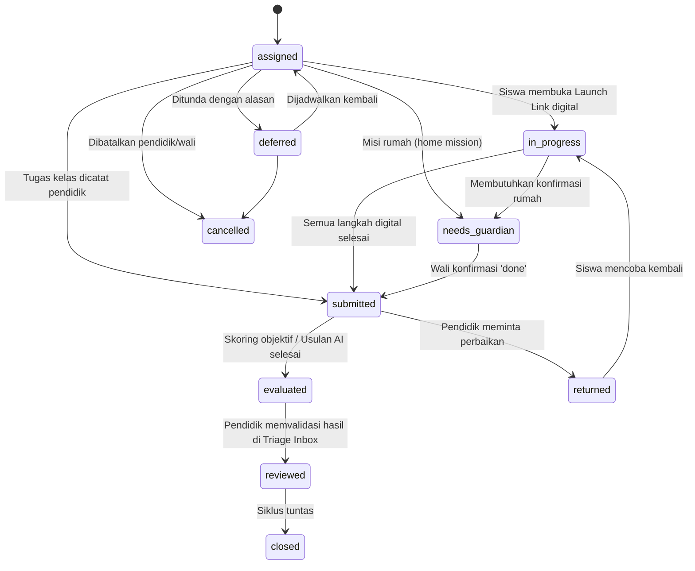

# WALIKELAS.ID
## Rencana Arsitektur Sistem Dinamis & Roadmap Implementasi MVP v2.0
### Human-Guided AI Learning Ecosystem untuk Guru Sekolah, Tutor Privat, Siswa, dan Wali

---

**Versi Dokumen:** 2.0 — *Comprehensive System Architecture & Phased Implementation Plan*  
**Tanggal Rilis:** 21 Oktober 2026  
**Status Dokumen:** BASELINE ARSITEKTUR RESMI UNTUK REVIEW FOUNDER & EKSEKUSI SPRINT  
**Dokumen Induk (Product Truth):** [WALIKELAS_MVP_PRODUCT_BLUEPRINT_TECHNICAL_HANDOFF_v2.0.md](file:///home/dev360_03/locomo.id/docs/walikelas.id/WALIKELAS_MVP_PRODUCT_BLUEPRINT_TECHNICAL_HANDOFF_v2.0.md)  
**Dokumen Pelengkap:** [WALIKELAS_MVP_FUNDAMENTAL_PRODUCT_ARCHITECTURE_v1.0.md](file:///home/dev360_03/locomo.id/docs/walikelas.id/WALIKELAS_MVP_FUNDAMENTAL_PRODUCT_ARCHITECTURE_v1.0.md)  
**Konteks Submission:** Submission Akselerator Global (YC W27, Techstars, Founder Institute) November 2026.

---

## DAFTAR ISI

1. [Ringkasan Eksekutif & Keputusan Strategis](#1-ringkasan-eksekutif--keputusan-strategis)
2. [Prinsip Arsitektur Teknis & Invariants (TI-01 s/d TI-14)](#2-prinsip-arsitektur-teknis--invariants-ti-01-sd-ti-14)
3. [Arsitektur Sistem Dinamis (Pemisahan Kernel Tetap & Declarative Capability Layer)](#3-arsitektur-sistem-dinamis-pemisahan-kernel-tetap--declarative-capability-layer)
4. [Tumpukan Teknologi & Arsitektur Runtime](#4-tumpukan-teknologi--arsitektur-runtime)
5. [Model Data Relasional & Skema Kemampuan Dinamis (PostgreSQL DDL)](#5-model-data-relasional--skema-kemampuan-dinamis-postgresql-ddl)
6. [Model Otorisasi Berbasis Relasi & Isolasi Program](#6-model-otorisasi-berbasis-relasi--isolasi-program)
7. [Mesin Finite State Machine (FSM) Siklus Belajar](#7-mesin-finite-state-machine-fsm-siklus-belajar)
8. [Orkestrasi AI Google Gemini & Safeguarding](#8-orkestrasi-ai-google-gemini--safeguarding)
9. [Draft Kurasi Konten Pedagogi Awal (Fase B Kelas 3 SD)](#9-draft-kurasi-konten-pedagogi-awal-fase-b-kelas-3-sd)
10. [Rencana Pengerjaan Bertahap (5 Fase Menuju Submission VC)](#10-rencana-pengerjaan-bertahap-5-fase-menuju-submission-vc)
11. [Matriks Pengujian Kriteria Penerimaan Teknis (TAT-01 s/d TAT-24)](#11-matriks-pengujian-kriteria-penerimaan-teknis-tat-01-sd-tat-24)
12. [Struktur Repositori Proyek](#12-struktur-repositori-proyek)

---

## 1. Ringkasan Eksekutif & Keputusan Strategis

WaliKelas.id berevolusi dari gagasan les privat konvensional menjadi **Infrastruktur Pendidikan Human-Guided AI**. Platform ini menghadirkan **Educator Copilot** sebagai *wedge* (pintu masuk adopsi pasar) yang melayani **guru sekolah formal maupun tutor privat independen** dalam satu ekosistem terpadu, dengan **capaian hasil siswa sebagai pusat orientasi produk**.

### 1.1 Tiga Keputusan Kunci yang Telah Dikonfirmasi Founder (21 Okt 2026):
1. **Tumpukan Teknologi Seragam (Opsi A):** Menggunakan **Laravel 12 (PHP 8.4) + Inertia.js (React TypeScript) + PostgreSQL 16**. Keputusan ini menyelaraskan proyek dengan ekosistem sibling yang ada di workspace (`locomo-web`, `unimart.group`, `mandeh.online.v2`, `piticoin.id`), memanfaatkan *fat service*, *relation-based policies*, *CSRF/session hardening*, dan database queue yang sudah teruji.
2. **Penyedia AI Google Gemini:** Menggunakan **Google AI Studio / Gemini API** (khususnya keluarga model `Gemini 1.5 Flash` / `Gemini 2.0 Flash`) yang memiliki latensi sub-detik, jendela konteks besar untuk silabus kurikulum, serta kepatuhan mutlak pada skema JSON berstruktur (*strict responseSchema*).
3. **Konten Pedagogi Kurasi Mandiri:** Disediakan draf kurasi awal untuk literasi membaca naratif Fase B (Kelas 3 SD) berstandar Kurikulum Merdeka sebagai *seed data* untuk baseline, misi interaktif, rubrik asesmen, dan panduan rumah.

### 1.2 Target Deliverable untuk Review VC (November 2026):
* **Working Vertical Slice:** Satu siklus penuh tertutup: Pendidik merancang rencana program → Siswa mengerjakan misi membaca ramah anak tanpa distraksi → Wali mengonfirmasi aktivitas rumah → Guru menerima notifikasi antrean prioritas (triage) dan memvalidasi capaian dalam 1 klik.
* **Instrumen Telemetri Efisiensi Pendidik:** Bukti pengukuran waktu netto yang dihemat pendidik (*net educator time saved*).
* **Video Demo Produk 90 Detik:** Menunjukkan interaksi mulus antara Guru, Siswa, dan Wali.
* **Defensibilitas Arsitektur:** Arsitektur modular yang memisahkan *Kernel Inti* dari *Spesifikasi Kemampuan Deklaratif*, membuktikan bahwa platform siap berskala (*scale up*) tanpa penulisan ulang kode.

---

## 2. Prinsip Arsitektur Teknis & Invariants (TI-01 s/d TI-14)

Seluruh implementasi kode wajib mematuhi 14 invarian mutlak berikut:

| Kode | Invarian Teknis | Justifikasi Arsitektur |
|---|---|---|
| **TI-01** | **No Mandatory School Entity:** Kolom `organization_id` / `school_id` bersifat opsional (*nullable*). Tutor privat tidak boleh diblokir oleh ketiadaan institusi. | BP §23.1 |
| **TI-02** | **Strict Program Scoping:** Setiap penugasan, respons siswa, observasi, dan asesmen wajib mengikat pada `program_id` dan `enrollment_id`. | BP §2.10, §23.1 |
| **TI-03** | **Relation-Based Access Control:** Hak akses diputuskan oleh relasi aktif (`program_educators` atau `guardian_relations` verified), bukan hanya label peran di tabel akun. | BP §3.2, §23.1 |
| **TI-04** | **Immutable Plan Version:** Versi rencana yang telah disahkan (*approved*) tidak boleh diubah di tempat (*in-place mutation*). Revisi wajib menghasilkan versi baru (`version_no + 1`). | BP §4.4, §7.4 |
| **TI-05** | **AI Separation of Decisions:** Usulan AI (`ai_suggestions`) dicatat terpisah dari keputusan manusia (`educator_decisions`). AI tidak memiliki hak eksekusi langsung. | BP §2.7, §23.1 |
| **TI-06** | **Educator Exclusive Mastery:** Status masteri `educator_validated` hanya dapat ditulis oleh aktor pendidik berwenang melalui verifikasi basis data dan *policy guard*. | BP §11.4, D-15 |
| **TI-07** | **Guardian Activity ≠ Mastery:** Konfirmasi orang tua (`guardian_confirmations`) hanya membuktikan keterlaksanaan kegiatan offline, tidak boleh memicu status penguasaan materi. | BP §2.9, AT-9 |
| **TI-08** | **Fail-Closed Communication Outbox:** Pesan notifikasi ke wali ditolak oleh outbox jika status relasi belum `verified` atau *consent* telah dicabut. | BP §8.2, AT-8 |
| **TI-09** | **Honest Dispatch Logging:** Status pengiriman pesan hanya dicatat `sent` jika adapter eksternal mengonfirmasi berhasil; tautan web yang disalin manual dicatat `shared_manually`. | BP §10.2, AT-14 |
| **TI-10** | **Zero Child Free-Chat:** Tidak ada endpoint API yang meneruskan input teks anak langsung ke LLM generatif tanpa kontrol. Anak hanya menerima misi dan petunjuk terkurasi. | BP §2.18, §15 |
| **TI-11** | **Active Plan Prerequisite:** Penugasan misi baru hanya dapat diterbitkan jika program berstatus `active` dan memiliki rencana berstatus `approved`. | BP §4.4, AT-5 |
| **TI-12** | **Report Source Dependency Tracking:** Laporan berstatus `approved` tidak boleh ditimpa saat data nilai dikoreksi, melainkan ditandai `needs_review` untuk diterbitkan versi baru. | BP §12.2, AT-12 |
| **TI-13** | **Append-Only Evidence & Audit:** Tabel `audit_events`, `responses`, dan `assignment_transitions` bersifat kekal (hak `UPDATE` dan `DELETE` dicabut di basis data). | BP §2.17 |
| **TI-14** | **External Service Decoupling:** Kegagalan layanan pihak ketiga (Google Gemini API, WhatsApp, SMTP) tidak boleh menghentikan alur kerja inti dan selalu memiliki *fallback manual*. | BP §23.1 |

---

## 3. Arsitektur Sistem Dinamis (Pemisahan Kernel Tetap & Declarative Capability Layer)

Sesuai instruksi khusus founder: **"pastikan pembangunan arsitektur walikelas ini dinamis, agar kita mudah melakukan scale up ke depannya, serta penambahan fitur yang ada tanpa harus merubah kode atau update kode ke mesin yang berjalan."**

WaliKelas.id mengadopsi pola **Microkernel & Declarative Specification Engine**:

```
┌────────────────────────────────────────────────────────────────────────────────────────┐
│                          APLIKASI BERJALAN (THE STABLE KERNEL)                         │
│   (Laravel 12 Fat Services + PostgreSQL 16 ACID Engine + Inertia/React Component Host) │
├────────────────────────────────────────────────────────────────────────────────────────┤
│ • Auth & Session Engine               • Program-Scoped Policy Enforcer (RBAC)          │
│ • Assignment Finite State Machine     • Evidence & Assessment Vault                    │
│ • Attention-Budgeted Outbox           • Audit Logger & Append-Only Stream              │
└───────────────────────────────────────────┬────────────────────────────────────────────┘
                                            │ membaca & mengeksekusi
                                            ▼
┌────────────────────────────────────────────────────────────────────────────────────────┐
│                   DECLARATIVE CAPABILITY LAYER (DATA-DRIVEN EXTENSIONS)                │
├────────────────────────────────────────────────────────────────────────────────────────┤
│ 1. Dynamic Step & UI Registry        -> Definisi tipe langkah misi (JSON Component)    │
│ 2. Dynamic Rubric & Evaluation Specs -> Aturan penilaian, bobot, kata kunci & hint     │
│ 3. Schematized Observation Fields   -> Formulir observasi & kuesioner dinamis (JSONB)  │
│ 4. Report Template Definitions       -> Struktur layout laporan 3-lapis berversi       │
└───────────────────────────────────────────▲────────────────────────────────────────────┘
                                            │ menerjemahkan & memvalidasi
                                            │
┌───────────────────────────────────────────┴────────────────────────────────────────────┐
│                    GOOGLE GEMINI INTENT COMPILER & VALIDATION GATE                     │
│  "Input Guru/Kurator: 'Buat misi fabel tentang burung bangau fokus pada kata sulit...'" │
│  ──▶ Gemini Structured Prompt (Zod/JSONSchema Strict)                                  │
│  ──▶ Validation Gate (Policy Checker + Sanity Validator)                               │
│  ──▶ Publish to Capability Registry (Redis/DB Cache) -> LIVE SECARA INSTAN!            │
└────────────────────────────────────────────────────────────────────────────────────────┘
```

### 3.1 Empat Pilar Ekstensibilitas Tanpa Sentuh Kode (*Zero-Code Extension*):

1. **Server-Driven Step Catalog (SDUI):**
   Frontend menyediakan pustaka komponen interaksi standar yang stabil:
   * `SingleChoiceCard`: Menampilkan pilihan ganda teks/gambar.
   * `SequenceOrderingCard`: Menyusun kartu urutan kronologi peristiwa.
   * `ContextWordMatcher`: Menjodohkan kosakata dengan arti konteks.
   * `ShortPromptReader`: Input jawaban reflektif singkat (maks 200 karakter).
   * `OfflineActionCard`: Panduan aktivitas keluarga dengan tombol konfirmasi.
   
   Ketika tim pedagogi ingin membuat format misi baru (misalnya kuis tebak tokoh atau rangkum paragraf), kurator cukup membuat konfigurasi JSON baru yang mengombinasikan komponen katalog di atas. **Aplikasi klien langsung menampilkan antarmuka baru tanpa deployment ulang kode frontend atau backend!**

2. **Declarative Rubric & Scoring Specifications:**
   Aturan evaluasi tidak diketik manual dalam kode PHP. Setiap rubrik didefinisikan dalam JSON Schema berversi yang memuat:
   * Target kompetensi & indikator keberhasilan.
   * Kata kunci acuan (*matched concepts*) & potensi miskonsepsi.
   * Petunjuk adaptif bertingkat (*hierarchical hints*).
   * Ambang keyakinan pedagogis (*confidence thresholds*).
   
   AI Evaluator (Gemini) membaca spesifikasi rubrik ini secara dinamis dan mengevaluasi jawaban anak ke dalam format structured JSON yang tervalidasi.

3. **Schematized Dynamic Observations & Forms:**
   Kolom observasi guru dan kuesioner orang tua disimpan dalam format terstruktur di tabel `dynamic_field_definitions`. Jika ada sekolah mitra yang membutuhkan isian tambahan (misalnya: "Apakah anak membaca sambil bersuara?", "Tingkat kantuk anak"), admin cukup menambahkan 1 baris record definisi bidang di database. Sistem form otomatis me-render input tersebut dan menyimpannya di kolom JSONB tanpa perlu migrasi DDL (`ALTER TABLE`).

4. **Gemini Intent Compiler:**
   Guru atau kurator dapat mengetik instruksi dalam bahasa Indonesia sehari-hari. Google Gemini bertindak sebagai *Compiler* yang menerjemahkan niat (*intent*) tersebut menjadi payload spesifikasi JSON yang valid. *Validation Gate* memastikan dokumen tersebut mematuhi batasan keamanan (durasi layar ≤12 menit, tanpa konten berbahaya, skema valid 100%) sebelum disetujui kurator dan aktif secara instan di runtime.

---

## 4. Tumpukan Teknologi & Arsitektur Runtime

### 4.1 Spesifikasi Komponen

| Komponen | Pilihan Teknologi | Versi | Peran & Justifikasi |
|---|---|---|---|
| **Backend Framework** | **Laravel (Fat Service Architecture)** | 12.x (PHP 8.4) | Menyediakan routing cepat, Eloquent ORM terparameter, Policy-based authorization, database queue bawaan, dan fitur keamanan out-of-the-box. |
| **Frontend Framework** | **Inertia.js + React + TypeScript** | React 18 / Inertia 2.x | Single Page Application (SPA) modern tanpa kerumitan REST API ganda. Menyajikan 3 permukaan pengguna: Educator Workspace, Guardian Portal, dan Learner Runner. |
| **Database Primer** | **PostgreSQL** | 16-alpine (Docker) | Menjamin integritas relasional ACID, penguncian transaksi, dukungan audit append-only, dan querying JSONB berindeks GIN untuk spesifikasi dinamis. |
| **Model AI / LLM** | **Google Gemini API (via Google AI Studio)** | Gemini 1.5 Flash / 2.0 Flash | Menyediakan throughput tinggi, jendela konteks kurikulum luas, latensi rendah (< 1 detik), dan dukungan *strict responseSchema* (JSON Schema). |
| **Styling & Design System** | **CSS Modules / Custom CSS Tokens** | Vanilla CSS + CSS Variables | Desain premium, clean, anti-distraksi, responsif smartphone/tablet, tanpa dependensi framework CSS eksternal yang membengkak. |
| **Antrean & Worker** | **Laravel Database Queue / Redis** | Postgres / Redis 7 | Menangani pemanggilan Gemini AI asinkron, pemrosesan outbox notifikasi, dan kalkulasi telemetri. |
| **Containerization** | **Docker Compose (Tier 1 Locomo OS)** | Compose Spec v2 | Membungkus seluruh dependensi (PHP-FPM, Nginx, PostgreSQL, Redis) sehingga dapat dijalankan identik di WSL, VPS Linux, maupun Cloud. |

---

## 5. Model Data Relasional & Skema Kemampuan Dinamis (PostgreSQL DDL)

Berikut adalah skema basis data PostgreSQL yang mengimplementasikan arsitektur *Learning Program*, pemisahan *Kernel* dan *Declarative Specs*, serta *Append-Only Audit*:

```sql
-- ============================================================================
-- BAGIAN 1: IDENTITAS, ORGANISASI, DAN PROGRAM PEMBELAJARAN
-- ============================================================================

CREATE TABLE users (
    id UUID PRIMARY KEY DEFAULT gen_random_uuid(),
    name VARCHAR(150) NOT NULL,
    email VARCHAR(190) UNIQUE,
    phone_e164 VARCHAR(25) UNIQUE,              -- Kontak, bukan bukti perwalian sah (BP §2.8)
    password_hash VARCHAR(255),                 -- Argon2id; NULL untuk wali via magic link
    is_active BOOLEAN NOT NULL DEFAULT TRUE,
    created_at TIMESTAMPTZ NOT NULL DEFAULT NOW(),
    updated_at TIMESTAMPTZ NOT NULL DEFAULT NOW(),
    CHECK (email IS NOT NULL OR phone_e164 IS NOT NULL)
);

CREATE TABLE educator_profiles (
    user_id UUID PRIMARY KEY REFERENCES users(id) ON DELETE CASCADE,
    display_name VARCHAR(150) NOT NULL,
    bio TEXT,
    accepted_ai_terms_version VARCHAR(20) NOT NULL, -- Bukti persetujuan batasan AI
    created_at TIMESTAMPTZ NOT NULL DEFAULT NOW()
);

CREATE TABLE organizations (                    -- Lembaga / Sekolah opsional (TI-01)
    id UUID PRIMARY KEY DEFAULT gen_random_uuid(),
    kind VARCHAR(30) NOT NULL CHECK (kind IN ('school', 'institution')),
    name VARCHAR(200) NOT NULL,
    npsn VARCHAR(20),                           -- Tidak pernah wajib bagi tutor privat
    created_by UUID NOT NULL REFERENCES users(id),
    created_at TIMESTAMPTZ NOT NULL DEFAULT NOW()
);

CREATE TABLE learning_programs (
    id UUID PRIMARY KEY DEFAULT gen_random_uuid(),
    mode VARCHAR(20) NOT NULL CHECK (mode IN ('school', 'private')), -- Mode program fleksibel
    organization_id UUID REFERENCES organizations(id),              -- Nullable (TI-01)
    title VARCHAR(200) NOT NULL,
    goal_summary TEXT,
    grade_level SMALLINT DEFAULT 3,
    period_start DATE,
    period_end DATE,
    planned_session_count SMALLINT,
    status VARCHAR(20) NOT NULL DEFAULT 'draft'
        CHECK (status IN ('draft', 'ready_for_review', 'active', 'paused', 'completed', 'archived')),
    active_plan_version_id UUID,               -- Di-update saat versi rencana disahkan
    created_by UUID NOT NULL REFERENCES users(id),
    created_at TIMESTAMPTZ NOT NULL DEFAULT NOW(),
    updated_at TIMESTAMPTZ NOT NULL DEFAULT NOW()
);

CREATE TABLE program_educators (                -- Relasi pendidik - program (TI-03)
    id UUID PRIMARY KEY DEFAULT gen_random_uuid(),
    program_id UUID NOT NULL REFERENCES learning_programs(id) ON DELETE CASCADE,
    user_id UUID NOT NULL REFERENCES users(id) ON DELETE CASCADE,
    role VARCHAR(20) NOT NULL DEFAULT 'lead' CHECK (role IN ('lead', 'collaborator')),
    started_at TIMESTAMPTZ NOT NULL DEFAULT NOW(),
    ended_at TIMESTAMPTZ,
    UNIQUE (program_id, user_id)
);

-- ============================================================================
-- BAGIAN 2: KURIKULUM & PERENCANAAN (PLANNING COPILOT)
-- ============================================================================

CREATE TABLE competencies (
    id UUID PRIMARY KEY DEFAULT gen_random_uuid(),
    code VARCHAR(50) NOT NULL,                  -- Contoh: 'LIT-B-EXP-01'
    domain VARCHAR(40) NOT NULL DEFAULT 'literacy',
    title VARCHAR(200) NOT NULL,
    description TEXT NOT NULL,
    grade_band VARCHAR(20) DEFAULT 'FASE_B_GR3',
    prerequisite_id UUID REFERENCES competencies(id),
    version SMALLINT NOT NULL DEFAULT 1,
    review_status VARCHAR(20) NOT NULL DEFAULT 'reviewed' CHECK (review_status IN ('draft', 'reviewed', 'retired')),
    source_ref TEXT,                            -- Sumber acuan (misal: Kemendikbudristek Fase B)
    created_at TIMESTAMPTZ NOT NULL DEFAULT NOW(),
    UNIQUE (code, version)
);

CREATE TABLE rubrics (                          -- Spesifikasi rubrik deklaratif berversi
    id UUID PRIMARY KEY DEFAULT gen_random_uuid(),
    competency_id UUID NOT NULL REFERENCES competencies(id),
    version SMALLINT NOT NULL DEFAULT 1,
    levels JSONB NOT NULL,                      -- Skema kriteria: [NEEDS_SUPPORT, DEVELOPING, INDICATED_MASTERY]
    origin VARCHAR(30) NOT NULL CHECK (origin IN ('curated', 'educator_authored')),
    review_status VARCHAR(20) NOT NULL DEFAULT 'reviewed',
    created_by UUID NOT NULL REFERENCES users(id),
    created_at TIMESTAMPTZ NOT NULL DEFAULT NOW(),
    UNIQUE (competency_id, version)
);

CREATE TABLE learning_plans (
    id UUID PRIMARY KEY DEFAULT gen_random_uuid(),
    program_id UUID NOT NULL UNIQUE REFERENCES learning_programs(id) ON DELETE CASCADE,
    created_at TIMESTAMPTZ NOT NULL DEFAULT NOW()
);

CREATE TABLE plan_versions (                    -- Rencana berversi & immutable (TI-04)
    id UUID PRIMARY KEY DEFAULT gen_random_uuid(),
    plan_id UUID NOT NULL REFERENCES learning_plans(id) ON DELETE CASCADE,
    version_no SMALLINT NOT NULL,
    status VARCHAR(20) NOT NULL DEFAULT 'draft'
        CHECK (status IN ('draft', 'ready_for_review', 'approved', 'superseded')),
    source_type VARCHAR(20) NOT NULL CHECK (source_type IN ('import', 'wizard', 'template')),
    content JSONB NOT NULL,                     -- {objectives[], activities[], assessment_strategy}
    ambiguities JSONB NOT NULL DEFAULT '[]',    -- Bagian yang perlu verifikasi pendidik
    approved_by UUID REFERENCES users(id),
    approved_at TIMESTAMPTZ,
    created_by UUID NOT NULL REFERENCES users(id),
    created_at TIMESTAMPTZ NOT NULL DEFAULT NOW(),
    UNIQUE (plan_id, version_no)
);

ALTER TABLE learning_programs 
    ADD CONSTRAINT fk_active_plan_version 
    FOREIGN KEY (active_plan_version_id) REFERENCES plan_versions(id);

CREATE TABLE plan_sources (                     -- Penyimpanan sumber teks mentah impor
    id UUID PRIMARY KEY DEFAULT gen_random_uuid(),
    plan_version_id UUID NOT NULL REFERENCES plan_versions(id) ON DELETE CASCADE,
    kind VARCHAR(20) NOT NULL DEFAULT 'pasted_text' CHECK (kind IN ('pasted_text', 'file_upload')),
    raw_text TEXT NOT NULL,
    extracted JSONB,                            -- Hasil ekstraksi Gemini Intent Compiler
    created_at TIMESTAMPTZ NOT NULL DEFAULT NOW()
);

-- ============================================================================
-- BAGIAN 3: SISWA, PERWALIAN & KONSEN HUKUM (DATA MINIMALIS)
-- ============================================================================

CREATE TABLE learners (                         -- Data siswa minimal (BP §8.1, §19.1)
    id UUID PRIMARY KEY DEFAULT gen_random_uuid(),
    display_name VARCHAR(80) NOT NULL,          -- Hanya nama panggilan
    grade_level SMALLINT DEFAULT 3,
    birth_year SMALLINT,                        -- Hanya tahun lahir (opsional)
    avatar_id VARCHAR(40) DEFAULT 'avatar_kancil_01',
    is_synthetic BOOLEAN NOT NULL DEFAULT FALSE,-- Penanda data uji coba pilot
    created_by UUID NOT NULL REFERENCES users(id),
    created_at TIMESTAMPTZ NOT NULL DEFAULT NOW()
);

CREATE TABLE enrollments (                      -- Partisipasi program (TI-02)
    id UUID PRIMARY KEY DEFAULT gen_random_uuid(),
    program_id UUID NOT NULL REFERENCES learning_programs(id) ON DELETE CASCADE,
    learner_id UUID NOT NULL REFERENCES learners(id) ON DELETE CASCADE,
    status VARCHAR(20) NOT NULL DEFAULT 'active' CHECK (status IN ('pending_guardian', 'active', 'paused', 'left')),
    enrolled_at TIMESTAMPTZ NOT NULL DEFAULT NOW(),
    left_at TIMESTAMPTZ,
    UNIQUE (program_id, learner_id)
);

CREATE TABLE guardian_relations (               -- Relasi keluarga independen dari program
    id UUID PRIMARY KEY DEFAULT gen_random_uuid(),
    learner_id UUID NOT NULL REFERENCES learners(id) ON DELETE CASCADE,
    guardian_user_id UUID REFERENCES users(id), -- Terhubung setelah klaim undangan
    relation_type VARCHAR(30) NOT NULL DEFAULT 'parent' CHECK (relation_type IN ('parent', 'legal_guardian', 'caregiver')),
    status VARCHAR(20) NOT NULL DEFAULT 'invited' CHECK (status IN ('invited', 'claimed', 'verified', 'revoked')),
    verified_via VARCHAR(40),                   -- 'two_sided_educator_confirmation'
    educator_confirmed_by UUID REFERENCES users(id),
    verified_at TIMESTAMPTZ,
    revoked_at TIMESTAMPTZ,
    created_at TIMESTAMPTZ NOT NULL DEFAULT NOW()
);

CREATE TABLE guardian_invitations (             -- Token undangan sekali pakai
    id UUID PRIMARY KEY DEFAULT gen_random_uuid(),
    guardian_relation_id UUID NOT NULL REFERENCES guardian_relations(id) ON DELETE CASCADE,
    program_id UUID NOT NULL REFERENCES learning_programs(id) ON DELETE CASCADE,
    token_hash CHAR(64) NOT NULL UNIQUE,        -- SHA-256 hash token
    expires_at TIMESTAMPTZ NOT NULL,
    used_at TIMESTAMPTZ,
    created_by UUID NOT NULL REFERENCES users(id)
);

CREATE TABLE consents (                         -- Izin perwalian eksplisit (TI-08)
    id UUID PRIMARY KEY DEFAULT gen_random_uuid(),
    guardian_relation_id UUID NOT NULL REFERENCES guardian_relations(id) ON DELETE CASCADE,
    program_id UUID NOT NULL REFERENCES learning_programs(id) ON DELETE CASCADE,
    purpose_scope VARCHAR(60) NOT NULL,         -- 'PROGRAM_PARTICIPATION', 'PROGRESS_REPORTS'
    policy_version VARCHAR(20) NOT NULL,
    granted_at TIMESTAMPTZ NOT NULL DEFAULT NOW(),
    revoked_at TIMESTAMPTZ
);

-- ============================================================================
-- BAGIAN 4: DECLARATIVE MISSION & EXECUTION ENGINE (SDUI)
-- ============================================================================

CREATE TABLE dynamic_component_catalog (        -- Katalog komponen UI Runner yang didukung
    component_type VARCHAR(50) PRIMARY KEY,     -- e.g. 'SingleChoiceCard', 'SequenceOrderingCard'
    schema_definition JSONB NOT NULL,           -- JSON Schema validasi props
    description TEXT,
    is_active BOOLEAN NOT NULL DEFAULT TRUE,
    created_at TIMESTAMPTZ NOT NULL DEFAULT NOW()
);

CREATE TABLE missions (                         -- Template misi deklaratif
    id UUID PRIMARY KEY DEFAULT gen_random_uuid(),
    program_id UUID REFERENCES learning_programs(id), -- NULL = pustaka umum terkurasi
    competency_id UUID NOT NULL REFERENCES competencies(id),
    rubric_id UUID NOT NULL REFERENCES rubrics(id),
    kind VARCHAR(20) NOT NULL CHECK (kind IN ('digital', 'home', 'in_class')),
    title VARCHAR(200) NOT NULL,
    estimated_minutes SMALLINT NOT NULL DEFAULT 10,  -- Batas screen-time ramah anak
    steps_payload JSONB NOT NULL,               -- SDUI Steps: [{step_key, component_type, content, options, hints}]
    offline_activity_guide JSONB,               -- Panduan interaksi rumah untuk orang tua
    version SMALLINT NOT NULL DEFAULT 1,
    status VARCHAR(20) NOT NULL DEFAULT 'ready' CHECK (status IN ('draft', 'ready', 'retired')),
    created_by UUID NOT NULL REFERENCES users(id),
    created_at TIMESTAMPTZ NOT NULL DEFAULT NOW()
);

CREATE TABLE assignments (                      -- Instansiasi penugasan kepada siswa
    id UUID PRIMARY KEY DEFAULT gen_random_uuid(),
    program_id UUID NOT NULL REFERENCES learning_programs(id) ON DELETE CASCADE,
    enrollment_id UUID NOT NULL REFERENCES enrollments(id) ON DELETE CASCADE,
    mission_id UUID NOT NULL REFERENCES missions(id),
    plan_version_id UUID NOT NULL REFERENCES plan_versions(id), -- TI-04
    status VARCHAR(20) NOT NULL DEFAULT 'assigned' CHECK (status IN (
        'assigned', 'deferred', 'in_progress', 'needs_guardian', 
        'submitted', 'returned', 'evaluated', 'reviewed', 'closed', 'cancelled'
    )),
    requires_guardian_confirmation BOOLEAN NOT NULL DEFAULT FALSE,
    requires_educator_review BOOLEAN NOT NULL DEFAULT TRUE,
    due_at TIMESTAMPTZ,
    assigned_by UUID NOT NULL REFERENCES users(id),
    created_at TIMESTAMPTZ NOT NULL DEFAULT NOW(),
    updated_at TIMESTAMPTZ NOT NULL DEFAULT NOW()
);

CREATE TABLE assignment_transitions (           -- Append-only audit transisi status (TI-13)
    id BIGSERIAL PRIMARY KEY,
    assignment_id UUID NOT NULL REFERENCES assignments(id) ON DELETE CASCADE,
    from_status VARCHAR(20),
    to_status VARCHAR(20) NOT NULL,
    actor_type VARCHAR(20) NOT NULL CHECK (actor_type IN ('educator', 'guardian', 'learner_link', 'system')),
    actor_id UUID,
    reason TEXT,
    created_at TIMESTAMPTZ NOT NULL DEFAULT NOW()
);

CREATE TABLE launch_tokens (                    -- Akses misi siswa tanpa akun/password
    id UUID PRIMARY KEY DEFAULT gen_random_uuid(),
    assignment_id UUID NOT NULL REFERENCES assignments(id) ON DELETE CASCADE,
    token_hash CHAR(64) NOT NULL UNIQUE,
    expires_at TIMESTAMPTZ NOT NULL,            -- Default 2 jam
    revoked_at TIMESTAMPTZ,
    created_at TIMESTAMPTZ NOT NULL DEFAULT NOW()
);

CREATE TABLE attempts (
    id UUID PRIMARY KEY DEFAULT gen_random_uuid(),
    assignment_id UUID NOT NULL REFERENCES assignments(id) ON DELETE CASCADE,
    started_at TIMESTAMPTZ NOT NULL DEFAULT NOW(),
    finished_at TIMESTAMPTZ,
    active_seconds INTEGER NOT NULL DEFAULT 0,
    assisted_by_adult BOOLEAN NOT NULL DEFAULT FALSE
);

CREATE TABLE responses (                        -- Respons siswa (Append-only) (TI-10, TI-13)
    id UUID PRIMARY KEY DEFAULT gen_random_uuid(),
    attempt_id UUID NOT NULL REFERENCES attempts(id) ON DELETE CASCADE,
    step_key VARCHAR(50) NOT NULL,
    answer JSONB NOT NULL,
    hints_used SMALLINT NOT NULL DEFAULT 0,
    auto_result VARCHAR(15) CHECK (auto_result IN ('correct', 'incorrect')), -- Khusus soal objektif
    safety_flag BOOLEAN NOT NULL DEFAULT FALSE,
    created_at TIMESTAMPTZ NOT NULL DEFAULT NOW()
);

CREATE TABLE guardian_confirmations (           -- Konfirmasi rumah (Bukan masteri!) (TI-07)
    id UUID PRIMARY KEY DEFAULT gen_random_uuid(),
    assignment_id UUID NOT NULL REFERENCES assignments(id) ON DELETE CASCADE,
    guardian_relation_id UUID NOT NULL REFERENCES guardian_relations(id),
    response VARCHAR(20) NOT NULL CHECK (response IN ('done', 'not_yet', 'need_help')),
    note VARCHAR(500),
    channel VARCHAR(30) NOT NULL DEFAULT 'web_link',
    confirmed_at TIMESTAMPTZ NOT NULL DEFAULT NOW()
);

CREATE TABLE educator_observations (           -- Observasi cepat guru (1-klik)
    id UUID PRIMARY KEY DEFAULT gen_random_uuid(),
    program_id UUID NOT NULL REFERENCES learning_programs(id) ON DELETE CASCADE,
    enrollment_id UUID NOT NULL REFERENCES enrollments(id) ON DELETE CASCADE,
    assignment_id UUID REFERENCES assignments(id),
    kind VARCHAR(40) NOT NULL CHECK (kind IN ('attendance', 'participation', 'difficulty', 'support_given', 'repeat_needed')),
    value VARCHAR(50) NOT NULL,
    note VARCHAR(500),
    recorded_by UUID NOT NULL REFERENCES users(id),
    recorded_at TIMESTAMPTZ NOT NULL DEFAULT NOW()
);

CREATE TABLE mastery_states (                   -- Status perkembangan kompetensi (TI-06)
    id UUID PRIMARY KEY DEFAULT gen_random_uuid(),
    enrollment_id UUID NOT NULL REFERENCES enrollments(id) ON DELETE CASCADE,
    competency_id UUID NOT NULL REFERENCES competencies(id),
    level VARCHAR(30) NOT NULL CHECK (level IN (
        'no_evidence', 'needs_support', 'developing', 'indicated_mastery', 'educator_validated'
    )),
    basis_refs JSONB NOT NULL,                  -- Array ID respons / observasi yang mendasari
    decided_by_type VARCHAR(20) NOT NULL CHECK (decided_by_type IN ('system', 'educator')),
    decided_by UUID REFERENCES users(id),
    created_at TIMESTAMPTZ NOT NULL DEFAULT NOW(),
    CHECK (level <> 'educator_validated' OR (decided_by_type = 'educator' AND decided_by IS NOT NULL))
);

-- ============================================================================
-- BAGIAN 5: COPILOT SUGGESTIONS, KEPUTUSAN & LAPORAN 3-LAPIS
-- ============================================================================

CREATE TABLE ai_runs (                          -- Log audit seluruh panggilan Google Gemini
    id UUID PRIMARY KEY DEFAULT gen_random_uuid(),
    purpose VARCHAR(40) NOT NULL,               -- 'plan_extract', 'gap_analysis', 'intervention', 'report_draft'
    program_id UUID REFERENCES learning_programs(id),
    prompt_version VARCHAR(30) NOT NULL,
    model_name VARCHAR(80) NOT NULL,            -- e.g. 'gemini-1.5-flash'
    input_refs JSONB NOT NULL,                  -- Tanpa data PII siswa
    output_payload JSONB,
    status VARCHAR(20) NOT NULL CHECK (status IN ('ok', 'schema_invalid', 'timeout', 'refused', 'error')),
    latency_ms INTEGER,
    created_at TIMESTAMPTZ NOT NULL DEFAULT NOW()
);

CREATE TABLE ai_suggestions (                   -- Saran AI yang menunggu keputusan guru (TI-05)
    id UUID PRIMARY KEY DEFAULT gen_random_uuid(),
    ai_run_id UUID NOT NULL REFERENCES ai_runs(id),
    program_id UUID NOT NULL REFERENCES learning_programs(id) ON DELETE CASCADE,
    enrollment_id UUID REFERENCES enrollments(id),
    kind VARCHAR(30) NOT NULL,                  -- 'plan_draft', 'intervention', 'report_draft'
    payload JSONB NOT NULL,
    rationale TEXT NOT NULL,                    -- Penjelasan alasan pedagogis
    uncertainty VARCHAR(25) NOT NULL CHECK (uncertainty IN ('low', 'medium', 'high', 'insufficient_evidence')),
    status VARCHAR(20) NOT NULL DEFAULT 'pending' CHECK (status IN ('pending', 'accepted', 'edited', 'rejected')),
    created_at TIMESTAMPTZ NOT NULL DEFAULT NOW()
);

CREATE TABLE educator_decisions (               -- Keputusan mutlak guru (TI-05)
    id UUID PRIMARY KEY DEFAULT gen_random_uuid(),
    suggestion_id UUID REFERENCES ai_suggestions(id),
    subject_type VARCHAR(40) NOT NULL,
    subject_id UUID NOT NULL,
    decision VARCHAR(20) NOT NULL CHECK (decision IN ('approve', 'edit', 'reject')),
    reason TEXT,
    edited_payload JSONB,
    decided_by UUID NOT NULL REFERENCES users(id),
    decided_at TIMESTAMPTZ NOT NULL DEFAULT NOW()
);

CREATE TABLE interventions (                    -- Rekomendasi tindak lanjut yang disahkan
    id UUID PRIMARY KEY DEFAULT gen_random_uuid(),
    program_id UUID NOT NULL REFERENCES learning_programs(id) ON DELETE CASCADE,
    enrollment_id UUID REFERENCES enrollments(id),
    competency_id UUID NOT NULL REFERENCES competencies(id),
    description TEXT NOT NULL,
    decision_id UUID NOT NULL REFERENCES educator_decisions(id),
    status VARCHAR(20) NOT NULL DEFAULT 'planned' CHECK (status IN ('planned', 'done', 'cancelled')),
    created_at TIMESTAMPTZ NOT NULL DEFAULT NOW()
);

CREATE TABLE reports (                          -- Laporan perkembangan 3-lapis berversi (TI-12)
    id UUID PRIMARY KEY DEFAULT gen_random_uuid(),
    program_id UUID NOT NULL REFERENCES learning_programs(id) ON DELETE CASCADE,
    enrollment_id UUID REFERENCES enrollments(id), -- NULL = laporan agregat kelompok
    version_no SMALLINT NOT NULL DEFAULT 1,
    status VARCHAR(20) NOT NULL DEFAULT 'draft' CHECK (status IN ('draft', 'approved', 'needs_review', 'superseded')),
    facts_layer JSONB NOT NULL,                 -- Fakta kehadiran & misi selesai
    findings_layer JSONB NOT NULL,              -- Temuan rubrik & capaian kompetensi
    recommendations_layer JSONB NOT NULL,       -- Rekomendasi aktivitas berikutnya
    attribution_tags JSONB NOT NULL,            -- Label: human_note vs auto_assessment vs educator_validated
    approved_by UUID REFERENCES users(id),
    approved_at TIMESTAMPTZ,
    created_at TIMESTAMPTZ NOT NULL DEFAULT NOW()
);

CREATE TABLE report_sources (                   -- Pelacak dependensi laporan (TI-12)
    report_id UUID NOT NULL REFERENCES reports(id) ON DELETE CASCADE,
    source_type VARCHAR(40) NOT NULL,           -- 'responses', 'mastery_states', 'educator_observations'
    source_id UUID NOT NULL,
    PRIMARY KEY (report_id, source_type, source_id)
);

CREATE TABLE outbox_messages (                  -- Notifikasi terjadwal & aman (TI-08, TI-09)
    id UUID PRIMARY KEY DEFAULT gen_random_uuid(),
    guardian_relation_id UUID NOT NULL REFERENCES guardian_relations(id) ON DELETE CASCADE,
    program_id UUID NOT NULL REFERENCES learning_programs(id) ON DELETE CASCADE,
    channel VARCHAR(20) NOT NULL DEFAULT 'web_link' CHECK (channel IN ('web_link', 'email', 'whatsapp')),
    template_key VARCHAR(60) NOT NULL,
    status VARCHAR(25) NOT NULL DEFAULT 'queued' CHECK (status IN (
        'queued', 'held_quiet_hours', 'blocked_policy', 'link_ready', 'shared_manually', 'sent', 'failed'
    )),
    policy_check JSONB NOT NULL,                -- Log verifikasi consent & jam tenang
    scheduled_for TIMESTAMPTZ,
    sent_at TIMESTAMPTZ,
    created_at TIMESTAMPTZ NOT NULL DEFAULT NOW()
);

CREATE TABLE audit_events (                     -- Audit log kekal (Append-only) (TI-13)
    id BIGSERIAL PRIMARY KEY,
    actor_type VARCHAR(20) NOT NULL,
    actor_id UUID,
    action VARCHAR(80) NOT NULL,
    subject_type VARCHAR(40),
    subject_id UUID,
    program_id UUID,
    payload JSONB NOT NULL DEFAULT '{}',
    created_at TIMESTAMPTZ NOT NULL DEFAULT NOW()
);
```

---

## 6. Model Otorisasi Berbasis Relasi & Isolasi Program

Otorisasi tidak mengandalkan kolom string peran statis tunggal, melainkan didasarkan pada **relasi aktif program dan perwalian** yang dievaluasi melalui Laravel Policies:

```php
// app/Policies/ProgramPolicy.php
namespace App\Policies;

use App\Models\User;
use App\Models\LearningProgram;

class ProgramPolicy
{
    /**
     * Memeriksa apakah user adalah Pendidik Pengampu Program yang aktif
     */
    public function manage(User $user, LearningProgram $program): bool
    {
        return $program->educators()
            ->where('user_id', $user->id)
            ->whereNull('ended_at')
            ->exists();
    }

    /**
     * Memeriksa apakah wali sah berhak melihat progres anak di program tertentu
     */
    public function viewLearnerProgress(User $user, LearningProgram $program, string $learnerId): bool
    {
        // 1. Jika dia guru pengampu program, izinkan
        if ($this->manage($user, $program)) {
            return true;
        }

        // 2. Jika wali: wajib verified + anak terdaftar di program + consent aktif
        return $user->guardianRelations()
            ->where('learner_id', $learnerId)
            ->where('status', 'verified')
            ->whereNull('revoked_at')
            ->whereHas('consents', function ($query) use ($program) {
                $query->where('program_id', $program->id)
                      ->where('purpose_scope', 'PROGRAM_PARTICIPATION')
                      ->whereNull('revoked_at');
            })
            ->exists();
    }
}
```

*Jika ada request yang mencoba mengakses data siswa atau program tanpa relasi yang sah, sistem mengembalikan kode HTTP **404 Not Found** (bukan 403 Forbidden) untuk mencegah kebocoran informasi metadata perwalian.*

---

## 7. Mesin Finite State Machine (FSM) Siklus Belajar

Alur penugasan dikendalikan secara deterministik oleh `AssignmentStateMachine`:



### Aturan Transisi FSM:
1. **Guard `needs_guardian` ke `submitted`:** Hanya dapat dipicu jika rekaman `guardian_confirmations` berisi nilai `response = 'done'`.
2. **Status `closed`:** Menyelesaikan siklus penugasan tugas. Tidak otomatis menetapkan `mastery_states`.
3. **Penundaan / Berhenti di Tengah Jalan:** Jika anak lelah atau berhenti, attempt dicatat sebagai pekerjaan parsial, **bukan kegagalan anak**.

---

## 8. Orkestrasi AI Google Gemini & Safeguarding

### 8.1 Spesifikasi Driver Google Gemini (Laravel Service)
Menggunakan endpoint Gemini API dengan mode **Strict JSON Schema (`responseSchema`)**:

```php
// app/Services/Copilot/GeminiClient.php
namespace App\Services\Copilot;

use Illuminate\Support\Facades\Http;
use Exception;

class GeminiClient
{
    protected string $apiKey;
    protected string $model;

    public function __construct()
    {
        $this->apiKey = config('services.gemini.api_key');
        $this->model = config('services.gemini.model', 'gemini-1.5-flash');
    }

    /**
     * Memanggil Gemini dengan JSON Schema terikat secara deterministik
     */
    public function generateStructured(string $systemPrompt, string $userPrompt, array $jsonSchema): array
    {
        $url = "https://generativelanguage.googleapis.com/v1beta/models/{$this->model}:generateContent?key={$this->apiKey}";

        $payload = [
            'contents' => [
                ['role' => 'user', 'parts' => [['text' => $userPrompt]]]
            ],
            'systemInstruction' => [
                'parts' => [['text' => $systemPrompt]]
            ],
            'generationConfig' => [
                'temperature' => 0.1, // Deterministik, anti-halusinasi
                'responseMimeType' => 'application/json',
                'responseSchema' => $jsonSchema
            ]
        ];

        $response = Http::timeout(20)->post($url, $payload);

        if (!$response->successful()) {
            throw new Exception("Gemini API Error: " . $response->body());
        }

        $jsonText = $response->json('candidates.0.content.parts.0.text');
        return json_decode($jsonText, true);
    }
}
```

### 8.2 Proteksi Privasi & Safeguarding Anak (TI-10)
1. **Pseudonimisasi Penuh:** Data yang dikirim ke Google Gemini hanya berupa pengidentifikasi pseudonim (misal: `Siswa-1`, `Siswa-2`), teks bacaan fabel, dan jawaban anak. Tidak ada data nomor telepon, nama orang tua, atau NIK yang dikirimkan.
2. **Circuit Breaker Kata Kunci Bahaya:** Jika pada respons anak terdeteksi indikasi kata bahaya/kekerasan:
   * Kolom `responses.safety_flag` otomatis diset `true`.
   * Layar runner anak langsung dialihkan ke pesan netral: *"Kegiatan membaca dijeda. Mari beristirahat dan berbincang dengan orang dewasa di dekatmu."*
   * Kasus otomatis masuk ke antrean darurat pendidik manusia tanpa interaksi AI lanjutan.

---

## 9. Draft Kurasi Konten Pedagogi Awal (Fase B Kelas 3 SD)

Berikut adalah draf materi literasi membaca naratif berstandar Kurikulum Merdeka (Fase B) yang siap dimasukkan sebagai *seed data* produksi:

### 9.1 Tiga Kompetensi Inti
1. **`LIT-B-EXP-01` (Informasi Tersurat):** Menemukan informasi eksplisit (tokoh, latar tempat, waktu kejadian) dalam teks narasi fabel pendek.
2. **`LIT-B-SEQ-02` (Kronologi Peristiwa):** Mengurutkan urutan kejadian awal, tengah, dan akhir dalam cerita naratif.
3. **`LIT-B-VOC-03` (Kosakata Kontekstual):** Memahami makna kosakata baru melalui konteks kalimat cerita fabel.

---

### 9.2 Instrumen Asesmen Setara (Set A & Set B)

#### A. Asesmen Baseline (Set A): *"Petualangan Kancil dan Burung Pipit"*
* **Teks Cerita:**  
  *"Di sebuah tepi sungai yang jernih, Kancil sedang asyik mencari buah rambutan yang jatuh. Tiba-tiba, terdengar suara cicitan cemas dari atas dahan pohon beringin. Seekor Burung Pipit kecil tersangkut pada jaring laba-laba raksasa. Sayapnya tidak bisa bergerak. Kancil yang cerdik segera mencari ranting bambu panjang di semak-semak. Dengan hati-hati, Kancil mengulurkan ranting itu ke arah sarang laba-laba. Pipit kecil segera melompat ke atas ranting dan berhasil bebas. Mereka pun bersorak gembira sambil memakan buah rambutan bersama."*
* **Langkah Uji (Steps):**
  1. *[Pilihan Ganda]* Di mana Kancil mencari buah rambutan? (Pilihan: A. Di dalam gua, B. Di tepi sungai yang jernih [KUNCI], C. Di puncak bukit).
  2. *[Urutan Kejadian]* Urutkan kejadian berikut: (1) Kancil mengulurkan ranting bambu, (2) Burung Pipit tersangkut jaring, (3) Mereka makan buah rambutan bersama. [Kunci: 2 - 1 - 3].
  3. *[Kosakata]* Kata **"cemas"** dalam cerita memiliki arti yang paling dekat dengan... (Pilihan: A. Marah, B. Takut dan khawatir [KUNCI], C. Senang).
  4. *[Esai Singkat]* Mengapa Kancil menggunakan ranting bambu untuk menolong Pipit? (Rubrik: Menyebutkan bahwa sarang laba-laba berada di atas dahan pohon beringin yang tinggi).

#### B. Asesmen Reassessment (Set B): *"Tupai Melompat Menolong Sahabat"*
* **Teks Cerita:**  
  *"Pagi hari di Hutan Pinus, Tupai melompat lincah dari satu pohon ke pohon lain sambil membawa biji kenari. Dari kejauhan, ia melihat Kura-kura terbalik di atas batu licin dekat air terjun. Kura-kura itu tampak panik karena tempurungnya terjepit celah batu. Tupai segera menjatuhkan kenarinya dan bergegas turun. Tupai menggunakan sebatang dahan kayu pinus yang kokoh untuk mengungkit tempurung Kura-kura. Perlahan tapi pasti, Kura-kura berhasil membalikkan tubuhnya kembali. Kura-kura mengucapkan terima kasih yang tulus kepada Tupai yang baik hati."*
* *(Tingkat kesulitan, struktur 4 langkah, dan rubrik penilaian diselaraskan 100% dengan Set A untuk mengukur pertumbuhan belajar yang valid).*

---

### 9.3 Dua Misi Literasi Digital

#### Misi Digital 1: *"Misteri Jejak Kaki di Kebun Paman"* (`LIT-B-EXP-01`)
* Durasi perkiraan: 10 menit.
* Komponen: `SingleChoiceCard` (Menemukan siapa yang datang ke kebun) + `ShortPromptReader` (Menjelaskan tanda jejak kaki yang ditinggalkan).
* Petunjuk Bertingkat (*Hints*):
  - Hint 1: *"Perhatikan kalimat kedua di paragraf pertama."*
  - Hint 2: *"Siapa hewan yang memiliki telapak kaki berselaput di dekat kolam?"*

#### Misi Digital 2: *"Kata Ajaib Burung Hantu"* (`LIT-B-VOC-03`)
* Durasi perkiraan: 10 menit.
* Komponen: `ContextWordMatcher` (Menjodohkan kata: *gigih, gulita, berteduh* dengan artinya berdasarkan bacaan fabel malam).

---

### 9.4 Satu Misi Rumah (Home / Offline Mission)

#### Misi Rumah: *"Mendongeng di Meja Makan"*
* **Aktivitas Non-Digital:** Siswa menceritakan kembali fabel Kancil atau Tupai kepada orang tua/keluarga selama 5 menit saat santap malam atau sebelum tidur.
* **Tugas Wali:** Membuka tautan web aman di smartphone dan memilih 1 dari 3 tombol:
  - 🟢 **Selesai**: *"Anak berhasil menceritakan alur cerita dengan antusias."*
  - 🟡 **Belum Selesai**: *"Belum sempat malam ini, jadwalkan besok."*
  - 🔴 **Butuh Bantuan Guru**: *"Anak kesulitan mengingat tokoh cerita, mohon arahan guru."*

---

## 10. Rencana Pengerjaan Bertahap (5 Fase Menuju Submission VC)

Rencana implementasi dirancang ramping dalam **5 Fase Kerja Terstruktur**:

```
[Timeline Eksekusi Terfokus WaliKelas.id MVP v2.0]

FASE 0              FASE 1              FASE 2              FASE 3              FASE 4
Hari 1 - 2          Hari 3 - 4          Hari 5 - 7          Hari 8 - 9          Hari 10 - 12
┌─────────────────┐ ┌─────────────────┐ ┌─────────────────┐ ┌─────────────────┐ ┌─────────────────┐
│ Fondasi Docker, │ │ Educator Work-  │ │ Enrollment,     │ │ Triage Inbox,   │ │ Telemetri Guru, │
│ Skema DB Relasi │─▶│ space Dua Mode │─▶│ Learner Runner │─▶│ Evaluasi Gemini │─▶│ Usability Test  │
│ & Auth Policies │ │ & Plan Copilot  │ │ (SDUI) & Home   │ │ & Laporan 3-Lap │ │ & Video Demo 90s│
└─────────────────┘ └─────────────────┘ └─────────────────┘ └─────────────────┘ └─────────────────┘
```

### 🔹 FASE 0: Inisialisasi Stack, Migrasi Database & Auth Policies (Hari 1 – 2)
* Setup direktori `walikelas.id/` dengan Docker Compose (PHP 8.4 FPM, Nginx, PostgreSQL 16, Vite).
* Eksekusi seluruh DDL migrasi database (25 tabel relasional & indeks pencarian GIN).
* Autentikasi sesi berbasis cookie aman (`__Host-`, HttpOnly, SameSite=Lax, CSRF enforcement).
* Implementasi `ProgramPolicy` (RBAC berbasis relasi aktif, TI-01 s/d TI-03).
* Seed 3 kompetensi literasi, rubrik penilaian, dan 10 data siswa/wali sintetis.
* **Deliverable:** Docker berjalan, migrasi sukses, test otorisasi lulus (TAT-01, TAT-02, TAT-07, TAT-19, TAT-20).

### 🔹 FASE 1: Shared Educator Workspace & Planning Copilot (Hari 3 – 4)
* Dashboard Pendidik terpadu: peralihan mode program (`school` vs `private`) dalam 1 UI.
* **Planning Copilot (Import Path):** Textarea impor teks silabus/RPP → ekstraksi Gemini AI → pemetaan ke skema rencana draf.
* **Planning Copilot (Wizard Path):** Wizard 5 langkah penyusunan tujuan ajar berbasis kompetensi terkurasi.
* **Plan Version Engine:** Peninjauan ambiguitas, pengeditan draf, dan pengesahan versi rencana aktif (TI-04).
* **Deliverable:** Pendidik dapat membuat program privat dan sekolah serta mengaktifkan rencana ajar (TAT-03, TAT-04, TAT-05, TAT-23).

### 🔹 FASE 2: Enrollment, Learner Runner (SDUI) & Checkpoint Rumah (Hari 5 – 7)
* Pendaftaran siswa minimalis (hanya nama panggilan) & pembuatan tautan undangan wali aman.
* Modul verifikasi wali dua sisi (*two-sided confirmation*) & pencatatan consent PDP.
* **Learner Runner (Web PWA):** Tampilan membaca ramah anak kelas 3 SD berbasis katalog komponen Server-Driven UI (anti-distraksi, timer sesi 10 menit, tombol petunjuk bertingkat).
* Penugasan misi & FSM lifecycle (`assigned` → `in_progress` → `needs_guardian` → `submitted`).
* **Guardian Checkpoint:** Halaman web konfirmasi tugas rumah untuk orang tua (Selesai / Belum / Butuh Bantuan).
* **Deliverable:** Siswa dapat menyelesaikan misi membaca; orang tua dapat mengonfirmasi tugas rumah (TAT-06, TAT-08, TAT-09, TAT-13, TAT-16, TAT-22, TAT-24).

### 🔹 FASE 3: Triage Inbox Guru, Gemini Evaluator & Laporan 3-Lapis (Hari 8 – 9)
* **Teacher Triage Queue:** Antrean prioritas yang hanya menampilkan kasus siswa yang butuh intervensi atau kesulitan berulang.
* **Gemini Rubric Scorer:** Evaluasi jawaban esai terbuka terhadap rubrik kurasi secara deterministik via strict JSON schema.
* **Intervention Generator:** Copilot merekomendasikan 1 tindakan perbaikan (remedial/prasyarat) lengkap dengan alasan pedagogis.
* **3-Layer Progress Report:** Penerbitan laporan berversi (*Fakta*, *Temuan Bukti*, *Rekomendasi*) dengan pelacakan dependensi sumber (TI-12).
* **Communication Outbox:** Penjadwalan pesan tautan web dengan penjaga jam tenang (*Quiet Hours 20.00 - 07.00 WIB*).
* **Deliverable:** Alur penelaahan guru tuntas dalam 1 klik; laporan progres dapat dibagikan ke wali sah (TAT-10, TAT-11, TAT-12, TAT-14, TAT-15, TAT-18, TAT-21).

### 🔹 FASE 4: Telemetri Efisiensi, Security Audit & Aset Submission VC (Hari 10 – 12)
* Pencatatan event telemetri waktu kerja pendidik (*net time saved tracking*) vs baseline cara konvensional.
* Audit keamanan: CSRF testing, sanitasi XSS pada render React, audit header HTTP, IDOR check.
* Sesi usability testing dengan mitra desain (3 guru, 3 tutor) menggunakan data simulasi.
* **Aset VC Submission:**
  - Perekaman video demo 90 detik (Alur Pendidik → Runner Siswa → Konfirmasi Wali → Triage Guru).
  - Ekspor CSV data telemetri pilot & ringkasan arsitektur defensibilitas untuk Pitch Deck.
* **Deliverable:** Seluruh 24 TAT lulus pengujian otomatis, video demo siap submit, data room siap rilis.

---

## 11. Matriks Pengujian Kriteria Penerimaan Teknis (TAT-01 s/d TAT-24)

Setiap kriteria penerimaan diuji melalui automated testing (Pest / PHPUnit):

| Kode Test | Skenario Pengujian | Hasil yang Diharapkan |
|---|---|---|
| **TAT-01** | Tutor privat membuat program tanpa institusi | Sukses tersimpan; form tidak memvalidasi `organization_id` (TI-01). |
| **TAT-02** | User beralih antara program sekolah & privat | Workspace menampilkan aksi yang sama; data terisolasi rapi. |
| **TAT-03** | Impor teks rencana pembelajaran bebas | Ekstraksi menghasilkan draf berstatus `draft`; tidak auto-approve (TI-04). |
| **TAT-04** | Penyusunan rencana via wizard | Draf terisi; rubrik penilaian diambil dari pustaka terkurasi. |
| **TAT-05** | Menerbitkan tugas pada program draft | Ditolak dengan error `PLAN_NOT_APPROVED` (TI-11). |
| **TAT-06** | Siswa gagal prasyarat pada asesmen awal | Sistem merekomendasikan misi dasar; tidak memaksa teks sulit. |
| **TAT-07** | Guru B mencoba membaca tugas siswa program A | HTTP 404 Not Found; tidak ada kebocoran metadata (TI-02). |
| **TAT-08** | Kirim laporan ke wali yang belum verified | Outbox mencatat `blocked_policy`; tidak ada pesan keluar (TI-08). |
| **TAT-09** | Wali konfirmasi 'done' pada tugas rumah | Status tugas `submitted`; `mastery_states` tidak berubah (TI-07). |
| **TAT-10** | Analisis kesenjangan tanpa bukti asesmen | Copilot mengembalikan `uncertainty: insufficient_evidence`. |
| **TAT-11** | Pendidik menolak usulan intervensi AI | Rekomendasi diabaikan; tidak ada intervensi yang dibuat (TI-05). |
| **TAT-12** | Koreksi nilai asesmen setelah laporan disahkan | Laporan lama utuh; status ditandai `needs_review` (TI-12). |
| **TAT-13** | Siswa menyelesaikan langkah akhir misi | Tampil layar selesai dan ajakan jeda layar; tanpa infinite loop. |
| **TAT-14** | Notifikasi saat adapter WA offline | Pesan tersimpan sebagai tautan web aman; status tercatat jujur (TI-09). |
| **TAT-15** | Pendidik menutup program (`completed`) | Data historis dan bukti capaian tetap dapat ditinjau (read-only). |
| **TAT-16** | Siswa mengetik kata kunci bahaya | `safety_flag = true`, misi dijeda, alert darurat ke pendidik (TI-10). |
| **TAT-17** | Pelacakan durasi kerja guru | Telemetri mencatat waktu mulai dan selesai penelaahan tugas. |
| **TAT-18** | Ekstraksi rencana kurikulum ambigu | AI menandai field ambigu; melarang klaim "pasti sesuai regulasi". |
| **TAT-19** | User non-pendidik mencoba set `educator_validated` | Ditolak di level policy dan database check constraint (TI-06). |
| **TAT-20** | Percobaan `DELETE` pada tabel `audit_events` | Ditolak oleh PostgreSQL permission privilege (TI-13). |
| **TAT-21** | Gemini API timeout atau respons JSON rusak | Sistem mencatat error; UI menampilkan opsi input manual (TI-14). |
| **TAT-22** | Akses misi menggunakan launch token kedaluwarsa | Akses ditolak HTTP 401/404; token tidak dapat dipakai ulang. |
| **TAT-23** | Revisi rencana aktif | Dibuat record `plan_versions` baru; tugas lama tetap merujuk versi lama. |
| **TAT-24** | Wali mencabut izin (*consent*) partisipasi | Akses portal wali untuk program tersebut seketika nonaktif. |

---

## 12. Struktur Repositori Proyek (`/home/dev360_03/locomo.id/walikelas.id/`)

```text
walikelas.id/
├── app/
│   ├── Domain/
│   │   ├── Identity/               # User, EducatorProfile, MagicLinkService
│   │   ├── Programs/               # LearningProgram, ProgramPolicy, ProgramEducator
│   │   ├── Planning/               # LearningPlan, PlanVersion, GeminiPlanCompiler
│   │   ├── Curriculum/             # Competency, Rubric, ContentCatalog
│   │   ├── Learners/               # Learner, Enrollment, GuardianRelation
│   │   ├── Execution/              # Assignment, AssignmentFSM, LaunchToken, Attempt
│   │   ├── Evidence/               # Response, GuardianConfirmation, Observation
│   │   ├── Assessment/             # Assessment, AssessmentResult, MasteryState
│   │   ├── Interventions/          # Intervention, GeminiInterventionSuggester
│   │   ├── Reporting/              # Report, ReportSources, ReportObserver
│   │   ├── Communication/          # OutboxMessage, PolicyCheck, WebLinkAdapter
│   │   ├── Copilot/                # GeminiClient, StructuredPromptEngine, Sanitizer
│   │   └── Telemetry/              # TelemetryService, NetTimeTracker
│   │
│   ├── Http/
│   │   ├── Controllers/            # Skinny Controllers (Delegasi ke Fat Services)
│   │   └── Middleware/             # Authenticate, EncryptCookies, VerifyCsrfToken
│   │
│   └── Providers/
│       └── DynamicCapabilityServiceProvider.php # Registry Komponen & Validasi Skema
│
├── database/
│   ├── migrations/                 # 25 DDL Migrations relasional
│   └── seeders/                    # Seed Kompetensi Fase B, Rubrik & Data Sintetis
│
├── resources/
│   ├── js/                         # Inertia.js React Frontend
│   │   ├── Components/             # Design Tokens, Modal, Timer, Header, Alerts
│   │   ├── Catalog/                # SDUI Component Catalog (SingleChoice, Ordering, dll)
│   │   ├── Pages/
│   │   │   ├── Educator/           # Workspace, Planning Wizard, Triage Inbox, Reports
│   │   │   ├── Guardian/           # Progress View, Offline Checkpoint, Consents
│   │   │   └── Learner/            # Clean Distraction-Free Runner (Misi Kelas 3)
│   │   ├── app.tsx
│   │   └── types/                  # TypeScript Data Contracts & Enums
│   └── css/
│       └── app.css                 # Clean Modern Design System Tokens
│
├── content/seed/                   # Sumber Konten Literasi (Fabel A & B, Rubrik JSON)
├── tests/
│   └── Feature/                    # Implementasi 24 Technical Acceptance Tests (TAT)
├── compose.yaml                    # Docker Compose Stack (PHP 8.4, Nginx, Postgres, Redis)
└── README.md
```

---

## 13. Kesimpulan & Kesiapan Eksekusi

Rancangan arsitektur sistem ini mengintegrasikan seluruh masukan founder:
1. **Keseragaman Stack (Laravel 12 + React Inertia):** Memastikan pembangunan cepat, stabil, dan menggunakan praktik terbaik yang telah matang di lingkungan server.
2. **Kekuatan AI Google Gemini:** Mengotomatiskan penyusunan rencana ajar dan analisis kesenjangan belajar secara terstruktur dan aman.
3. **Ekstensibilitas Dinamis (Zero-Code Scale-Up):** Menjamin bahwa setiap penambahan tipe misi membaca, instrumen observasi guru, dan format rubrik baru di masa depan dapat ditambahkan langsung sebagai spesifikasi data deklaratif berversi tanpa mematikan atau mengubah kode mesin yang sedang berjalan.
4. **Kepatuhan Mutlak Privasi & Etika Anak:** Tidak ada chatbot bebas ke anak, data minimalis, kendali manusia mutlak atas nilai rapor/reputasi guru, dan pembuktian empiris yang siap memikat para reviewer akselerator global pada November 2026.

Dokumen ini siap ditinjau. Setelah Anda menyetujui rancangan ini, kita dapat langsung memulai eksekusi **Fase 0 (Scaffolding & Database Migration)**!
