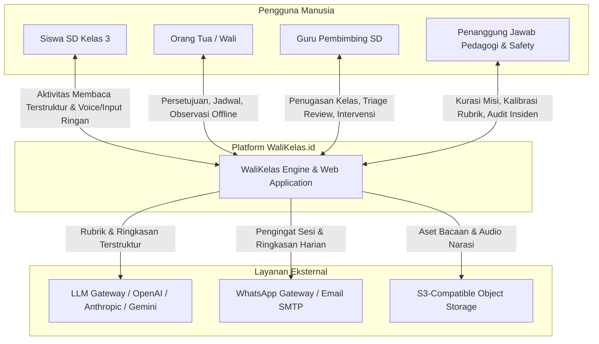
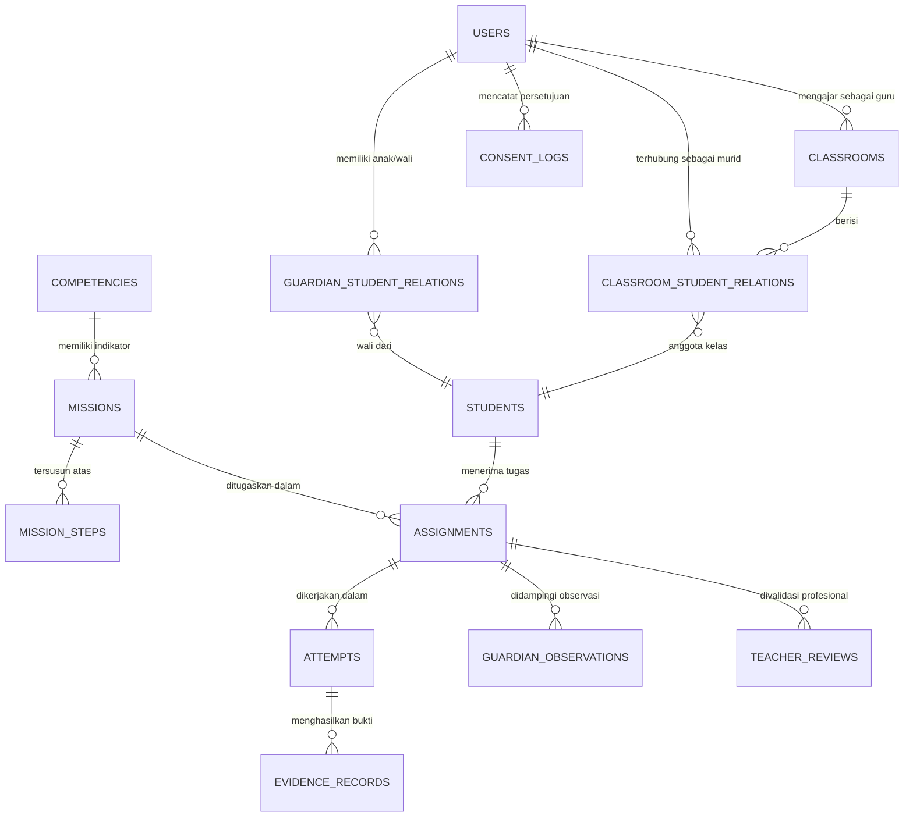

# WALIKELAS.ID
## Rencana Arsitektur Teknis & Roadmap Implementasi MVP v1.0
### Human-Guided AI Platform untuk Kolaborasi Literasi Guru SD, Orang Tua/Wali, dan Siswa

---

**Versi Dokumen:** 1.0 — *Technical Architecture Baseline & Phased Implementation Plan*  
**Tanggal Rilis:** 13 Oktober 2026  
**Status Dokumen:** DIKUNCI sebagai panduan teknis implementasi teknik, arsitektur data, API, AI Orchestrator, dan pembagian sprint  
**Dokumen Induk (Single Source of Truth):** [WALIKELAS_MVP_FUNDAMENTAL_PRODUCT_ARCHITECTURE_v1.0.md](file:///home/dev360_03/locomo.id/docs/walikelas.id/WALIKELAS_MVP_FUNDAMENTAL_PRODUCT_ARCHITECTURE_v1.0.md)  
**Konteks Submission:** Transisi dari *unimart.group* ke *walikelas.id* menuju akselerator global (Founder Institute Bali, Y Combinator W27, Techstars London/NYC) Oktober–November 2026.

---

## DAFTAR ISI

1. [Eksekutif & Penyelarasan Strategis (VC Submission Alignment)](#1-eksekutif--penyelarasan-strategis-vc-submission-alignment)
2. [Prinsip Arsitektur Teknis (Technical Invariants)](#2-prinsip-arsitektur-teknis-technical-invariants)
3. [Arsitektur Sistem Tingkat Tinggi (C4 Level 1 & 2)](#3-arsitektur-sistem-tingkat-tinggi-c4-level-1--2)
4. [Tumpukan Teknologi (Technology Stack)](#4-tumpukan-teknologi-technology-stack)
5. [Model Data Relasional & Skema Database (Database Architecture)](#5-model-data-relasional--skema-database-database-architecture)
6. [Mesin Finite State Machine (FSM) Siklus Misi](#6-mesin-finite-state-machine-fsm-siklus-misi)
7. [WaliKelas AI Engine & Guardrails Orchestrator](#7-walikelas-ai-engine--guardrails-orchestrator)
8. [Desain API & Kontrak Antarmuka (API Contracts)](#8-desain-api--kontrak-antarmuka-api-contracts)
9. [Protokol Privasi, Keamanan Anak & Incident Response (Safeguarding)](#9-protokol-privasi-keamanan-anak--incident-response-safeguarding)
10. [Rencana Pengerjaan Bertahap (Phased Implementation Roadmap)](#10-rencana-pengerjaan-bertahap-phased-implementation-roadmap)
11. [Matriks Pengujian, Kriteria Penerimaan Teknis (Technical AC) & Telemetri Pilot](#11-matriks-pengujian-kriteria-penerimaan-teknis-technical-ac--telemetri-pilot)
12. [Struktur Repositori & Petunjuk Pengorganisasian Kode](#12-struktur-repositori--petunjuk-pengorganisasian-kode)

---

## 1. Eksekutif & Penyelarasan Strategis (VC Submission Alignment)

### 1.1 Perubahan Strategis: Unimart ke WaliKelas.id
Peralihan dari `unimart.group` (Voice B2B OS) ke `walikelas.id` (Human-Guided EdTech & AI Co-Pilot) membawa proposisi nilai yang lebih kuat dan mendalam:
1. **Defensibilitas Nyata:** Bukan sekadar wrapper LLM, melainkan *closed-loop workflow* yang menghubungkan tiga pihak (Guru, Wali, Murid) yang didukung kurasi pedagogi dan kepatuhan privasi anak (UU PDP & COPPA-aligned).
2. **Distribusi Organik (High-Trust Network):** Akses pilot instan melalui jaringan guru SD dan ikatan emosional keluarga terhadap pendidikan anak dasar.
3. **Efisiensi Waktu Guru (Direct ROI):** Mengurangi hingga 40% waktu administrasi penelaahan tugas guru tanpa menambah durasi layar (screen time) anak.

### 1.2 Target Milestone & Deadline Submission 2026

| Milestone / Program | Deadline / Tanggal Target | Prasyarat Teknis yang Harus Siap |
|---|---|---|
| **Founder Institute Bali** | Kickoff **21 Okt 2026** | Prototipe UI/UX interaktif alur tertutup (Fase 1); arsitektur data solid. |
| **YC Winter 2027** | **2 Nov 2026 20.00 PT** (*3 Nov 11.00 WIB*) | Live working MVP, data pilot 20–30 siswa & 5 guru, video demo 90s, bukti validasi bukti belajar. |
| **Techstars London / NYC** | **18 Nov 2026** | Bukti retensi pilot 7 hari, metrik waktu guru yang dihemat, willingness-to-pay baseline. |
| **Cloud Perks (AWS, Azure, NVIDIA)** | Rolling (Nov 2026) | Arsitektur cloud-agnostic berbasis container, domain terverifikasi, CI/CD pipeline. |

---

## 2. Prinsip Arsitektur Teknis (Technical Invariants)

Mengacu pada Dokumen Arsitektur Fundamental Bagian A & E, arsitektur perangkat lunak wajib mematuhi 7 invarian mutlak:

```
[Invarian Teknis WaliKelas.id]
  ├── 1. Least Privilege & Strict Data Isolation (Isolasi Data Siswa & Keluarga)
  ├── 2. Dual-Path Execution (Jalur Mandiri Keluarga vs Kolaborasi Guru)
  ├── 3. Strict State Attribution (Label Sumber Bukti Tidak Boleh Tertukar)
  ├── 4. Bounded AI Engine (AI HANYA Bertindak dalam Batas Skema & Rubrik)
  ├── 5. Zero Generative Free-Chat for Children (Anak Hanya Berinteraksi Terstruktur)
  ├── 6. Screen Time Throttling (Batas Waktu Layar 10-15 Menit + Mandatory Break)
  └── 7. Immediate Safeguarding Circuit Breaker (Deteksi Konten Bahaya -> Eskalasi Manusia)
```

1. **Strict RBAC & Tenant Isolation:** Siswa A tidak dapat melihat data Siswa B. Guru hanya dapat mengakses siswa yang secara eksplisit memberikan persetujuan relasi kelas. Orang tua hanya mengakses anak kandung/perwalian resminya.
2. **Immutable Audit Trail of Evidence:** Data respons siswa, observasi wali, evaluasi sistem, dan review guru dicatat sebagai entitas terpisah dengan atribut `source_type` dan timestamp yang tidak dapat dimanipulasi.
3. **No Hallucinatory AI Grading:** Engine evaluasi jawaban menggunakan deterministic keyword/semantic matching berbasis rubrik kurasi, bukan inferensi bebas tanpa referensi.
4. **Offline First Consideration:** Data aktivitas lokal di-cache secara temporer sehingga bila koneksi putus di tengah misi membaca, status tidak hangus dan tidak melabeli anak gagal.

---

## 3. Arsitektur Sistem Tingkat Tinggi (C4 Level 1 & 2)

### 3.1 C4 Level 1: System Context Diagram



### 3.2 C4 Level 2: Container Diagram

```mermaid
flowchart TB
    subgraph Clients [Frontend Applications]
        StudentPWA[Student Runner PWA\n(Mobile/Tablet, Anti-Distraksi, Touch-First)]
        GuardianApp[Guardian Portal Web/PWA\n(Mobile Responsive, Persetujuan, Laporan)]
        TeacherPortal[Teacher Co-Pilot Dashboard\n(Desktop/Tablet, Batch Triage, Analitik)]
    end

    subgraph Gateway [API & Routing Layer]
        APIGateway[Fastify / NestJS API Gateway\n(JWT, Rate Limiting, RBAC Enforcer)]
    end

    subgraph Services [Application Core Services]
        AuthService[Auth & Consent Service\n(Kepatuhan PDP, Multi-Wali, Token Undangan)]
        MissionService[Mission & Assignment FSM Engine\n(State Machine, Scheduler)]
        EvidenceService[Evidence & Assessment Service\n(Pencatatan Jawaban & Observasi)]
        TeacherReviewService[Teacher Triage & Review Service\n(Antrean Prioritas & Intervensi)]
        AIOptService[WaliKelas AI Orchestrator\n(Rubric Evaluation, Context Scoper, Digest)]
        NotificationWorker[Notification & Queue Worker\n(BullMQ, WhatsApp, Quiet Hours)]
    end

    subgraph Storage [Persistence & Cache]
        PostgreSQL[(PostgreSQL Relational DB\nPrimary OLTP & Audit Trail)]
        RedisCache[(Redis\nSessions, Rate Limits, BullMQ)]
        S3Storage[(Object Store / MinIO\nAsset Konten Misi)]
    end

    StudentPWA -->|HTTPS / REST + WS| APIGateway
    GuardianApp -->|HTTPS / REST| APIGateway
    TeacherPortal -->|HTTPS / REST| APIGateway

    APIGateway --> AuthService
    APIGateway --> MissionService
    APIGateway --> EvidenceService
    APIGateway --> TeacherReviewService

    MissionService --> PostgreSQL
    EvidenceService --> PostgreSQL
    TeacherReviewService --> PostgreSQL
    AuthService --> PostgreSQL

    EvidenceService -->|Event: MISSION_COMPLETED| RedisCache
    RedisCache --> AIOptService
    AIOptService --> PostgreSQL
    AIOptService --> RedisCache
    RedisCache --> NotificationWorker
```

---

## 4. Tumpukan Teknologi (Technology Stack)

Sesuai filosofi arsitektur *Fat Service, Skinny Controller*, keandalan relasional, dan kecepatan implementasi pra-November 2026:

| Layer | Komponen / Teknologi | Justifikasi Teknis & Kepatuhan |
|---|---|---|
| **Backend Framework** | **Node.js (TypeScript) + Fastify** atau **NestJS** | Performa tinggi, throughput I/O cepat, dukungan Zod schema validation end-to-end, kompatibilitas TypeScript dengan frontend. |
| **Primary Database** | **PostgreSQL 16** | Relasional murni, transaksi ACID kuat, integrasi JSONB untuk konfigurasi fleksibel rubrik, indexing performa tinggi (BRIN/B-Tree). |
| **ORM / Query Builder** | **Prisma** atau **Drizzle ORM** | Type-safety penuh, migrasi skema terkelola dengan versi kode, proteksi bawaan terhadap SQL Injection. |
| **Cache & Job Queue** | **Redis 7 + BullMQ** | Manajemen antrean FSM asinkron, scheduled reminders (pengingat jam belajar), rate limiting, dan buffer scoring AI. |
| **AI LLM Gateway** | **LiteLLM / Direct SDK (OpenAI gpt-4o-mini & Claude 3.5 Haiku)** | Penilaian rubrik terstruktur menggunakan JSON Strict Mode (`response_format`). Model ringkas menjamin latensi < 1.5s dan efisiensi biaya. |
| **Frontend Web/PWA** | **Next.js 14 / Vite React (TypeScript) + TailwindCSS** | Akses cepat via browser ponsel tanpa unduh APK berat. Desain modular untuk 3 persona (Siswa, Wali, Guru). |
| **Audio & Media Delivery** | **Web Audio API + AWS S3 / Cloudflare R2** | Format audio terkompresi (Opus/AAC) untuk narasi membaca teks kelas 3 SD; bandwidth-friendly. |
| **Notification Engine** | **Fonnte / WhatsApp Business API + Resend (Email)** | WhatsApp adalah kanal utama orang tua di Indonesia; pesan dibatasi oleh *daily quiet-hour budget*. |
| **Container & CI/CD** | **Docker + Docker Compose + GitHub Actions** | Portabel dari WSL dev environment ke cloud VPS (AWS Lightsail / Hetzner / Railway) tanpa deviasi runtime. |

---

## 5. Model Data Relasional & Skema Database (Database Architecture)

### 5.1 Entity Relationship Diagram (ERD) Konseptual



### 5.2 Skema Tabel Utama (DDL PostgreSQL Specification)

#### 1. Manajemen Akun, Relasi, dan Persetujuan (Auth, Roles & Consent)
```sql
-- Role Enum
CREATE TYPE user_role AS ENUM ('GUARDIAN', 'EDUCATOR', 'PEDAGOGY_LEAD', 'ADMIN');
CREATE TYPE verification_status AS ENUM ('PENDING', 'ACTIVE', 'REVOKED', 'EXPIRED');

CREATE TABLE users (
    id UUID PRIMARY KEY DEFAULT gen_random_uuid(),
    role user_role NOT NULL,
    full_name VARCHAR(150) NOT NULL,
    phone_number VARCHAR(20) UNIQUE NOT NULL,
    email VARCHAR(150) UNIQUE,
    password_hash VARCHAR(255) NOT NULL,
    is_active BOOLEAN DEFAULT TRUE,
    created_at TIMESTAMPTZ DEFAULT NOW(),
    updated_at TIMESTAMPTZ DEFAULT NOW()
);

CREATE TABLE students (
    id UUID PRIMARY KEY DEFAULT gen_random_uuid(),
    display_name VARCHAR(100) NOT NULL, -- Nama panggilan, tanpa data sensitif
    grade_level SMALLINT DEFAULT 3,     -- Baseline kelas 3 SD
    birth_year SMALLINT,                -- Hanya tahun lahir (minimalisasi data PDP)
    avatar_id VARCHAR(50) DEFAULT 'default_avatar_1',
    created_at TIMESTAMPTZ DEFAULT NOW()
);

-- Hubungan Perwalian (Wali - Anak)
CREATE TABLE guardian_student_relations (
    id UUID PRIMARY KEY DEFAULT gen_random_uuid(),
    guardian_id UUID NOT NULL REFERENCES users(id) ON DELETE RESTRICT,
    student_id UUID NOT NULL REFERENCES students(id) ON DELETE CASCADE,
    relation_type VARCHAR(50) DEFAULT 'PARENT', -- PARENT, GUARDIAN, TUTOR
    is_primary_contact BOOLEAN DEFAULT TRUE,
    created_at TIMESTAMPTZ DEFAULT NOW(),
    UNIQUE(guardian_id, student_id)
);

-- Log Persetujuan Hukum Wali (Consent Kritis)
CREATE TABLE consent_logs (
    id UUID PRIMARY KEY DEFAULT gen_random_uuid(),
    guardian_id UUID NOT NULL REFERENCES users(id),
    student_id UUID NOT NULL REFERENCES students(id),
    consent_version VARCHAR(20) NOT NULL, -- e.g., 'v1.0-OCT-2026'
    purpose_scope VARCHAR(255) NOT NULL,  -- e.g., 'LITERACY_PILOT_GRADE_3'
    ip_address VARCHAR(45),
    user_agent TEXT,
    consented_at TIMESTAMPTZ DEFAULT NOW(),
    revoked_at TIMESTAMPTZ
);

-- Ruang Kelas & Relasi Guru-Siswa
CREATE TABLE classrooms (
    id UUID PRIMARY KEY DEFAULT gen_random_uuid(),
    educator_id UUID NOT NULL REFERENCES users(id),
    school_name VARCHAR(150) NOT NULL,
    classroom_name VARCHAR(100) NOT NULL,
    grade_level SMALLINT DEFAULT 3,
    invitation_code VARCHAR(12) UNIQUE NOT NULL,
    created_at TIMESTAMPTZ DEFAULT NOW()
);

CREATE TABLE classroom_student_relations (
    id UUID PRIMARY KEY DEFAULT gen_random_uuid(),
    classroom_id UUID NOT NULL REFERENCES classrooms(id) ON DELETE CASCADE,
    student_id UUID NOT NULL REFERENCES students(id) ON DELETE CASCADE,
    guardian_consent_id UUID REFERENCES consent_logs(id),
    status verification_status DEFAULT 'PENDING',
    joined_at TIMESTAMPTZ DEFAULT NOW(),
    revoked_at TIMESTAMPTZ,
    UNIQUE(classroom_id, student_id)
);
```

#### 2. Kurikulum Literasi & Pustaka Misi (Pedagogy & Mission Store)
```sql
CREATE TABLE competencies (
    id VARCHAR(50) PRIMARY KEY, -- e.g., 'LIT-GR3-EXP-INFO', 'LIT-GR3-SEQ-EVENT'
    title VARCHAR(150) NOT NULL,
    description TEXT NOT NULL,
    target_grade SMALLINT DEFAULT 3,
    prerequisite_competency_id VARCHAR(50) REFERENCES competencies(id)
);

CREATE TABLE missions (
    id UUID PRIMARY KEY DEFAULT gen_random_uuid(),
    competency_id VARCHAR(50) NOT NULL REFERENCES competencies(id),
    title VARCHAR(200) NOT NULL,
    story_narrative TEXT NOT NULL,       -- Teks bacaan naratif kelas 3 SD
    story_audio_url VARCHAR(500),        -- Opsional audio pendamping
    estimated_duration_min SMALLINT DEFAULT 12,
    is_safe_for_independent_family BOOLEAN DEFAULT TRUE,
    offline_activity_guide JSONB NOT NULL, -- Instruksi praktis orang tua di rumah
    created_by UUID REFERENCES users(id), -- Kurator pedagogi
    created_at TIMESTAMPTZ DEFAULT NOW()
);

CREATE TABLE mission_steps (
    id UUID PRIMARY KEY DEFAULT gen_random_uuid(),
    mission_id UUID NOT NULL REFERENCES missions(id) ON DELETE CASCADE,
    step_order SMALLINT NOT NULL,
    prompt_text TEXT NOT NULL,
    question_type VARCHAR(30) NOT NULL, -- 'MULTIPLE_CHOICE', 'ORDERING', 'SHORT_EXPLAIN'
    options JSONB,                      -- Opsi pilihan ganda bila relevan
    rubric_criteria JSONB NOT NULL,     -- Rubrik acuan jawaban dan kata kunci
    hints JSONB NOT NULL                -- Petunjuk bertingkat: [Hint 1, Hint 2]
);
```

#### 3. Siklus Penugasan, Eksekusi, dan Bukti Belajar (Lifecycle & Evidence)
```sql
CREATE TYPE assignment_status AS ENUM (
    'DRAFT', 'APPROVED', 'ASSIGNED', 'SCHEDULED', 
    'IN_PROGRESS', 'PAUSED', 'ACTIVITY_DONE', 
    'EVIDENCE_RECORDED', 'REVIEW_PENDING', 'REVIEWED', 
    'SUMMARY_READY', 'CANCELLED'
);

CREATE TYPE confidence_level AS ENUM (
    'NOT_ASSESSED', 'NEEDS_SUPPORT', 'DEVELOPING', 
    'SYSTEM_INDICATED_MASTERY', 'TEACHER_VALIDATED'
);

CREATE TABLE assignments (
    id UUID PRIMARY KEY DEFAULT gen_random_uuid(),
    mission_id UUID NOT NULL REFERENCES missions(id),
    student_id UUID NOT NULL REFERENCES students(id),
    classroom_id UUID REFERENCES classrooms(id), -- NULL jika Mode Keluarga Mandiri
    assigned_by_role user_role NOT NULL,         -- GUARDIAN atau EDUCATOR
    status assignment_status DEFAULT 'ASSIGNED',
    scheduled_for_date DATE,
    started_at TIMESTAMPTZ,
    completed_at TIMESTAMPTZ,
    created_at TIMESTAMPTZ DEFAULT NOW()
);

CREATE TABLE attempts (
    id UUID PRIMARY KEY DEFAULT gen_random_uuid(),
    assignment_id UUID NOT NULL REFERENCES assignments(id) ON DELETE CASCADE,
    student_id UUID NOT NULL REFERENCES students(id),
    attempt_number SMALLINT DEFAULT 1,
    screen_time_seconds INTEGER DEFAULT 0,
    pause_count SMALLINT DEFAULT 0,
    is_completed BOOLEAN DEFAULT FALSE,
    started_at TIMESTAMPTZ DEFAULT NOW(),
    finished_at TIMESTAMPTZ
);

-- Bukti Hasil Pengerjaan Anak (Jawaban & Koreksi)
CREATE TABLE evidence_records (
    id UUID PRIMARY KEY DEFAULT gen_random_uuid(),
    attempt_id UUID NOT NULL REFERENCES attempts(id) ON DELETE CASCADE,
    mission_step_id UUID NOT NULL REFERENCES mission_steps(id),
    student_response TEXT NOT NULL,
    hints_used_count SMALLINT DEFAULT 0,
    retry_count SMALLINT DEFAULT 0,
    system_score NUMERIC(4,2), -- Nilai kecocokan rubrik (0.00 - 1.00)
    system_feedback TEXT,
    system_confidence confidence_level DEFAULT 'DEVELOPING',
    created_at TIMESTAMPTZ DEFAULT NOW()
);

-- Observasi Offline Orang Tua (Terpisah Tegas dari Bukti Siswa)
CREATE TABLE guardian_observations (
    id UUID PRIMARY KEY DEFAULT gen_random_uuid(),
    assignment_id UUID NOT NULL REFERENCES assignments(id) ON DELETE CASCADE,
    guardian_id UUID NOT NULL REFERENCES users(id),
    offline_activity_conducted BOOLEAN NOT NULL DEFAULT TRUE,
    observed_engagement VARCHAR(50), -- e.g., 'ENTHUSIASTIC', 'NEEDED_HELP', 'TIRED'
    freeform_notes TEXT,
    recorded_at TIMESTAMPTZ DEFAULT NOW()
);

-- Review Profesional Guru (Hanya Guru Berwenang)
CREATE TABLE teacher_reviews (
    id UUID PRIMARY KEY DEFAULT gen_random_uuid(),
    assignment_id UUID NOT NULL REFERENCES assignments(id) ON DELETE CASCADE,
    educator_id UUID NOT NULL REFERENCES users(id),
    validated_confidence confidence_level NOT NULL, -- e.g., 'TEACHER_VALIDATED'
    teacher_notes TEXT,
    recommended_intervention VARCHAR(100), -- 'PRACTICE_PREREQUISITE', 'CONTINUE_LEVEL'
    reviewed_at TIMESTAMPTZ DEFAULT NOW()
);

-- Ringkasan Progres Akhir (Multi-Layer Data Display)
CREATE TABLE progress_summaries (
    id UUID PRIMARY KEY DEFAULT gen_random_uuid(),
    assignment_id UUID NOT NULL REFERENCES assignments(id) ON DELETE CASCADE,
    student_id UUID NOT NULL REFERENCES students(id),
    facts_layer JSONB NOT NULL,          -- Fakta apa yang dikerjakan & durasi layar
    findings_layer JSONB NOT NULL,       -- Temuan rubrik & pola kesalahan
    recommendations_layer JSONB NOT NULL,-- Rekomendasi aktivitas berikutnya
    validation_status VARCHAR(50) NOT NULL, -- 'SYSTEM_ESTIMATION' atau 'TEACHER_VERIFIED'
    generated_at TIMESTAMPTZ DEFAULT NOW()
);
```

---

## 6. Mesin Finite State Machine (FSM) Siklus Misi

### 6.1 Tabel Transisi State & Event Trigger

Siklus penugasan dikendalikan oleh modul `AssignmentStateMachine` yang terisolasi dari UI:

```
[ASSIGNED]
   │  (Event: SCHEDULE_SET)
   ▼
[SCHEDULED]
   │  (Event: SESSION_START)
   ▼
[IN_PROGRESS] ──(Event: PAUSE_REST)──► [PAUSED]
   │                                      │ (Event: RESUME)
   │◄─────────────────────────────────────┘
   │  (Event: DIGITAL_COMPLETED)
   ▼
[ACTIVITY_DONE]
   │  (Event: GUARDIAN_CONFIRM_OFFLINE)
   ▼
[EVIDENCE_RECORDED]
   ├── [Mode Keluarga Mandiri] ──────────► [SUMMARY_READY]
   │
   └── [Mode Guru Terhubung]
           │ (Event: FLAG_FOR_TEACHER)
           ▼
     [REVIEW_PENDING]
           │ (Event: TEACHER_SUBMIT_REVIEW)
           ▼
        [REVIEWED]
           │
           ▼
     [SUMMARY_READY]
```

### 6.2 Aturan Transisi & Validasi Invarian FSM

1. **Guard `IN_PROGRESS`:** Tidak dapat dimulai jika waktu belajar anak telah melebihi ambang batas harian (maks 25 menit digital).
2. **Guard `ACTIVITY_DONE` ke `EVIDENCE_RECORDED`:** Wajib menerima konfirmasi pelaksanaan aktivitas offline dari wali melalui modul *Guardian Checkpoint*.
3. **Branching `EVIDENCE_RECORDED`:**
   - Jika `classroom_id IS NULL`: Langsung menuju `SUMMARY_READY` dengan tagar status `validation_status = 'SYSTEM_ESTIMATION'`. DILARANG KERAS menetapkan `TEACHER_VALIDATED`.
   - Jika `classroom_id IS NOT NULL`: Menganalisis ambang prioritas. Jika sistem mendeteksi error berulang atau keraguan rubrik, dialihkan ke `REVIEW_PENDING`.
4. **Pembatalan (`CANCELLED`):** Dapat dipicu oleh Wali atau Guru kapan saja sebelum `SUMMARY_READY`. Bukti percobaan parsial tetap disimpan di audit log namun tidak dihitung sebagai capaian kompetensi.

---

## 7. WaliKelas AI Engine & Guardrails Orchestrator

### 7.1 Prinsip Kerja AI Orchestrator
WaliKelas AI Engine berfungsi sebagai asisten semi-otonom dengan **kewenangan terbatas (bounded scope)**:
1. **Bukan Chatbot Siswa:** AI tidak membuka interface percakapan bebas dengan anak. Siswa hanya menerima petunjuk terkurasi (*multi-level hints*) yang telah dianalisis sesuai rubrik.
2. **Deterministic Scorer:** Mengukur kesesuaian jawaban naratif anak terhadap rubrik melalui prompt terstruktur berformat JSON Schema murni.
3. **Teacher Triage Queue Filter:** Memfilter penugasan yang memerlukan review manual guru (hanya menyorot kasus anomalus, kesulitan berulang, atau pola keraguan), sehingga guru tidak terbebani membaca seluruh jawaban yang sudah jelas tuntas.

### 7.2 Diagram Pipeline Evaluasi Jawaban & Scoring

```
[Jawaban Siswa] + [Rubrik Misi] + [Teks Narasi Cerita]
                        │
                        ▼
           [Safety & PII Sanitizer]
      (Memeriksa kata terlarang / bahaya)
                        │
                        ▼
         [LiteLLM Structured Prompt]
        (Model: gpt-4o-mini / Haiku)
                        │
                        ▼
          [Strict JSON Parser & Zod]
    {
      "match_score": 0.85,
      "identified_keywords": ["sebab", "hujan"],
      "missing_elements": [],
      "pedagogical_confidence": "DEVELOPING",
      "recommended_hint": "Bagus! Coba ingat mengapa tokoh berteduh..."
    }
                        │
                        ▼
            [Evidence Recording Service]
```

### 7.3 Skema Prompt Evaluasi & Scoring Rubrik (Zod Contract)

```typescript
// contract/ai-scoring.contract.ts
import { z } from "zod";

export const RubricEvaluationSchema = z.object({
  score: z.number().min(0).max(1).describe("Skor kesesuaian dengan rubrik antara 0.0 - 1.0"),
  evidence_level: z.enum([
    "NEEDS_SUPPORT",
    "DEVELOPING",
    "SYSTEM_INDICATED_MASTERY"
  ]),
  matched_concepts: z.array(z.string()).describe("Konsep yang berhasil diidentifikasi dari jawaban anak"),
  misconceptions: z.array(z.string()).describe("Kesalahan tafsir yang terdeteksi"),
  next_adaptive_hint: z.string().max(160).describe("Petunjuk ringkas ramah anak untuk percobaan berikutnya jika belum tepat"),
  needs_teacher_escalation: z.boolean().describe("Wajib true jika anak mengalami kesulitan berulang atau jawaban ambigu")
});

export type RubricEvaluation = z.infer<typeof RubricEvaluationSchema>;
```

### 7.4 Budget Perhatian & Pembatasan Notifikasi (Attention Budgeting)
Untuk mencegah gangguan notifikasi berlebih kepada orang tua dan guru:
- **Quiet Hours:** Pukul 20.00 – 07.00 WIB tidak ada notifikasi yang dikirimkan ke ponsel orang tua kecuali konfirmasi login mendesak.
- **Daily Digest Cap:** Maksimal 1 ringkasan harian untuk wali via WhatsApp/Email.
- **Teacher Batching:** Review siswa tidak dikirim secara perorangan via notifikasi real-time, melainkan dikelompokkan ke dalam *Morning / Afternoon Digest*.

---

## 8. Desain API & Kontrak Antarmuka (API Contracts)

API dirancang RESTful dengan payload JSON terstandardisasi, beroperasi pada port internal dan dilindungi middleware autentikasi JWT + Context Checker.

### 8.1 Ringkasan Endpoint Inti

```
AUTH & ONBOARDING:
  POST /api/v1/auth/guardian/register
  POST /api/v1/auth/educator/register
  POST /api/v1/auth/login
  POST /api/v1/guardian/students              -> Buat profil anak minimal
  POST /api/v1/guardian/consent               -> Catat persetujuan eksplisit PDP

RELATION & CLASSROOMS:
  POST /api/v1/educator/classrooms            -> Guru membuat kelas pilot
  POST /api/v1/classrooms/invite              -> Generate kode/link undangan
  POST /api/v1/guardian/connect-classroom     -> Wali menerima & setuju berbagi data

MISSION RUNNER (STUDENT):
  GET  /api/v1/student/missions/today         -> Ambil misi aktif hari ini
  POST /api/v1/student/attempts/start         -> Mulai sesi digital (start timer)
  POST /api/v1/student/attempts/:id/submit    -> Kirim jawaban per langkah
  POST /api/v1/student/attempts/:id/pause     -> Jeda / istirahat (anti-distraksi)
  POST /api/v1/student/attempts/:id/complete  -> Selesai langkah digital

GUARDIAN CHECKPOINT:
  POST /api/v1/guardian/assignments/:id/offline-done -> Konfirmasi tugas rumah offline

TEACHER CO-PILOT:
  GET  /api/v1/educator/review-queue          -> Antrean kasus siswa prioritas
  POST /api/v1/educator/reviews/submit        -> Simpan validasi & intervensi

REPORTS & SUMMARIES:
  GET  /api/v1/reports/assignments/:id        -> Ambil ringkasan 3 lapis berlabel
```

### 8.2 Spesifikasi Detail Request / Response Contoh Kritis

#### `POST /api/v1/student/attempts/:id/submit` (Penyampaian Respons Jawaban)
```json
// Request
{
  "step_id": "8c8430b2-7bb5-4f32-8dfc-31c4f51e3e7a",
  "response_text": "Kelinci berteduh di bawah pohon rindang karena hujan sangat lebat",
  "time_spent_seconds": 45,
  "hints_requested": 1
}

// Response (HTTP 200)
{
  "status": "success",
  "data": {
    "step_id": "8c8430b2-7bb5-4f32-8dfc-31c4f51e3e7a",
    "is_acceptable": true,
    "system_feedback": "Hebat! Kamu berhasil menemukan alasan mengapa kelinci berteduh.",
    "is_mission_steps_completed": true,
    "next_action": "PROCEED_TO_OFFLINE_ACTIVITY"
  }
}
```

#### `GET /api/v1/reports/assignments/:id` (Tampilan Laporan 3 Lapis)
```json
// Response (HTTP 200)
{
  "assignment_id": "2d1f92e4-a124-4f01-b3cb-8c9e4210a56e",
  "student_display_name": "Budi",
  "mission_title": "Petualangan Tupai Menemukan Biji Cemara",
  "facts_layer": {
    "date": "2026-10-14",
    "screen_duration_minutes": 11,
    "steps_completed": 3,
    "offline_activity_conducted": true
  },
  "findings_layer": {
    "competency": "LIT-GR3-EXP-INFO",
    "competency_title": "Menemukan informasi eksplisit dalam teks naratif",
    "confidence_level": "TEACHER_VALIDATED",
    "attribution_source": "Ditinjau oleh Ibu Guru Sarah, S.Pd (Wali Kelas 3A)"
  },
  "recommendations_layer": {
    "action": "Lanjutkan ke latihan sebab-akibat (LIT-GR3-CAUSE-EFFECT)",
    "home_reading_tip": "Ajak anak membaca dongeng fabel pendek 5 menit sebelum tidur"
  }
}
```

---

## 9. Protokol Privasi, Keamanan Anak & Incident Response (Safeguarding)

### 9.1 Kepatuhan UU Perlindungan Data Pribadi (UU PDP) & Zero Excessive Data
1. **Data Anak Minimal:** Tidak mengumpulkan NIK, alamat rumah presisi, foto wajah asli, maupun rekam jejak digital di luar aplikasi.
2. **Hak Wali (Data Subject Rights):** Orang tua dapat kapan saja mengekspor riwayat belajar anak dalam format PDF/JSON, atau meminta penghapusan akun (`Right to Erasure`).
3. **Pencabutan Akses Guru:** Jika wali mencabut izin koneksi kelas, guru seketika kehilangan hak akses membaca aktivitas baru anak. Riwayat lama yang telah divalidasi disimpan dalam status terarsip (*anonymized audit record*).

### 9.2 Circuit Breaker Insiden Keamanan & Konten
Jika dalam isian teks terbuka (respons anak atau catatan wali) terdeteksi kata kunci darurat (kekerasan, perundungan ekstrem, ancaman fisik):
1. **Blokir Pemrosesan AI Otomatis:** Sistem membekukan respons otomatis.
2. **Redirection UI:** Menampilkan pesan netral: *"Kegiatan belajar dijeda. Mari beristirahat dan berbincang dengan orang tua atau guru."*
3. **Alert Tim Penanggung Jawab:** Notifikasi darurat dikirimkan secara internal ke tim Safeguarding manusia tanpa mempublikasikan insiden ke publik.

---

## 10. Rencana Pengerjaan Bertahap (Phased Implementation Roadmap)

Pelaksanaan teknis dibagi menjadi **5 Fase terstruktur dan terukur** menuju kesiapan pilot dan submission YC / Techstars November 2026.

```
[Timeline Eksekusi Teknis WaliKelas.id]
┌──────────────┬────────────────────────────────────────────────────────┬────────────────┐
│ Fase         │ Ruang Lingkup Pengerjaan                               │ Target Selesai │
├──────────────┼────────────────────────────────────────────────────────┼────────────────┤
│ Fase 0       │ Fondasi Data, Skema Relasional, Auth RBAC & Consent    │ 18 Okt 2026    │
│ Fase 1       │ Pustaka Misi Literasi, FSM Engine & Student Runner PWA │ 24 Okt 2026    │
│ Fase 2       │ AI Rubric Evaluator, Evidence Store & Summary Engine   │ 29 Okt 2026    │
│ Fase 3       │ Portal Guru Co-Pilot, Portal Wali & Proactive Notifier │ 03 Nov 2026    │
│ Fase 4       │ Pilot Testing (5 Guru, 25 Siswa), Telemetri & Security │ 08 Nov 2026    │
│ Fase 5       │ Finalisasi Data Room, Metrik Traction & Demo VC Deck   │ 15 Nov 2026    │
└──────────────┴────────────────────────────────────────────────────────┴────────────────┘
```

### FASE 0: Fondasi Data, Autentikasi, RBAC & Consent Engine
*Target: 14 – 18 Oktober 2026*
- **Tujuan:** Menyiapkan backend repository, skema PostgreSQL, Docker environment, dan sistem izin perwalian.
- **Detail Tugas:**
  1. Setup repository struktur monorepo / split clean architecture (`apps/api`, `apps/web`).
  2. Implementasi skema tabel PostgreSQL via migrasi (Prisma/Drizzle) sesuai Bagian 5.
  3. Modul Autentikasi JWT: Registrasi Wali, Siswa, Guru, dan Kurator Pedagogi.
  4. Modul Consent Engine: Pencatatan persetujuan wali berbasis timestamp, versi kebijakan, dan pencabutan hak akses.
  5. API Endpoint pengujian koneksi kelas melalui kode undangan 12 karakter.
- **Deliverables:** Unit test auth lulus, migrasi DB tereksekusi di Docker, API spec Swagger aktif.

### FASE 1: Pustaka Misi Literasi, FSM Lifecycle & Student Runner PWA
*Target: 19 – 24 Oktober 2026*
- **Tujuan:** Menyediakan pengalaman belajar anak yang interaktif, terstruktur, ramah usia, dan anti-distraksi.
- **Detail Tugas:**
  1. Input 5 Misi Kurasi Literasi Naratif Kelas 3 SD ke database (teks cerita, pertanyaan, rubrik, petunjuk, panduan offline).
  2. Implementasi `AssignmentStateMachine` (transisi state, penanganan jeda, validasi aturan).
  3. Membangun antarmuka **Student Runner (Web/PWA)**:
     - Tampilan bersih 1 soal per layar.
     - Kontrol audio narasi membaca ramah anak.
     - Timer batas sesi (12–15 menit) dengan pengingat istirahat ramah.
     - Antarmuka meminta petunjuk (*hints*) bertingkat tanpa membocorkan kunci jawaban.
  4. Fitur *Guardian Checkpoint*: Antarmuka konfirmasi kegiatan offline orang tua di rumah.
- **Deliverables:** Misi dapat dijalankan dari awal hingga selesai oleh pengguna tes di perangkat mobile.

### FASE 2: WaliKelas AI Scorer, Evidence Attribution & Summary Generator
*Target: 25 – 29 Oktober 2026*
- **Tujuan:** Mengotomatiskan penilaian jawaban berdasarkan rubrik pedagogi dan menghasilkan ringkasan berlabel tegas.
- **Detail Tugas:**
  1. Integrasi AI Gateway (LiteLLM / OpenAI gpt-4o-mini) dengan Zod Strict Schema.
  2. Algoritma evaluasi jawaban: mencocokkan respons teks anak dengan rubrik kata kunci dan mendeteksi miskonsepsi.
  3. Evidence Storage Engine: Penyimpanan hasil analisis dengan label attribution permanen (`SYSTEM_INDICATED_MASTERY`, `DEVELOPING`, `NEEDS_SUPPORT`).
  4. Summary Builder: Mengolah rekaman bukti menjadi laporan 3 lapis (*Fakta Kegiatan*, *Temuan Bukti*, *Rekomendasi*).
  5. Pengujian keandalan: Memastikan sistem konsisten menyatakan *"Belum cukup bukti"* bila jawaban ambigu.
- **Deliverables:** Evaluasi otomatis tereksekusi < 1.5 detik per jawaban dengan akurasi rubrik teruji.

### FASE 3: Portal Guru Co-Pilot, Portal Wali & Proactive Notification Engine
*Target: 30 Oktober – 03 November 2026*
- **Tujuan:** Memberikan alat pemantau guru yang efisien (hemat waktu) dan laporan yang menenangkan bagi orang tua.
- **Detail Tugas:**
  1. **Teacher Co-Pilot Dashboard:**
     - Triage Queue: Daftar siswa yang memerlukan perhatian (kesulitan berulang / ambigu).
     - 1-Click Validation: Guru menyetujui, mengoreksi, atau menambahkan catatan intervensi.
     - Metrik beban guru: Pelacak waktu penelaahan tugas guru vs cara manual.
  2. **Guardian Progress Portal:**
     - Ringkasan harian pencapaian misi dan tips pendampingan di rumah.
     - Indikator transparan: membedakan jelas mana yang *penilaian sistem* dan mana yang *tervalidasi guru*.
  3. **Notification Engine (BullMQ + WhatsApp API):**
     - Pengingat jadwal misi membaca sore/pagi.
     - Penerapan jam tenang (*Quiet Hours 20.00 - 07.00 WIB*).
- **Deliverables:** Guru pilot dapat menyelesaikan telaah 1 kelas (25 anak) dalam waktu < 10 menit.

### FASE 4: Pilot Testing (5 Guru SD, 25 Siswa), Telemetri & Security Hardening
*Target: 04 – 08 November 2026*
- **Tujuan:** Menjalankan uji coba lapangan nyata selama 5 hari bersama mitra desain sekolah dasar.
- **Detail Tugas:**
  1. Onboarding 5 guru SD mitra desain dan 20–30 orang tua dengan surat persetujuan digital.
  2. Pelaksanaan siklus literasi 5 misi naratif.
  3. Pengumpulan instrumen telemetri:
     - *Mission Completion Rate* (Digital + Offline).
     - *Teacher Time Saved* (Menghitung selisih waktu koreksi).
     - *Parent Usability Score* & keluhan screen time.
  4. Pengujian Circuit Breaker keamanan anak (uji penetrasi kata kunci dan isolasi data).
- **Deliverables:** Log pilot aktual, tidak ada insiden kebocoran privasi, data traction terverifikasi.

### FASE 5: Konsolidasi Metrik Pilot, Investor Data Room & Demo Deck VC
*Target: 09 – 15 November 2026 (Menjelang Techstars Deadline 18 Nov)*
- **Tujuan:** Mengonversi hasil teknis dan pilot menjadi bukti traksi kuat untuk seleksi wawancara YC dan submission Techstars.
- **Detail Tugas:**
  1. Pembangunan dashboard analitik ringkasan pilot untuk Data Room.
  2. Perekaman video demo produk 90 detik (menampilkan alur anak membaca -> pendampingan orang tua -> triage 1 menit guru).
  3. Penyusunan laporan dampak: *Waktu guru dihemat (±40%)*, *Tingkat keterlibatan wali (>80%)*, *Screen time anak terkendali (rata-rata 11 menit/sesi)*.
  4. Finalisasi dokumen arsitektur dan security whitepaper untuk uji tuntas teknis (*technical due diligence*).
- **Deliverables:** Master Data Room lengkap, video demo profesional, metrik pilot terverifikasi.

---

## 11. Matriks Pengujian, Kriteria Penerimaan Teknis (Technical AC) & Telemetri Pilot

### 11.1 Matriks Kriteria Penerimaan Teknis (Technical Acceptance Criteria)

| ID | Kode Pengujian | Skenario Uji | Syarat Keberhasilan Teknis |
|---|---|---|---|
| **TAC-01** | *Tenant Isolation* | Pengguna Wali A mencoba membaca endpoint `/api/v1/reports/assignments/:id` milik Siswa B (tanpa relasi). | Sistem mengembalikan HTTP 403 Forbidden. Tidak ada kebocoran metadata. |
| **TAC-02** | *Family Mode Independence* | Siswa menjalankan misi hingga tuntas tanpa `classroom_id`. | Misi sukses berstatus `SUMMARY_READY`, label laporan wajib `SYSTEM_ESTIMATION`. |
| **TAC-03** | *Attribution Integrity* | Guru memvalidasi tugas siswa terhubung via endpoint review. | Label laporan berubah menjadi `TEACHER_VALIDATED` dengan nama guru terekam di DB. |
| **TAC-04** | *Screen-Time Throttling* | Siswa membiarkan aplikasi aktif selama > 15 menit. | Aplikasi menampilkan layar jeda paksa: *"Waktunya mengistirahatkan mata!"* |
| **TAC-05** | *Offline Task Gate* | Penugasan mencoba beralih ke `EVIDENCE_RECORDED` tanpa catatan konfirmasi wali. | FSM menolak transisi (Throw Error: `GUARDIAN_OFFLINE_CONFIRMATION_REQUIRED`). |
| **TAC-06** | *AI Rubric Fallback* | Model AI mengembalikan output ambigu atau latensi > 4.0 detik. | Sistem fallback ke status `REVIEW_PENDING` dengan catatan *"Memerlukan telaah manual"*. |
| **TAC-07** | *Quiet Hours Enforcement* | Event pengingat misi terpicu pada pukul 21.30 WIB. | Worker menunda antrean pesan hingga pukul 07.30 WIB hari berikutnya. |

### 11.2 Telemetri Pilot yang Dicatat Otomatis

Untuk kebutuhan evaluasi efektivitas produk dan pelaporan investor:
```json
{
  "pilot_telemetry_event": "SESSION_METRICS_LOG",
  "session_id": "993a4b01-71e4-4d62-9e48-31ef09c12345",
  "metrics": {
    "screen_time_seconds": 680,
    "idle_pause_seconds": 120,
    "hints_requested": 1,
    "attempts_count": 2,
    "offline_activity_conducted": true,
    "teacher_review_seconds": 42,
    "system_ai_latency_ms": 1180
  }
}
```

---

## 12. Struktur Repositori & Petunjuk Pengorganisasian Kode

Untuk memastikan pengerjaan rapi, terisolasi, dan mudah didelegasikan ke swarm worker agents (`agy`, `opencode`), struktur codebase diatur sebagai berikut:

```text
walikelas-ecosystem/
├── apps/
│   ├── api/                           # Backend Fastify / NestJS API
│   │   ├── src/
│   │   │   ├── modules/
│   │   │   │   ├── auth/              # JWT, Guard, PDP Consent
│   │   │   │   ├── classrooms/        # Kode undangan & relasi guru-murid
│   │   │   │   ├── missions/          # Pustaka misi & FSM Assignment Engine
│   │   │   │   ├── evidence/          # Pencatatan jawaban & observasi wali
│   │   │   │   ├── reviews/           # Triage queue guru & validasi
│   │   │   │   └── ai-evaluator/      # Prompt rubrik, LiteLLM gateway, sanitizer
│   │   │   ├── common/
│   │   │   │   ├── guards/            # RBAC & Tenant isolation middleware
│   │   │   │   └── filters/           # Global exception handler
│   │   │   └── main.ts
│   │   ├── prisma/
│   │   │   └── schema.prisma          # PostgreSQL relational schema
│   │   └── Dockerfile
│   │
│   ├── web-student/                   # Student Runner PWA (Lightweight, Touch-First)
│   │   ├── src/
│   │   │   ├── components/            # Reader view, hint button, session timer
│   │   │   └── pages/runner/
│   │   └── package.json
│   │
│   ├── web-portal/                    # Shared Portal untuk Guru & Orang Tua
│   │   ├── src/
│   │   │   ├── modules/guardian/      # Progress card, offline checkpoint, settings
│   │   │   └── modules/educator/      # Triage inbox, 1-click review, classroom roster
│   │   └── package.json
│   │
│   └── workers/                       # BullMQ Background Job Worker
│       └── src/
│           ├── notification.worker.ts # WhatsApp / Email scheduler & quiet hours
│           └── telemetry.worker.ts    # Agregasi metrik pilot
│
├── docs/walikelas.id/                 # Arsip Blueprint & Dokumentasi Resmi
│   ├── WALIKELAS_MVP_FUNDAMENTAL_PRODUCT_ARCHITECTURE_v1.0.md
│   └── WALIKELAS_TECHNICAL_ARCHITECTURE_IMPLEMENTATION_PLAN_v1.0.md
│
├── docker-compose.yml                 # PostgreSQL 16, Redis 7, Local API, MinIO
└── README.md
```

---

## 13. Kesimpulan & Langkah Eksekusi Selanjutnya

Rencana arsitektur teknis ini mengonversi seluruh batasan konseptual dari dokumen fundamental menjadi struktur data relasional yang kokoh, alur kerja FSM yang deterministik, isolasi hak akses yang ketat, serta orkestrasi AI yang aman dan hemat biaya.

**Langkah Langsung yang Dapat Dimulai (Action Items):**
1. **Kickoff Fase 0:** Inisialisasi struktur skema database PostgreSQL dan modul autentikasi/consent.
2. **Penyusunan Kontrak Data 5 Misi Awal:** Menginput materi narasi fabel/cerita anak kelas 3 SD beserta rubrik penilaian ke dalam basis data.
3. **Pendelegasian Tugas ke Swarm Agent:** Pembagian tiket pengerjaan modular kepada `opencode` dan `agy` sesuai fase yang telah dibakukan.
