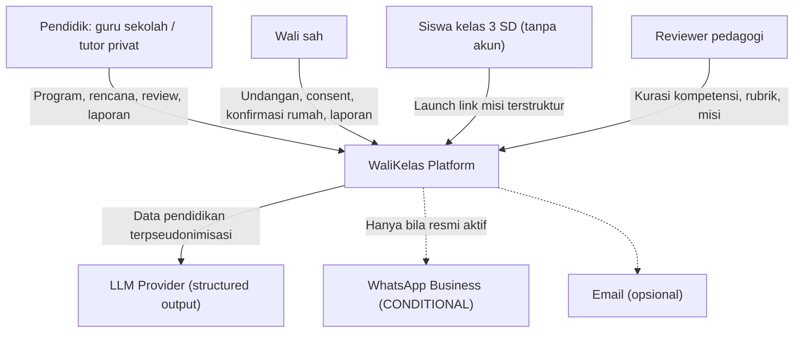
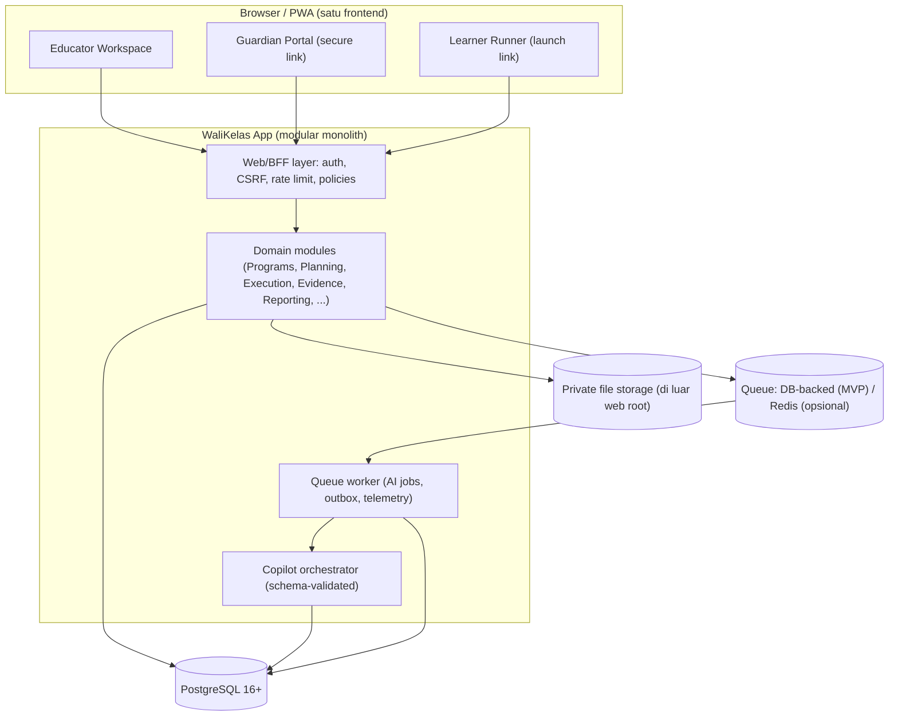
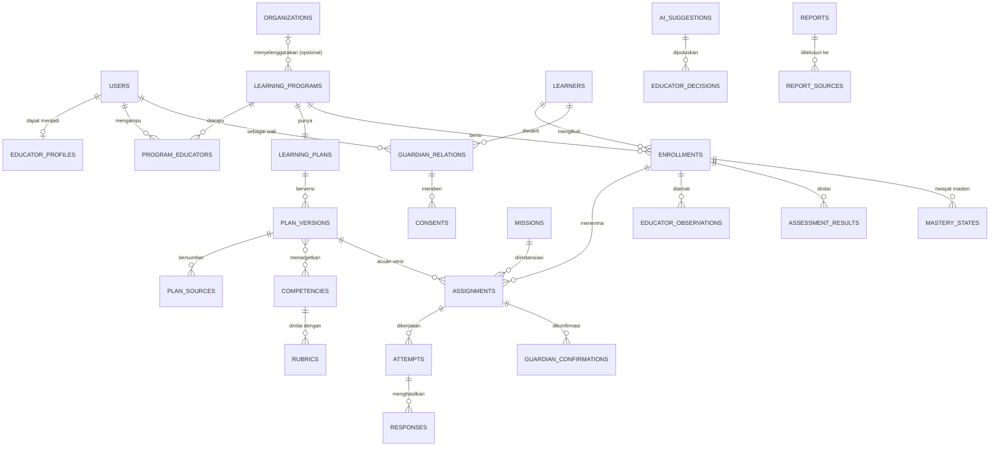
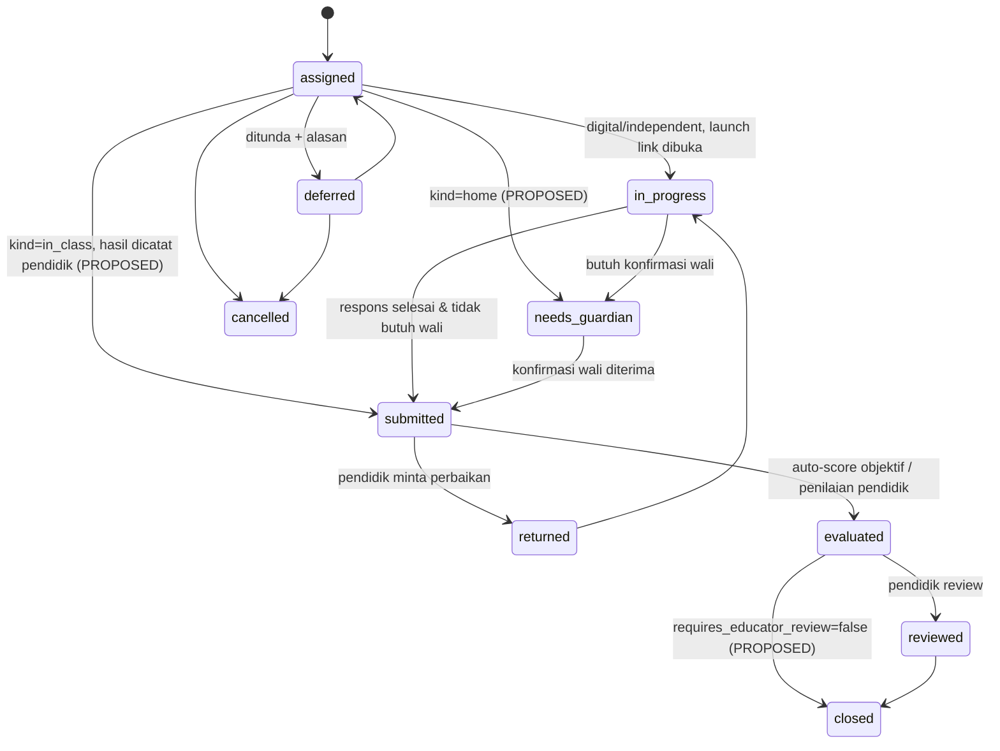

# WALIKELAS.ID
## Rencana Arsitektur Teknis & Implementasi MVP v2.0
### Educator Copilot berbasis Learning Program — guru sekolah & tutor privat, wali, dan siswa

---

**Versi dokumen:** 2.0 — *Technical Architecture Baseline, selaras dengan Product Blueprint v2.0*
**Tanggal:** 21 Oktober 2026
**Status:** **DRAFT UNTUK REVIEW FOUNDER.** Invariants dan model domain diusulkan untuk dikunci; pilihan stack, vendor, dan jadwal masih **[OPEN]**.
**Dokumen induk (source of truth produk):** [WALIKELAS_MVP_PRODUCT_BLUEPRINT_TECHNICAL_HANDOFF_v2.0.md](file:///home/dev360_03/locomo.id/docs/walikelas.id/WALIKELAS_MVP_PRODUCT_BLUEPRINT_TECHNICAL_HANDOFF_v2.0.md)
**Dokumen pelengkap:** [WALIKELAS_MVP_FUNDAMENTAL_PRODUCT_ARCHITECTURE_v1.0.md](file:///home/dev360_03/locomo.id/docs/walikelas.id/WALIKELAS_MVP_FUNDAMENTAL_PRODUCT_ARCHITECTURE_v1.0.md) (prinsip keselamatan, laporan 3 lapis, tingkat keyakinan bukti)
**Menggantikan:** [WALIKELAS_TECHNICAL_ARCHITECTURE_IMPLEMENTATION_PLAN_v1.0.md](file:///home/dev360_03/locomo.id/docs/walikelas.id/WALIKELAS_TECHNICAL_ARCHITECTURE_IMPLEMENTATION_PLAN_v1.0.md)

> **Aturan baca:** Jika dokumen ini bertentangan dengan Blueprint v2.0, **Blueprint v2.0 yang berlaku**. Penanda status mengikuti Blueprint §0.1: **[LOCKED] [MVP] [CONDITIONAL] [PROPOSED] [OPEN] [LATER]**. Rujukan "BP §x" berarti bagian di Blueprint v2.0.

---

## DAFTAR ISI

1. Perubahan dari Technical v1.0
2. Technical Invariants
3. Arsitektur Sistem (Modular Monolith + Bounded Context)
4. Tumpukan Teknologi [OPEN]
5. Model Domain & Skema Database
6. Model Otorisasi (Relation-Based, Program-Scoped)
7. State Machines
8. AI Orchestration & Guardrails
9. Communication & Guardian Channel
10. Keamanan, Privasi Anak & Safeguarding
11. Permukaan Rute / Kontrak Aplikasi
12. Telemetri & Metrik Pilot
13. Technical Acceptance Tests
14. Fase Implementasi
15. Struktur Repositori
16. Register Keputusan Teknis

---

## 1. Perubahan dari Technical v1.0

| Area | v1.0 | v2.0 | Rujukan |
|---|---|---|---|
| Root domain | `classrooms` (wajib `school_name`) | **`learning_programs`** dengan `mode ∈ {school, private}`; organisasi opsional | BP §4, D-05 |
| Identitas | `users.role` enum tunggal | Satu `users`; peran **diturunkan dari relasi** (pendidik program, wali sah) | BP §3.2, §23.1 |
| Otorisasi | RBAC + `classroom_id` | **Policy per program + relasi wali**; tidak ada akses lintas program otomatis | BP §2.10, §8.3 |
| Siklus | Asesmen → misi | **Planning-first:** rencana berversi → review → enrollment → baseline → misi | BP §5, D-06 |
| Planning | Tidak ada | **Planning Copilot:** wizard + impor teks + versi rencana | BP §7 |
| Family mode | P0 (`classroom_id IS NULL`) | **[LATER].** Relasi wali–siswa tetap independen dari program | BP §4.2-D, D-12 |
| FSM | Satu FSM, gerbang offline wajib | **Template misi** dan **assignment** dipisah; konfirmasi wali hanya untuk `home` | BP §9.2, §9.5 |
| AI ke anak | LLM scorer + hint adaptif real-time | **Tanpa LLM ke anak.** Hint ditulis lebih dulu; auto-score hanya untuk soal objektif | BP §15, O-09 |
| Bukti/keputusan | `teacher_reviews` | `ai_suggestions` ≠ `educator_decisions` ≠ `mastery_states` (append-only) | BP §23.1 |
| Laporan | `progress_summaries` statis | Laporan **berversi** + `report_sources` → `needs_review` saat sumber berubah | BP §12.2, AT-12 |
| Screen time | Throttle keras 10–15 menit | Durasi misi + layar selesai + pengingat istirahat (tanpa cap harian keras) | BP §2.12, §17.7 |
| Notifikasi | BullMQ + WhatsApp | **Outbox + policy check**; kanal MVP = secure web link / dibagikan manual | BP §10, O-07 |
| Pilot | 25 siswa nyata sebelum YC | **Data sintetis** + usability design partner; pilot anak setelah O-05/O-06 | BP §19.2 |
| Capability Kernel/SDUI | Direncanakan | **[LATER].** Hanya konten misi/rubrik berversi yang divalidasi skema | BP §22 |

---

## 2. Technical Invariants [PROPOSED → dikunci setelah review]

Setiap invariant di bawah wajib punya **test otomatis** (lihat §13).

| ID | Invariant | Turunan dari |
|---|---|---|
| **TI-01** | Tidak ada kolom/FK wajib `organization_id`/`school_id` pada program, pendidik, atau siswa. | BP §23.1 |
| **TI-02** | Setiap assignment, respons, observasi, asesmen, dan laporan **wajib** mereferensikan `program_id` + `enrollment_id` (kecuali laporan kelompok). | BP §23.1 |
| **TI-03** | Akses diputuskan oleh **relasi aktif** (`program_educators`, `guardian_relations` verified + consent aktif), bukan label peran. | BP §2.10, §23.1 |
| **TI-04** | Assignment menyimpan `plan_version_id`. Versi rencana yang sudah `approved` bersifat **immutable**; revisi berarti versi baru. | BP §4.4, §7.4 |
| **TI-05** | Output AI (`ai_suggestions`) disimpan terpisah dari keputusan manusia (`educator_decisions`). Tidak ada efek samping dari AI tanpa keputusan manusia. | BP §2.7, §23.1 |
| **TI-06** | `mastery_states.level = 'educator_validated'` **hanya** dapat ditulis oleh aktor pendidik program (DB CHECK + policy). | BP §11.4, D-15 |
| **TI-07** | `guardian_confirmations` tidak pernah memicu perubahan `mastery_states`. | BP §2.9, AT-9 |
| **TI-08** | Tidak ada pesan berisi data belajar ke wali yang belum `verified` atau consent-nya tidak aktif. Outbox menolak (*fail closed*). | BP §8.2, AT-8 |
| **TI-09** | Status kirim jujur: `sent` hanya jika adapter mengonfirmasi; tautan yang dibagikan manual tercatat `shared_manually`. | BP §10.2, AT-14 |
| **TI-10** | Tidak ada endpoint yang meneruskan input anak ke LLM. Anak hanya menerima konten misi dan hint yang sudah dikurasi. | BP §2.18, §15 |
| **TI-11** | Program hanya bisa membuat assignment baru bila `status = active` **dan** punya `active_plan_version_id` yang approved. | BP §4.4, AT-5 |
| **TI-12** | Laporan `approved` tidak pernah ditimpa. Perubahan sumber mengubah statusnya menjadi `needs_review` dan memicu versi baru. | BP §12.2, AT-12 |
| **TI-13** | `audit_events` dan `assignment_transitions` bersifat append-only (UPDATE/DELETE dicabut di level DB role). | BP §2.17 |
| **TI-14** | Integrasi eksternal (LLM, WhatsApp, email) bersifat opsional. Kegagalannya tidak memblokir alur inti dan selalu punya fallback manual. | BP §23.1 |

---

## 3. Arsitektur Sistem

### 3.1 Prinsip
**Modular monolith** dengan batas modul = bounded context BP §23. Pertimbangannya: satu deployable, satu database PostgreSQL, dan satu tim kecil dengan tenggat sekitar 10 hari. Event domain (BP §23.2) diimplementasikan sebagai **event in-process + tabel outbox**, bukan message broker terpisah. Pola **Skinny Controller, Fat Service** diterapkan (AGENTS.md).

### 3.2 Pemetaan Bounded Context → Modul

| BP §23 Context | Modul | MVP |
|---|---|---|
| 1 Identity & Authorization | `Identity`, `Access` (policies) | P0 |
| 2 Educator Workspace / Program | `Programs` | P0 |
| 3 Planning & Curriculum | `Planning`, `Curriculum` | P0 (impor teks + wizard) |
| 4 Learner & Guardian Relations | `Learners`, `Guardianship` | P0 |
| 5 Learning Execution | `Execution` (assignment FSM, launch link, runner) | P0 (sessions = P1) |
| 6 Assessment & Evidence | `Evidence` (respons, observasi, asesmen, masteri) | P0 |
| 7 Intervention & Coaching | `Interventions` | P0 minimal (1 opsi tindak lanjut) |
| 8 Reporting & Document Output | `Reporting` | P0 (1 template individu + 1 kelompok) |
| 9 Communication & Scheduling | `Communication` (outbox, adapters) | P0 web link; WA = CONDITIONAL |
| 10 AI Orchestration & Knowledge | `Copilot` | P0 |
| 11 Safety, Audit & Compliance | `Audit`, `Safety` | P0 |
| 12 Analytics & Experimentation | `Telemetry` | P0 (event mentah + ekspor) |

**Aturan dependensi:** modul hanya berinteraksi lewat service publik dan event. `Copilot` **tidak** menulis langsung ke tabel modul lain. Ia hanya menghasilkan `ai_suggestions`, lalu modul pemilik data yang mengeksekusi setelah ada `educator_decisions`.

### 3.3 C4 Level 1 — Context



### 3.4 C4 Level 2 — Container



**Catatan BFF:** semua kunci API (LLM, WA) hanya ada di server. Frontend tidak pernah memanggil vendor secara langsung.

---

## 4. Tumpukan Teknologi [OPEN — keputusan founder]

### 4.1 Opsi Backend

| Kriteria | **Opsi A — Laravel 12 (PHP 8.4) + Inertia/React TS** *(rekomendasi)* | Opsi B — Node TS (Fastify/NestJS) + Prisma + React (tech v1) |
|---|---|---|
| Keselarasan ekosistem | Semua proyek sibling di workspace (`unimart.group`, `mandeh.online.v2`, `piticoin.id`, `locomo-web`) memakai Laravel + Sail + PostgreSQL | Baru di workspace |
| Auth/session/CSRF | Bawaan (session cookie HttpOnly, CSRF, rate limiter) | Dirakit manual (JWT/cookie, CSRF lib) |
| Otorisasi per program | **Policies/Gates** cocok untuk relation-based checks | Guard kustom |
| Migrasi, queue, test | Migrations, DB queue, Pest, factories | Prisma migrate, BullMQ (perlu Redis), Vitest |
| Structured output LLM | Validasi JSON Schema via paket atau validator kustom | Zod (lebih ergonomis) |
| Estimasi waktu dasar (auth, scaffold, policies) | ±1 hari | ±2–3 hari |
| Risiko | Kualitas UI bergantung pada React di dalam Inertia (masih tetap React) | Lebih banyak pekerjaan dasar di jadwal yang sempit |

**Rekomendasi:** **Opsi A.** Jalur tercepat menuju vertical slice yang aman dengan sisa waktu sekitar 10 hari, dan konsisten dengan stack yang paling dikuasai tim. Frontend tetap React + TypeScript (via Inertia), sehingga satu aplikasi melayani tiga permukaan: Educator, Guardian, dan Learner Runner.

### 4.2 Komponen lain

| Layer | Usulan | Status |
|---|---|---|
| Database | **PostgreSQL 16+** (JSONB untuk konten/rubrik tervalidasi) | [LOCKED] |
| Runtime | Docker Compose (Tier 1 Locomo OS), proyek terpisah di `walikelas.id/` | [LOCKED] |
| Queue | DB-backed queue di MVP; Redis opsional | [PROPOSED] |
| LLM | Provider cloud dengan **structured output / JSON schema** (mis. Gemini Flash-class atau GPT-4o-mini-class) di balik interface `LlmClient`; Ollama lokal hanya untuk dev/stub (`qwen2.5:1.5b` tidak memadai untuk ekstraksi) | [OPEN] O-06 + biaya |
| Styling | Vanilla CSS dengan design tokens (tanpa Tailwind kecuali diminta founder) | [PROPOSED] |
| Komunikasi | Adapter `web_link` (P0), `email` (opsional), `whatsapp` (CONDITIONAL, off) | [PROPOSED] O-07 |
| Hosting demo | VPS/Cloud container + TLS + domain `walikelas.id` (staging) | [OPEN] |

---

## 5. Model Domain & Skema Database

### 5.1 ERD Konseptual



### 5.2 DDL Spesifikasi (PostgreSQL)

> Nama kolom bersifat indikatif. Enum ditulis sebagai `VARCHAR + CHECK` agar mudah dievolusikan lewat migrasi. Semua PK berupa `UUID`.

#### A. Identity, Organisasi, Program

```sql
CREATE TABLE users (
  id UUID PRIMARY KEY DEFAULT gen_random_uuid(),
  name VARCHAR(150) NOT NULL,
  email VARCHAR(190) UNIQUE,
  phone_e164 VARCHAR(20) UNIQUE,               -- kontak, BUKAN bukti perwalian (BP §2.8)
  password_hash VARCHAR(255),                  -- argon2id; NULL untuk wali via magic link
  deactivated_at TIMESTAMPTZ,
  created_at TIMESTAMPTZ NOT NULL DEFAULT now(),
  CHECK (email IS NOT NULL OR phone_e164 IS NOT NULL)
);

CREATE TABLE educator_profiles (               -- penanda "akun ini pendidik"; bukan tipe produk
  user_id UUID PRIMARY KEY REFERENCES users(id),
  display_name VARCHAR(150) NOT NULL,
  accepted_ai_terms_version VARCHAR(20) NOT NULL,
  created_at TIMESTAMPTZ NOT NULL DEFAULT now()
);

CREATE TABLE organizations (                   -- OPSIONAL (TI-01)
  id UUID PRIMARY KEY DEFAULT gen_random_uuid(),
  kind VARCHAR(20) NOT NULL CHECK (kind IN ('school','institution')),
  name VARCHAR(200) NOT NULL,
  npsn VARCHAR(20),                            -- tidak pernah wajib
  created_by UUID NOT NULL REFERENCES users(id),
  created_at TIMESTAMPTZ NOT NULL DEFAULT now()
);

CREATE TABLE learning_programs (
  id UUID PRIMARY KEY DEFAULT gen_random_uuid(),
  mode VARCHAR(20) NOT NULL CHECK (mode IN ('school','private')),   -- 'institution','family' = LATER
  organization_id UUID REFERENCES organizations(id),                -- NULLABLE (TI-01)
  title VARCHAR(200) NOT NULL,
  goal_summary TEXT,
  grade_level SMALLINT,                        -- konteks, bukan pembatas kemampuan
  period_start DATE, period_end DATE,
  planned_session_count SMALLINT,              -- fleksibel; boleh NULL (BP §23.1)
  status VARCHAR(20) NOT NULL DEFAULT 'draft'
    CHECK (status IN ('draft','ready_for_review','active','paused','completed','archived')),
  active_plan_version_id UUID,                 -- FK ditambahkan setelah plan_versions
  created_by UUID NOT NULL REFERENCES users(id),
  created_at TIMESTAMPTZ NOT NULL DEFAULT now(),
  updated_at TIMESTAMPTZ NOT NULL DEFAULT now()
);

CREATE TABLE program_educators (               -- many-to-many; MVP: 1 lead per program (O-08)
  id UUID PRIMARY KEY DEFAULT gen_random_uuid(),
  program_id UUID NOT NULL REFERENCES learning_programs(id),
  user_id UUID NOT NULL REFERENCES users(id),
  role VARCHAR(20) NOT NULL DEFAULT 'lead' CHECK (role IN ('lead')),  -- 'assistant' = LATER
  started_at TIMESTAMPTZ NOT NULL DEFAULT now(),
  ended_at TIMESTAMPTZ
);
CREATE UNIQUE INDEX one_active_lead ON program_educators(program_id) WHERE ended_at IS NULL AND role='lead';
```

#### B. Planning & Curriculum

```sql
CREATE TABLE competencies (
  id UUID PRIMARY KEY DEFAULT gen_random_uuid(),
  code VARCHAR(50) NOT NULL,                   -- mis. 'LIT-G3-EXPLICIT-INFO'
  domain VARCHAR(30) NOT NULL DEFAULT 'literacy', -- tidak di-hardcode (BP §22)
  title VARCHAR(200) NOT NULL,
  description TEXT NOT NULL,
  grade_band VARCHAR(20),
  prerequisite_id UUID REFERENCES competencies(id),
  version SMALLINT NOT NULL DEFAULT 1,
  review_status VARCHAR(20) NOT NULL DEFAULT 'draft' CHECK (review_status IN ('draft','reviewed','retired')),
  reviewed_by UUID REFERENCES users(id),
  source_ref TEXT,                             -- provenance kurikulum/metode (BP §14)
  UNIQUE (code, version)
);

CREATE TABLE rubrics (
  id UUID PRIMARY KEY DEFAULT gen_random_uuid(),
  competency_id UUID NOT NULL REFERENCES competencies(id),
  version SMALLINT NOT NULL,
  levels JSONB NOT NULL,                       -- divalidasi skema: [{level, descriptor, evidence_examples}]
  origin VARCHAR(20) NOT NULL CHECK (origin IN ('curated','educator_authored')),
  review_status VARCHAR(20) NOT NULL DEFAULT 'draft' CHECK (review_status IN ('draft','reviewed','retired')),
  reviewed_by UUID REFERENCES users(id),
  created_by UUID NOT NULL REFERENCES users(id),
  UNIQUE (competency_id, version)
);

CREATE TABLE learning_plans (
  id UUID PRIMARY KEY DEFAULT gen_random_uuid(),
  program_id UUID NOT NULL UNIQUE REFERENCES learning_programs(id)
);

CREATE TABLE plan_versions (
  id UUID PRIMARY KEY DEFAULT gen_random_uuid(),
  plan_id UUID NOT NULL REFERENCES learning_plans(id),
  version_no SMALLINT NOT NULL,
  status VARCHAR(20) NOT NULL DEFAULT 'draft'
    CHECK (status IN ('draft','ready_for_review','approved','superseded')),
  source_type VARCHAR(20) NOT NULL CHECK (source_type IN ('import','wizard','template')),
  content JSONB NOT NULL,                      -- {objectives[], activities[], assessment_plan, differentiation, output_profile}
  ambiguities JSONB NOT NULL DEFAULT '[]',     -- field kosong/konflik yang wajib ditinjau (BP §7.5)
  origin_suggestion_id UUID,                   -- jika draf berasal dari AI
  approved_by UUID REFERENCES users(id),
  approved_at TIMESTAMPTZ,
  created_by UUID NOT NULL REFERENCES users(id),
  created_at TIMESTAMPTZ NOT NULL DEFAULT now(),
  UNIQUE (plan_id, version_no),
  CHECK ((status = 'approved') = (approved_by IS NOT NULL AND approved_at IS NOT NULL) OR status = 'superseded')
);
ALTER TABLE learning_programs ADD FOREIGN KEY (active_plan_version_id) REFERENCES plan_versions(id);

CREATE TABLE plan_version_competencies (
  plan_version_id UUID NOT NULL REFERENCES plan_versions(id),
  competency_id UUID NOT NULL REFERENCES competencies(id),
  rubric_id UUID NOT NULL REFERENCES rubrics(id),
  PRIMARY KEY (plan_version_id, competency_id)
);

CREATE TABLE plan_sources (                    -- teks asli dipisah dari ekstraksi & usulan (BP §7.5)
  id UUID PRIMARY KEY DEFAULT gen_random_uuid(),
  plan_version_id UUID NOT NULL REFERENCES plan_versions(id),
  kind VARCHAR(20) NOT NULL CHECK (kind IN ('pasted_text','file')),  -- 'file' = P1
  raw_text TEXT,
  storage_key VARCHAR(100),                    -- nama acak; file di luar web root
  original_name VARCHAR(255),
  sha256 CHAR(64),
  extracted JSONB,                             -- hasil ekstraksi tervalidasi skema
  created_at TIMESTAMPTZ NOT NULL DEFAULT now()
);
```

#### C. Learners, Enrollment, Guardianship, Consent

```sql
CREATE TABLE learners (                        -- data minimum (BP §8.1, §19.1)
  id UUID PRIMARY KEY DEFAULT gen_random_uuid(),
  display_name VARCHAR(80) NOT NULL,           -- nama panggilan / pseudonim pilot
  grade_level SMALLINT,
  birth_year SMALLINT,                         -- opsional
  is_synthetic BOOLEAN NOT NULL DEFAULT false, -- data uji sebelum consent sah (O-06)
  created_by UUID NOT NULL REFERENCES users(id),
  created_at TIMESTAMPTZ NOT NULL DEFAULT now()
);

CREATE TABLE enrollments (
  id UUID PRIMARY KEY DEFAULT gen_random_uuid(),
  program_id UUID NOT NULL REFERENCES learning_programs(id),
  learner_id UUID NOT NULL REFERENCES learners(id),
  status VARCHAR(20) NOT NULL DEFAULT 'pending_guardian'
    CHECK (status IN ('pending_guardian','active','paused','left')),
  enrolled_at TIMESTAMPTZ NOT NULL DEFAULT now(),
  left_at TIMESTAMPTZ,
  UNIQUE (program_id, learner_id)
);

CREATE TABLE guardian_relations (              -- independen dari program (D-12)
  id UUID PRIMARY KEY DEFAULT gen_random_uuid(),
  learner_id UUID NOT NULL REFERENCES learners(id),
  guardian_user_id UUID REFERENCES users(id),  -- terisi saat undangan diterima
  relation_type VARCHAR(20) NOT NULL DEFAULT 'parent' CHECK (relation_type IN ('parent','legal_guardian','caregiver')),
  status VARCHAR(20) NOT NULL DEFAULT 'invited'
    CHECK (status IN ('invited','claimed','verified','revoked','disputed')),
  verified_via VARCHAR(30),                    -- 'two_sided_educator_confirmation' (MVP)
  educator_confirmed_by UUID REFERENCES users(id),
  verified_at TIMESTAMPTZ,
  revoked_at TIMESTAMPTZ,
  created_at TIMESTAMPTZ NOT NULL DEFAULT now()
);

CREATE TABLE guardian_invitations (
  id UUID PRIMARY KEY DEFAULT gen_random_uuid(),
  guardian_relation_id UUID NOT NULL REFERENCES guardian_relations(id),
  program_id UUID NOT NULL REFERENCES learning_programs(id),
  token_hash CHAR(64) NOT NULL UNIQUE,         -- hanya hash yang disimpan
  contact_masked VARCHAR(40),                  -- '+62***-****-1234'
  expires_at TIMESTAMPTZ NOT NULL,
  used_at TIMESTAMPTZ,
  created_by UUID NOT NULL REFERENCES users(id)
);

CREATE TABLE consents (
  id UUID PRIMARY KEY DEFAULT gen_random_uuid(),
  guardian_relation_id UUID NOT NULL REFERENCES guardian_relations(id),
  program_id UUID NOT NULL REFERENCES learning_programs(id),   -- consent per program (BP §8.3)
  purpose_scope VARCHAR(60) NOT NULL,          -- 'PROGRAM_PARTICIPATION','PROGRESS_REPORTS','AI_PROCESSING'
  policy_version VARCHAR(20) NOT NULL,
  channel_prefs JSONB NOT NULL DEFAULT '{}',   -- kanal, jam tenang, frekuensi (O-15)
  granted_at TIMESTAMPTZ NOT NULL DEFAULT now(),
  revoked_at TIMESTAMPTZ
);
```

#### D. Curriculum Content, Execution & Evidence

```sql
CREATE TABLE missions (                        -- template; program_id NULL = pustaka terkurasi
  id UUID PRIMARY KEY DEFAULT gen_random_uuid(),
  program_id UUID REFERENCES learning_programs(id),
  competency_id UUID NOT NULL REFERENCES competencies(id),
  rubric_id UUID NOT NULL REFERENCES rubrics(id),
  kind VARCHAR(20) NOT NULL CHECK (kind IN ('digital','home','in_class','independent')),
  title VARCHAR(200) NOT NULL,
  content JSONB NOT NULL,                      -- skema: {intro, passage, steps[{key,type,prompt,options,answer_key?,hints[]}], guardian_guide, closing}
  estimated_minutes SMALLINT NOT NULL,
  version SMALLINT NOT NULL DEFAULT 1,
  status VARCHAR(20) NOT NULL DEFAULT 'draft' CHECK (status IN ('draft','ready','retired')),
  reviewed_by UUID REFERENCES users(id),
  created_by UUID NOT NULL REFERENCES users(id)
);

CREATE TABLE assignments (
  id UUID PRIMARY KEY DEFAULT gen_random_uuid(),
  program_id UUID NOT NULL REFERENCES learning_programs(id),
  enrollment_id UUID NOT NULL REFERENCES enrollments(id),
  mission_id UUID NOT NULL REFERENCES missions(id),
  plan_version_id UUID NOT NULL REFERENCES plan_versions(id),         -- TI-04
  status VARCHAR(20) NOT NULL DEFAULT 'assigned' CHECK (status IN
    ('assigned','deferred','in_progress','needs_guardian','submitted','returned','evaluated','reviewed','closed','cancelled')),
  requires_guardian_confirmation BOOLEAN NOT NULL DEFAULT false,
  requires_educator_review BOOLEAN NOT NULL DEFAULT true,
  due_at TIMESTAMPTZ,
  assigned_by UUID NOT NULL REFERENCES users(id),
  created_at TIMESTAMPTZ NOT NULL DEFAULT now(),
  updated_at TIMESTAMPTZ NOT NULL DEFAULT now()
);

CREATE TABLE assignment_transitions (          -- append-only (TI-13)
  id BIGSERIAL PRIMARY KEY,
  assignment_id UUID NOT NULL REFERENCES assignments(id),
  from_status VARCHAR(20), to_status VARCHAR(20) NOT NULL,
  actor_type VARCHAR(20) NOT NULL CHECK (actor_type IN ('educator','guardian','learner_link','system')),
  actor_id UUID, reason TEXT,
  at TIMESTAMPTZ NOT NULL DEFAULT now()
);

CREATE TABLE launch_tokens (                   -- akses siswa tanpa akun (G-1)
  id UUID PRIMARY KEY DEFAULT gen_random_uuid(),
  assignment_id UUID NOT NULL REFERENCES assignments(id),
  token_hash CHAR(64) NOT NULL UNIQUE,
  issued_by UUID NOT NULL REFERENCES users(id),   -- pendidik atau wali verified
  expires_at TIMESTAMPTZ NOT NULL,             -- mis. 2 jam
  revoked_at TIMESTAMPTZ
);

CREATE TABLE attempts (
  id UUID PRIMARY KEY DEFAULT gen_random_uuid(),
  assignment_id UUID NOT NULL REFERENCES assignments(id),
  started_at TIMESTAMPTZ NOT NULL DEFAULT now(),
  finished_at TIMESTAMPTZ,
  active_seconds INTEGER NOT NULL DEFAULT 0,
  assisted_by_adult BOOLEAN NOT NULL DEFAULT false   -- v1 §16: "dibantu" ≠ bukti mandiri
);

CREATE TABLE responses (                       -- bukti siswa; immutable
  id UUID PRIMARY KEY DEFAULT gen_random_uuid(),
  attempt_id UUID NOT NULL REFERENCES attempts(id),
  step_key VARCHAR(40) NOT NULL,
  answer JSONB NOT NULL,
  hints_used SMALLINT NOT NULL DEFAULT 0,
  auto_result VARCHAR(12) CHECK (auto_result IN ('correct','incorrect')),  -- hanya untuk soal objektif (O-09)
  safety_flag BOOLEAN NOT NULL DEFAULT false,
  created_at TIMESTAMPTZ NOT NULL DEFAULT now()
);

CREATE TABLE guardian_confirmations (          -- aktivitas, BUKAN masteri (TI-07)
  id UUID PRIMARY KEY DEFAULT gen_random_uuid(),
  assignment_id UUID NOT NULL REFERENCES assignments(id),
  guardian_relation_id UUID NOT NULL REFERENCES guardian_relations(id),
  response VARCHAR(20) NOT NULL CHECK (response IN ('done','not_yet','need_help')),
  note VARCHAR(500),
  channel VARCHAR(30) NOT NULL CHECK (channel IN ('web_link','whatsapp','recorded_by_educator')),
  at TIMESTAMPTZ NOT NULL DEFAULT now()
);

CREATE TABLE educator_observations (
  id UUID PRIMARY KEY DEFAULT gen_random_uuid(),
  program_id UUID NOT NULL REFERENCES learning_programs(id),
  enrollment_id UUID NOT NULL REFERENCES enrollments(id),
  assignment_id UUID REFERENCES assignments(id),
  kind VARCHAR(30) NOT NULL CHECK (kind IN ('attendance','participation','difficulty','support_given','repeat_needed','in_class_result')),
  value VARCHAR(40),                           -- pilihan cepat sekali klik
  note VARCHAR(500),
  recorded_by UUID NOT NULL REFERENCES users(id),
  at TIMESTAMPTZ NOT NULL DEFAULT now()
);

CREATE TABLE assessments (
  id UUID PRIMARY KEY DEFAULT gen_random_uuid(),
  program_id UUID NOT NULL REFERENCES learning_programs(id),
  kind VARCHAR(20) NOT NULL CHECK (kind IN ('baseline','reassessment','formative')),
  competency_id UUID NOT NULL REFERENCES competencies(id),
  instrument_code VARCHAR(50) NOT NULL,        -- set A / set B sebanding (O-04)
  mission_id UUID REFERENCES missions(id),
  created_by UUID NOT NULL REFERENCES users(id)
);

CREATE TABLE assessment_results (
  id UUID PRIMARY KEY DEFAULT gen_random_uuid(),
  assessment_id UUID NOT NULL REFERENCES assessments(id),
  enrollment_id UUID NOT NULL REFERENCES enrollments(id),
  result JSONB NOT NULL,                       -- skor per indikator rubrik
  source VARCHAR(20) NOT NULL CHECK (source IN ('auto','educator')),
  recorded_by UUID REFERENCES users(id),
  supersedes_id UUID REFERENCES assessment_results(id),   -- koreksi = baris baru (AT-12)
  at TIMESTAMPTZ NOT NULL DEFAULT now()
);

CREATE TABLE mastery_states (                  -- append-only; status terkini = baris terbaru
  id UUID PRIMARY KEY DEFAULT gen_random_uuid(),
  enrollment_id UUID NOT NULL REFERENCES enrollments(id),
  competency_id UUID NOT NULL REFERENCES competencies(id),
  level VARCHAR(30) NOT NULL CHECK (level IN
    ('no_evidence','needs_support','developing','indicated_mastery','educator_validated')),
  basis JSONB NOT NULL,                        -- referensi bukti (responses/results/observations)
  decided_by_type VARCHAR(20) NOT NULL CHECK (decided_by_type IN ('system','educator')),
  decided_by UUID REFERENCES users(id),
  at TIMESTAMPTZ NOT NULL DEFAULT now(),
  CHECK (level <> 'educator_validated' OR (decided_by_type = 'educator' AND decided_by IS NOT NULL))  -- TI-06
);
```

#### E. Copilot, Keputusan, Intervensi, Laporan, Komunikasi, Audit

```sql
CREATE TABLE ai_runs (                         -- provenance setiap pemanggilan LLM
  id UUID PRIMARY KEY DEFAULT gen_random_uuid(),
  purpose VARCHAR(30) NOT NULL,                -- plan_extract | plan_draft | gap_analysis | intervention | report_draft
  program_id UUID REFERENCES learning_programs(id),
  prompt_version VARCHAR(30) NOT NULL,
  model VARCHAR(80) NOT NULL,
  input_refs JSONB NOT NULL,                   -- ID sumber, BUKAN salinan PII
  output JSONB,
  status VARCHAR(20) NOT NULL CHECK (status IN ('ok','schema_invalid','timeout','refused','provider_error')),
  latency_ms INTEGER, input_tokens INTEGER, output_tokens INTEGER,
  at TIMESTAMPTZ NOT NULL DEFAULT now()
);

CREATE TABLE ai_suggestions (
  id UUID PRIMARY KEY DEFAULT gen_random_uuid(),
  ai_run_id UUID NOT NULL REFERENCES ai_runs(id),
  kind VARCHAR(30) NOT NULL,
  program_id UUID NOT NULL REFERENCES learning_programs(id),
  enrollment_id UUID REFERENCES enrollments(id),
  payload JSONB NOT NULL,
  rationale TEXT NOT NULL,                     -- alasan + keterbatasan (BP §11.2)
  source_refs JSONB NOT NULL,
  uncertainty VARCHAR(20) NOT NULL CHECK (uncertainty IN ('low','medium','high','insufficient_evidence')),
  status VARCHAR(20) NOT NULL DEFAULT 'pending' CHECK (status IN ('pending','accepted','edited','rejected','expired')),
  created_at TIMESTAMPTZ NOT NULL DEFAULT now()
);

CREATE TABLE educator_decisions (              -- keputusan manusia terpisah (TI-05)
  id UUID PRIMARY KEY DEFAULT gen_random_uuid(),
  suggestion_id UUID REFERENCES ai_suggestions(id),
  subject_type VARCHAR(30) NOT NULL, subject_id UUID NOT NULL,
  decision VARCHAR(20) NOT NULL CHECK (decision IN ('approve','edit','reject')),
  reason TEXT,
  edited_payload JSONB,
  decided_by UUID NOT NULL REFERENCES users(id),
  at TIMESTAMPTZ NOT NULL DEFAULT now()
);

CREATE TABLE interventions (
  id UUID PRIMARY KEY DEFAULT gen_random_uuid(),
  program_id UUID NOT NULL REFERENCES learning_programs(id),
  enrollment_id UUID REFERENCES enrollments(id),     -- NULL = kelompok
  competency_id UUID NOT NULL REFERENCES competencies(id),
  description TEXT NOT NULL,
  decision_id UUID NOT NULL REFERENCES educator_decisions(id),
  status VARCHAR(20) NOT NULL DEFAULT 'planned' CHECK (status IN ('planned','done','cancelled')),
  created_at TIMESTAMPTZ NOT NULL DEFAULT now()
);

CREATE TABLE reports (
  id UUID PRIMARY KEY DEFAULT gen_random_uuid(),
  program_id UUID NOT NULL REFERENCES learning_programs(id),
  enrollment_id UUID REFERENCES enrollments(id),     -- NULL = ringkasan kelompok
  version_no SMALLINT NOT NULL,
  status VARCHAR(20) NOT NULL DEFAULT 'draft'
    CHECK (status IN ('draft','approved','needs_review','superseded')),
  facts JSONB NOT NULL, findings JSONB NOT NULL, recommendations JSONB NOT NULL,  -- 3 lapis (v1 §19)
  attribution JSONB NOT NULL,                  -- per klaim: human_note | auto_assessment | ai_recommendation
  approved_by UUID REFERENCES users(id), approved_at TIMESTAMPTZ,
  created_at TIMESTAMPTZ NOT NULL DEFAULT now()
);

CREATE TABLE report_sources (                  -- dependency tracking (TI-12)
  report_id UUID NOT NULL REFERENCES reports(id),
  source_type VARCHAR(30) NOT NULL, source_id UUID NOT NULL,
  PRIMARY KEY (report_id, source_type, source_id)
);

CREATE TABLE outbox_messages (
  id UUID PRIMARY KEY DEFAULT gen_random_uuid(),
  guardian_relation_id UUID NOT NULL REFERENCES guardian_relations(id),
  program_id UUID NOT NULL REFERENCES learning_programs(id),
  channel VARCHAR(20) NOT NULL CHECK (channel IN ('web_link','email','whatsapp')),
  template_key VARCHAR(50) NOT NULL,
  subject_type VARCHAR(30), subject_id UUID,
  status VARCHAR(20) NOT NULL DEFAULT 'queued' CHECK (status IN
    ('queued','held_quiet_hours','blocked_policy','link_ready','shared_manually','sent','failed')),
  policy_check JSONB NOT NULL,                 -- hasil cek: verified, consent, kanal, kuota harian
  scheduled_for TIMESTAMPTZ, sent_at TIMESTAMPTZ,
  created_at TIMESTAMPTZ NOT NULL DEFAULT now()
);

CREATE TABLE audit_events (                    -- append-only (TI-13)
  id BIGSERIAL PRIMARY KEY,
  actor_type VARCHAR(20) NOT NULL, actor_id UUID,
  action VARCHAR(60) NOT NULL,
  subject_type VARCHAR(30), subject_id UUID,
  program_id UUID,
  meta JSONB NOT NULL DEFAULT '{}',            -- tanpa token/secret/PII mentah
  at TIMESTAMPTZ NOT NULL DEFAULT now()
);

CREATE TABLE telemetry_events (
  id BIGSERIAL PRIMARY KEY,
  event VARCHAR(60) NOT NULL,
  actor_pseudo VARCHAR(64),                    -- HMAC id; terpisah dari identitas (BP §23-12)
  program_id UUID,
  props JSONB NOT NULL DEFAULT '{}',
  at TIMESTAMPTZ NOT NULL DEFAULT now()
);
```

**[P1] ditunda:** `sessions` (agenda pertemuan), `plan_sources.kind='file'` (unggah DOCX/PDF), ekspor dokumen administratif multi-format.

---

## 6. Model Otorisasi (Relation-Based, Program-Scoped)

### 6.1 Predikat dasar

```
isProgramEducator(u, p)  := ∃ program_educators(p, u) WHERE ended_at IS NULL
isVerifiedGuardian(u, l) := ∃ guardian_relations(l, u) WHERE status='verified' AND revoked_at IS NULL
hasConsent(gr, p, scope) := ∃ consents(gr, p, scope) WHERE revoked_at IS NULL
guardianSeesProgram(u, p, l) := isVerifiedGuardian(u,l) ∧ ∃ enrollment(p,l) ∧ hasConsent(gr,p,'PROGRAM_PARTICIPATION')
learnerLink(t, a)        := launch_tokens(t) valid ∧ t.assignment_id = a
```

### 6.2 Matriks (ringkas, turunan BP §13)

| Aksi | Syarat |
|---|---|
| Buat program | `educator_profiles` ada |
| Ubah/aktifkan rencana, buat assignment, catat observasi/nilai, putuskan saran AI, setujui laporan | `isProgramEducator(u,p)` + status program sesuai FSM |
| Tetapkan `educator_validated` | `isProgramEducator(u,p)` (TI-06) |
| Lihat data siswa di program | `isProgramEducator(u,p)` **atau** `guardianSeesProgram(u,p,l)` (hanya anak sendiri) |
| Konfirmasi tugas rumah | `guardianSeesProgram` ∧ assignment milik anak tersebut |
| Terima laporan individu | `guardianSeesProgram` ∧ `hasConsent(...,'PROGRESS_REPORTS')` ∧ laporan `approved` |
| Kerjakan misi | `learnerLink(t,a)` saja; tanpa akses ke data lain |
| Data lintas program | **Tidak ada di MVP** (BP §8.3; sharing eksplisit = LATER) |

**Implementasi:** setiap query data siswa di-*scope* melalui `program_id` yang sudah lolos policy, sedekat mungkin dengan akses data. Kegagalan policy menghasilkan **404** (bukan 403) untuk resource milik pihak lain, agar keberadaan data tidak bocor.

### 6.3 Kasus otorisasi wajib (BP §13)
- Pendidik keluar program → `program_educators.ended_at` diisi, akses berhenti seketika.
- Wali mencabut consent → outbox memblokir pesan, akses portal untuk program itu dicabut, bukti audit tetap.
- Nomor wali berganti → relasi **tidak** otomatis berpindah; perlu verifikasi ulang.
- Dua wali → relasi dan consent masing-masing terpisah.
- Siswa keluar program → `enrollments.left_at` diisi; launch token aktif dicabut.

---

## 7. State Machines

Semua transisi melewati service FSM tunggal per objek, dicatat ke tabel transisi/audit, dan menolak transisi ilegal dengan error domain.

### 7.1 Learning Program (BP §4.4)
`draft → ready_for_review → active ⇄ paused → completed → archived`
- `→ active` membutuhkan `active_plan_version_id` yang approved (TI-11).
- Assignment baru hanya boleh dibuat saat `active`.

### 7.2 Plan Version
`draft → ready_for_review → approved → superseded`
- `approved` membutuhkan: `ambiguities` kosong **atau** setiap ambiguitas ditandai "diterima pendidik", serta minimal 1 kompetensi dengan rubrik.
- Merevisi rencana `approved` → buat `version_no+1` (draft). Saat versi baru di-approve, versi lama menjadi `superseded` dan `active_plan_version_id` diperbarui. Assignment lama tetap menunjuk versi lama.

### 7.3 Mission Template
`draft → ready → retired`. Misi dari pustaka terkurasi sudah `ready` setelah reviewer pedagogi menandai.

### 7.4 Assignment (BP §9.5, dengan penyesuaian [PROPOSED])



**Guard penting:**
- `needs_guardian → submitted` hanya oleh `guardian_confirmations` dengan `response='done'`. `not_yet` tetap di state yang sama; `need_help` membuat item di antrean keputusan pendidik.
- Siswa berhenti di tengah jalan: attempt tetap terbuka, **bukan** gagal (BP §18).
- `closed` tidak pernah mengubah `mastery_states` secara implisit. Masteri adalah keputusan terpisah.

### 7.5 Guardian Relation
`invited → claimed (wali membuka undangan + menyatakan hubungan + consent) → verified (pendidik mengonfirmasi) → revoked | disputed`

### 7.6 Report
`draft → approved → (needs_review → draft vN+1 → approved) ; approved → superseded`
Trigger `needs_review`: perubahan pada salah satu `report_sources` (assessment result baru yang mengoreksi, observasi diubah, masteri berubah).

---

## 8. AI Orchestration & Guardrails

### 8.1 Peran Copilot di MVP (BP §15)

| Peran | Pemicu | Output (`ai_suggestions.kind`) | Human gate | MVP |
|---|---|---|---|---|
| Planning – Extract | Pendidik menempel teks rencana | `plan_extraction`: objectives, activities, assessment, ambiguities, mapping ke kompetensi pustaka | Pendidik mengedit lalu approve versi | P0 |
| Planning – Wizard Draft | Jawaban wizard minimum | `plan_draft`: struktur rencana; **rubrik diambil dari pustaka** (G-4) | Pendidik approve | P0 |
| Assessment | Hasil tersedia | Rekap + `insufficient_evidence` bila kurang | Untuk penilaian penting | P0 (deterministik + ringkasan AI) |
| Intervention | Gap terdeteksi | `intervention`: 1 opsi tindak lanjut + alasan + kapan asesmen ulang | Pendidik approve/edit/reject | P0 |
| Report Draft | Pendidik meminta laporan | `report_draft`: 3 lapis + atribusi per klaim | Pendidik approve sebelum dibagikan | P0 |
| Family Coordination | Misi rumah / laporan approved | Teks instruksi wali dari template | Policy outbox | P0 (berbasis template, tanpa LLM) |
| Coaching | — | — | — | LATER |

### 8.2 Kontrak Orchestrator

```
CopilotTask {
  purpose, program_id, actor_user_id,
  input_refs[],            // ID data yang boleh dibaca, sudah lolos policy
  prompt_version,
  output_schema            // JSON Schema ketat; unknown keys ditolak
}
→ ai_runs (selalu dicatat) → validasi skema → ai_suggestions(pending) → UI review → educator_decisions → modul pemilik mengeksekusi
```

**Aturan:**
1. **Context scoping:** orchestrator hanya menerima data dari `input_refs` yang sudah diotorisasi untuk satu program. Tidak ada retrieval lintas program.
2. **Pseudonimisasi:** yang dikirim ke LLM hanya `display_name` siswa (atau token `Siswa-A`), jawaban, dan konten pendidikan. **Tidak pernah** nomor HP, email, atau nama wali.
3. **Structured output wajib.** Respons yang gagal validasi dicoba ulang maksimal 1 kali; jika masih gagal → `schema_invalid` → UI menampilkan "Copilot tidak dapat menyusun draf; lanjutkan manual" (TI-14).
4. **Timeout** 20 detik untuk planning (job async) dan 10 detik untuk ringkasan. Tidak ada AI di jalur kritis siswa.
5. **Grounding:** prompt menyertakan kompetensi dan rubrik terkurasi sebagai satu-satunya acuan. Model diinstruksikan untuk menandai `insufficient_evidence` alih-alih mengarang skor (AT-10).
6. **Prompt injection (dokumen impor):** teks impor dibungkus sebagai data berpembatas, tanpa tool/function calling, dan output divalidasi skema. Apa pun isinya, hasilnya selalu draft.
7. **Tidak ada klaim kepatuhan:** prompt dan template output melarang frasa "sesuai ketentuan resmi" kecuali template ditandai `reviewed` (AT-18).
8. **Biaya:** batas token per run dan kuota harian per pendidik (konfigurasi).

### 8.3 Penilaian Otomatis (O-09) [PROPOSED]
- `multiple_choice`, `ordering`: deterministik terhadap `answer_key` → `responses.auto_result`.
- `short_text`: **tidak dinilai otomatis** ke anak. Jawaban masuk antrean pendidik, dan copilot boleh memberi *usulan* level rubrik ke pendidik (bukan ke anak).
- Usulan `mastery_states.level` dari sistem maksimal `indicated_mastery`, dan hanya bila aturan minimum bukti di rubrik terpenuhi (≥2 bukti independen; nilai final ditetapkan pedagogy lead, O-03).

### 8.4 Contoh Skema Output: `intervention`

```json
{
  "type": "object",
  "additionalProperties": false,
  "required": ["competency_code", "target", "recommendation", "rationale", "evidence_refs", "reassess_after", "uncertainty"],
  "properties": {
    "competency_code": { "type": "string" },
    "target": { "type": "string", "enum": ["individual", "group"] },
    "recommendation": { "type": "string", "maxLength": 400 },
    "rationale": { "type": "string", "maxLength": 600 },
    "evidence_refs": { "type": "array", "items": { "type": "string" }, "minItems": 1 },
    "reassess_after": { "type": "string", "maxLength": 60 },
    "uncertainty": { "type": "string", "enum": ["low", "medium", "high", "insufficient_evidence"] }
  }
}
```

---

## 9. Communication & Guardian Channel

### 9.1 Alur Outbox
`event (mission.assigned / report.approved)` → `PolicyCheck` → `outbox_messages` → `ChannelAdapter`

**PolicyCheck (fail closed, TI-08):** relasi `verified` ∧ consent aktif sesuai scope ∧ kanal di-opt-in ∧ bukan jam tenang (default 20.00–07.00 WIB → `held_quiet_hours`) ∧ kuota harian (default 1 pesan rutin per wali per hari) ∧ konten bebas label negatif (lint template).

### 9.2 Adapter

| Adapter | Perilaku | Status |
|---|---|---|
| `web_link` | Membuat secure link (token hash, kedaluwarsa) → status `link_ready`. Pendidik menekan "Salin & bagikan" → `shared_manually` (jujur, TI-09) | **P0** |
| `email` | Kirim via SMTP/penyedia → `sent`/`failed` | Opsional |
| `whatsapp` | Interface disiapkan, **dinonaktifkan** sampai WABA + template disetujui | CONDITIONAL (O-07) |

Halaman yang dibuka dari link wali hanya menampilkan data minimum dan meminta verifikasi sesi (magic link → session cookie). Token tidak pernah dimuat ke log.

---

## 10. Keamanan, Privasi Anak & Safeguarding

### 10.1 Privasi (BP §19)
- Data minimum: nama panggilan/pseudonim, kelas, tahun lahir opsional. Tanpa NISN, NIK, foto, lokasi, data kesehatan, atau profil psikologi.
- **Pilot pra-consent memakai data sintetis** (`learners.is_synthetic`). Sebelum O-05 dan O-06 diputuskan, tidak boleh ada data anak nyata (TODO legal).
- Ekspor dan penghapusan data atas permintaan wali: **P1** (prosedur manual terdokumentasi di MVP).

### 10.2 Safeguarding (siswa)
- Siswa tidak punya kolom chat. Input teks bebas hanya pada langkah `short_text` (≤200 karakter).
- Filter kata kunci keselamatan (daftar dikurasi) → `responses.safety_flag=true` → misi dijeda dengan pesan netral ("Kegiatan dijeda. Yuk istirahat dan bicara dengan orang dewasa di dekatmu.") → item prioritas di antrean pendidik. Tidak ada respons AI ke anak. SOP insiden manusia = **[OPEN] pra-pilot**.
- Layar selesai wajib + ajakan aktivitas luar layar (AT-13). Tanpa streak, feed, atau leaderboard.

### 10.3 Kontrol Keamanan Aplikasi (wajib)

| Area | Kontrol |
|---|---|
| Autentikasi | Auth bawaan framework; hash **argon2id**; password min 12 karakter tanpa batas komposisi; rate limit login; `TODO(security)`: MFA pendidik, deteksi password bocor |
| Sesi | Cookie `__Host-` / `Secure`, `HttpOnly`, `SameSite=Lax`; masa idle 2 jam (pendidik) / 30 menit (wali); invalidasi semua sesi saat logout/deaktivasi; token tidak disimpan di `localStorage` |
| CSRF | Proteksi CSRF bawaan **tidak dinonaktifkan** pada rute mana pun, termasuk unggah dan konfirmasi wali |
| Token link | 256-bit dari CSPRNG; hanya SHA-256 yang disimpan; kedaluwarsa; sekali pakai untuk undangan; tidak pernah di log/URL analitik |
| Otorisasi | Policy di setiap akses data (§6); 404 untuk resource asing; test isolasi otomatis |
| Input | Validasi allow-list (tipe, panjang, enum) di server; JSONB konten divalidasi skema saat tulis |
| Output/XSS | Auto-escape React; **tanpa** `dangerouslySetInnerHTML`; teks AI dirender sebagai teks biasa |
| Header | CSP ketat (`default-src 'self'`, nonce untuk script, `frame-ancestors 'none'`), `X-Content-Type-Options: nosniff`, `Permissions-Policy: camera=(), microphone=(), geolocation=()`, CORS tanpa wildcard, metode HTTP di-allow-list |
| SQL | ORM/query builder terparameter saja; error SQL tidak diekspos |
| DB | User aplikasi non-superuser; `REVOKE UPDATE, DELETE` pada `audit_events` & `assignment_transitions`; DB hanya listen di jaringan internal Docker/localhost |
| Secrets | Dari environment/secret manager; aplikasi **gagal start** jika secret produksi tidak ada; tanpa fallback literal |
| Unggah (P1) | Allow-list DOCX/PDF, cek magic bytes, ≤5 MB, nama acak, di luar web root, non-executable, parser XML dengan XXE dimatikan; `TODO(security)`: AV scan & CDR |
| Logging | Pesan error generik ke user; log tanpa token/password/PII mentah |
| Transport | TLS 1.2+ di staging/produksi; `Cache-Control: no-store` untuk halaman data siswa |
| Testing lokal | Server dev dan DB bind ke `127.0.0.1` |

---

## 11. Permukaan Rute / Kontrak Aplikasi

> Untuk Opsi A, sebagian besar berupa rute web (Inertia) dengan CSRF; endpoint JSON hanya untuk Learner Runner dan polling job AI. Nama indikatif.

```
EDUCATOR (auth: session pendidik)
  POST   /onboarding/educator                       accept AI terms, profil
  GET    /programs                                   My Programs
  POST   /programs                                   {mode, title, ...} — tanpa field sekolah wajib pada private
  POST   /programs/{p}/plan/import                   {pasted_text} → job plan_extract
  POST   /programs/{p}/plan/wizard                   jawaban wizard → job plan_draft
  GET    /programs/{p}/plan/versions/{v}             draf + ambiguitas + sumber
  PATCH  /programs/{p}/plan/versions/{v}             edit draf
  POST   /programs/{p}/plan/versions/{v}/approve
  POST   /programs/{p}/activate | /pause | /complete
  POST   /programs/{p}/learners                      {display_name, grade_level?} → enrollment + guardian invitation link
  POST   /guardian-relations/{gr}/confirm            konfirmasi sisi pendidik
  POST   /programs/{p}/assessments                   baseline/reassessment
  POST   /programs/{p}/assignments                   {mission_id, enrollment_ids[], due_at}
  POST   /assignments/{a}/launch-link                buat launch token (perangkat kelas)
  POST   /programs/{p}/observations                  input cepat
  GET    /programs/{p}/inbox                         item yang butuh keputusan (BP §17.9)
  POST   /suggestions/{s}/decide                     {approve|edit|reject, reason, edited_payload}
  POST   /programs/{p}/mastery                       tetapkan level (termasuk educator_validated)
  POST   /programs/{p}/reports                       minta draf laporan (individu/kelompok)
  POST   /reports/{r}/approve
  POST   /outbox/{m}/mark-shared                     pendidik menyatakan link sudah dibagikan

GUARDIAN (secure link → session wali)
  GET    /g/invite/{token}                           klaim undangan
  POST   /g/invite/{token}/accept                    {relation_type, consents[]}
  GET    /g/programs/{p}/learners/{l}                ringkasan anak sendiri
  POST   /g/assignments/{a}/confirm                  {done|not_yet|need_help, note?}
  POST   /g/assignments/{a}/launch-link              wali membuka misi di perangkatnya
  GET    /g/reports/{r}                              laporan approved
  POST   /g/consents/{c}/revoke

LEARNER (launch token → sesi misi terbatas)
  GET    /m/{token}                                  runner (satu langkah per layar)
  POST   /m/{token}/attempt/start
  POST   /m/{token}/attempt/answer                   {step_key, answer, hints_used}
  POST   /m/{token}/attempt/finish
```

---

## 12. Telemetri & Metrik Pilot (BP §20.3)

| Metrik | Event minimum |
|---|---|
| Educator activation | `program.created`, `plan.approved`, `program.activated`, `mission.assigned` (pertama) |
| **Net time saved** | `educator_task.started/completed` {task: plan \| review \| report, includes_correction} + baseline manual (form durasi) |
| Error rate / rework | `suggestion.decided` {decision, edit_distance_bucket}, `report.needs_review` |
| Teacher acceptance | rasio approve/edit/reject + alasan |
| Family participation | `guardian.confirmed` {response}, `outbox.shared_manually` |
| Learner completion | `attempt.finished`, `assignment.closed` (bukan menit layar) |
| Safety | `policy.denied`, `safety.flagged`, `outbox.blocked_policy` |
| **Learning cycle completed** | `program` dengan rantai: plan approved → assignment → evidence → decision → report approved |

Ekspor CSV untuk data room. Identitas dipseudonimkan (HMAC).

---

## 13. Technical Acceptance Tests

Setiap AT di Blueprint §24 dan setiap TI dipetakan ke **feature test otomatis**.

| ID | Skenario | Lulus jika | Ref |
|---|---|---|---|
| TAT-01 | Tutor `private` membuat program tanpa organisasi | Tersimpan; form tidak meminta field sekolah | AT-1, TI-01 |
| TAT-02 | Satu user mengelola program school + private | Dua program terisolasi; workspace dan aksi sama | AT-2, AT-7 |
| TAT-03 | Teks rencana ditempel | Draft + `plan_sources.raw_text` + ambiguitas; tidak auto-approve | AT-3 |
| TAT-04 | Wizard minimum | Draft berisi tujuan/aktivitas; rubrik berasal dari pustaka | AT-4, G-4 |
| TAT-05 | Assignment pada program tanpa rencana approved | Ditolak (domain error) | AT-5, TI-11 |
| TAT-06 | Baseline rendah | Pendidik dapat memilih misi prasyarat; tidak dipaksa level kelas | AT-6 |
| TAT-07 | Pendidik B mengakses siswa program A | 404; tidak ada metadata bocor | AT-7, TI-03 |
| TAT-08 | Laporan untuk wali belum verified | Outbox `blocked_policy`; tidak ada link | AT-8, TI-08 |
| TAT-09 | Wali konfirmasi "done" | Assignment → submitted; `mastery_states` tidak berubah | AT-9, TI-07 |
| TAT-10 | Gap analysis tanpa asesmen | `uncertainty=insufficient_evidence`, tanpa skor | AT-10 |
| TAT-11 | Pendidik menolak intervensi | Tidak ada `interventions`; keputusan tercatat | AT-11, TI-05 |
| TAT-12 | Skor dikoreksi setelah laporan approved | Laporan → `needs_review`; versi approved utuh | AT-12, TI-12 |
| TAT-13 | Misi selesai | Layar selesai + aktivitas luar layar; tidak ada "lanjut misi berikut" otomatis | AT-13 |
| TAT-14 | WA nonaktif | Alur `web_link`; status tidak pernah `sent` palsu | AT-14, TI-09 |
| TAT-15 | Program completed | Data historis tetap terbaca oleh pendidik | AT-15 |
| TAT-16 | Siswa mengetik konten berbahaya | `safety_flag`, misi dijeda, item prioritas; tidak ada respons AI | AT-16, TI-10 |
| TAT-17 | Durasi kerja pendidik | Event start/complete tercatat termasuk koreksi | AT-17 |
| TAT-18 | Minta "pasti sesuai aturan" | Output menyatakan perlu pengecekan | AT-18 |
| TAT-19 | Non-pendidik menulis `educator_validated` | Ditolak oleh policy **dan** DB CHECK | TI-06 |
| TAT-20 | UPDATE/DELETE pada `audit_events` | Ditolak oleh DB role | TI-13 |
| TAT-21 | LLM timeout / schema invalid | `ai_runs.status` tercatat; UI menawarkan jalur manual | TI-14 |
| TAT-22 | Launch token kedaluwarsa / milik assignment lain | Ditolak; tidak ada akses ke data lain | §6 |
| TAT-23 | Revisi rencana aktif | Versi baru; assignment lama tetap menunjuk versi lama | TI-04 |
| TAT-24 | Consent dicabut | Akses portal wali untuk program hilang; outbox memblokir | §6.3 |

**Security verification:** test CSRF di semua POST; cek header (CSP, nosniff, frame-ancestors); rate limit login; cek token tidak muncul di log; test IDOR untuk setiap rute ber-ID; scan dependency sebelum menambah paket.

---

## 14. Fase Implementasi (ringkas)

> Jadwal rinci, cut line, dan pembagian tugas ada di **rencana implementasi** terpisah untuk review founder. Tanggal bergantung pada **O-16** (tanggal submission yang dikonfirmasi).

| Fase | Isi | Keluaran |
|---|---|---|
| F0 — Fondasi | Scaffold, Docker, skema, auth, policies, audit, seed sintetis + konten pustaka | Migrasi jalan; TAT-07/19/20 hijau |
| F1 — Program & Planning | Workspace dua mode, impor teks + wizard, review & versi rencana, aktivasi | TAT-01..05, 23 |
| F2 — Enrollment & Execution | Siswa, undangan + verifikasi wali, consent, baseline, assignment FSM, runner, konfirmasi rumah, observasi | TAT-06, 08, 09, 13, 16, 22, 24 |
| F3 — Copilot & Reporting | Gap analysis + 1 intervensi, inbox keputusan, masteri, laporan 3 lapis berversi, outbox web link | TAT-10..12, 14, 15, 18, 21 |
| F4 — Hardening & Demo | Telemetri, security pass, staging + TLS, skrip demo, usability design partner, video | Semua TAT hijau; demo end-to-end |

---

## 15. Struktur Repositori (Opsi A — Laravel)

```text
walikelas.id/
├── app/
│   ├── Domain/
│   │   ├── Identity/        # users, educator onboarding
│   │   ├── Programs/        # LearningProgram, ProgramFsm, ProgramEducator
│   │   ├── Planning/        # PlanVersion, PlanFsm, ImportService, WizardService
│   │   ├── Curriculum/      # Competency, Rubric, Mission (+ JSON schema validators)
│   │   ├── Learners/        # Learner, Enrollment
│   │   ├── Guardianship/    # GuardianRelation, Invitation, Consent
│   │   ├── Execution/       # Assignment, AssignmentFsm, LaunchToken, Attempt
│   │   ├── Evidence/        # Response, Observation, Assessment, MasteryState
│   │   ├── Interventions/
│   │   ├── Reporting/       # Report, ReportSources, NeedsReviewObserver
│   │   ├── Communication/   # Outbox, PolicyCheck, Adapters/{WebLink,Email,WhatsApp}
│   │   ├── Copilot/         # Orchestrator, LlmClient, Prompts/, Schemas/
│   │   ├── Audit/  Safety/  Telemetry/
│   ├── Http/Controllers/    # skinny; delegasi ke service domain
│   └── Policies/            # program-scoped policies
├── database/
│   ├── migrations/
│   └── seeders/             # konten pustaka literasi + data sintetis
├── resources/js/            # React TS (Inertia)
│   ├── styles/tokens.css
│   ├── Pages/Educator/  Pages/Guardian/  Pages/Learner/
│   └── Components/
├── content/literacy-g3/     # sumber konten terkurasi (YAML/JSON) → seeder
├── tests/Feature/           # TAT-01..24
├── compose.yaml             # app, pgsql (127.0.0.1), queue worker
└── README.md
```

---

## 16. Register Keputusan Teknis

| ID | Keputusan | Rekomendasi | Status | Blokir |
|---|---|---|---|---|
| T-01 | Stack backend | Opsi A Laravel + Inertia React TS | **OPEN** | F0 |
| T-02 | Provider LLM & data ke vendor | Cloud structured-output; pseudonim; sintetis dulu | **OPEN** (O-06) | F1 |
| T-03 | Akses siswa | Launch link tanpa akun anak | PROPOSED | F2 |
| T-04 | Verifikasi wali MVP | Konfirmasi dua sisi | PROPOSED (legal O-05) | F2 |
| T-05 | Auto-scoring | Objektif saja; short text → review pendidik | PROPOSED (O-09) | F2 |
| T-06 | FSM assignment | §7.4 dengan 3 transisi tambahan | PROPOSED | F2 |
| T-07 | Format impor/laporan | Teks tempel; 1 template rencana + 1 laporan individu + 1 kelompok | PROPOSED (O-02, O-14) | F1/F3 |
| T-08 | Kanal wali | `web_link` + bagikan manual; WA off | PROPOSED (O-07) | F3 |
| T-09 | Hosting staging & domain | VPS/cloud container + TLS | OPEN | F4 |
| T-10 | Capability Kernel/SDUI | LATER; hanya konten berversi + skema | PROPOSED (BP §22) | — |
| T-11 | Konten pedagogi P0 | 1 unit, 3 kompetensi, 2 set asesmen, 2 misi digital, 1 misi rumah | **OPEN — pemilik konten** (O-01/03/04) | F2 |

---

**Status dokumen:** Draft siap direview founder. Setelah T-01, T-02, dan T-11 diputuskan, §4 dan §14 dikunci dan implementasi F0 dapat dimulai.
